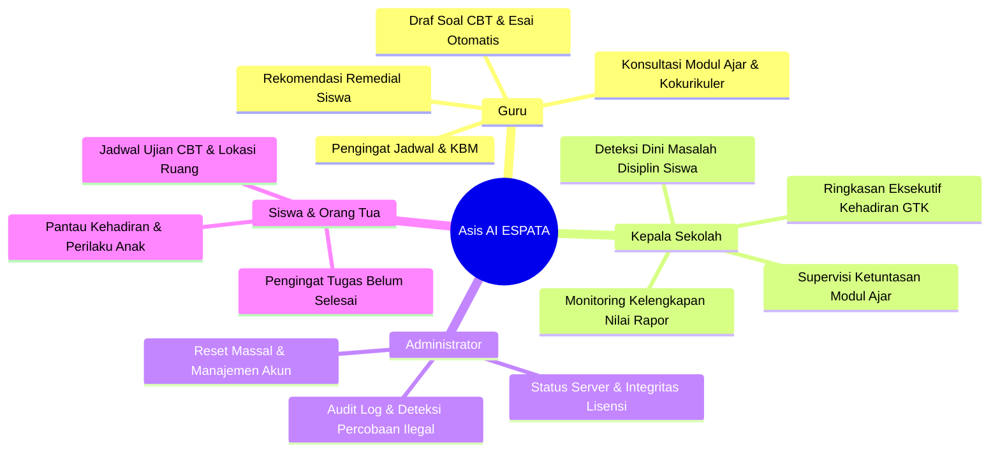
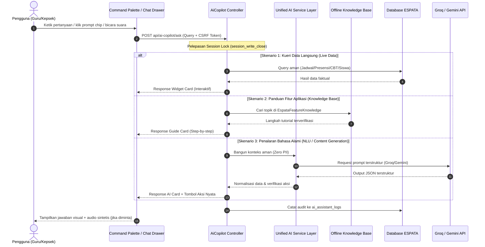

# ASIS AI PRODUCT BLUEPRINT
**Cetrawacana & Arsitektur Strategis Asis AI ESPATA**
*Dokumen Arsitektur & Desain Produk — Disetujui pada Mandat EAO-002*

---

| Parameter | Data Faktual Repositori |
|:---|:---|
| **Nama Produk** | **Asis AI ESPATA** (Asisten Cerdas Akademik & Operasional Sekolah) |
| **Versi Target** | v2.1.0 (Evolusi dari Baseline v2.0.7) |
| **Status Lingkungan** | Localhost Development (XAMPP / PHP 8.2 / MySQL 8.x) |
| **Tim Penanggung Jawab** | Tim EAO: Project Manager, Product Analyst, System Architect, Security Reviewer |
| **Status Dokumen** | **Disetujui Konsep Arsitektur (EAO-002) — Desain Teknis Tuntas (EAO-002A) — Implementasi Kode Belum Diizinkan** |

---

## 1. Ringkasan Eksekutif

Mandat EAO-001 menetapkan transformasi **Asis AI ESPATA** dari sekadar antarmuka *quick navigation / lightweight chatbot* menjadi **Asisten Cerdas Terpadu Ekosistem Sekolah**. Asis AI dirancang bukan sebagai chatbot percakapan umum yang hampa data, melainkan kecerdasan buatan kontekstual yang:
1. **Memahami Konteks Sekolah:** Mengenali siapa yang bertanya (Guru, Kepala Sekolah, Siswa, atau Admin), mata pelajaran apa yang diampu, kelas berapa, fase kurikulum apa, serta jadwal dan kalender hari ini.
2. **Berpijak pada Data Nyata (*Grounded on ESPATA Data*):** Mengambil data langsung dari 167 tabel database ESPATA dengan izin yang sah, tanpa mengarang informasi (*zero hallucination*).
3. **Mengotomatisasi Pekerjaan Administratif Guru:** Membantu pembuatan modul ajar, konsultasi kokurikuler lintas mapel, penilaian esai CBT, dan penyiapan jurnal KBM.
4. **Beroperasi Aman di Shared Hosting:** Menjaga beban komputasi server tetap ringan melalui arsitektur hibrida (Pencocokan Cepat Lokal + Basis Pengetahuan Offline + LLM Eksternal Groq & Gemini).
5. **Menjaga Privasi & Keamanan Ketat:** Menerapkan prinsip *Zero PII Leakage* (tidak membocorkan data pribadi siswa ke server luar) dan kewenangan persetujuan manusia (*Human-in-the-Loop*) untuk setiap tindakan berisiko tinggi.

---

## 2. Kondisi Asis AI Saat Ini Berdasarkan Audit Kode

Audit mendalam terhadap basis kode aktual menghasilkan temuan faktual berikut:

### A. Komponen Antarmuka & Frontend
- **[FAKTA KODE]** Antarmuka utama berpusat pada [command_palette.php](file:///c:/xampp/htdocs/siakad/app/Views/layouts/partials/command_palette.php) yang di-include di bagian bawah [app.php](file:///c:/xampp/htdocs/siakad/app/Views/layouts/app.php).
- **[FAKTA KODE]** Antarmuka memiliki dua tab utama: **Navigasi Cepat** (pencarian menu berbasis kata kunci) dan **Chat Asisten AI** (bubble chat interaktif dengan prompt chips).
- **[FAKTA KODE]** Dilengkapi modul **Voice TTS (Morning Briefing Toast)** di sudut kanan bawah dengan deteksi jenis kelamin guru, deteksi hari kerja vs hari libur akhir pekan, pemecahan kalimat berantai (*sentence chunking queue*), dan penangkap gestur pengguna (*gesture listener*) untuk mengatasi kebijakan autoplay peramban Chromium.
- **[KESIMPULAN ANALISIS]** Pengalaman pengguna saat ini cukup bersih dan responsif, namun interaksi chat masih bersifat jendela modal melayang (*pop-up modal*), belum terintegrasi secara kontekstual di halaman kerja guru (misal: panel asisten samping saat menginput nilai atau menyusun modul).

### B. Arsitektur Backend & Orkestrasi AI
- **[FAKTA KODE]** Endpoint percakapan utama berada pada `App\Controllers\Api\AiCopilot::ask()` dengan alur triage 3 tahap:
  1. *Tahap 1 (Live Data Query):* Deteksi kueri data langsung via 4 pola regex statis (`tryExecuteLiveQuery`).
  2. *Tahap 2 (Knowledge Base):* Pencocokan panduan offline via `App\Libraries\EspataFeatureKnowledge`.
  3. *Tahap 3 (Gemini NLU / Local Matcher):* Jika ada API Key Gemini, memanggil endpoint `gemini-1.5-flash`; jika tidak ada, fallback ke *Local Intent Matcher* berbasis pembobotan token kata.
- **[FAKTA KODE]** Implementasi AI di ESPATA saat ini masih **terfragmentasi (*siloed*)**:
  - `AiCopilot.php`: Hanya memanggil Gemini (Groq belum dihubungkan).
  - `Kokurikuler.php`: Memanggil Groq (`openai/gpt-oss-20b`, `qwen/qwen3.8-27b`) dan Gemini (`gemini-2.0-flash`, `gemini-1.5-flash`) via `callAIPlanningAPI`.
  - `ElearningPackageGeneratorService.php`: Memiliki resolver AI sendiri untuk Groq dan Gemini.
  - `AdministrasiGuru.php`: Memiliki pemanggil AI generator modul ajar mandiri.
- **[KESIMPULAN ANALISIS]** Belum ada **Satu Layanan AI Terpusat (*Unified AI Service Layer*)**. Fragmentasi ini menyebabkan duplikasi kode cURL, penanganan API Key yang terpisah-pisah, dan inkonsistensi penanganan error.

### C. Konteks Data & Riwayat Percakapan
- **[FAKTA KODE]** Riwayat interaksi dicatat pada tabel `ai_assistant_logs` (migrasi `2026-11-13-180000_CreateAiAssistantLogsTable.php`) yang merekam kolom: `user_id`, `role_id`, `query`, `intent`, `matched_id`, `source`, `ip_address`, dan `created_at`.
- **[FAKTA KODE]** Tabel `ai_assistant_logs` **TIDAK menyimpan respon jawaban asisten maupun sesi obrolan (*session_id / thread_id*)**.
- **[KESIMPULAN ANALISIS]** Percakapan saat ini bersifat **Single-Turn Stateless**. Asisten langsung lupa pada pertanyaan sebelumnya dan tidak dapat diajak berdiskusi bertahap (*multi-turn contextual dialogue*).

### D. Manajemen Kunci API & Penyedia Model
- **[FAKTA KODE]** Penyimpanan API Key tersebar di tiga tempat:
  1. Kolom `gemini_api_key` dan `ai_provider` pada tabel `teachers` (guru dapat memasukkan kunci pribadi).
  2. Kolom `gemini_api_key` dan `ai_provider` pada tabel `users` (admin dapat memasukkan kunci).
  3. File konfigurasi `.env` (`GEMINI_API_KEY` dan `GROQ_API_KEY`).
- **[FAKTA KODE]** Server Groq telah terbukti lebih tangguh dan stabil terhadap timeout DNS shared hosting di Indonesia bila dipadukan dengan opsi `CURLOPT_IPRESOLVE => CURL_IPRESOLVE_V4`.

---

## 3. Peta Fitur yang Sudah Tersedia vs Status Fungsional

| Modul / Fitur AI | Komponen Kode Aktual | Status Fungsional | Catatan Kinerja |
|:---|:---|:---:|:---|
| **Morning Briefing Guru & VTTS** | `AiCopilot::morningBriefing` & `command_palette.php` | **Berjalan Baik** | Mengenali jadwal harian guru, agenda CBT, dan libur akhir pekan. |
| **Executive Briefing Kepsek** | `AiCopilot::morningBriefing` | **Berjalan Baik** | Menyajikan total sesi KBM hari ini, jumlah guru bertugas, dan sesi CBT aktif. |
| **Offline Knowledge Base** | `App\Libraries\EspataFeatureKnowledge` | **Berjalan Baik** | Menjawab panduan penggunaan (modul ajar, nilai, presensi, CBT) tanpa kuota API. |
| **Pencarian Aksi Cepat (RBAC)** | `App\Libraries\AiActionRegistry` | **Berjalan Baik** | Memfilter tautan menu sesuai role yang sedang login. |
| **Konsultan Perencana Kokurikuler** | `Admin\Kokurikuler::callAIPlanningAPI` | **Berjalan Baik** | Menganalisis keselarasan TP, kondisi sekolah, dan fase kognitif. Mendukung Groq & Gemini. |
| **Generator Modul Ajar AI** | `Admin\AdministrasiGuru::generateModul` | **Berjalan Baik** | Menghasilkan komponen modul ajar, pertanyaan pemantik, dan lembar asesmen. |
| **Generator E-Learning Multi-Segmen** | `ElearningPackageGeneratorService` | **Berjalan Baik** | Transformasi modul menjadi alur pembelajaran digital aktif. |
| **Koreksi Esai CBT Otomatis** | `CbtAktivitasEssay` & `cbt_essay_grades_v3` | **Parsial** | Tersedia di backend, namun antarmuka pemicuan guru masih semi-manual. |
| **Kueri Data Langsung (Live Data)** | `AiCopilot::tryExecuteLiveQuery` | **Terbatas** | Hanya mendukung 4 skenario: Jadwal Guru, Presensi Guru, Monitoring CBT, Cari Siswa. |
| **Multi-Turn Chat Memory** | `ai_assistant_logs` | **Belum Ada** | Percakapan masih stateless; jawaban asisten belum disimpan di DB. |
| **Akses Siswa & Orang Tua ke AI** | `AiCopilot.php` | **Belum Ada** | Masih ditolak dengan status `not_applicable` bagi Role 4 & 5. |

---

## 4. Analisis Kebutuhan Pengguna Berdasarkan Peran

Berdasarkan analisis alur kerja sekolah riil di Indonesia:



### 1. Kebutuhan Guru (Role 3)
- **Konteks:** Guru memiliki beban administratif tinggi (RPP/Modul Ajar, asesmen formatif, input nilai, presensi per JP, dan koreksi esai CBT).
- **Kebutuhan Nyata:**
  - *"Asis, siapa saja siswa yang belum mengumpulkan tugas Matematika Bab 2?"*
  - *"Asis, buatkan 5 soal pilihan ganda kompleks untuk TP Mengenal Pancasila Fase D."*
  - *"Asis, bantu saya menyusun narasi capaian kompetensi untuk rapor siswa bernama Budi."*
  - *"Asis, buatkan rubrik asesmen proyek gaya hidup berkelanjutan kelas 7."*

### 2. Kebutuhan Kepala Sekolah (Role 2)
- **Konteks:** Pimpinan sekolah membutuhkan gambaran makro yang cepat dan akurat untuk pengambilan keputusan tanpa harus membuka puluhan halaman laporan.
- **Kebutuhan Nyata:**
  - *"Asis, berapa persen guru yang sudah mengisi jurnal mengajar minggu ini?"*
  - *"Asis, tampilkan kelas yang paling banyak memiliki siswa alpa bulan ini."*
  - *"Asis, berapa guru yang belum menuntaskan penginputan nilai rapor semester?"*

### 3. Kebutuhan Administrator Sekolah (Role 1)
- **Konteks:** Administrator mengelola kelancaran teknis sistem, keamanan akun, integritas data, dan sinkronisasi Dapodik.
- **Kebutuhan Nyata:**
  - *"Asis, periksa apakah ada anomali atau upaya login yang mencurigakan hari ini."*
  - *"Asis, berapa banyak siswa yang belum mengubah password bawaan mereka?"*
  - *"Asis, cek status koneksi sinkronisasi bridge Dapodik terakhir."*

### 4. Kebutuhan Siswa (Role 5) & Orang Tua (Role 4)
- **Konteks:** Membutuhkan informasi yang jelas, ramah anak, dan transparan mengenai proses belajar tanpa hak akses mengubah data.
- **Kebutuhan Nyata Siswa:** *"Asis, apa PR dan tugas saya yang tenggat waktunya besok?"*, *"Kapan jadwal ujian CBT saya dimulai?"*.
- **Kebutuhan Nyata Orang Tua:** *"Asis, bagaimana riwayat kehadiran anak saya minggu ini?"*, *"Apakah ada catatan kedisiplinan atau tugas anak saya yang tertinggal?"*.

---

## 5. Visi & Tujuan Produk Asis AI ESPATA

> **Visi & Sasaran Produk:** Menjadikan Asis AI sebagai rekan kerja digital (*co-pilot*) cerdas yang membantu meringankan beban administratif guru dan pimpinan sekolah secara terukur (sasaran dievaluasi melalui studi waktu kerja pasca-implementasi), sehingga pendidik dapat kembali fokus penuh pada pengajaran dan pembinaan karakter siswa.

### Prinsip Operasional Asis AI:
1. **Empati & Sopan Santun Pendidikan:** Menggunakan bahasa Indonesia yang menghormati tradisi akademik (menyapa Bapak/Ibu dengan santun).
2. **Konteks Tanpa Perlu Diberitahu (*Proactive Context Awareness*):** AI langsung mengetahui kelas yang diampu guru, tanpa guru harus mengetik *"saya mengajar kelas apa"*.
3. **Pemberian Tindakan Nyata (*Action-Oriented AI*):** Tidak sekadar memberi teks, tetapi menyertakan tombol aksi navigasi langsung, kartu data interaktif, atau draf yang siap dicetak.
4. **Persetujuan Manusia Mutlak (*Human Gatekeeper*):** AI dilarang mengubah status nilai, mempublikasikan pengumuman, atau menghapus data tanpa konfirmasi klik manual oleh pengguna.

---

## 6. Daftar Kemampuan Asis AI yang Diusulkan

Kemampuan Asis AI dikelompokkan ke dalam 4 Pilar:

```
┌─────────────────────────────────────────────────────────────┐
│                    KEMAMPUAN ASIS AI ESPATA                 │
├──────────────┬──────────────┬───────────────┬───────────────┤
│ 1. INFORMASI │ 2. ANALITIK  │ 3. GENERATOR  │ 4. TINDAKAN   │
│   & EDUKASI  │ & REKOMENDASI│   KONTEN KBM  │   TERKONTROL  │
└──────────────┴──────────────┴───────────────┴───────────────┘
```

### Pilar 1: Pusat Informasi & Panduan Pintar (Knowledge & Guidance)
- **Panduan Penggunaan Sistem:** Membimbing pengguna langkah demi langkah menggunakan fitur ESPATA secara offline berbasis `EspataFeatureKnowledge`.
- **Kueri Data Akademik Real-Time:** Menjawab pertanyaan seputar jadwal mengajar, jadwal ujian CBT, kalender akademik, dan presensi.
- **Voice Greeting & Briefing:** Menyajikan sambutan audio harian yang dipersonalisasi sesuai peran dan hari kerja/libur.

### Pilar 2: Analitik & Rekomendasi Cerdas (Analytics & Insights)
- **Deteksi Keterlambatan Pengisian Administrasi:** Mengingatkan guru jika ada jurnal KBM atau absensi yang belum ditutup pada hari sebelumnya.
- **Rekomendasi Intervensi Akademik:** Menemukan siswa yang mengalami penurunan nilai atau kehadiran untuk ditindaklanjuti oleh Wali Kelas dan Guru BK.
- **Supervisi Ringkas Eksekutif:** Menyajikan ringkasan persentase kehadiran sekolah dan ketuntasan nilai secara instan bagi Kepala Sekolah.

### Pilar 3: Generator Konten Pendidikan (Educational Content Generation)
- **Generator Draf Modul Ajar:** Memanfaatkan database CP/ATP untuk menyusun komponen modul ajar secara kontekstual.
- **Konsultan Perencana Kokurikuler:** Menganalisis keterkaitan TP antar-mata pelajaran dan merekomendasikan tema proyek kolaboratif yang realistis sesuai sarana sekolah.
- **Generator Soal Ujian & Rubrik CBT:** Membantu guru membuat draf butir soal CBT dan rubrik penilaian esai sesuai tingkat kognitif Fase A–F.
- **Penyusun Narasi Rapor Otomatis:** Mengubah nilai angka dan capaian TP menjadi teks narasi deskripsi rapor yang bermakna dan santun.

### Pilar 4: Tindakan Berbantuan (*Assisted Actions with Human Confirmation*)
- **Pencarian & Pintasan Navigasi Langsung:** Membuka form atau halaman target dalam 1 ketukan.
- **Draf Cepat Presensi / Pengumuman:** Menyiapkan draf pengumuman kelas untuk ditinjau dan diterbitkan oleh guru/admin dengan 1 klik.

---

## 7. Matriks Hak Akses & Kewenangan Peran (RBAC Matrix)

| Kategori Kemampuan Asis AI | Admin (1) | Kepsek (2) | Guru (3) | Siswa (5) | Ortu (4) | Staf TU (7) |
|:---|:---:|:---:|:---:|:---:|:---:|:---:|
| **Panduan Cara Pakai Modul** | ✅ Penuh | ✅ Penuh | ✅ Penuh | ✅ Siswa | ✅ Ortu | ✅ TU |
| **Morning Audio Briefing** | ✅ Eksekutif | ✅ Eksekutif | ✅ Guru (KBM) | ❌ | ❌ | ✅ Staf |
| **Pencarian Data Siswa** | ✅ Semua | ✅ Semua | ✅ Terbatas Mapel/Kelas | ❌ | ❌ | ✅ Administrasi |
| **Rekap Presensi Guru/Pegawai** | ✅ Lengkap | ✅ Lengkap | ❌ | ❌ | ❌ | ✅ Rekap Presensi |
| **Generator Modul Ajar & ATP** | ✅ Preview | ❌ | ✅ Kelas Ampuan | ❌ | ❌ | ❌ |
| **Konsultan Kokurikuler** | ✅ Desain | ✅ Supervisi | ✅ Kolaborator | ❌ | ❌ | ❌ |
| **Pemeriksaan Tugas & PR Siswa**| ❌ | ❌ | ✅ Kelas Ampuan | ✅ Tugas Pribadi | ✅ Tugas Anak | ❌ |
| **Koreksi Esai CBT Otomatis** | ✅ Audit | ❌ | ✅ Soal Ampuan | ❌ | ❌ | ❌ |
| **Pencatatan Log & Audit Trail** | ✅ Lengkap | ✅ Laporan | ❌ | ❌ | ❌ | ❌ |
| **Akses Konfigurasi AI & API Key**| ✅ Global | ❌ | ✅ Kunci Mandiri | ❌ | ❌ | ❌ |

---

## 8. Rancangan Alur Interaksi Pengguna (User Interaction Flow)



---

## 9. Rancangan Integrasi dengan Modul ESPATA

Asis AI tidak berdiri terisolasi, melainkan menjadi asisten penghubung antarmodul:

1. **Integrasi Akademik & KBM:** Membaca jadwal pelajaran hari ini, status jurnal mengajar yang belum diisi, dan status absensi siswa per jam pelajaran.
2. **Integrasi Kurikulum & Modul Ajar:** Mengakses tabel `alur_tujuan_pembelajaran`, `tujuan_pembelajaran`, dan `modul_ajar` untuk membantu guru menyusun diferensiasi pembelajaran sesuai Fase A–F.
3. **Integrasi Kokurikuler:** Mengakses `kokurikuler_documents` dan rubrik penilaian untuk memberikan saran kolaborasi guru lintas disiplin ilmu.
4. **Integrasi CBT V3:** Membaca status ujian yang sedang berjalan dari `cbt_test_status` dan mengasistensi koreksi esai melalui rubrik penilaian terstandar.
5. **Integrasi BK & Catatan Karakter:** Mengingatkan wali kelas bila ada siswa di kelasnya yang mendapat catatan kedisiplinan atau memerlukan pemanggilan konseling.

---

## 10. Rancangan Keamanan & Perlindungan Privasi Data

Berdasarkan tinjauan AI Security Reviewer:

1. **Prinsip Nol Kebocoran PII (*Zero PII Leakage*):**
   - Saat mengirim prompt ke server AI eksternal (Groq atau Google Gemini), sistem **DILARANG menyertakan Nama Lengkap Siswa, NISN, NIK, Nomor HP, atau Alamat Rumah**.
   - Konteks siswa wajib menggunakan agregat atau anonimisasi (contoh: *"Siswa A (Kemampuan Awal: Sedang)"*).
2. **Perlindungan Akses Data Antar-Pengguna (IDOR Prevention):**
   - Guru A hanya boleh menanyakan nilai dan presensi siswa pada mata pelajaran dan rombel kelas yang diampunya.
   - Pengecekan kepemilikan (`teaching_assignments` & `classes.teacher_id`) wajib diverifikasi sebelum kueri database dieksekusi.
3. **Tata Kelola Kunci API Terkendali (BYOK Guru vs Kunci Sekolah):**
   - BYOK mandiri guru dibatasi khusus untuk Google Gemini (memanfaatkan kolom eksisting `teachers.gemini_api_key`), sedangkan Groq dikelola eksklusif melalui kunci institusi sekolah di `.env`.
   - Nilai kunci disamarkan secara visual pada antarmuka profil (`AIzaSy...4xQ1`) dan tidak pernah dikirimkan ke peramban klien via API/HTML.
   - Pemanfaatan k-anonymity ditegaskan sebagai upaya mitigasi risiko teknis terukur, bukan jaminan absolut, sehingga pengawasan etika pendidik tetap menjadi pilar utama.
4. **Pencegahan Penyalahgunaan Kuota (*Flood Protection*):**
   - Mempertahankan rate limiting `service('throttler')` maksimal 30 request/menit per pengguna.
   - Mengoptimalkan fallback lokal (*Local Intent Matcher* dan *Knowledge Base Offline*) agar pertanyaan seputar navigasi dan tutorial tidak mengonsumsi kuota API luar sama sekali.

---

## 11. Rekomendasi Arsitektur Teknis Final (Hasil Mandat EAO-002)

Berdasarkan keputusan resmi Pemilik Proyek pada Mandat EAO-002:

1. **Membangun `App\Services\Ai\UnifiedAiService`:**
   - Menjadi pintu gerbang tunggal seluruh komunikasi AI di ESPATA (terpisah dari controller aplikasi).
   - Menggunakan Adapter Pattern (`GroqAdapter`, `GeminiAdapter`) dengan antarmuka baku `AiProviderInterface`.
   - Mengonsolidasikan penanganan cURL, batas waktu (*timeout*), dan resiliensi IPv4 shared hosting (`CURLOPT_IPRESOLVE => CURL_IPRESOLVE_V4`).
   - Prioritas integrasi bertahap: Dimulai dari `AiCopilot.php` terlebih dahulu (modul lain diintegrasikan kemudian).
2. **Penyimpanan Memori Percakapan Ternormalisasi:**
   - Mempertahankan tabel `ai_assistant_logs` murni sebagai log audit operasional sistem (tanpa pembengkakan data).
   - Menyiapkan migrasi basis data tabel khusus memori percakapan:
     - `ai_conversations`: Menyimpan UUID sesi, `user_id`, `role_id`, judul, dan status aktif.
     - `ai_messages`: Menyimpan butir dialog (User/Assistant), jumlah token input/output, model, status pesan, dan idempotency key.
   - Menerapkan strategi *Sliding Window Memory* (maksimal 6 pesan riwayat terakhir) dengan anggaran token presisi 3.000 input (termasuk 200 overhead protokol) + 1.096 output (total 4.096 token hard cap copilot default).
   - Menerapkan protokol pembersihan otomatis pesan pending kedaluwarsa (> 60 detik) dan soft tombstone guard saat sesi dihapus.
3. **Pemisahan Konteks Respons Cepat (*Fast Triage Pipeline*):**
   - Mempertahankan pemrosesan bertingkat: Live Data (DB) -> Knowledge Base (PHP) -> LLM Reasoning (Groq/Gemini).
   - Pendekatan ini menargetkan respon instan (< 100 ms) untuk sebagian besar pertanyaan navigasi dan panduan harian sekolah melalui cache dan basis pengetahuan offline tanpa membebani kuota API luar.

---

## 12. Roadmap Pengembangan Bertahap (Phased Roadmap)

```
[Fase 1: Fondasi, Blueprint & Desain Teknis]  <── SELESAI (EAO-001 & EAO-002)
- Penyusunan Blueprint, Technical Design, Provider Evaluation, Conversation Design.
            │
            ▼
[Fase 2: Unified AI Engine & Refactoring Copilot]  <── TAHAP BERIKUTNYA
- Implementasi AiConfig.php, UnifiedAiService, GroqAdapter, dan GeminiAdapter.
- Refactoring AiCopilot.php (menghubungkan Groq sebagai provider utama).
- Pengujian kestabilan koneksi, latency, dan fallback terkendali di localhost.
            │
            ▼
[Fase 3: Multi-Turn Conversation & Contextual Widget Drawer]
- Eksekusi migrasi tabel ai_conversations dan ai_messages.
- Implementasi session-based multi-turn chat dengan sliding window.
- Antarmuka widget samping (Drawer) pada halaman Modul Ajar dan Koreksi Esai CBT.
            │
            ▼
[Fase 4: Portal Siswa, Orang Tua & Asistensi Lanjut]
- Akses terkontrol bagi Siswa (pengingat tugas & ujian CBT) dan Orang Tua (kehadiran anak).
- Supervisi analitik eksekutif terpadu bagi Kepala Sekolah.
```

---

## 13. Kriteria Keberhasilan & Skenario Pengujian (QA & Acceptance)

Berdasarkan rekomendasi AI QA Engineer:

| Komponen Uji | Kriteria Keberhasilan | Metode Pengujian |
|:---|:---|:---|
| **Respon Waktu Cepat** | Pertanyaan navigasi & panduan terjawab dalam waktu < 300 ms. | Benchmark kueri offline lokal. |
| **Kehandalan Penanganan Galat (Graceful Degradation)** | Jika provider utama mengalami kendala jaringan atau limit, sistem menangani secara ramah pengguna tanpa crash dan tanpa memicu pemanggilan ganda; auto-failover tetap dalam status nonaktif. | Simulasi API key tidak valid / simulasi offline cURL. |
| **Kepatuhan RBAC** | Siswa/Guru tidak dapat mengakses statistik kehadiran guru atau data kelas lain melalui manipulasi pertanyaan teks. | Pengujian skenario lintas 7 role pengguna. |
| **Stabilitas Voice TTS** | Sambutan suara tidak berhenti di tengah kalimat pada browser Google Chrome & Edge di Windows. | Pengujian pemutaran naskah panjang (> 400 karakter). |
| **Integritas Lisensi** | Seluruh proses pengembangan tidak mengganggu 6 file lisensi; status verifikasi wajib `SEC_PASS`. | Verifikasi otomatis `SecurityGuard::verifyCriticalFiles()`. |

---

## 14. Klasifikasi Temuan Faktual & Analisis

Sesuai ketentuan Mandat EAO-001, temuan audit diklasifikasikan secara tegas:

### A. [FAKTA KODE]
1. Endpoint `AiCopilot.php` saat ini hanya mengaktifkan `gemini-1.5-flash`, sedangkan integrasi Groq baru aktif di modul Kokurikuler dan Elearning.
2. Fitur *live query* di `AiCopilot.php` baru menangani 4 kueri spesifik (Jadwal Guru, Presensi Guru, Monitoring CBT, Cari Siswa).
3. Tabel `ai_assistant_logs` saat ini belum menyimpan riwayat jawaban asisten (*stateless*).
4. Terdapat pemetaan 13 modul dan hak akses dinamis pada `App\Libraries\MenuRegistry.php` yang sudah siap dimanfaatkan penuh oleh AI.
5. Durasi JP dan penanganan tingkatan kelas sudah terpusat di `App\Services\JenjangService.php`.

### B. [KESIMPULAN ANALISIS]
1. Fragmentasi pemanggilan AI antar-controller meningkatkan beban pemeliharaan dan risiko inkonsistensi error handling.
2. Penggunaan Groq API sebagai provider utama sangat ideal untuk shared hosting di Indonesia karena waktu respon yang sangat cepat (< 1,5 detik) dan stabilitas jaringan yang tinggi.
3. Asis AI sangat potensial menjadi keunggulan kompetitif utama ESPATA dibanding aplikasi sejenis jika berhasil mengotomatiskan administrasi harian guru.

### C. [REKOMENDASI PENGEMBANGAN]
1. Membangun kelas layanan tunggal `App\Services\Ai\UnifiedAiService` untuk seluruh kebutuhan pemanggilan AI di ESPATA.
2. Menghubungkan Groq API ke dalam `AiCopilot.php` sebagai prioritas pertama dengan fallback ke Gemini.
3. Menambahkan memori sesi percakapan agar pengguna dapat mengajukan pertanyaan bersambung.
4. Menghadirkan portal Asis AI versi terbatas untuk Siswa (pengingat tugas & jadwal ujian) dan Orang Tua (kehadiran anak).

### D. [BELUM DAPAT DIPASTIKAN / PERLU KONFIRMASI]
1. Apakah kuota Groq API dan Gemini API yang tersedia saat ini ditargetkan untuk menanggung seluruh pengguna sekolah secara terpusat (*school-wide key* di `.env`), ataukah setiap guru diharapkan memasukkan API Key mandiri?
2. Apakah peran Siswa dan Orang Tua disetujui untuk mulai diberikan akses interaksi dengan Asis AI pada Fase 4?

---

## 15. Catatan Status Tata Kelola & Keputusan Resmi (Hasil Mandat EAO-002 & EAO-002A)

Pemilik Proyek telah menetapkan batasan dan keputusan resmi dengan distingsi status yang tegas:

### A. Keputusan Arsitektur yang Telah Disetujui (Approved Baseline)
1. **Unified AI Service Layer:** DISETUJUI sebagai pintu gerbang terpusat multi-provider yang terpisah dari logika aplikasi, dengan penanganan error, batas waktu, dan pencatatan token.
2. **Strategi Kandidat Provider:** DISETUJUI BERSYARAT dengan Groq sebagai kandidat utama dan Gemini sebagai kandidat cadangan. Auto-failover berstatus NONAKTIF MUTLAK.
3. **Pemisahan Memori Percakapan & Audit:** DISETUJUI pemisahan tabel log audit (`ai_assistant_logs`) dari tabel dialog ternormalisasi (`ai_conversations` & `ai_messages`).
4. **Prinsip Zero PII & RBAC:** DISETUJUI penegakan hak akses sebelum kueri data (*pre-query RBAC*) dan perlindungan data pribadi tanpa kebocoran ke pihak ketiga.

### B. Dokumen Spesifikasi Desain Teknis yang Selesai Disempurnakan (Menunggu Otorisasi Pemilik)
1. [ASIS_AI_SECURITY_DESIGN.md](file:///c:/xampp/htdocs/siakad/ASIS_AI_SECURITY_DESIGN.md): Desain pertahanan 4-lapis Zero PII, mitigasi quasi-identifiers, pre-query RBAC, isolasi sesi anti-IDOR, dan hierarki API Key (BYOK vs Sekolah).
2. [ASIS_AI_TECHNICAL_DESIGN.md](file:///c:/xampp/htdocs/siakad/ASIS_AI_TECHNICAL_DESIGN.md): Desain antarmuka `UnifiedAiService`, DTO `AiRequest`/`AiResponse`, adapter Groq/Gemini, cURL IPv4, dan metodologi pengukuran kinerja empiris.
3. [ASIS_AI_PROVIDER_EVALUATION.md](file:///c:/xampp/htdocs/siakad/ASIS_AI_PROVIDER_EVALUATION.md): Evaluasi komparatif, daftar kandidat model awal, matriks pengujian empiris, dan kebijakan nonaktif auto-failover.
4. [ASIS_AI_CONVERSATION_DESIGN.md](file:///c:/xampp/htdocs/siakad/ASIS_AI_CONVERSATION_DESIGN.md): Relasi skema basis data, siklus status pesan (`pending`/`completed`/`failed`/`timeout`), pencegahan klik ganda (*idempotency guard*), dan alokasi anggaran token ketat.

### C. Status Implementasi Kode (Fase 2)
- **STATUS IMPLEMENTASI: BELUM DIIZINKAN (MUTLAK).**
- Sesuai tata kelola EAO, persetujuan atas dokumen bukan merupakan izin otomatis untuk menulis kode atau menjalankan migrasi.
- Implementasi Fase 2 baru boleh dimulai setelah memperoleh persetujuan dan otorisasi tertulis eksplisit dari Pemilik Proyek (*Human-in-the-Loop*).
