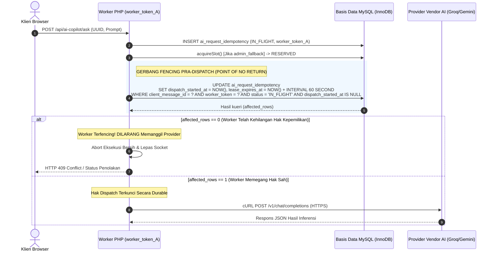
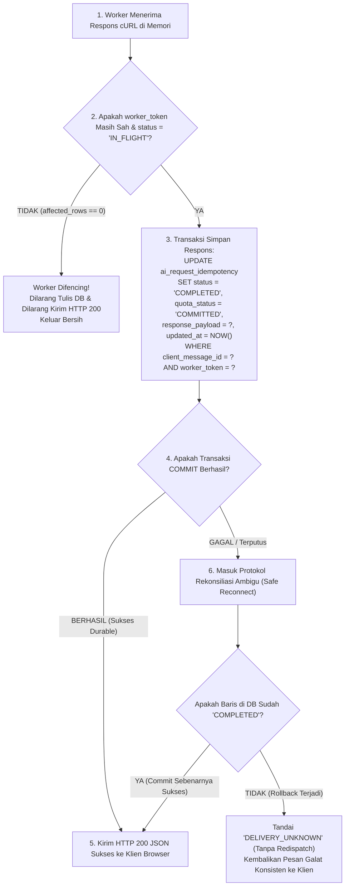

# EAO-ADDENDUM-2026-006I-FINAL-IMPLEMENTATION-CONDITIONS
## Adendum Teknis Final: Ketentuan Fencing Pra-Dispatch, Persistensi Respons Sebelum Klien, Orphan Recovery Atomik, dan Anti-Enumerasi UUID

**Nomor Dokumen:** EAO-ADDENDUM-2026-006I-FINAL-IMPLEMENTATION-CONDITIONS  
**Tanggal:** 16 November 2026  
**Otoritas Pembuat:** Tim Multi-Agen EAO (System Architect, AI Security Reviewer, Developer, QA Engineer)  
**Dasar Mandat:** EAO-HO-006I (Bagian 2 — Ketentuan Teknis Wajib)  
**Status Dokumen:** FINAL TECHNICAL AMENDMENT (READ-ONLY)  
**Batasan Kerja:** Desain dokumen murni; dilarang mengubah kode, database, dan 6 berkas lisensi terlindung.

---

## 1. Tiga Ketentuan Teknis Utama

### A. Fencing Sebelum HTTP Dispatch (Pre-Dispatch Fencing Gate)
Untuk menjamin bahwa worker lama yang telah kehilangan kepemilikan tidak dapat menghubungi penyedia AI (Groq / Google Gemini), diterapkan **Gerbang Fencing Pra-Dispatch**:



#### Aturan Ketat Fencing Pra-Dispatch:
1. **Pembangkitan Token Unik:** Worker membangkitkan `worker_token` berbasis kriptografis (`bin2hex(random_bytes(16))`).
2. **Penetapan Durable Marker:** Transisi `dispatch_started_at = NOW()` wajib dieksekusi dan di-commit ke basis data InnoDB sebelum fungsi cURL (`curl_exec()`) dipanggil.
3. **Pemberhentian Mutlak:** Jika kueri transisi menghasilkan `affected_rows == 0` (misalnya karena proses recovery telah mengambil alih atau masa berlaku request telah berakhir), worker **WAJIB SEGERA BERHENTI**.
4. **Peniadaan Jalur Bypass:** Tidak ada jalur kode apa pun yang diizinkan membuka soket jaringan ke provider sebelum transisi dispatch marker berhasil dikonfirmasi oleh database engine.

---

### B. Persistensi Respons Sebelum Dikirim ke Klien (Persist-Before-Respond)
Sistem dilarang mengembalikan status sukses kepada klien seolah-olah proses telah selesai apabila hasil tersebut belum tersimpan secara persisten di media penyimpanan database.



#### Aturan Ketat Persist-Before-Respond:
1. **Penyimpanan Sebelum Pengiriman:** Penyimpanan `response_payload` dan perubahan status menjadi `COMPLETED` wajib dikomit ke database **SEBELUM** respons HTTP 200 dikirimkan ke browser pengguna.
2. **Ketiadaan Klaim Semu:** Jika penyimpanan database gagal, sistem dilarang mengirimkan respons seolah-olah transaksi telah tuntas.
3. **Penanganan Kegagalan Rekonsiliasi:** Jika hasil inferensi telah diterima tetapi database gagal menyimpan dan tidak dapat direkonsiliasi, status dikunci ke `DELIVERY_UNKNOWN` tanpa refund dan **tanpa redispatch otomatis**.
4. **Rekonsiliasi Ambigu COMMIT Respons:** Jika koneksi terputus saat konfirmasi COMMIT:
   - Worker membuka koneksi baru dan memeriksa status baris berdasarkan `client_message_id` dan `worker_token`.
   - Jika status di database telah tercatat `COMPLETED`, worker mengembalikan hasil tersimpan tersebut kepada klien. **Dilarang keras mengulang pemanggilan inferensi AI ke vendor.**

---

### C. Orphan Recovery dan Fencing Atomik
Ambang batas 10 menit semata-mata merupakan ambang deteksi (*detection heuristic*), bukan bukti fisik bahwa proses telah mati.

#### Mekanisme Recovery Terfencing:
1. **Pencabutan Token Atomik:** Proses recovery mengambil alih baris terlantar menggunakan kueri bersyarat yang secara atomik mencabut `worker_token` lama:
   ```sql
   -- Recovery Kasus Pra-Dispatch (Terbukti dispatch_started_at IS NULL)
   UPDATE ai_request_idempotency
   SET status = 'FAILED_BEFORE_HTTP_DISPATCH',
       quota_status = 'REFUNDED',
       worker_token = NULL,
       updated_at = NOW()
   WHERE client_message_id = ?
     AND status = 'IN_FLIGHT'
     AND dispatch_started_at IS NULL
     AND (lease_expires_at IS NULL OR lease_expires_at < NOW())
     AND updated_at < NOW() - INTERVAL 10 MINUTE;
   ```
2. **Pencegahan Pengambilalihan Worker Ber-Lease Sah:** Kueri di atas mensyaratkan `lease_expires_at < NOW()`. Recovery **DILARANG** mengambil alih worker yang masih memiliki sewa waktu aktif (*active lease*).
3. **Konsekuensi bagi Worker Lama:** Jika Worker lama terbangun kembali setelah recovery mengambil alih, kueri worker lama akan gagal (`affected_rows == 0`) karena `worker_token` lama telah menjadi `NULL` atau tidak cocok. Worker lama secara otomatis difencing dan tidak dapat memanggil provider atau menulis respons.
4. **Kaidah Strict No-Refund:** Jika `dispatch_started_at IS NOT NULL` atau kondisi pra-dispatch tidak dapat dibuktikan secara persisten, status dialihkan ke `DELIVERY_UNKNOWN` dan **KUOTA TIDAK DIKEMBALIKAN**.

---

## 2. Isolasi UUID Antar-Akun & Pencegahan Enumerasi (Anti-Enumeration Protocol)

### 2.1 Analisis Celah Keamanan HTTP 403:
Jika seorang pengguna mengirimkan `client_message_id` yang terdaftar atas nama pengguna lain dan sistem mengembalikan `HTTP 403 Forbidden` dengan pesan *"UUID milik pengguna lain"*, maka sistem membocorkan informasi (*information disclosure*):
- Penyerang mengetahui bahwa UUID tersebut **benar-benar ada** di database.
- Penyerang dapat melakukan enumerasi UUID secara sistematis untuk memetakan volume transaksi sekolah.

### 2.2 Kebijakan Respons Generik Terstandarisasi (Anti-Enumeration):
Sistem mengadopsi prinsip **Zero Information Leakage**. Ketika verifikasi kepemilikan akun gagal:
```php
// Pemeriksaan Kepemilikan di AiCopilot Controller
if ($existing && (int)$existing['user_id'] !== (int)$currentUser['id']) {
    // PENTING: Dilarang mengembalikan HTTP 403 spesifik!
    // Kembalikan respons generik HTTP 404 yang identik dengan UUID yang tidak pernah ada
    return $this->response->setStatusCode(404)->setJSON([
        'status'    => 'not_found',
        'code'      => 'RESOURCE_NOT_FOUND',
        'message'   => 'Permintaan tidak ditemukan atau sesi tidak valid.',
        'csrf_hash' => csrf_hash(),
    ]);
}
```
- **Jaminan Keamanan:** Penyerang tidak dapat membedakan antara UUID yang tidak terdaftar dengan UUID milik akun lain. Seluruh metadata, kepemilikan, dan riwayat terisolasi secara mutlak.

---

## 3. Analisis Race Condition antara Worker Aktif dan Recovery Worker

### Pembuktian Matematis Ketiadaan Dua Pemenang (Strict Single-Winner Proof):
Misalkan Worker A dan Recovery Worker mengeksekusi kueri pada mikrodetik yang sama di baris yang sama:

1. **Mesin Penguncian InnoDB:**  
   MySQL InnoDB menerapkan *exclusive row-level lock* (`X-lock`) pada baris dengan kunci utama/unik `client_message_id`. Salah satu proses akan memperoleh kunci terlebih dahulu, sementara proses lainnya mengantre (*lock wait*).
2. **Skenario 1 (Worker A Menang Kunci Terlebih Dahulu):**
   - Worker A mengeksekusi `UPDATE ... SET dispatch_started_at = NOW() WHERE worker_token = 'wtk_A' AND status = 'IN_FLIGHT' AND dispatch_started_at IS NULL`.
   - `affected_rows == 1`. Nilai `dispatch_started_at` kini terisi. Worker A commit dan memegang hak cURL.
   - Antrean berlanjut ke Recovery Worker.
   - Recovery Worker mengeksekusi `WHERE dispatch_started_at IS NULL`. Karena `dispatch_started_at` sudah terisi oleh Worker A, kueri menghasilkan `affected_rows == 0`.
   - **Hasil:** Recovery gagal mengambil alih; Worker A memproses secara sah.
3. **Skenario 2 (Recovery Worker Menang Kunci Terlebih Dahulu):**
   - Recovery Worker mengeksekusi `UPDATE ... SET worker_token = NULL, status = 'FAILED_BEFORE_HTTP_DISPATCH' WHERE worker_token = 'wtk_A'`.
   - `affected_rows == 1`. Status baris berubah dan `worker_token` dicabut. Recovery commit.
   - Antrean berlanjut ke Worker A.
   - Worker A mengeksekusi `WHERE worker_token = 'wtk_A' AND status = 'IN_FLIGHT'`. Karena status sudah bukan `IN_FLIGHT` dan token sudah `NULL`, kueri menghasilkan `affected_rows == 0`.
   - **Hasil:** Worker A terfencing seketika dan **DILARANG MEMANGGIL cURL**.
4. **Kesimpulan Pembuktian:** Tidak ada kondisi di mana Worker A dan Recovery Worker dapat memenangkan klaim secara bersamaan. Tepat satu pihak yang menang, mengeliminasi risiko eksekusi liar secara mutlak.

---

## 4. Kriteria Penerimaan Tambahan (AC-15 s.d. AC-17)

Melengkapi 14 Kriteria Penerimaan sebelumnya pada `EAO-IMPLEMENTATION-MANDATE-2026-006G`:

- [ ] **AC-15 (Pre-Dispatch Fencing):** Worker terbukti secara fisik membatalkan pemanggilan provider AI apabila transisi `dispatch_started_at` menghasilkan `affected_rows == 0`.
- [ ] **AC-16 (Persist-Before-Respond):** Respons HTTP 200 terbukti hanya dikirimkan kepada klien setelah transaksi penyimpanan `response_payload` dan status `COMPLETED` berhasil di-commit di basis data InnoDB.
- [ ] **AC-17 (Anti-Enumeration Isolation):** Permintaan terhadap UUID milik pengguna lain terbukti mengembalikan respons generik `HTTP 404` tanpa membocorkan eksistensi atau identitas pemilik asli.

---

## 5. Analisis Risiko Residual
1. **Koneksi Klien Putus Setelah Respons Dikirim:** Browser menutup tab tepat setelah server mengirimkan respons HTTP 200. Hal ini tidak berdampak buruk karena data telah tersimpan secara persisten di database, sehingga pengguna dapat melihat jawaban melalui riwayat percakapan.
2. **Keterlambatan Ekstrem Penyedia Pihak Ketiga (> 60 detik):** Jika provider memakan waktu lebih dari 60 detik (melampaui batas lease), sistem tetap aman karena kueri penyelesaian akhir tetap memverifikasi kepemilikan dan menolak mutasi jika status telah terkunci sebagai `DELIVERY_UNKNOWN`.
