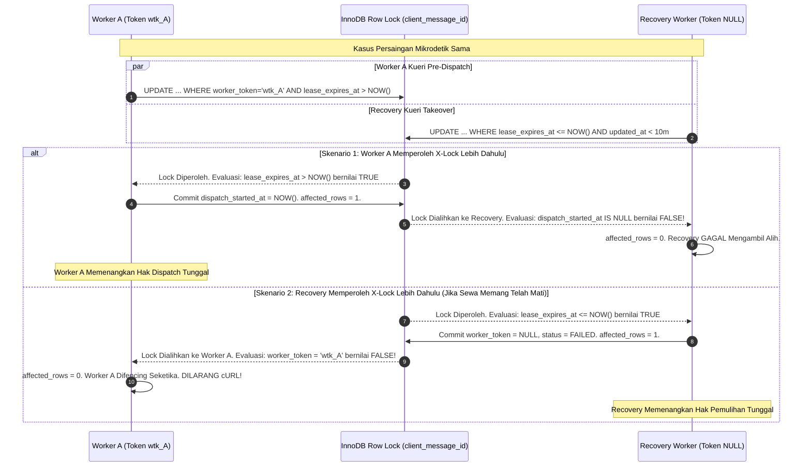

# EAO-ADDENDUM-2026-006J-PREDISPATCH-LEASE-CLOSURE
## Adendum Teknis Final: Validasi Masa Berlaku Lease Pra-Dispatch, Eliminasi Race Condition Recovery, dan Protokol Perpanjangan Sewa

**Nomor Dokumen:** EAO-ADDENDUM-2026-006J-PREDISPATCH-LEASE-CLOSURE  
**Tanggal:** 16 November 2026  
**Otoritas Pembuat:** Tim Multi-Agen EAO (System Architect, AI Security Reviewer, Developer, QA Engineer)  
**Dasar Mandat:** EAO-HO-006J (Pre-Dispatch Lease Validity & Recovery Race Closure)  
**Status Dokumen:** FINAL TECHNICAL AMENDMENT (READ-ONLY)  
**Batasan Kerja:** Desain dokumen murni; dilarang mengubah kode, database, dan 6 berkas lisensi terlindung.

---

## 1. Temuan Awal & Latar Belakang Perbaikan (EAO-006I Gap)

Pada dokumen adendum terdahulu (`EAO-ADDENDUM-2026-006I`), kueri gerbang fencing pra-dispatch dirancang sebagai berikut:
```sql
-- Kueri Lama pada Dokumen 006I (Mengandung Celah)
UPDATE ai_request_idempotency
SET dispatch_started_at = NOW(),
    lease_expires_at = NOW() + INTERVAL 60 SECOND
WHERE client_message_id = ?
  AND worker_token = ?
  AND status = 'IN_FLIGHT'
  AND dispatch_started_at IS NULL;
```

### 1.1 Analisis Celah Logika:
Klausa `WHERE` di atas memverifikasi `worker_token`, `status`, dan ketiadaan `dispatch_started_at`, namun **TIDAK MEMERIKSA APAKAH SEWA WAKTU AWAL (`lease_expires_at`) MASIH AKTIF ATAU SUDAH KEDALUWARSA**.

Jika sebuah proses worker PHP mengalami kelambatan ekstrem antara saat pendaftaran awal dan gerbang dispatch (misalnya karena antrean kunci kuota MySQL, pembersihan Zero PII yang lambat, atau latensi jaringan lokal) hingga masa sewa awalnya habis (`lease_expires_at <= NOW()`):
- Kueri lama di atas masih dapat menghasilkan `affected_rows == 1` dan memperpanjang sewa baru.
- Padahal, proses recovery latar belakang mungkin sedang mengevaluasi baris tersebut untuk diambil alih karena masa sewanya telah kedaluwarsa.
- Hal ini menimbulkan potensi *race condition* laten antara worker yang terlambat dengan proses recovery.

---

## 2. Kueri SQL Final Pra-Dispatch Berpagar Masa Berlaku Lease

Untuk menutup celah tersebut secara mutlak, kueri gerbang dispatch disempurnakan dengan menyertakan syarat validitas sewa waktu secara eksplisit:

```sql
-- Kueri SQL Final Gerbang Fencing Pra-Dispatch
UPDATE ai_request_idempotency
SET dispatch_started_at = NOW(),
    lease_expires_at = NOW() + INTERVAL 60 SECOND,
    updated_at = NOW()
WHERE client_message_id = ?
  AND worker_token = ?
  AND status = 'IN_FLIGHT'
  AND dispatch_started_at IS NULL
  AND lease_expires_at > NOW(); -- SYARAT MUTLAK: Sewa saat ini WAJIB masih aktif!
```

### 2.1 Ketentuan Operasional Worker:
1. **Inisialisasi Durable Saat Registrasi:**  
   Pada saat worker pertama kali mendaftarkan baris di `ai_request_idempotency`, kolom `lease_expires_at` wajib diinisialisasi secara persisten:
   `lease_expires_at = NOW() + INTERVAL 60 SECOND`.
2. **Kewajiban Commit Sebelum cURL:**  
   Transisi di atas wajib dieksekusi dan di-commit ke storage engine InnoDB sebelum soket jaringan cURL dibuka ke provider AI.
3. **Pemberhentian Mutlak jika Gagal:**  
   Jika kueri menghasilkan `affected_rows == 0` (karena sewa habis, token dicabut, atau baris telah diambil alih), worker **WAJIB SEGERA BERHENTI**. Dilarang keras membuka koneksi jaringan ke Groq, Gemini, atau provider mana pun.

---

## 3. Kueri SQL Final Orphan Recovery (Fenced Takeover)

Proses pemulihan baris terlantar dipagari oleh dua kondisi mutlak: status sewa waktu telah kedaluwarsa (`lease_expires_at <= NOW()`) dan ambang waktu deteksi (`updated_at < NOW() - INTERVAL 10 MINUTE`).

### 3.1 Kasus A: Recovery Terbukti Gagal Sebelum Dispatch (Refund Kuota Sah)
```sql
START TRANSACTION;

-- A.1 Ambil alih baris dan cabut token worker lama
UPDATE ai_request_idempotency
SET status = 'FAILED_BEFORE_HTTP_DISPATCH',
    quota_status = 'REFUNDED',
    worker_token = NULL,
    updated_at = NOW()
WHERE client_message_id = ?
  AND status = 'IN_FLIGHT'
  AND dispatch_started_at IS NULL
  AND lease_expires_at <= NOW()                    -- SYARAT 1: Sewa telah mati!
  AND updated_at < NOW() - INTERVAL 10 MINUTE;     -- SYARAT 2: Melewati ambang deteksi!

-- A.2 Refund Kuota HANYA JIKA kueri A.1 berhasil mengambil alih (affected_rows == 1)
UPDATE ai_admin_quota_daily
SET used_count = GREATEST(0, used_count - 1),
    updated_at = NOW()
WHERE quota_date = ?
  AND used_count > 0;

COMMIT;
```

### 3.2 Kasus B: Recovery Setelah Dispatch Dimulai / Kondisi Tidak Pasti (Strict No-Refund)
```sql
START TRANSACTION;

UPDATE ai_request_idempotency
SET status = 'DELIVERY_UNKNOWN',
    quota_status = 'COMMITTED', -- Kuota tetap terhitung hak Admin yang terpakai
    worker_token = NULL,
    updated_at = NOW()
WHERE client_message_id = ?
  AND status = 'IN_FLIGHT'
  AND (dispatch_started_at IS NOT NULL OR updated_at < NOW() - INTERVAL 10 MINUTE)
  AND lease_expires_at <= NOW();

-- KUOTA TIDAK DIKEMBALIKAN (NO REFUND)
COMMIT;
```

---

## 4. Protokol Perpanjangan Sewa Waktu (*Lease Renewal Protocol*)

### 4.1 Kapan Lease Diperpanjang?
Perpanjangan sewa waktu (*Lease Renewal*) dijalankan jika worker menghadapi proses lokal yang memerlukan waktu tambahan sebelum dispatch (misalnya antrean transaksi basis data yang padat):

```sql
-- Kueri Perpanjangan Sewa Waktu (Lease Heartbeat)
UPDATE ai_request_idempotency
SET lease_expires_at = NOW() + INTERVAL 60 SECOND,
    updated_at = NOW()
WHERE client_message_id = ?
  AND worker_token = ?
  AND status = 'IN_FLIGHT'
  AND lease_expires_at > NOW(); -- SYARAT MUTLAK: Hanya worker aktif yang sewanya belum mati!
```

### 4.2 Tindakan jika Renewal Gagal (`affected_rows == 0`):
Jika kueri perpanjangan menghasilkan 0 baris terpengaruh, worker menyadari bahwa hak sewanya telah kedaluwarsa atau tokennya telah dicabut oleh sistem. Worker **WAJIB SEGERA MEMBATALKAN PROSES** dan keluar secara bersih.

### 4.3 Pembedaan Worker Aktif vs Terlantar:
- **Worker Aktif:** Memiliki `lease_expires_at > NOW()`. Kueri recovery mustahil menyentuh baris ini karena recovery mensyaratkan `lease_expires_at <= NOW()`.
- **Worker Terlantar:** Memiliki `lease_expires_at <= NOW()` DAN `updated_at < NOW() - INTERVAL 10 MINUTE`.

---

## 5. Bukti Analisis Ketiadaan Pemenang Ganda (*Single-Winner Proof via InnoDB*)



### Poin Pembuktian:
1. **Serialisasi InnoDB:** Dua transaksi konkuren yang menargetkan baris fisik yang sama pada tabel dengan kunci unik akan diserialisasi oleh mekanisme *exclusive row-level lock* (`X-lock`).
2. **Kondisi Saling Meniadakan (*Mutually Exclusive Predicates*):**
   - Kueri Worker mensyaratkan: `lease_expires_at > NOW()`.
   - Kueri Recovery mensyaratkan: `lease_expires_at <= NOW()`.
3. Secara logika matematika biner, ekspresi `(T > NOW())` dan `(T <= NOW())` **mustahil bernilai benar pada saat yang sama**. Oleh karena itu, salah satu kueri dipastikan menghasilkan `affected_rows == 0`.

---

## 6. Matriks Penanganan 6 Skenario Race Condition & Kegagalan

| No | Skenario Kegagalan / Balapan | Kondisi Transaksi | Hasil Eksekusi | Status Akhir | Dampak Kuota Admin |
|:---:|:---|:---|:---|:---:|:---:|
| 1 | **Lease habis sebelum dispatch** | Worker mengalami delay; waktu melewati `lease_expires_at`. | Kueri pre-dispatch `WHERE lease_expires_at > NOW()` menghasilkan `affected_rows == 0`. Worker abort. | `IN_FLIGHT` (Menunggu Recovery) | Kuota tetap `RESERVED` hingga di-refund oleh recovery. |
| 2 | **Lease habis tepat saat pre-dispatch update** | MySQL mengevaluasi klausa `WHERE` pada mikrodetik saat sewa persis kedaluwarsa. | Syarat `lease_expires_at > NOW()` bernilai false. `affected_rows == 0`. Worker abort. | `IN_FLIGHT` (Menunggu Recovery) | Kuota aman; worker tidak membuka cURL. |
| 3 | **Recovery berjalan bersamaan dengan pre-dispatch** | Worker A dan Recovery berebut baris pada detik yang sama. | Diserialisasi oleh InnoDB X-lock. Jika sewa masih aktif, Worker menang (`affected_rows=1`); jika sewa mati, Recovery menang. | Tepat 1 Pemenang (Tidak Ada Split-Brain) | Kuota konsisten 100%. |
| 4 | **Recovery berjalan setelah dispatch marker dikomit** | Worker A telah sukses commit `dispatch_started_at = NOW()`. | Recovery memeriksa `dispatch_started_at IS NULL` $\rightarrow$ False. Baris dialihkan ke Kasus B (`DELIVERY_UNKNOWN`). | `DELIVERY_UNKNOWN` | **Strict No-Refund** (Kuota terkunci terpakai). |
| 5 | **Worker lama hidup kembali setelah token dicabut** | Worker A bangun setelah tidur panjang. Tokennya di database telah di-set `NULL` oleh recovery. | Worker A mencoba kueri mutasi `WHERE worker_token = 'wtk_A'`. Menghasilkan `affected_rows == 0`. | Status DB Tidak Berubah | Worker lama dilarang menulis hasil atau kuota. |
| 6 | **Lease renewal gagal karena DB tidak tersedia** | Koneksi MySQL terputus saat worker mencoba memperpanjang sewa. | Renewal melempar exception; `affected_rows == 0`. Worker membatalkan rencana dispatch. | Fail-Closed | Kuota aman; tidak ada dispatch tanpa konfirmasi sewa. |

---

## 7. Kriteria Penerimaan Tambahan (AC-18 & AC-19)

- [ ] **AC-18 (Pre-Dispatch Lease Validation):** Worker terbukti membatalkan pemanggilan provider AI jika `lease_expires_at <= NOW()` pada saat gerbang pre-dispatch dieksekusi.
- [ ] **AC-19 (Mutually Exclusive Lease Predicates):** Terbukti secara konseptual dan struktural bahwa kueri worker (`> NOW()`) dan kueri recovery (`<= NOW()`) tidak dapat menghasilkan `affected_rows == 1` pada baris yang sama secara bersamaan.

---

## 8. Risiko Residual
- **Penyimpangan Waktu Server (*NTP Clock Drift*):** Jika server MySQL dan server Web PHP berada pada host fisik yang berbeda dan sinkronisasi jam NTP melenceng, perbandingan `NOW()` dapat mengalami pergeseran mikrodetik.  
  *Mitigasi:* Pada shared hosting ESPATA, PHP dan MySQL beroperasi pada satu host lokal (`localhost / 127.0.0.1`), sehingga pembacaan fungsi `NOW()` dan waktu sistem selalu 100% tersinkronisasi.
