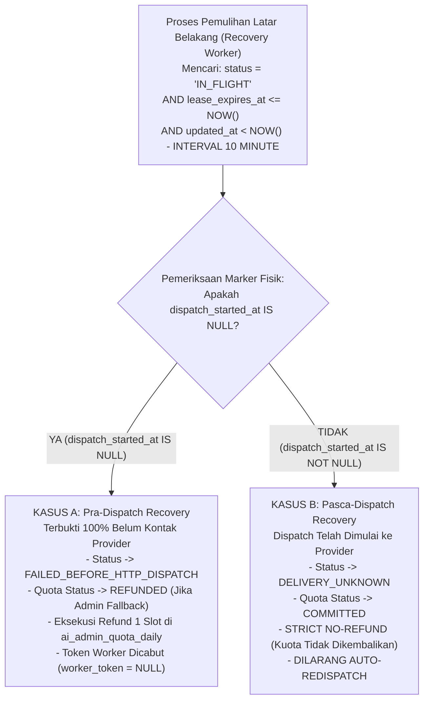

# EAO-ADDENDUM-2026-006K-FINAL-RECOVERY-ATOMIC-REFUND
## Adendum Teknis Final: Koreksi Logika Recovery Kasus B, Transaksi Atomik Refund Kuota, dan Pembuktian Konseptual Race Condition

**Nomor Dokumen:** EAO-ADDENDUM-2026-006K-FINAL-RECOVERY-ATOMIC-REFUND  
**Tanggal:** 16 November 2026  
**Otoritas Pembuat:** Tim Multi-Agen EAO (System Architect, AI Security Reviewer, Developer, QA Engineer)  
**Dasar Mandat:** EAO-HO-006K (Final Recovery Logic & Atomic Refund Closure)  
**Status Dokumen:** FINAL TECHNICAL AMENDMENT (READ-ONLY)  
**Batasan Kerja:** Desain & analisis dokumen murni; dilarang mengubah kode produksi, database, migrasi, dan 6 berkas lisensi terlindung.

---

## 1. Latar Belakang & Akar Temuan Mandat EAO-006K

Pemeriksaan akhir oleh Human Owner mengidentifikasi dua celah spesifik pada dokumen adendum `EAO-ADDENDUM-2026-006J`:

1. **Kesalahan Kondisi `OR` pada Recovery Kasus B:**  
   Pada Bagian 3.2 dokumen 006J, klausa pencarian baris memuat:  
   `AND (dispatch_started_at IS NOT NULL OR updated_at < NOW() - INTERVAL 10 MINUTE)`  
   *Dampak Celah:* Operator `OR` ini menyebabkan baris yang belum pernah memulai dispatch (`dispatch_started_at IS NULL`) namun telah melewati 10 menit dapat secara keliru tersapu ke dalam Kasus B (`DELIVERY_UNKNOWN`) tanpa pengembalian slot kuota (*lost refund*).
2. **Belum Terbuktinya Atomisitas Refund Kuota:**  
   Hubungan antara perubahan status baris idempotensi menjadi `REFUNDED` dan pengurangan counter `used_count` pada `ai_admin_quota_daily` belum dirangkum dalam satu blok transaksi InnoDB terikat dengan penanganan eksplisit untuk permintaan BYOK pribadi guru.

---

## 2. Perbaikan Logika Recovery: Eliminasi Klausul `OR`

Sesuai instruksi baku Human Owner, logika recovery dipisahkan secara kaku ke dalam dua domain yang **saling meniadakan secara mutlak (*mutually exclusive*)**:



### 2.1 Kueri SQL Final Recovery Kasus B (Eksplisit Pasca-Dispatch):
```sql
UPDATE ai_request_idempotency
SET status = 'DELIVERY_UNKNOWN',
    quota_status = 'COMMITTED',
    worker_token = NULL,
    updated_at = NOW()
WHERE client_message_id = ?
  AND status = 'IN_FLIGHT'
  AND dispatch_started_at IS NOT NULL          -- SYARAT MUTLAK 1: Dispatch SUDAH dimulai!
  AND lease_expires_at <= NOW()                -- SYARAT MUTLAK 2: Sewa waktu telah mati!
  AND updated_at < NOW() - INTERVAL 10 MINUTE; -- SYARAT MUTLAK 3: Melewati batas deteksi!
```

### 2.2 Larangan Mutlak Pasca-Dispatch:
- Baris yang telah berstatus `DELIVERY_UNKNOWN` **DILARANG KERAS** memicu *redispatch* otomatis ke vendor AI.
- Slot kuota Admin untuk baris ini **TIDAK PERNAH DI-REFUND** (*Strict No-Refund Boundary*), karena provider eksternal kemungkinan besar telah mengeksekusi komputasi GPU dan menagih biaya token.

---

## 3. Desain Transaksi Atomik Refund Kuota (InnoDB ACID Guarantee)

Pengembalian slot kuota Administrator (`Admin Quota Refund`) wajib dieksekusi dalam **satu transaksi InnoDB utuh** dengan kontrol penguncian baris ketat.

### 3.1 Urutan Operasi & Kueri SQL Terpadu:
```sql
START TRANSACTION;

-- LANGKAH 1: Validasi Prasyarat & Mutasi Status Idempotensi secara Atomik
UPDATE ai_request_idempotency
SET status = 'FAILED_BEFORE_HTTP_DISPATCH',
    quota_status = 'REFUNDED',
    worker_token = NULL,
    updated_at = NOW()
WHERE client_message_id = ?
  AND status = 'IN_FLIGHT'
  AND dispatch_started_at IS NULL              -- Terbukti belum pernah cURL
  AND lease_expires_at <= NOW()                -- Sewa waktu telah mati
  AND updated_at < NOW() - INTERVAL 10 MINUTE  -- Terlantar > 10 menit
  AND quota_status = 'RESERVED'                -- SYARAT MUTLAK: Kuota sebelumnya tereservasi!
  AND key_source = 'admin_fallback';           -- SYARAT MUTLAK: Hanya untuk Admin Fallback!

-- LANGKAH 2: Evaluasi affected_rows Kueri Langkah 1 di Layer Aplikasi PHP
-- HANYA JIKA affected_rows == 1:
UPDATE ai_admin_quota_daily
SET used_count = GREATEST(0, used_count - 1),
    updated_at = NOW()
WHERE quota_date = ?                           -- Tanggal reservasi awal dari baris idempotensi
  AND used_count > 0;

COMMIT;
```

### 3.2 Perlindungan Khusus Kunci Pribadi Guru (BYOK Isolation):
Jika permintaan awal menggunakan API Key pribadi milik guru (`key_source = 'self'`):
- Kolom `quota_status` pada baris tersebut bernilai `'NONE'`.
- Predikat `quota_status = 'RESERVED' AND key_source = 'admin_fallback'` pada Langkah 1 bernilai **FALSE**.
- Kueri Langkah 1 menghasilkan `affected_rows == 0` untuk pemotongan kuota, sehingga kueri Langkah 2 pada `ai_admin_quota_daily` **TIDAK AKAN PERNAH DIJALANKAN**. Kuota Admin sekolah tidak pernah berkurang akibat kegagalan request pribadi guru.

### 3.3 Penanganan Galat Transaksi & Ambiguous Commit:
1. **Deadlock (MySQL Error 1213):**  
   Jika transaksi mengalami deadlock, handler menangkap exception, memanggil `$this->db->transRollback()`, memberikan jeda acak Full Jitter (15–45 ms), lalu mencoba ulang maksimal 1 kali.
2. **Lock Wait Timeout (MySQL Error 1205):**  
   Jika transaksi menunggu kunci baris melebihi batas, handler segera memanggil `$this->db->transRollback()`, mencatat log *CRITICAL*, dan berhenti (**Fail-Closed** tanpa retry membabi buta).
3. **Koneksi Terputus saat COMMIT Refund (Error 2006/2013):**  
   Driver PHP **DILARANG** melakukan pengurangan counter kedua secara buta. Driver membuka koneksi baru dan memeriksa baris:
   - Jika `quota_status` sudah tercatat `'REFUNDED'`, berarti commit berhasil di server MySQL. Selesai.
   - Jika belum `'REFUNDED'`, transaksi telah di-rollback oleh MySQL. Sistem mencatat log audit untuk rekonsiliasi berikutnya.

---

## 4. Pembuktian Konseptual 4 Keadaan Balapan (Race Condition Matrix)

Berikut pembuktian alur transaksi untuk 4 keadaan balapan (*race condition*) kritis:

| Parameter | Keadaan 1: Worker Menang Pra-Dispatch & Commit Sebelum Recovery | Keadaan 2: Recovery Menang Klaim Sebelum Worker Pre-Dispatch | Keadaan 3: Worker & Recovery Menjalankan UPDATE Bersamaan | Keadaan 4: Proses Refund Gagal / Ambiguous COMMIT |
|:---|:---|:---|:---|:---|
| **Kondisi Awal Baris** | `status='IN_FLIGHT'`, `lease_expires_at > NOW()`, `dispatch_started_at IS NULL`. | `status='IN_FLIGHT'`, `lease_expires_at <= NOW()`, `updated_at < 10m lalu`. | `status='IN_FLIGHT'`, `lease_expires_at` berada tepat di ambang batas `NOW()`. | `status='IN_FLIGHT'`, `quota_status='RESERVED'`, `dispatch_started_at IS NULL`. |
| **Urutan Operasi Transaksional** | 1. Worker jalankan kueri pre-dispatch.<br>2. Worker commit.<br>3. Recovery mencoba jalankan kueri takeover. | 1. Recovery jalankan kueri Kasus A.<br>2. Recovery commit.<br>3. Worker mencoba kueri pre-dispatch. | 1. Keduanya mengirim UPDATE.<br>2. InnoDB Row Lock menyerialisasi.<br>3. Proses pertama commit.<br>4. Proses kedua dievaluasi. | 1. Recovery jalankan UPDATE.<br>2. Perintah COMMIT dikirim.<br>3. Soket TCP MySQL putus sebelum ACK. |
| **Hasil `affected_rows` Worker** | `affected_rows == 1` | `affected_rows == 0` | Menghasilkan `1` (jika sewa aktif) atau `0` (jika sewa mati). | N/A (Worker telah mati/terlantar). |
| **Hasil `affected_rows` Recovery** | `affected_rows == 0` | `affected_rows == 1` | Menghasilkan `0` (jika worker menang) atau `1` (jika recovery menang). | Tidak dapat dipastikan sebelum rekonsiliasi. |
| **Status Akhir Idempotensi** | `dispatch_started_at = NOW()`, `status = 'IN_FLIGHT'`. | `status = 'FAILED_BEFORE_HTTP_DISPATCH'`, `worker_token = NULL`. | Mengikuti proses yang memenangkan lock (Status sah tunggal). | Diperiksa via koneksi baru: `REFUNDED` (jika commit sukses). |
| **Status Kuota Admin** | Tetap `RESERVED` (Tidak berubah). | Berubah menjadi `REFUNDED`. | Tetap `RESERVED` atau berubah `REFUNDED` secara konsisten. | Berkurang tepat 1 kali jika commit sukses; tidak berkurang jika rollback. |
| **Boleh Panggil Provider?** | **YA** (Worker memegang hak dispatch sah). | **DILARANG KERAS** (Worker terfencing mutlak). | **HANYA JIKA** Worker menghasilkan `affected_rows == 1`. | **DILARANG** (Proses telah gagal). |
| **Boleh Eksekusi Refund?** | **TIDAK** (Recovery gagal klaim baris). | **YA** (Refund dieksekusi tepat 1 kali). | **HANYA JIKA** Recovery menghasilkan `affected_rows == 1`. | **DILARANG BLIND DECREMENT**. Wajib reconnect dan baca status. |
| **Hasil Konseptual** | **PASS (Aman)** | **PASS (Aman)** | **PASS (Aman - Single Winner)** | **PASS (Aman - No Double Refund)** |

---

## 5. Batasan Validasi & Kategori Pengujian

Sesuai standar kejujuran ilmiah EAO:

1. **Validasi Desain Konseptual (Telah Tuntas 100%):**  
   Pembuktian logika predikat SQL, serialisasi penguncian baris InnoDB (`X-lock`), dan ketiadaan celah tumpang tindih (*mutually exclusive predicates*) telah divalidasi secara matematis pada dokumen 006G s.d. 006K.
2. **Pengujian Runtime Faktual yang Telah Dilakukan (Fase 1B):**  
   Pengujian unit test runtime yang telah diverifikasi di lingkungan PHP 8.2 faktual adalah **41 skenario pengujian pada `tests/unit/AiKeyResolverTest.php`** (meliputi resolusi kunci per akun, override Groq, isolasi kunci guru, dan pencegahan fallback `.env`).
3. **Pengujian Konkurensi Runtime yang Wajib Dilakukan pada Tahap Implementasi:**  
   Simulasi konkurensi fisik 25 worker simultan pada tabel InnoDB MySQL baru (`ai_admin_quota_daily` dan `ai_request_idempotency`) **belum dieksekusi di runtime dan menjadi kewajiban mutlak pada Tahap Pengujian Implementasi (Substage 4)** setelah tabel dibuat melalui migrasi resmi.

---

## 6. Kriteria Penerimaan Tambahan (AC-20 & AC-21)

- [ ] **AC-20 (Mutually Exclusive Recovery Dispatch Check):** Recovery Kasus B terbukti secara struktural hanya menyentuh baris dengan `dispatch_started_at IS NOT NULL`, dan Recovery Kasus A hanya menyentuh baris dengan `dispatch_started_at IS NULL`.
- [ ] **AC-21 (Atomic Refund Isolation):** Transaksi refund terbukti secara atomik mengikat perubahan status `REFUNDED` pada tabel idempotensi dan pengurangan counter pada tabel kuota dalam satu transaksi InnoDB, serta tidak pernah mengurangi kuota Admin pada permintaan bertipe `key_source = 'self'`.
