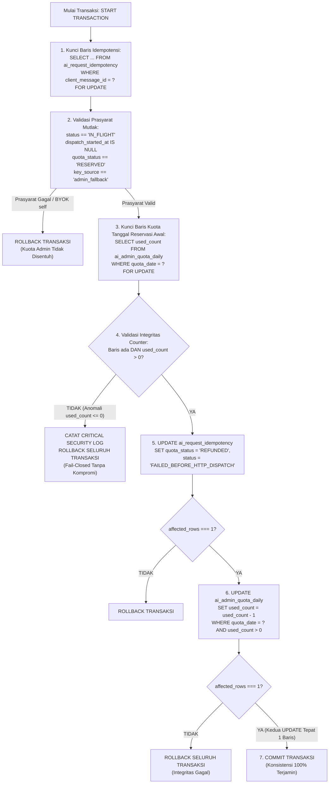

# EAO-ADDENDUM-2026-006L-FINAL-REFUND-COUNTER-CONSISTENCY
## Adendum Teknis Final: Penegakan Konsistensi Atomik Mutlak antara Status Refund Idempotensi dan Penghitung Kuota Harian Admin

**Nomor Dokumen:** EAO-ADDENDUM-2026-006L-FINAL-REFUND-COUNTER-CONSISTENCY  
**Tanggal:** 16 November 2026  
**Otoritas Pembuat:** Tim Multi-Agen EAO (System Architect, AI Security Reviewer, Developer, QA Engineer)  
**Dasar Mandat:** EAO-HO-006L (Final Refund Counter Consistency)  
**Status Dokumen:** FINAL TECHNICAL AMENDMENT (READ-ONLY)  
**Batasan Kerja:** Desain & analisis dokumen murni; dilarang mengubah kode produksi, database, migrasi, dan 6 berkas lisensi terlindung.

---

## 1. Analisis Celah Inkonsistensi Parsial pada Dokumen 006K

Pada rancangan transaksi dokumen `EAO-ADDENDUM-2026-006K`, terdapat celah inkonsistensi yang ditemukan oleh Human Owner:

```php
// Celah pada Alur Lama:
$this->db->query("UPDATE ai_request_idempotency SET quota_status = 'REFUNDED' ...");
$affectedIdempotency = $this->db->affectedRows(); // bernilai 1

if ($affectedIdempotency === 1) {
    $this->db->query("UPDATE ai_admin_quota_daily SET used_count = GREATEST(0, used_count - 1) WHERE ... AND used_count > 0");
    $affectedQuota = $this->db->affectedRows(); // BISA BERNILAI 0 (misal used_count sudah 0 atau baris hilang)
}

$this->db->transCommit(); // TRANSAKSI TETAP DI-COMMIT!
```

### 1.1 Bahaya Logika Inkonsistensi Parsial:
Jika `UPDATE` pada tabel idempotensi menghasilkan `affected_rows == 1`, namun `UPDATE` pada `ai_admin_quota_daily` menghasilkan `affected_rows == 0` (misalnya karena anomali data di mana `used_count` sudah bernilai 0 atau baris tanggal hilang):
- Transaksi tetap di-commit.
- Status pada `ai_request_idempotency` telah berubah permanen menjadi `REFUNDED`.
- Namun counter `used_count` pada `ai_admin_quota_daily` **TIDAK BERKURANG**.
- Penggunaan fungsi MySQL `GREATEST(0, used_count - 1)` secara diam-diam menutupi anomali penghitung dan menyamarkan kerusakan integritas data.

---

## 2. Rancang Bangun Transaksi Final Bersyarat Ganda (*Dual-Exact-Match Transaction*)

Untuk menutup celah di atas, seluruh proses pengembalian slot kuota diatur dalam satu blok transaksi InnoDB dengan protokol **Keduanya Wajib Sukses Tepat Satu Baris (*All-or-Nothing Strict 1-Row Match*)**:



---

## 3. Pseudocode Transaksi Final: `AdminQuotaManager::executeAtomicRefund()`

```php
public function executeAtomicRefund(string $clientMessageId): array
{
    // 1. Mulai Transaksi InnoDB
    $this->db->transBegin();

    try {
        // 2. Kunci dan baca baris idempotensi
        $idempotencyRow = $this->db->query("
            SELECT id, user_id, client_message_id, key_source, quota_date, quota_status, status, dispatch_started_at
            FROM ai_request_idempotency
            WHERE client_message_id = ?
            FOR UPDATE
        ", [$clientMessageId])->getRowArray();

        if (!$idempotencyRow) {
            $this->db->transRollback();
            return ['success' => false, 'reason' => 'ROW_NOT_FOUND'];
        }

        // Perlindungan Mutlak BYOK: Kunci pribadi guru DILARANG kurangi kuota Admin!
        if ($idempotencyRow['key_source'] !== 'admin_fallback') {
            $this->db->transRollback();
            return ['success' => false, 'reason' => 'BYPASS_NOT_ADMIN_FALLBACK'];
        }

        // Validasi prasyarat status mutlak
        if ($idempotencyRow['status'] !== 'IN_FLIGHT' ||
            $idempotencyRow['dispatch_started_at'] !== null ||
            $idempotencyRow['quota_status'] !== 'RESERVED' ||
            empty($idempotencyRow['quota_date'])) {
            $this->db->transRollback();
            return ['success' => false, 'reason' => 'PRECONDITIONS_NOT_MET'];
        }

        $quotaDate = $idempotencyRow['quota_date'];

        // 3. Kunci dan baca baris kuota harian untuk tanggal reservasi awal yang tepat
        $quotaRow = $this->db->query("
            SELECT id, quota_date, used_count
            FROM ai_admin_quota_daily
            WHERE quota_date = ?
            FOR UPDATE
        ", [$quotaDate])->getRowArray();

        // Validasi Integritas Counter (DILARANG pakai GREATEST untuk menutupi anomali)
        if (!$quotaRow) {
            log_message('critical', "[RefundIntegrityError] Baris kuota harian hilang untuk tanggal: {$quotaDate}");
            $this->db->transRollback();
            return ['success' => false, 'reason' => 'QUOTA_ROW_MISSING_FAIL_CLOSED'];
        }

        if ((int)$quotaRow['used_count'] <= 0) {
            log_message('critical', "[RefundIntegrityError] Anomali: used_count bernilai 0 saat refund diminta untuk tanggal: {$quotaDate}");
            $this->db->transRollback();
            return ['success' => false, 'reason' => 'QUOTA_COUNTER_ZERO_FAIL_CLOSED'];
        }

        // 4. Update baris idempotensi
        $this->db->query("
            UPDATE ai_request_idempotency
            SET status = 'FAILED_BEFORE_HTTP_DISPATCH',
                quota_status = 'REFUNDED',
                worker_token = NULL,
                updated_at = NOW()
            WHERE client_message_id = ?
              AND status = 'IN_FLIGHT'
              AND dispatch_started_at IS NULL
              AND quota_status = 'RESERVED'
              AND key_source = 'admin_fallback'
        ", [$clientMessageId]);

        $affectedIdempotency = $this->db->affectedRows();
        if ($affectedIdempotency !== 1) {
            log_message('error', "[RefundError] UPDATE idempotency menghasilkan {$affectedIdempotency} rows (wajib 1). Rollback.");
            $this->db->transRollback();
            return ['success' => false, 'reason' => 'IDEMPOTENCY_UPDATE_FAILED'];
        }

        // 5. Kurangi counter pada ai_admin_quota_daily (Wajib validasi used_count > 0)
        $this->db->query("
            UPDATE ai_admin_quota_daily
            SET used_count = used_count - 1,
                updated_at = NOW()
            WHERE quota_date = ?
              AND used_count > 0
        ", [$quotaDate]);

        $affectedQuota = $this->db->affectedRows();
        if ($affectedQuota !== 1) {
            log_message('critical', "[RefundError] UPDATE quota counter menghasilkan {$affectedQuota} rows (wajib 1). ROLLBACK SELURUH TRANSAKSI!");
            $this->db->transRollback();
            return ['success' => false, 'reason' => 'QUOTA_UPDATE_FAILED'];
        }

        // 6. HANYA JIKA KEDUA UPDATE MENGHASILKAN TEPAT 1 BARIS: COMMIT!
        $this->db->transCommit();

        return [
            'success'    => true,
            'quota_date' => $quotaDate,
            'status'     => 'REFUNDED'
        ];

    } catch (\Throwable $e) {
        if ($this->db->transStatus() !== false) {
            $this->db->transRollback();
        }

        $msg = $e->getMessage();

        // Deadlock 1213: Retry dengan Full Jitter (15-45ms)
        if (str_contains($msg, '1213') || stripos($msg, 'deadlock') !== false) {
            usleep(random_int(15000, 45000));
            return $this->executeAtomicRefund($clientMessageId); // Retry 1x
        }

        // Lock Wait Timeout 1205 / Error Lain: Fail-Closed
        log_message('critical', "[RefundException] Gagal transaksi refund: {$msg}");
        return ['success' => false, 'reason' => 'EXCEPTION_FAIL_CLOSED'];
    }
}
```

---

## 4. Penanganan Hasil COMMIT Ambigu pada Transaksi Refund

Jika koneksi jaringan MySQL terputus tepat saat PHP mengirim perintah `COMMIT` refund:

1. **Dilarang Decrement Buta (*No Blind Re-Decrement*):**  
   Driver PHP membuka koneksi baru ke basis data.
2. **Kueri Verifikasi Status Bersih:**  
   ```sql
   SELECT quota_status, status FROM ai_request_idempotency WHERE client_message_id = ?;
   ```
3. **Pohon Keputusan Rekonsiliasi:**
   - **Jika `quota_status === 'REFUNDED'`:**  
     Transaksi commit sebelumnya terbukti **SUKSES** di storage engine MySQL. Pengurangan `used_count` telah terjadi di server. Sistem **DILARANG MENGURANGI COUNTER LAGI**. Refund dinyatakan selesai.
   - **Jika `quota_status === 'RESERVED'`:**  
     Transaksi commit sebelumnya terbukti **ROLLBACK** oleh MySQL akibat putusnya koneksi. Counter kuota belum berkurang. Recovery diizinkan mencoba kembali transaksi refund atomik secara aman.
   - **Jika Status Belum Pasti / DB Masih Down:**  
     Pertahankan kebijakan **Fail-Closed**. Catat alert audit untuk rekonsiliasi manual administrator sistem.

---

## 5. Matriks Pembuktian 8 Skenario Konseptual Wajib

| No | Skenario Konseptual | Kondisi Awal Idempotensi | Kondisi Awal Kuota Admin | Urutan Operasi | Status Akhir Idempotensi | Status Akhir Kuota Admin | Keputusan Recovery & Konsistensi |
|:---:|:---|:---|:---|:---|:---|:---|:---|
| 1 | **UPDATE idempotensi sukses, UPDATE kuota sukses, COMMIT sukses** | `status='IN_FLIGHT'`, `quota_status='RESERVED'`, `quota_date='2026-11-16'`. | `used_count = 15`. | Transaksi InnoDB kunci kedua baris, update idempotensi (`aff=1`), update kuota (`aff=1`), commit. | `status='FAILED_BEFORE_HTTP_DISPATCH'`, `quota_status='REFUNDED'`. | `used_count = 14`. | **SUKSES SEMPURNA (PASS).** Kedua tabel 100% konsisten. |
| 2 | **UPDATE idempotensi sukses, baris kuota tidak ditemukan** | `status='IN_FLIGHT'`, `quota_status='RESERVED'`, `quota_date='2026-11-16'`. | Baris tanggal tidak ada di tabel kuota (anomali). | Transaksi kunci idempotensi (`aff=1`), kueri kunci kuota menghasilkan `null`. Validasi integritas gagal $\rightarrow$ **ROLLBACK SELURUHNYA**. | Tetap `status='IN_FLIGHT'`, `quota_status='RESERVED'`. | Tetap tidak ada. | **FAIL-CLOSED (PASS).** Tidak terjadi mutasi parsial pada status idempotensi. |
| 3 | **UPDATE idempotensi sukses, `used_count = 0`** | `status='IN_FLIGHT'`, `quota_status='RESERVED'`, `quota_date='2026-11-16'`. | `used_count = 0` (anomali counter). | Transaksi kunci idempotensi (`aff=1`), kueri kunci kuota mendeteksi `used_count <= 0`. Validasi integritas gagal $\rightarrow$ **ROLLBACK SELURUHNYA**. | Tetap `status='IN_FLIGHT'`, `quota_status='RESERVED'`. | Tetap `used_count = 0` (tidak menjadi negatif). | **FAIL-CLOSED (PASS).** Counter dicegah dari angka negatif, alert investigasi dicatat. |
| 4 | **UPDATE idempotensi gagal karena status sudah berubah** | `status='COMPLETED'` (telah selesai di worker). | `used_count = 15`. | Recovery mencoba kunci baris. Syarat `status='IN_FLIGHT'` gagal. Kueri update menghasilkan `aff=0` $\rightarrow$ **ROLLBACK**. | Tetap `status='COMPLETED'`, `quota_status='COMMITTED'`. | Tetap `used_count = 15`. | **REFUND DITOLAK (PASS).** Recovery dilarang mengembalikan kuota untuk request yang telah selesai. |
| 5 | **Deadlock saat dua recovery mencoba refund** | `status='IN_FLIGHT'`, `quota_status='RESERVED'`. | `used_count = 15`. | Recovery 1 dan Recovery 2 berebut kunci silang. InnoDB mendeteksi Error 1213 pada Recovery 2. | Recovery 2 rollback bersih, jeda Full Jitter (15-45ms), retry. Recovery 1 commit sukses. Recovery 2 saat retry mendeteksi status sudah `REFUNDED` $\rightarrow$ abort. | `status='FAILED_BEFORE_HTTP_DISPATCH'`, `quota_status='REFUNDED'`. | `used_count = 14`. | **TERTANGANI BERSIH (PASS).** Tepat 1 refund yang berhasil, nol korupsi transaksi. |
| 6 | **Koneksi terputus saat COMMIT refund** | `status='IN_FLIGHT'`, `quota_status='RESERVED'`. | `used_count = 15`. | Driver kirim COMMIT, soket putus. Driver buka koneksi baru dan kueri status baris: jika `REFUNDED` $\rightarrow$ selesai; jika `RESERVED` $\rightarrow$ retry aman. | Konsisten sesuai status commit MySQL server. | `used_count = 14` (jika commit) atau `15` (jika rollback). | **REKONSILIASI BERSIH (PASS).** Tidak ada double-decrement buta. |
| 7 | **Dua recovery mencoba refund UUID yang sama** | `status='IN_FLIGHT'`, `quota_status='RESERVED'`. | `used_count = 15`. | Recovery A kunci baris, eksekusi kedua update, commit. Recovery B yang antre di lock mendapatkan giliran, mendeteksi status sudah `REFUNDED` $\rightarrow$ `aff=0` $\rightarrow$ abort. | `status='FAILED_BEFORE_HTTP_DISPATCH'`, `quota_status='REFUNDED'`. | `used_count = 14` (hanya berkurang 1). | **ANTI-DOUBLE-REFUND (PASS).** Recovery kedua ditolak secara atomik. |
| 8 | **Permintaan BYOK guru gagal sebelum dispatch** | `status='IN_FLIGHT'`, `quota_status='NONE'`, `key_source='self'`. | `used_count = 15`. | Recovery kunci baris. Pengecekan mendeteksi `key_source !== 'admin_fallback'` $\rightarrow$ **ROLLBACK TRANSAKSI KUOTA**. Status idempotensi diperbarui tanpa menyentuh kuota Admin. | `status='FAILED_BEFORE_HTTP_DISPATCH'`, `quota_status='NONE'`. | Tetap `used_count = 15` (tidak disentuh). | **BYOK TERISOLASI MUTLAK (PASS).** Kuota Admin sekolah tidak pernah berkurang akibat kegagalan request guru pribadi. |

---

## 6. Ringkasan Jaminan Integritas Sistem
1. **Integritas Ganda Tanpa Kompromi:** Perubahan status menjadi `REFUNDED` dan pengurangan penghitung `used_count` dijamin **100% committed bersama atau 100% rolled back bersama**.
2. **Penolakan Silent Masking:** Penggunaan `GREATEST(0, used_count - 1)` secara resmi dilarang dalam alur refund; kondisi `used_count > 0` wajib divalidasi secara eksplisit.
3. **Presisi Tanggal Reservasi:** Pengurangan counter kuota wajib merujuk pada `quota_date` yang tersimpan pada baris idempotensi saat reservasi awal, bukan tanggal saat recovery dijalankan.
