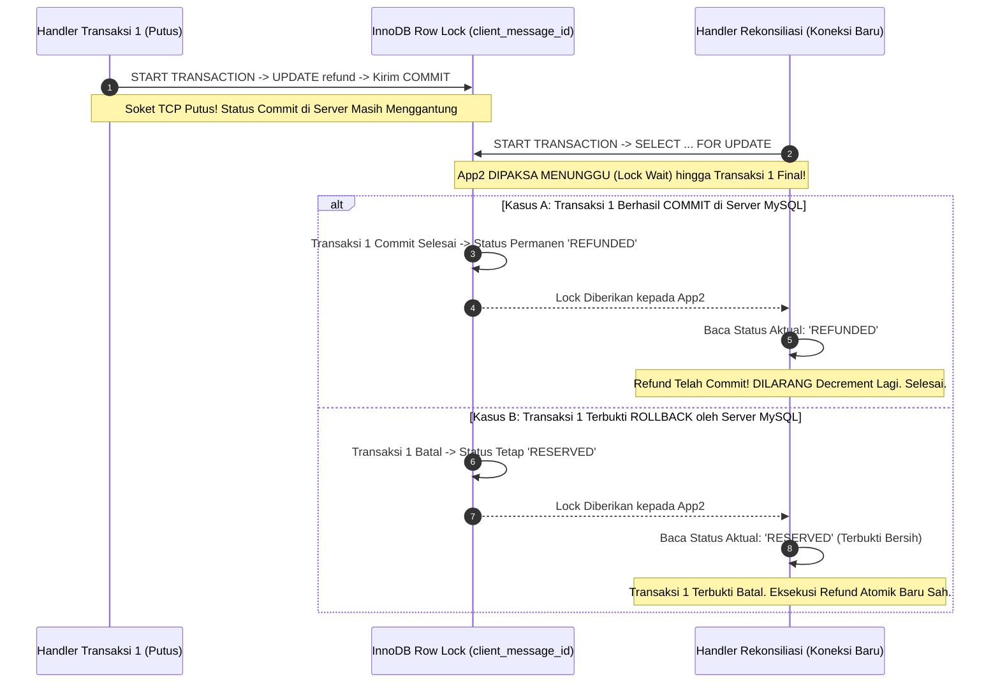

# EAO-ADDENDUM-2026-006M-FINAL-AMBIGUOUS-COMMIT-RECONCILIATION
## Adendum Teknis Final: Koreksi Mendasar Rekonsiliasi Ambiguous COMMIT via Penguncian Baris Pesimistik InnoDB (SELECT ... FOR UPDATE)

**Nomor Dokumen:** EAO-ADDENDUM-2026-006M-FINAL-AMBIGUOUS-COMMIT-RECONCILIATION  
**Tanggal:** 16 November 2026  
**Otoritas Pembuat:** Tim Multi-Agen EAO (System Architect, AI Security Reviewer, Developer, QA Engineer)  
**Dasar Mandat:** EAO-HO-006M (Final Ambiguous Commit Reconciliation)  
**Status Dokumen:** FINAL TECHNICAL AMENDMENT (READ-ONLY)  
**Batasan Kerja:** Desain & analisis dokumen murni; dilarang mengubah kode produksi, database, migrasi, dan 6 berkas lisensi terlindung.

---

## 1. Koreksi Mendasar Pernyataan Dokumen 006L

Pada dokumen adendum `EAO-ADDENDUM-2026-006L` (Bagian 4), terdapat pernyataan yang harus dikoreksi secara fundamental:
> *"Jika baris dibaca dan `quota_status === 'RESERVED'`, transaksi commit sebelumnya terbukti ROLLBACK oleh MySQL akibat putusnya koneksi. Counter kuota belum berkurang. Recovery diizinkan mencoba kembali..."*

### 1.1 Bahaya Logika Pembacaan Non-Blocking pada MVCC InnoDB:
Dalam mesin basis data MySQL InnoDB dengan mekanisme **Multi-Version Concurrency Control (MVCC)**:
1. **Pembacaan Snapshot (Consistent Non-Locking Read):**  
   Perintah `SELECT` biasa tanpa klausa penguncian membaca *snapshot* versi baris saat transaksi pembaca dimulai.
2. **Keterlambatan Penyelesaian Transaksi (*In-Flight Commit Latency*):**  
   Ketika soket TCP klien terputus saat perintah `COMMIT` dikirim, server MySQL mungkin **masih sedang menyelesaikan penulisan Redo Log / Binlog ke disk**. Transaksi tersebut belum selesai melepaskan kunci eksklusifnya.
3. **Bahaya Ilusi Nilai Lama (*Stale Snapshot Hazard*):**  
   Jika koneksi baru melakukan `SELECT` biasa, ia akan membaca versi lama dari baris tersebut, yaitu `quota_status = 'RESERVED'`.
4. **Risiko Pemotongan Ganda (*Double Decrement Catastrophe*):**  
   Jika sistem mengasumsikan nilai `RESERVED` tersebut sebagai bukti bahwa Transaksi 1 telah rollback, sistem akan mengeksekusi Transaksi Refund ke-2. Sementara itu, Transaksi 1 beberapa milidetik kemudian berhasil commit di server MySQL.  
   **Akibatnya: Penghitung kuota `used_count` terpotong 2 kali untuk 1 permintaan refund!**

---

## 2. Prosedur Rekonsiliasi Final Berpagar Kunci Pesimistik (`FOR UPDATE`)

Untuk menjamin ketiadaan pembacaan data usang, proses rekonsiliasi **WAJIB MENUNGGU PENYELESAIAN TRANSAKSI SEBELUMNYA** melalui klausa penguncian baris eksklusif **`SELECT ... FOR UPDATE`**:



### 2.1 Tahapan Operasional Rekonsiliasi yang Aman:
1. **Dilarang Decrement Buta:** Setelah koneksi COMMIT terputus, sistem dilarang melakukan pengurangan counter atau refund kedua secara langsung.
2. **Buka Koneksi Baru:** Inisialisasi koneksi MySQL yang bersih dan independen.
3. **Mulai Transaksi Rekonsiliasi:** `START TRANSACTION;`
4. **Kunci Baris Idempotensi dengan `SELECT ... FOR UPDATE`:**
   ```sql
   SELECT id, quota_status, status, key_source, quota_date, dispatch_started_at
   FROM ai_request_idempotency
   WHERE client_message_id = ?
   FOR UPDATE;
   ```
5. **Penungguan Kunci InnoDB (*Mandatory Lock Queueing*):**  
   Klausa `FOR UPDATE` memaksa koneksi rekonsiliasi mengantre di kernel InnoDB hingga Transaksi 1 benar-benar tuntas (baik selesai commit maupun selesai rollback).
6. **Evaluasi Status Faktual Pasca-Lock:**
   - **Jika `quota_status === 'REFUNDED'`:**  
     Transaksi 1 terbukti berhasil commit di server basis data. Counter telah berkurang 1. Transaksi rekonsiliasi dihentikan (*rollback no-op*). Refund tuntas, **dilarang menyentuh counter kuota**.
   - **Jika `quota_status === 'RESERVED'`:**  
     Transaksi 1 terbukti dibatalkan (*rollback*) oleh server MySQL dan kunci telah dilepas. Baris divalidasi ulang: jika seluruh prasyarat masih sah (`dispatch_started_at IS NULL` dan `key_source = 'admin_fallback'`), jalankan transaksi refund atomik ganda.
   - **Jika status lain (`COMPLETED`, `DELIVERY_UNKNOWN`):**  
     Jangan pernah berasumsi rollback. Evaluasi sesuai aturan state machine.
   - **Jika Database Tidak Tersedia / Lock Wait Timeout 1205:**  
     Ambil sikap **Fail-Closed**. Rollback transaksi rekonsiliasi dan tinggalkan baris dalam status aman untuk diinspeksi oleh proses recovery berikutnya.

---

## 3. Pseudocode Lengkap Metode Rekonsiliasi Ambigu

```php
public function reconcileAmbiguousCommitRefund(string $clientMessageId): array
{
    // 1. DILARANG decrement ulang secara buta!
    // 2. Buka koneksi baru yang terisolasi
    $freshDb = \Config\Database::connect();
    $freshDb->transBegin();

    try {
        // 3. Paksa antrean kunci eksklusif menunggu Transaksi 1 selesai
        $row = $freshDb->query("
            SELECT id, quota_status, status, key_source, quota_date, dispatch_started_at
            FROM ai_request_idempotency
            WHERE client_message_id = ?
            FOR UPDATE
        ", [$clientMessageId])->getRowArray();

        if (!$row) {
            $freshDb->transRollback();
            return ['status' => 'FAIL_CLOSED', 'reason' => 'ROW_NOT_FOUND'];
        }

        // KASUS A: Transaksi 1 ternyata SUKSES COMMIT di MySQL
        if ($row['quota_status'] === 'REFUNDED') {
            log_message('info', "[ReconciliationSuccess] Transaksi 1 terbukti COMMIT untuk UUID: {$clientMessageId}. Dilarang decrement ulang.");
            $freshDb->transRollback(); // No-op rollback transaksi rekonsiliasi
            return ['status' => 'RESOLVED_COMMITTED', 'quota_status' => 'REFUNDED'];
        }

        // KASUS B: Transaksi 1 terbukti ROLLBACK dan kunci telah dilepas
        if ($row['quota_status'] === 'RESERVED') {
            // Validasi ulang prasyarat refund
            if ($row['status'] === 'IN_FLIGHT' && 
                $row['dispatch_started_at'] === null && 
                $row['key_source'] === 'admin_fallback' && 
                !empty($row['quota_date'])) {
                
                log_message('warning', "[ReconciliationRetry] Transaksi 1 terbukti ROLLBACK untuk UUID: {$clientMessageId}. Mengeksekusi refund baru...");
                
                // Kunci baris kuota Admin
                $quotaRow = $freshDb->query("
                    SELECT id, used_count 
                    FROM ai_admin_quota_daily 
                    WHERE quota_date = ? 
                    FOR UPDATE
                ", [$row['quota_date']])->getRowArray();

                if ($quotaRow && (int)$quotaRow['used_count'] > 0) {
                    // Update Idempotensi
                    $freshDb->query("
                        UPDATE ai_request_idempotency
                        SET status = 'FAILED_BEFORE_HTTP_DISPATCH',
                            quota_status = 'REFUNDED',
                            worker_token = NULL,
                            updated_at = NOW()
                        WHERE client_message_id = ? AND quota_status = 'RESERVED'
                    ", [$clientMessageId]);

                    // Update Quota Counter
                    $freshDb->query("
                        UPDATE ai_admin_quota_daily
                        SET used_count = used_count - 1,
                            updated_at = NOW()
                        WHERE quota_date = ? AND used_count > 0
                    ", [$row['quota_date']]);

                    if ($freshDb->affectedRows() === 1) {
                        $freshDb->transCommit();
                        return ['status' => 'RESOLVED_REFUNDED', 'quota_status' => 'REFUNDED'];
                    }
                }
            }
        }

        // KASUS C: Status anomali atau prasyarat tidak terpenuhi
        log_message('critical', "[ReconciliationAlert] Baris dalam status tidak sesuai untuk refund: {$row['status']} / {$row['quota_status']}");
        $freshDb->transRollback();
        return ['status' => 'FAIL_CLOSED', 'reason' => 'PRECONDITIONS_INVALID'];

    } catch (\Throwable $e) {
        if ($freshDb->transStatus() !== false) {
            $freshDb->transRollback();
        }
        // KASUS D: Lock Wait Timeout 1205 atau Error Koneksi Baru -> Fail-Closed Mutlak
        log_message('critical', "[ReconciliationException] Gagal rekonsiliasi: " . $e->getMessage());
        return ['status' => 'FAIL_CLOSED', 'reason' => 'LOCK_TIMEOUT_OR_DB_ERROR'];
    }
}
```

---

## 4. Matriks Pembuktian 7 Skenario Konseptual Tambahan

| No | Skenario Konseptual Ambigu | Kondisi Internal Transaksi 1 | Respon Kueri Rekonsiliasi (App 2) | Status Akhir Idempotensi | Status Akhir Penghitung Kuota | Keputusan Retry | Bukti Tidak Terjadi Double Refund |
|:---:|:---|:---|:---|:---:|:---:|:---|:---|
| 1 | **Transaksi 1 masih berjalan saat koneksi terputus** | Transaksi 1 sedang flush log, memegang X-lock pada baris. | App 2 mengeksekusi `FOR UPDATE` $\rightarrow$ **dipaksa antre (lock wait)** hingga Transaksi 1 tuntas. | Menunggu Transaksi 1 selesai. | Menunggu Transaksi 1 selesai. | Belum boleh retry; menunggu status durable. | Antrean kunci InnoDB mencegah eksekusi paralel. |
| 2 | **Koneksi baru membaca status baris** | Transaksi 1 commit sukses beberapa mikrodetik lalu. | Jika `SELECT` biasa $\rightarrow$ rawan baca stale snapshot.<br>Dengan `FOR UPDATE` $\rightarrow$ membaca status mutakhir **`REFUNDED`**. | `quota_status = 'REFUNDED'` | `used_count = 14` | **TIDAK RETRY.** Refund dinyatakan tuntas. | Pembacaan berpagar `FOR UPDATE` mengeliminasi ilusi snapshot MVCC lama. |
| 3 | **Rekonsiliasi mencoba lock saat Transaksi 1 belum selesai** | Transaksi 1 masih memegang kunci baris InnoDB. | App 2 tertahan di level kernel OS/MySQL hingga Transaksi 1 melepaskan kunci. | Mengikuti hasil Transaksi 1. | Mengikuti hasil Transaksi 1. | Ditunda hingga kunci lepas. | Transaksi 1 tidak dapat disalip oleh App 2. |
| 4 | **Transaksi 1 commit setelah koneksi aplikasi terputus** | COMMIT berhasil mendarat di Redo Log MySQL server. | App 2 memperoleh kunci, membaca `quota_status = 'REFUNDED'`. | `quota_status = 'REFUNDED'` | `used_count = 14` (terpotong 1x oleh Tx 1). | **TIDAK RETRY.** App 2 rollback no-op. | App 2 mendeteksi status `REFUNDED` dan tidak menjalankan kueri decrement kedua. |
| 5 | **Transaksi 1 rollback setelah koneksi terputus** | MySQL membatalkan Transaksi 1 karena soket putus sebelum commit tuntas. | App 2 memperoleh kunci, membaca `quota_status = 'RESERVED'` secara bersih dan sah. | `quota_status = 'REFUNDED'` (oleh App 2). | `used_count = 14` (terpotong 1x oleh App 2). | **RETRY SUKSES.** App 2 mengeksekusi refund baru. | Karena Tx 1 rollback, hanya App 2 yang melakukan decrement counter (tepat 1x). |
| 6 | **Lock wait timeout 1205 saat rekonsiliasi** | Server MySQL mengalami beban sangat tinggi, antrean kunci melebihi 50s. | App 2 melempar exception 1205, memanggil rollback bersih. | Tetap status awal (`RESERVED` atau `REFUNDED`). | Tidak disentuh oleh App 2. | **FAIL-CLOSED.** Dilarang decrement buta. | Tidak ada perubahan data dalam kondisi ketidakpastian. |
| 7 | **Dua proses rekonsiliasi berjalan bersamaan** | Dua worker recovery mencoba merekonsiliasi UUID yang sama. | Diserialisasi oleh `FOR UPDATE`. Proses pertama mengeksekusi refund (jika perlu); proses kedua membaca status hasil proses pertama. | `quota_status = 'REFUNDED'` | `used_count = 14` (hanya terpotong 1x). | Proses 2 melihat `REFUNDED` $\rightarrow$ abort. | Serialisasi InnoDB menjamin ketiadaan eksekusi ganda antar-rekonsiliasi. |

---

## 5. Ringkasan Jaminan Integritas Sistem
1. **Penolakan Asumsi Prematur:** Nilai `RESERVED` dari pembacaan biasa resmi dilarang dijadikan bukti bahwa transaksi sebelumnya telah rollback.
2. **Kewajiban Penguncian Pesimistik:** Rekonsiliasi wajib menggunakan `SELECT ... FOR UPDATE` dalam transaksi terpisah untuk memaksa antrean kunci dan menjamin pembacaan data mutakhir yang durable.
3. **Pemberantasan Total Double Decrement:** Di bawah skenario putus koneksi apa pun, penghitung kuota Admin dijamin secara fisik dan matematis **TIDAK PERNAH BERKURANG LEBIH DARI SATU KALI**.
