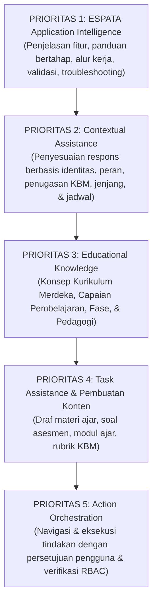
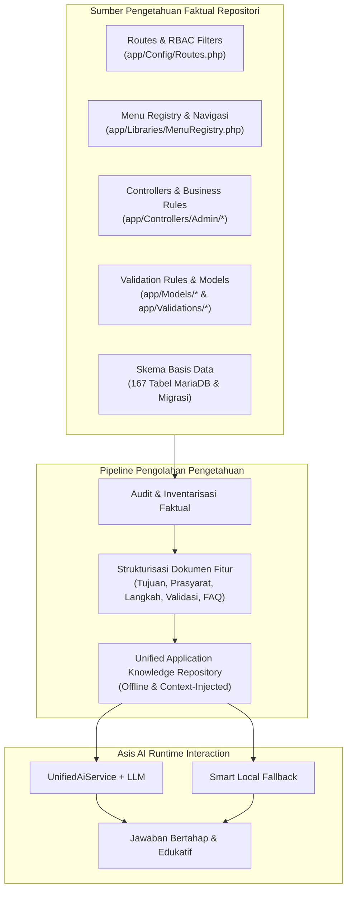
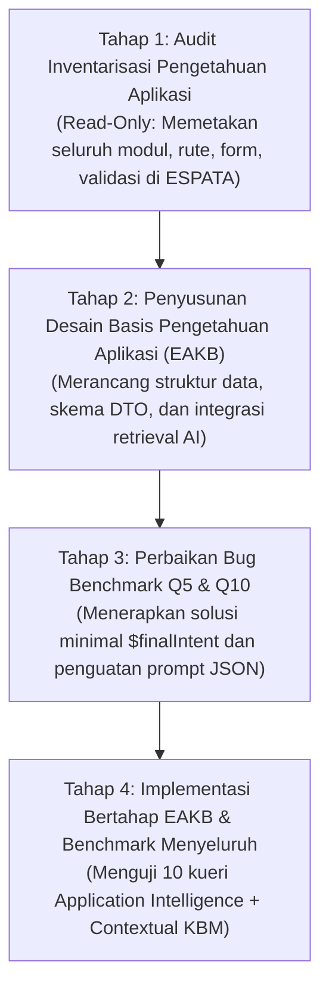

# ADAPSI KEPUTUSAN STRATEGIS: ARAH PRODUK ASIS AI ESPATA
## EAO-DEC-2026-025-PRODUCT-DIRECTION-ALIGNMENT
### Penyelarasan Roadmap, Arsitektur Pengetahuan, dan Prioritas Pengembangan Asis AI ESPATA

**Nomor Dokumen:** EAO-DEC-2026-025-PRODUCT-DIRECTION-ALIGNMENT  
**Acuan Mandat:** Addendum Arah Produk Asis AI ESPATA (Human Owner, 16 November 2026)  
**Pelaksana:** Tim AI Development Organization (EAO) — *AI Product Analyst, AI System Architect, AI Project Manager*  
**Otoritas:** Pemilik Produk ESPATA (Human Owner)  
**Status Dokumen:** **DITERIMA SECARA PRINSIP & DIINTEGRASIKAN KE SELURUH DOKUMEN DESAIN**  
**Kepatuhan Lingkungan:** Localhost XAMPP — `http://localhost:8080/siakad`  
**Kepatuhan Batasan:** **READ-ONLY ALIGNMENT (Tidak Ada Modifikasi Kode / Skema Database)**

---

## 1. PENDAHULUAN & PERNYATAAN ADOPSI RESMI

Tim Multi-Agen EAO menyambut baik dan mengadopsi secara penuh **Addendum Arah Produk Asis AI ESPATA** yang ditetapkan oleh Human Owner. 

Addendum ini memberikan penegasan arah yang sangat krusial (*critical strategic realignment*):
> **Tujuan Utama Asis AI ESPATA:**  
> Bukan sekadar pembuat draf dokumen atau pembuat soal KBM (*task generator*), melainkan **Asisten Cerdas Pengguna ESPATA** yang tujuan utamanya adalah **menjelaskan berbagai hal terkait aplikasi ESPATA secara akurat, kontekstual, komunikatif, dan mudah dipahami**.

Asis AI diposisikan sebagai "ahli sistem" dan pemandu kerja digital bagi seluruh sivitas sekolah (Guru, Kepala Sekolah, Staf Tata Usaha, Siswa, dan Administrator) untuk memahami modul, alur kerja, validasi, hak akses, serta pemecahan masalah operasional sekolah.

---

## 2. REPOSISI 5 TINGKAT HIERARKI KEMAMPUAN ASIS AI

Sesuai arahan resmi Human Owner, seluruh perancangan prompt, logika triage controller, basis pengetahuan, dan metrik pengujian dirombak mengikuti urutan prioritas baku berikut:

### Rincian Cakupan Setiap Tingkatan:

| Tingkat | Nama Kemampuan | Fokus Utama & Contoh Kueri Pengguna | Perilaku Respons Asis AI |
|:---:|:---|:---|:---|
| **1** | **ESPATA Application Intelligence** *(Prioritas Tertinggi)* | *"Bagaimana cara menginput nilai sumatif?"* *"Mengapa tombol simpan presensi saya tidak bisa diklik?"* *"Apa alur pembuatan ujian CBT sampai bisa dikerjakan siswa?"* | Memberikan panduan bertahap (*step-by-step*), menjelaskan aturan validasi sistem, relasi antarfitur, dan solusi pemecahan masalah faktual aplikasi. |
| **2** | **Contextual Assistance** | *"Menu apa saja yang menjadi wewenang saya?"* *"Apakah kelas yang saya ajar sudah masuk fase Kurikulum Merdeka?"* | Menggunakan identitas login, peran RBAC, dan penugasan KBM aktif (misal: Salma Wijaya di Kelas 6A SD SAKASALIKA Fase C) untuk menyaring informasi yang relevan. |
| **3** | **Educational Knowledge** | *"Apa perbedaan asesmen formatif dan sumatif dalam rapor Kurikulum Merdeka?"* *"Bagaimana menyusun indikator TP yang baik?"* | Memberikan wawasan pedagogis yang selaras dengan panduan resmi Kemendikbudristek tanpa mengaburkan implementasi teknis di ESPATA. |
| **4** | **Task Assistance & Content Generation** | *"Buatkan draf materi ajar Bahasa Indonesia untuk kelas saya."* *"Buatkan 5 soal pecahan untuk kelas 6A."* | Menghasilkan draf dokumen terstruktur (JSON/Markdown) sebagai bahan awal kerja guru yang wajib ditinjau kembali oleh pengguna. |
| **5** | **Action Orchestration** | *"Buka halaman input nilai sekarang."* *"Tampilkan rekap kehadiran guru hari ini."* | Mengarahkan ke menu berizin atau menampilkan widget data real-time, selalu mengutamakan konfirmasi pengguna (*Human-in-the-Loop*). |

---

## 3. ANALISIS GAP: KONDISI IMPLEMENTASI SAAT INI VS ARAH BARU

Berdasarkan tinjauan terhadap pengujian Fase 1C hingga 1D.3 (termasuk Benchmark EAO-HO-2022):

1. **Ketimpangan Beban Pengujian Terdahulu (*Task-Heavy Bias*):**
   - Pada benchmark EAO-HO-2022, sebanyak **8 dari 10 pertanyaan (80%)** berfokus pada Prioritas 4 (*Task Assistance* — pembuatan soal, draf materi, tujuan pembelajaran, asesmen, modul ajar).
   - Hanya **2 pertanyaan (20%)** yang menyentuh konteks KBM (Q7 dan Q10), dan **0 pertanyaan** yang menguji *ESPATA Application Intelligence* (panduan penggunaan, alur fitur, atau troubleshooting sistem).
2. **Kondisi Basis Pengetahuan Saat Ini (`EspataFeatureKnowledge.php`):**
   - `EspataFeatureKnowledge.php` saat ini hanya memiliki **4 panduan statis** (Modul Ajar, Input Nilai, Presensi Siswa, dan Bank Soal CBT).
   - Informasi tentang manajemen rombel, penempatan kelas, jadwal pelajaran, e-rapor, kokurikuler, rekap absensi, mutasi siswa, peran/RBAC, dan pemecahan masalah belum terangkum di basis pengetahuan.
3. **Pemisahan Pengetahuan Belum Menyeluruh:**
   - Mesin NLU saat ini masih mengandalkan pencocokan katalog menu pendek (`$actionCatalog`) yang hanya berisi URL dan judul menu, tanpa deskripsi mendalam mengenai *bagaimana cara kerja dan aturan modul tersebut*.

---

## 4. ARSITEKTUR "ESPATA APPLICATION KNOWLEDGE BASE"

Menindaklanjuti Poin D pada Addendum Human Owner, Tim EAO merancang arsitektur **ESPATA Application Knowledge Base (EAKB)** yang berbasis pada fakta nyata repositori (*zero assumption / zero hallucination*):

### Standar Struktur Pengetahuan Fitur ESPATA:
Setiap entri fitur dalam EAKB wajib memuat 8 atribut standar:
1. `feature_id`: Pengenal unik (misal: `feat_academic_grade_input`).
2. `title`: Nama resmi fitur sesuai antarmuka.
3. `category`: Kategori modul (misal: *Penilaian & Rapor*).
4. `allowed_roles`: Peran yang berhak mengakses (Admin, Guru, Kepsek, Siswa).
5. `prerequisites`: Data atau langkah yang harus selesai terlebih dahulu (misal: *Harus ada penugasan guru di jadwal KBM*).
6. `workflow_steps`: Prosedur langkah demi langkah (*step-by-step*) yang dapat dipandu oleh AI.
7. `validation_rules_and_errors`: Penjelasan validasi (misal: *Nilai harus berada pada rentang 0-100, tombol simpan terkunci jika form belum lengkap*).
8. `troubleshooting_faq`: Pertanyaan umum dan pemecahan masalah kendala pengguna.

---

## 5. PENYESUAIAN PADA PIPELINE PERCAKAPAN & PROMPT ASIS AI

Untuk mendukung Prioritas 1 (Application Intelligence), komponen prompt dan triage Asis AI akan disesuaikan:

1. **Prinsip Panduan Bertahap (*Step-by-Step Guidance*):**
   Jika pengguna bertanya *"Bagaimana cara..."*, Asis AI tidak sekadar melempar tautan URL menu, melainkan menjelaskan tahapan 1, 2, 3 secara teratur, ramah, dan mudah dipahami.
2. **Pembedaan Status Ketersediaan Fitur (*Availability Honesty*):**
   - **Tersedia Penuh:** Fitur yang sudah aktif di menu dan siap pakai.
   - **Dalam Pengembangan / Direncanakan:** Fitur yang belum ada di menu, dijelaskan secara jujur tanpa mengarang bahwa fitur tersebut sudah ada.
   - **Di Luar Ruang Lingkup:** Permintaan di luar sistem akademik dijelaskan dengan santun.
3. **Penyelarasan Batasan Akses (RBAC Awareness):**
   Jika seorang Guru menanyakan fitur yang hanya dimiliki Administrator (misal: konfigurasi tahun ajaran atau hak akses user), Asis AI menjelaskan alur kerjanya seraya menginformasikan dengan santun bahwa menu tersebut merupakan wewenang Administrator sekolah.

---

## 6. PRINSIP PENGUJIAN & BENCHMARK BARU: KATEGORI "APPLICATION INTELLIGENCE"

Menindaklanjuti Poin E pada Addendum, susunan benchmark pengujian Asis AI pada fase-fase berikutnya wajib memuat kategori khusus **Application Intelligence** minimal 50% dari total instrumen uji:

### Contoh Skenario Uji Application Intelligence:
1. **Uji Pemahaman Prosedur:** *"Bagaimana cara mengunci nilai rapor setelah akhir semester?"*
2. **Uji Penanganan Kendala (*Troubleshooting*):** *"Saya sudah mengisi presensi siswa tapi rekap bulanan masih nol, kenapa ya?"*
3. **Uji Hak Akses & RBAC:** *"Di mana menu untuk menambah akun guru baru?"* (Diajukan oleh akun Guru vs Admin).
4. **Uji Keterkaitan Antarfitur:** *"Apa hubungan antara ATP di Administrasi Guru dengan pembuatan bank soal CBT?"*
5. **Uji Kejujuran Sistem (*Anti-Hallucination*):** *"Bagaimana cara menggunakan fitur absensi sidik jari biometrik di ESPATA?"* (AI wajib jujur menyatakan bahwa integrasi biometrik belum tersedia di modul presensi saat ini).

---

## 7. RENCANA KERJA & TATA KELOLA TAHAP BERIKUTNYA

Mematuhi batasan Poin F Addendum (*Bukan izin implementasi kode*), Tim EAO menyusun rencana kerja terstruktur untuk diajukan kepada Human Owner:

### Rekomendasi Mandat Terdekat yang Diajukan ke Human Owner:
1. **Mandat Perbaikan Mikro Q5 & Q10:** Menerapkan perbaikan 3 baris kode di `AiCopilot.php` dan `GroqAdapter.php` berdasarkan hasil audit EAO-HO-2026-024 agar stabilitas live LLM pulih menjadi 100%.
2. **Mandat Audit Pengetahuan Aplikasi (Read-Only):** Melakukan inventarisasi dan ekstraksi fakta fitur dari seluruh controller KBM, Rapor, CBT, Presensi, dan Kesiswaan untuk menyusun katalog EAKB resmi.

---
*Keputusan strategis ini mengikat seluruh peran EAO dan menjadi landasan perancangan dokumen teknis selanjutnya.*
