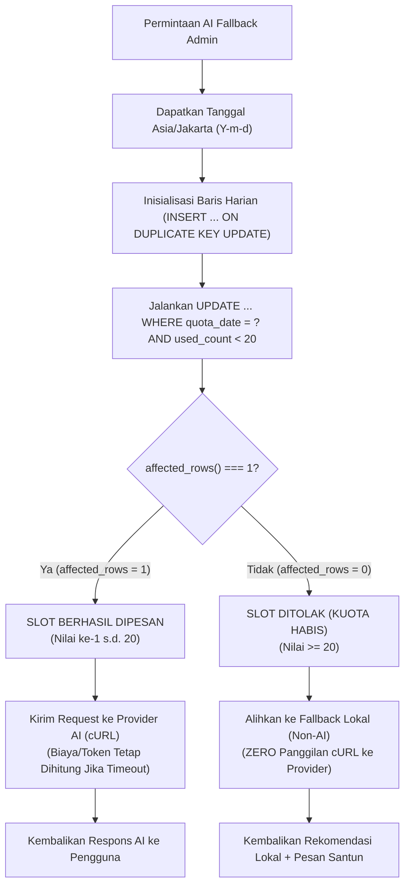

# EAO-DESIGN-2026-006A-ADMIN-QUOTA-FINAL
## Spesifikasi Teknis Final: Manajemen Kuota Kunci Administrator (Maksimal 20 Generasi/Hari)

**Nomor Dokumen:** EAO-DESIGN-2026-006A-ADMIN-QUOTA-FINAL  
**Tanggal:** 16 November 2026  
**Otoritas Pembuat:** Tim Multi-Agen EAO (System Architect, AI Security Reviewer, QA Engineer, Developer)  
**Keputusan Terkait:** Human Owner Directive EAO-HO-006A (Pilihan A — Dedicated Table)  
**Status Desain:** FINAL SPECIFICATION FOR IMPLEMENTATION APPROVAL  
**Batasan Kerja:** Desain final; tidak ada kode aplikasi atau migrasi database yang dijalankan sebelum persetujuan resmi.

---

## 1. Definisi & Ketentuan Baku Kuota Administrator

Sesuai Keputusan Resmi Human Owner **EAO-HO-006A**:

1. **Batas Kuota:** **Tepat 20 generasi per hari kalender**.
2. **Lingkup Perhitungan:** Akumulatif (*agregat*) untuk seluruh pengguna yang meminjam API Key Administrator sebagai fallback bersama. Bukan 20 generasi per individu pengguna.
3. **Pengecualian Kunci Pribadi (Self-Exemption):** Penggunaan API Key pribadi pengguna (`keySource = 'self'`) **TIDAK MENGURANGI** kuota Administrator dan tidak dibatasi oleh kuota Administrator.
4. **Zona Waktu:** Perhitungan hari kalender menggunakan zona waktu resmi **`Asia/Jakarta`** (WIB, UTC+7).
5. **Keamanan Konkurensi (Concurrency Safety):** Wajib menggunakan mekanisme atomik berlevel baris (*row-level lock*) pada tingkat basis data untuk mencegah *race condition* yang menembus batas 20.
6. **Kebijakan Pemotongan Kuota (Pre-Dispatch Reservation):** Slot kuota dialokasikan *sebelum* request cURL dikirim ke vendor AI. Jika terjadi timeout atau galat respons dari pihak vendor eksternal, **slot kuota tetap dihitung dan tidak dikembalikan**, demi melindungi kuota/anggaran Administrator dari eksploitasi retry berulang.
7. **Perilaku Kuota Habis:** Menolak fallback kunci Administrator, mengarahkan sistem secara anggun (*graceful degradation*) ke sistem lokal / non-AI, dan memberikan pesan informatif kepada pengguna.
8. **Prinsip Keamanan Gagal (Fail-Closed):** Apabila status database kuota tidak dapat dipastikan atau mengalami kegagalan teknis, sistem wajib menolak alokasi kunci Administrator (*fail-closed*) dan beralih ke fallback lokal.
9. **Zero Cross-Teacher Fallback:** Dilarang keras mengalihkan permintaan ke kunci milik guru lain.

---

## 2. Desain Final Skema Basis Data: `ai_admin_quota_daily`

Penyimpanan kuota Administrator dipisahkan ke dalam satu tabel khusus (*dedicated table*) sesuai Keputusan A Human Owner.

### 2.1 Definisi Kolom & Tipe Data

| Nama Kolom | Tipe Data | Nullable | Default | Keterangan & Aturan Integritas |
|:---|:---|:---:|:---:|:---|
| `id` | `INT(11) UNSIGNED` | NO | *Auto Increment* | Primary Key unik tabel. |
| `quota_date` | `DATE` | NO | - | Tanggal kalender `Asia/Jakarta` (Format: `YYYY-MM-DD`). |
| `used_count` | `INT(5) UNSIGNED` | NO | `0` | Jumlah akumulatif slot yang telah dialokasikan (Batas: 20). |
| `created_at` | `DATETIME` | YES | `NULL` | Waktu inisialisasi baris pertama kali pada hari tersebut. |
| `updated_at` | `DATETIME` | YES | `NULL` | Waktu mutasi alokasi slot terakhir. |

### 2.2 Constraints & Indeks
- **Primary Key:** `PRIMARY KEY (id)`
- **Unique Constraint:** `UNIQUE KEY uq_quota_date (quota_date)`  
  *Menjamin tidak akan pernah ada dua baris data untuk tanggal kalender yang sama.*
- **Storage Engine:** `InnoDB`  
  *Wajib menggunakan InnoDB untuk mendukung transaksi ACID dan row-level locking.*
- **Charset / Collation:** `utf8mb4 / utf8mb4_unicode_ci`

### 2.3 Aturan Retensi Data (Data Retention Policy)
- Data historis pemakaian kuota pada tabel `ai_admin_quota_daily` dipertahankan minimal selama **365 hari (1 tahun kalender)** untuk kebutuhan audit tahunan akademik sekolah.
- Tidak ada penghapusan otomatis harian (*no premature deletion*). Pembersihan data usang di atas 1 tahun dapat dijadwalkan melalui perintah CLI maintenance tahunan.

---

## 3. Algoritma Inisialisasi Baris Harian Anti-Race Condition

Ketika pergantian hari terjadi (pukul 00:00:00 WIB), baris baru untuk tanggal tersebut harus disiapkan tanpa menimbulkan galat *duplicate key* saat beberapa proses mengaksesnya serentak.

### Algoritma: *Atomic Lazy Upsert*
```sql
INSERT INTO ai_admin_quota_daily (quota_date, used_count, created_at, updated_at)
VALUES (?, 0, NOW(), NOW())
ON DUPLICATE KEY UPDATE id=id;
```
- **Karakteristik Keamanan:**
  1. Bersifat idempoten (*idempotent*).
  2. Jika proses pertama memasukkan tanggal `2026-11-16`, baris berhasil dibuat dengan `used_count = 0`.
  3. Jika 10 proses lain menjalankan perintah yang sama di milidetik yang sama, klausa `ON DUPLICATE KEY UPDATE id=id` membuat kueri sukses tanpa melempar exception galat duplikasi.

---

## 4. Mekanisme Alokasi Kuota Atomik (Batas Maksimal 20)

### 4.1 Kueri Mutasi Atomik
Alokasi slot kuota dilakukan menggunakan satu pernyataan SQL atomik dengan evaluasi predikat bersyarat:

```sql
UPDATE ai_admin_quota_daily
SET used_count = used_count + 1,
    updated_at = NOW()
WHERE quota_date = ?
  AND used_count < 20;
```

### 4.2 Analisis Perilaku Mesin Database (InnoDB Row-Level Locking)
Saat kueri di atas dieksekusi:
1. InnoDB mengunci baris tanggal yang bersangkutan (*exclusive row lock*).
2. Mesin basis data memeriksa predikat `used_count < 20`:
   - Jika `used_count < 20`: Nilai `used_count` dinaikkan 1. Kueri mengembalikan `affected_rows() === 1`. Slot kuota **BERHASIL DIPESAN (SLOT ACQUIRED)**.
   - Jika `used_count >= 20`: Kondisi WHERE bernilai salah. Tidak ada baris yang diupdate. Kueri mengembalikan `affected_rows() === 0`. Slot kuota **DITOLAK (QUOTA EXHAUSTED)**.
3. Kunci baris segera dilepaskan (*lock released*).



---

## 5. Matriks Perilaku pada Ambang Batas 19, 20, dan 21

| Nilai Counter Saat Ini | Status Permintaan Masuk | Hasil Eksekusi SQL | Status Alokasi | Tindakan Sistem |
|:---:|:---|:---:|:---:|:---|
| **18** | Permintaan ke-19 masuk | `affected_rows = 1` | **DIIZINKAN** | `used_count` menjadi 19. Provider AI dipanggil. |
| **19** | Permintaan ke-20 masuk (Batas Pamungkas) | `affected_rows = 1` | **DIIZINKAN** | `used_count` menjadi 20. Provider AI dipanggil. |
| **20** | Permintaan ke-21 masuk (Melebihi Batas) | `affected_rows = 0` | **DITOLAK** | `used_count` tetap 20. Tidak ada cURL ke provider. Beralih ke fallback lokal. |
| **20** | Permintaan ke-22 dan seterusnya | `affected_rows = 0` | **DITOLAK** | `used_count` tetap 20. Beralih ke fallback lokal. |
| **20** | Permintaan dari Guru dengan Kunci Pribadi (`self`) | *Bypassed* (Tidak sentuh tabel) | **DIIZINKAN** | Kunci guru dipakai. Kuota Admin tetap 20. |

---

## 6. Protokol Penanganan Kegagalan & Fail-Closed Guard

1. **Kegagalan Koneksi Database:**  
   Jika database mengalami kegagalan koneksi, lock timeout, atau tabel corrupt, metode `acquireSlot()` menangkap exception via blok `catch (\Throwable $e)` dan secara tegas mengembalikan `['allowed' => false, 'reason' => 'DB_ERROR']`.
2. **Jaminan Finansial:**  
   Sistem tidak pernah mengasumsikan kuota tersedia saat terjadi galat teknis. Mode *fail-closed* memastikan kunci Administrator tidak akan pernah terpanggil tanpa izin slot yang sah.
3. **Pencatatan Insiden:**  
   Kegagalan database dicatat ke dalam log sistem CodeIgniter (`log_message('error', ...)`), tanpa menyertakan API Key mentah.

---

## 7. Desain Kelas Layanan: `App\Services\Ai\AdminQuotaManager`

Kelas ini ditempatkan pada `app/Services/Ai/AdminQuotaManager.php` dengan implementasi lengkap sebagai berikut:

```php
namespace App\Services\Ai;

use App\Services\BaseService;

class AdminQuotaManager extends BaseService
{
    public const DAILY_LIMIT = 20;
    public const TIMEZONE    = 'Asia/Jakarta';

    /**
     * Memesan 1 slot kuota secara atomik
     */
    public function acquireSlot(): array
    {
        $tz = new \DateTimeZone(self::TIMEZONE);
        $now = new \DateTime('now', $tz);
        $today = $now->format('Y-m-d');

        if (!$this->db) {
            return ['allowed' => false, 'reason' => 'DB_UNAVAILABLE'];
        }

        try {
            // 1. Inisialisasi atomik baris tanggal kalender berjalan
            $this->db->query("
                INSERT INTO ai_admin_quota_daily (quota_date, used_count, created_at, updated_at)
                VALUES (?, 0, NOW(), NOW())
                ON DUPLICATE KEY UPDATE id=id
            ", [$today]);

            // 2. Pemesanan slot atomik dengan row-level lock
            $this->db->query("
                UPDATE ai_admin_quota_daily
                SET used_count = used_count + 1,
                    updated_at = NOW()
                WHERE quota_date = ?
                  AND used_count < ?
            ", [$today, self::DAILY_LIMIT]);

            $affected = $this->db->affectedRows();

            // 3. Ambil data hitungan terbaru
            $row = $this->db->table('ai_admin_quota_daily')
                ->where('quota_date', $today)
                ->get()
                ->getRowArray();

            $used = (int) ($row['used_count'] ?? self::DAILY_LIMIT);

            if ($affected > 0) {
                return [
                    'allowed'    => true,
                    'used_count' => $used,
                    'limit'      => self::DAILY_LIMIT,
                    'resets_at'  => $today . ' 23:59:59 WIB',
                ];
            }

            return [
                'allowed'    => false,
                'used_count' => $used,
                'limit'      => self::DAILY_LIMIT,
                'reason'     => 'QUOTA_EXHAUSTED',
                'resets_at'  => $today . ' 23:59:59 WIB',
            ];
        } catch (\Throwable $e) {
            log_message('error', '[AdminQuotaManager::acquireSlot] ' . $e->getMessage());
            return ['allowed' => false, 'reason' => 'DB_ERROR'];
        }
    }

    /**
     * Memeriksa status kuota saat ini tanpa menambah hitungan (Read-only)
     */
    public function getStatus(): array
    {
        $tz = new \DateTimeZone(self::TIMEZONE);
        $now = new \DateTime('now', $tz);
        $today = $now->format('Y-m-d');

        try {
            $row = $this->db->table('ai_admin_quota_daily')
                ->where('quota_date', $today)
                ->get()
                ->getRowArray();

            $used = (int) ($row['used_count'] ?? 0);
            return [
                'quota_date' => $today,
                'used_count' => $used,
                'limit'      => self::DAILY_LIMIT,
                'remaining'  => max(0, self::DAILY_LIMIT - $used),
                'exhausted'  => ($used >= self::DAILY_LIMIT),
            ];
        } catch (\Throwable $e) {
            return [
                'quota_date' => $today,
                'used_count' => 0,
                'limit'      => self::DAILY_LIMIT,
                'remaining'  => self::DAILY_LIMIT,
                'exhausted'  => false,
            ];
        }
    }
}
```
