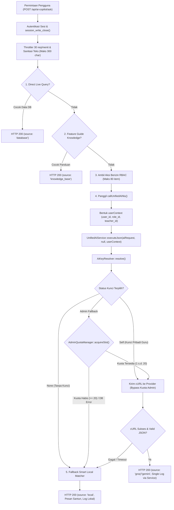

# EAO-DESIGN-2026-006A-AICOPILOT-ALIGNMENT-FINAL
## Spesifikasi Teknis Final: Penyelarasan Penuh AiCopilot dengan Unified AI Engine & Kuota Administrator

**Nomor Dokumen:** EAO-DESIGN-2026-006A-AICOPILOT-ALIGNMENT-FINAL  
**Tanggal:** 16 November 2026  
**Otoritas Pembuat:** Tim Multi-Agen EAO (System Architect, AI Security Reviewer, Developer, AI Product Analyst)  
**Keputusan Terkait:** Human Owner Directive EAO-HO-006A (Bagian B.4)  
**Status Desain:** FINAL SPECIFICATION FOR IMPLEMENTATION APPROVAL  
**Batasan Kerja:** Desain final; tidak ada perubahan kode produksi sebelum persetujuan resmi.

---

## 1. Peta Arsitektur Penyelarasan AiCopilot

Penyelarasan `app/Controllers/Api/AiCopilot.php` bertujuan menghubungkan Asis AI Copilot secara langsung ke dalam ekosistem `UnifiedAiService`, `AiKeyResolver`, dan `AdminQuotaManager`.



---

## 2. Rincian Tiga Perubahan Kunci pada `AiCopilot.php`

### 2.1 Penghapusan Blokade `.env` (Baris 609–612)
- **Kode Lama (Akar Masalah):**
  ```php
  $groqProvider = $aiService->getProvider('groq');
  if ($groqProvider === null || !$groqProvider->isAvailable()) {
      return ['success' => false, 'reason' => 'PROVIDER_UNAVAILABLE'];
  }
  ```
- **Alasan Penghapusan:** Logika lama ini mengecek apakah file `.env` memiliki `GROQ_API_KEY`. Ketika `.env` kosong, sistem membatalkan pemanggilan AI dan memblokir guru yang sebenarnya memiliki kunci pribadi di database.
- **Implementasi Baru:** Blok kode ini **dihapus seutuhnya**. Pemeriksaan ketersediaan provider dan kunci diserahkan sepenuhnya kepada `UnifiedAiService` dan `AiKeyResolver`.

### 2.2 Injeksi Konteks Pengguna Pemohon (`$userContext`)
- **Implementasi Baru pada `callUnifiedAiNlu()`:**
  ```php
  $userContext = [
      'user_id'    => (int) ($user['id'] ?? 0),
      'role_id'    => (int) ($user['role_id'] ?? 0),
      'teacher_id' => (int) ($user['teacher_id'] ?? $user['related_id'] ?? 0),
  ];

  // Jika teacher_id belum ada tetapi role adalah Guru, cari ID di tabel teachers
  if ($userContext['teacher_id'] <= 0 && $userContext['role_id'] === 3) {
      try {
          $db = db_connect();
          $tRow = $db->table('teachers')->where('user_id', $userContext['user_id'])->get()->getRowArray();
          if ($tRow) {
              $userContext['teacher_id'] = (int) $tRow['id'];
          }
      } catch (\Throwable $e) {}
  }

  // Panggil UnifiedAiService dengan parameter ke-2 null (auto provider) dan parameter ke-3 userContext
  $response = $aiService->executeJson($aiRequest, null, $userContext);
  ```

### 2.3 Resolusi Provider Dinamis (Groq & Gemini Agnostic)
- `AiCopilot` tidak lagi memaksakan string `'groq'` pada pemanggilan service.
- Jika pengguna atau Administrator memiliki kunci berawalan `AIzaSy...`, sistem otomatis memanggil `GeminiAdapter`. Jika berawalan `gsk_...`, sistem memanggil `GroqAdapter`.
- Nilai field `source` pada respons API dikembalikan sesuai provider aktual yang memproses (`$response->provider`).

---

## 3. Integrasi Kuota Administrator pada `UnifiedAiService`

Pemeriksaan kuota Administrator diletakkan di dalam lapisan `UnifiedAiService` tepat setelah kunci diselesaikan oleh `AiKeyResolver` dan sebelum panggilan cURL dieksekusi:

```php
// app/Services/Ai/UnifiedAiService.php (Pola Integrasi Fase 1C)
if ($resolvedKey && $resolvedKey->isAvailable()) {
    // Jika kunci berasal dari fallback Administrator, pesan slot kuota harian secara atomik
    if ($resolvedKey->keySource === 'admin_fallback') {
        $quotaManager = new AdminQuotaManager($this->config, $this->db);
        $quotaSlot = $quotaManager->acquireSlot();

        if (!$quotaSlot['allowed']) {
            $failureResponse = AiResponse::createFailure(
                'Kuota harian AI bantuan sekolah telah mencapai batas maksimal (20 generasi/hari).',
                'QUOTA_EXHAUSTED',
                $resolvedKey->provider ?: 'unknown',
                $sanitizedRequest->model ?: 'default'
            );
            $this->recordAuditTelemetry($sanitizedRequest, $failureResponse, $sessionUserId, $sessionRoleId, $resolvedKey);
            return $failureResponse;
        }
    }

    $sanitizedRequest->apiKeyOverride = $resolvedKey->getRawSecret();
}
```

---

## 4. Preservasi 100% Kontrak Respons JSON Frontend

Untuk memastikan tidak ada gangguan pada widget antarmuka Asis AI (`zero frontend regression`), skema JSON respons dijaga secara presisi:

```json
{
  "status": "success",
  "source": "groq",
  "query": "Jelaskan cara input nilai rapor",
  "explanation": "Mengarahkan ke menu Input Nilai Siswa (Akademik).",
  "matched_action": {
    "id": "action_input_nilai",
    "title": "Input Nilai Siswa",
    "url": "http://localhost/siakad/guru/erapor/nilai",
    "icon": "bi bi-pencil-square",
    "category": "Akademik"
  },
  "suggestions": [
    {
      "id": "action_cetak_rapor",
      "title": "Cetak Buku Rapor",
      "url": "http://localhost/siakad/guru/erapor/cetak",
      "icon": "bi bi-printer",
      "category": "Akademik"
    }
  ],
  "ai_content": null,
  "csrf_hash": "a1b2c3d4e5f6..."
}
```

### Pesan Khusus Ketika Kuota Administrator Habis:
Ketika kuota 20/20 tercapai:
- `status`: tetap `'success'` (HTTP 200).
- `source`: `'local'`.
- `explanation`: `"Kuota AI sekolah hari ini telah terpakai penuh (20/20). Asis AI mengarahkan Anda menggunakan rekomendasi pencocokan lokal."`
- `matched_action`: menyajikan aksi navigasi lokal terbaik.
- Pengguna tidak mengalami error HTTP 500 dan aplikasi tetap beroperasi secara mulus.
