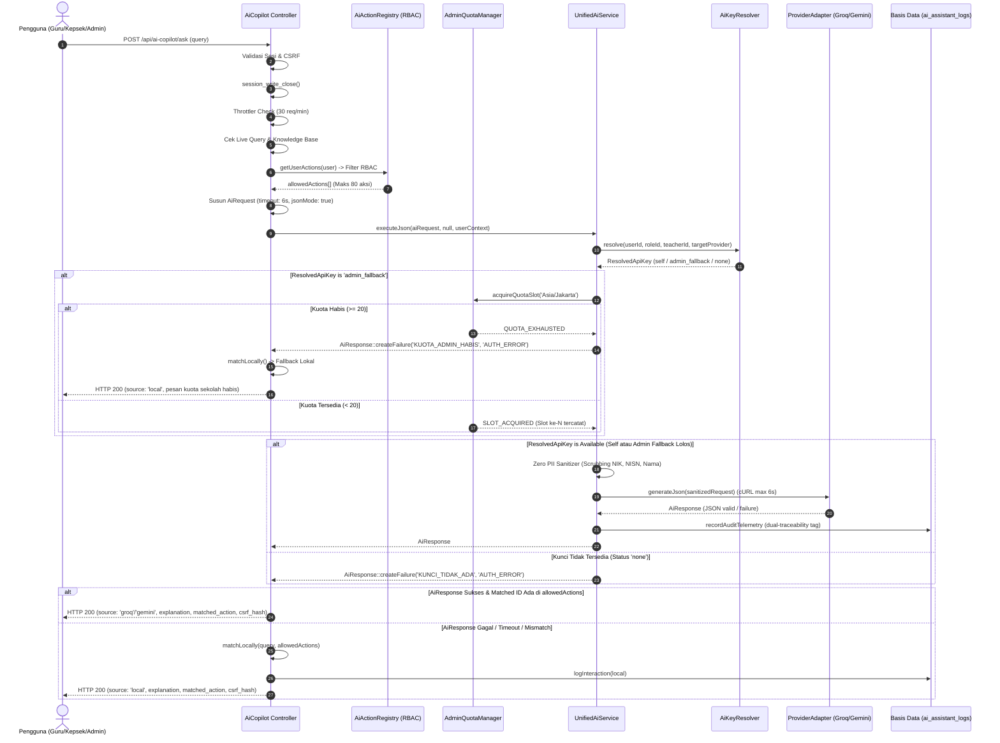

# EAO-DESIGN-2026-006A-AICOPILOT-ALIGNMENT
## Desain Teknis Penyelarasan AiCopilot dengan Unified AI Engine & Multi-Account Core

**Nomor Dokumen:** EAO-DESIGN-2026-006A-AICOPILOT-ALIGNMENT  
**Tanggal:** 16 November 2026  
**Otoritas Pembuat:** Tim Multi-Agen EAO (System Architect, AI Security Reviewer, Developer)  
**Mandat Terkait:** EAO-MANDATE-2026-006 (Persiapan Desain Fase 1C)  
**Status Desain:** PROPOSAL TEKNIS UNTUK PERSETUJUAN HUMAN OWNER  
**Target Berkas Implementasi:** `app/Controllers/Api/AiCopilot.php`

---

## 1. Prinsip Utama Arsitektur Penyelarasan

1. **Satu Sumber Kebenaran Resolusi Kunci (Single Source of Truth):**  
   `AiCopilot` **DILARANG** membuat logika kueri tabel `teachers` atau `users` secara mandiri. Seluruh resolusi kunci didelegasikan 100% kepada `App\Services\Ai\AiKeyResolver` melalui `UnifiedAiService`.
2. **Kepatuhan Urutan Resolusi Human Owner:**  
   - Prioritas 1: Kunci pribadi pengguna aktif (`self`).
   - Prioritas 2: Kunci Administrator sebagai fallback bersama (`admin_fallback`), tunduk pada kuota harian maksimal 20 generasi.
   - Prioritas 3: Fallback lokal / non-AI (`local` / `none`). Tidak ada fallback ke `.env` untuk permintaan pengguna.
3. **Penyelarasan Dinamis Provider (Groq / Gemini Agnostic):**  
   `AiCopilot` tidak lagi mematok string `'groq'` secara kaku. Jika pengguna atau Administrator menyediakan kunci Gemini (`AIzaSy...`), engine akan otomatis memanggil `GeminiAdapter`. Jika kunci adalah Groq (`gsk_...`), engine memanggil `GroqAdapter`.
4. **Zero Regression pada Kontrak API Frontend:**  
   Seluruh antarmuka JSON dari endpoint `/api/ai-copilot/ask` dan `/api/ai-copilot/morning-briefing` tetap mematuhi skema yang diharapkan frontend.
5. **Kepatuhan Lingkungan Shared Hosting:**  
   Mempertahankan pelepasan kunci sesi (`session_write_close()`) sebelum pemanggilan AI, batas waktu ketat (*timeout 6 detik*), dan throttling (30 req/menit).

---

## 2. Diagram Alur Data & Pemanggilan Layanan



---

## 3. Rincian Perubahan pada Metode `callUnifiedAiNlu()`

Di dalam `app/Controllers/Api/AiCopilot.php`, metode `callUnifiedAiNlu()` akan direstrukturisasi dengan pola bersih sebagai berikut:

```php
protected function callUnifiedAiNlu(string $query, array $allowedActions, array $user): array
{
    $aiService = $this->getAiService();

    // 1. Bentuk konteks pengguna pemohon secara lengkap
    $userContext = [
        'user_id'    => (int) ($user['id'] ?? 0),
        'role_id'    => (int) ($user['role_id'] ?? 0),
        'teacher_id' => (int) ($user['teacher_id'] ?? $user['related_id'] ?? 0),
    ];

    // Jika teacher_id belum terisi tetapi role adalah Guru, cari ID di tabel teachers
    if ($userContext['teacher_id'] <= 0 && $userContext['role_id'] === 3) {
        try {
            $db = db_connect();
            $tRow = $db->table('teachers')->where('user_id', $userContext['user_id'])->get()->getRowArray();
            if ($tRow) {
                $userContext['teacher_id'] = (int) $tRow['id'];
            }
        } catch (\Throwable $e) {}
    }

    try {
        // 2. Siapkan katalog tindakan berizin ringkas (maksimal 80 item agar hemat token)
        $actionCatalog = [];
        foreach (array_slice($allowedActions, 0, 80) as $act) {
            $actionCatalog[] = [
                'id'       => $act['id'],
                'title'    => $act['title'],
                'category' => $act['category'],
                'url'      => $act['url'],
            ];
        }

        $catalogJson = json_encode($actionCatalog, JSON_UNESCAPED_UNICODE);

        $systemInstruction = "Anda adalah Asis AI, asisten cerdas resmi sistem informasi akademik sekolah (ESPATA).\n"
            . "Tugas Anda adalah memahami maksud/pertanyaan pengguna, memberikan panduan langkah fitur jika ditanyakan, dan memilih 1 ID tindakan terbaik dari katalog tindakan berizin.\n"
            . "PENTING: Keluaran WAJIB HANYA berupa objek JSON valid tanpa teks pengantar atau penutup. Format respon json:\n"
            . "{\n"
            . '  "matched_id": "id tindakan yang cocok dari katalog, atau null jika tidak ada yang relevan",' . "\n"
            . '  "explanation": "Penjelasan singkat ramah 1 kalimat mengapa tindakan/panduan ini dipilih",' . "\n"
            . '  "ai_content": "Teks panduan langkah demi langkah bernomor (1, 2, 3) atau ide materi, atau null jika hanya navigasi sederhana",' . "\n"
            . '  "secondary_ids": ["id pilihan alternatif 1", "id pilihan alternatif 2"]' . "\n"
            . "}";

        $userPrompt = "Pertanyaan/perintah pengguna: \"{$query}\".\n"
            . "Pilih dari katalog tindakan berizin berikut dan jawab dalam format json:\n"
            . $catalogJson;

        // 3. Batas waktu Copilot ketat: connection 3s, total 6s
        $aiRequest = new AiRequest(
            $userPrompt,
            $systemInstruction,
            [],
            null, // Biarkan default provider atau model adapter yang menentukan
            0.2,
            600,
            6, // Timeout total 6 detik
            true,
            null, // Resolusi kunci diserahkan seutuhnya ke AiKeyResolver
            'copilot_u' . $userContext['user_id'] . '_r' . $userContext['role_id']
        );

        // 4. Eksekusi terpusat via UnifiedAiService dengan injeksi userContext
        // Provider diset null agar sistem memilih provider yang cocok dengan kunci yang tersedia
        $response = $aiService->executeJson($aiRequest, null, $userContext);

        if ($response->success && is_array($response->jsonData) && !empty($response->jsonData['matched_id'])) {
            $matchedId = $response->jsonData['matched_id'];

            $actionMap = [];
            foreach ($allowedActions as $act) {
                $actionMap[$act['id']] = $act;
            }

            // Validasi otorisasi RBAC ketat: ID tindakan WAJIB ada di dalam daftar berizin
            if (isset($actionMap[$matchedId])) {
                $suggestions = [];
                foreach ((array) ($response->jsonData['secondary_ids'] ?? []) as $secId) {
                    if (isset($actionMap[$secId])) {
                        $suggestions[] = $actionMap[$secId];
                    }
                }

                return [
                    'success'        => true,
                    'source'         => $response->provider, // 'groq' atau 'gemini'
                    'matched_action' => $actionMap[$matchedId],
                    'explanation'    => (string) ($response->jsonData['explanation'] ?? 'Tindakan yang sesuai ditemukan.'),
                    'ai_content'     => !empty($response->jsonData['ai_content']) ? (string) $response->jsonData['ai_content'] : null,
                    'suggestions'    => $suggestions,
                    'quota_info'     => $response->rawResponse['quota_info'] ?? null,
                ];
            }
        }

        // Catat alasan kegagalan spesifik untuk umpan balik pengguna
        if (!$response->success && $response->errorCode === 'QUOTA_EXHAUSTED') {
            return [
                'success' => false,
                'reason'  => 'QUOTA_EXHAUSTED',
                'message' => 'Kuota harian AI bantuan sekolah telah mencapai batas maksimal (20 generasi/hari). Beralih ke pencocokan sistem lokal.',
            ];
        }
    } catch (\Throwable $e) {
        log_message('error', '[AiCopilot::callUnifiedAiNlu] ' . $e->getMessage());
    }

    return ['success' => false, 'reason' => 'AI_UNAVAILABLE'];
}
```

---

## 4. Penanganan Redundansi Logging pada `AiCopilot::ask()`

Saat ini, `AiCopilot::ask()` baris 410 memanggil:
`$this->logInteraction($user, $query, $matched['category'] ?? 'NLU', $matched['id'] ?? null, 'groq');`
Sementara `UnifiedAiService::recordAuditTelemetry()` juga melakukan insert ke `ai_assistant_logs`.

### Strategi Eliminasi Redundansi Fase 1C:
1. **Untuk Permintaan yang Diproses oleh AI (`callUnifiedAiNlu` sukses):**  
   Pencatatan ke tabel `ai_assistant_logs` dilakukan **HANYA SATU KALI** oleh `UnifiedAiService::recordAuditTelemetry()`. Pemanggilan `$this->logInteraction()` pada baris 410 dihilangkan. Dengan demikian, tag dual-traceability (`groq:self:12` atau `groq:admin_fallback:1`) menjadi catatan tunggal yang akurat tanpa duplikasi baris.
2. **Untuk Permintaan Non-AI (Live Query, Knowledge Base, Local Matcher):**  
   Pemanggilan `$this->logInteraction()` tetap dipertahankan karena alur non-AI ini tidak melewati `UnifiedAiService`.

---

## 5. Strategi Mempertahankan Kontrak API & Pesan Humanis

Ketika pemanggilan AI gagal karena kuota Administrator habis:
- Response tetap berstatus HTTP 200 (bukan HTTP 500/400).
- `source` berlabel `'local'`.
- `explanation` menyertakan keterangan transparan:  
  *"Kuota AI sekolah hari ini telah terpakai penuh (20/20). Menampilkan rekomendasi fitur berdasarkan pencocokan kata kunci sistem."*
- Pengguna tetap mendapatkan navigasi fitur melalui `matched_action` lokal tanpa ada fitur yang mogok (*graceful degradation*).
