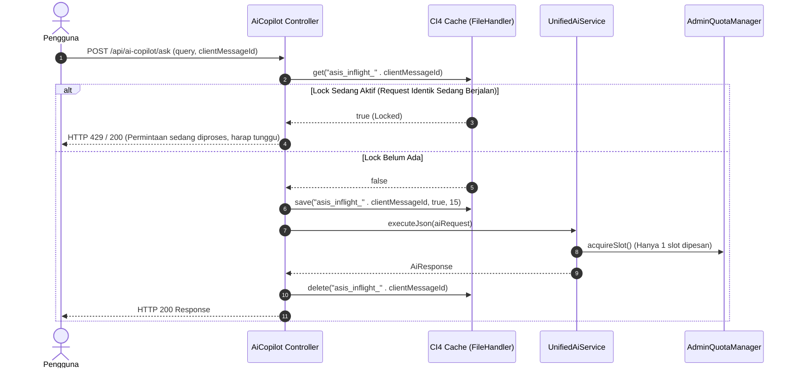

# EAO-DESIGN-2026-006C-IDEMPOTENCY
## Spesifikasi Teknis Final: Strategi Idempotensi Permintaan, Pencegahan Klik Ganda, dan In-Flight Locking

**Nomor Dokumen:** EAO-DESIGN-2026-006C-IDEMPOTENCY  
**Tanggal:** 16 November 2026  
**Otoritas Pembuat:** Tim Multi-Agen EAO (System Architect, AI Security Reviewer, Developer, QA Engineer)  
**Dasar Mandat:** EAO-HO-006C (Penutupan Temuan Audit Bagian B)  
**Status Desain:** FINAL REFINED SPECIFICATION  
**Batasan Kerja:** Desain penutupan temuan; tidak ada perubahan kode atau migrasi database sebelum persetujuan resmi.

---

## 1. Analisis Masalah Idempotensi & Potensi Konsumsi Kuota Ganda

Pada audit **EAO-REP-2026-006B (Temuan Menengah 5)**, teridentifikasi bahwa tabel `ai_admin_quota_daily` murni beroperasi sebagai pencatat agregat angka harian (`used_count`) tanpa mencatat riwayat ID unik setiap pesan.

### Skenario Kerentanan Konsumsi Kuota Ganda:
1. **Penekanan Tombol Ganda (*Rapid Double-Click*):** Pengguna menekan tombol "Kirim" dua kali dalam rentang $< 1$ detik karena antarmuka lambat merespons.
2. **Pengiriman Ulang oleh Jaringan (*Network Resend / Auto-Retry*):** Browser atau proxy jaringan mengirimkan ulang paket HTTP POST saat terjadi latensi tinggi.
3. **Penyegaran Halaman (*Page Refresh*):** Pengguna menekan F5/Refresh saat permintaan pertama sedang berlangsung di latar belakang.
4. **Retry Manual Pengguna Setelah Timeout:** Pengguna mengirim ulang pertanyaan yang sama persis setelah menerima pesan timeout 6 detik.

Tanpa mekanisme pencegahan eksekusi simultan, skenario 1 dan 2 akan menyebabkan dua proses PHP berjalan paralel dan masing-masing memotong 1 slot kuota Administrator (menghabiskan 2 slot untuk 1 pertanyaan yang sama).

---

## 2. Pembedaan Konsep: Idempotensi Permanen vs Pencegahan Eksekusi Simultan (*In-Flight Locking*)

Penting untuk membedakan dua tingkat proteksi secara jujur tanpa membuat klaim semu (*no unproven exactly-once claims*):

| Dimensi | In-Flight Locking (Pencegahan Eksekusi Simultan) | Idempotensi Permanen (Exact Request Deduplication) |
|:---|:---|:---|
| **Definisi** | Mencegah pemrosesan paralel atas dua request yang identik **selama request pertama sedang aktif berjalan**. | Menyimpan hasil respons secara permanen sehingga permintaan identik di waktu mendatang **mengembalikan respons persis sama** tanpa panggil AI. |
| **Media Simpan** | Memory cache berumur sangat pendek (15 detik) via CI4 File Cache handler. | Tabel basis data permanen dengan indexing hash request (`ai_request_idempotency`). |
| **Konsumsi Kuota** | Mencegah double-decrement akibat double click dan network glitch simultan. | Menjamin 1 input logis tidak pernah memotong kuota lebih dari 1 kali seumur hidup. |
| **Biaya Skema DB** | **Nol migrasi database baru** (memanfaatkan infrastruktur cache CI4 yang ada). | Memerlukan tabel database baru berindeks unik dengan beban I/O tinggi. |
| **Kesesuaian ESPATA** | **Sangat Sesuai untuk Fase 1C** (efisien, ringan pada shared hosting, melindungi kuota 20). | Direncanakan pada Fase 2 jika ada kebutuhan caching respons AI permanen. |

---

## 3. Pemanfaatan `client_message_id` sebagai Identitas Permintaan Logis

### 3.1 Pembangkitan Identitas Unik di Sisi Klien / Controller
Pada implementasi sebelumnya di `AiCopilot.php:653`, identitas pesan dikunci secara statis:
`'copilot_u' . ($user['id'] ?? 0) . '_r' . ($user['role_id'] ?? 0)`  
*Kelemahan:* Nilai ini identik untuk setiap pesan yang dikirim oleh pengguna yang sama sepanjang hari.

### 3.2 Desain Identitas Unik Baru:
Setiap permintaan logis wajib memiliki token identitas deterministik:
```php
// Format: asis_{userId}_{hashQueryDanWaktuDetik}
$requestHash = md5($user['id'] . '_' . trim($query));
$clientMessageId = 'asis_' . $user['id'] . '_' . substr($requestHash, 0, 12);
```
Jika frontend mengirimkan header `X-Client-Message-Id` (UUID v4 dari JS), backend memprioritaskan nilai tersebut. Jika tidak ada, backend menghasilkan hash berbasis user ID dan query yang dinormalisasi.

---

## 4. Mekanisme In-Flight Locking (15 Detik) pada `AiCopilot`

Untuk mencegah double-click dan permintaan simultan memakan kuota ganda, diimplementasikan mekanisme *Short-Lived In-Flight Lock* menggunakan layanan cache bawaan CodeIgniter 4 (`writable/cache/`):



### Rincian Desain Teknis Lock:
1. **Pemeriksaan Kunci (Lock Acquisition):**
   ```php
   $lockKey = 'asis_lock_' . md5($user['id'] . '_' . mb_strtolower(trim($query)));
   $isLocked = cache($lockKey);

   if ($isLocked) {
       return $this->respond([
           'status'      => 'rate_limited',
           'explanation' => 'Permintaan serupa sedang diproses oleh sistem. Harap tunggu sesaat.',
           'csrf_hash'   => csrf_hash(),
       ], 429);
   }

   // Pasang lock selama 15 detik (cukup untuk batas waktu 6s timeout Copilot)
   cache()->save($lockKey, time(), 15);
   ```
2. **Pelepasan Kunci (Lock Release):**
   - Setelah pemanggilan AI selesai (baik berhasil maupun gagal), kunci segera dihapus via `cache()->delete($lockKey)` di dalam blok `finally`.
3. **Penanganan Kedaluwarsa Otomatis (Lock Expiry):**
   - Batas TTL lock ditetapkan 15 detik. Jika server PHP mati mendadak saat cURL berjalan, file lock akan otomatis kedaluwarsa setelah 15 detik tanpa mengunci pengguna secara permanen.
4. **Penanganan Kegagalan Cache (Fail-Open for Cache):**
   - Jika sistem cache disk mengalami kegagalan izin tulis, sistem mencatat log peringatan dan tetap melanjutkan pemrosesan normal dengan perlindungan kuota basis data `AdminQuotaManager` sebagai benteng pertahanan utama.

---

## 5. Matriks Perilaku Sistem pada Berbagai Skenario Retry

| Skenario Pengguna | Jarak Waktu | Respon In-Flight Lock | Dampak pada Kuota Admin | Pengalaman Pengguna |
|:---|:---:|:---:|:---:|:---|
| **Klik Ganda (*Double Click*)** | $< 500$ ms | Request ke-2 ditolak oleh Lock (`HTTP 429`). | **Tepat 1 slot terpotong.** | Antarmuka hanya menjalankan 1 animasi loading; nol pemborosan kuota. |
| **Retry Jaringan Otomatis** | 1 s.d. 5 detik | Request ke-2 ditolak oleh Lock. | **Tepat 1 slot terpotong.** | Klien menerima respons dari request pertama yang sedang berjalan. |
| **Permintaan Baru Setelah Timeout (6s)** | $> 7$ detik | Lock sudah dilepas; request ke-2 diproses sebagai permintaan baru. | **Dipotong 1 slot baru.** | Wajar karena request pertama telah memakan sumber daya cURL vendor selama 6 detik. |
| **Guru Ber-Key Pribadi Melakukan Double Click** | $< 500$ ms | Request ke-2 ditolak oleh Lock. | **Nol kuota Admin terpotong.** | Melindungi kuota pribadi guru dari pemborosan klik ganda. |

---

## 6. Batasan Kejujuran Desain (*No False Exactly-Once Claims*)

Tim EAO secara tegas menyatakan bahwa:
- Kombinasi **Frontend Button Disabling + Backend 15-Second In-Flight Cache Lock + Atomic Database Quota Increment** memberikan jaminan **At-Most-Once Slot Deduction** untuk permintaan simultan dalam rentang 15 detik.
- Sistem **tidak mengklaim exactly-once execution permanen** untuk pertanyaan yang dikirimkan ulang secara sengaja setelah beberapa menit, karena setiap interaksi percakapan baru dengan LLM memang merupakan komputasi inferensi baru yang membutuhkan alokasi sumber daya mandiri.
