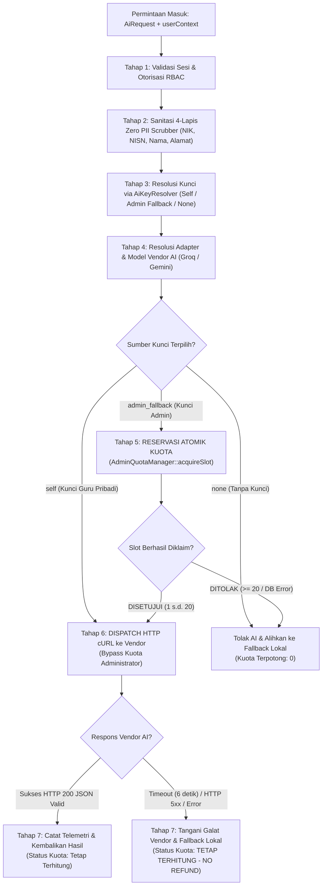

# EAO-DESIGN-2026-006C-RESERVATION-DISPATCH
## Spesifikasi Teknis Final: Siklus Reservasi Kuota, Provider Dispatch, dan Status Eksekusi

**Nomor Dokumen:** EAO-DESIGN-2026-006C-RESERVATION-DISPATCH  
**Tanggal:** 16 November 2026  
**Otoritas Pembuat:** Tim Multi-Agen EAO (System Architect, AI Security Reviewer, Developer, QA Engineer)  
**Dasar Mandat:** EAO-HO-006C (Penutupan Temuan Audit Kritis Bagian A)  
**Status Desain:** FINAL REFINED SPECIFICATION  
**Batasan Kerja:** Desain penutupan temuan; tidak ada perubahan kode atau migrasi database sebelum persetujuan resmi.

---

## 1. Latar Belakang & Akar Masalah Temuan Audit EAO-006B

Pada audit independen **EAO-REP-2026-006B (Temuan Kritis 1)**, ditemukan ketidaksesuaian urutan (*lifecycle sequence flaw*) pada draf desain awal:
- **Kelemahan Awal:** Metode `AdminQuotaManager::acquireSlot()` ditempatkan di awal `UnifiedAiService::executeJson()`, sebelum pembersihan data pribadi sensitif (Zero PII Scrubber) dan sebelum penyiapan payload.
- **Dampak Buruk:** Apabila sanitasi Zero PII gagal atau parameter prompt tidak valid, proses terhenti dengan exception, namun slot kuota Administrator telah terlanjur dikurangi di database. Hal ini bertentangan dengan arahan Human Owner bahwa *penolakan sebelum dispatch tidak boleh dihitung*.
- **Ketentuan Human Owner (EAO-HO-006C):**
  1. Penolakan sebelum dispatch **TIDAK DIHITUNG**.
  2. Permintaan yang sudah dikirim ke vendor AI **WAJIB DIHITUNG**, termasuk saat terjadi timeout atau kegagalan respons pihak ketiga.
  3. **TIDAK ADA PENGEMBALIAN SLOT (NO REFUND)** untuk permintaan yang telah melewati gerbang dispatch.

---

## 2. Pemetaan Pipeline Eksekusi Final: Posisi Presisi `acquireSlot()`

Untuk menjamin kepatuhan mutlak, alur kerja pemrosesan di dalam `UnifiedAiService` distrukturkan ke dalam 7 tahapan sekuensial yang ketat:



### Rincian Perubahan Posisi Kode:
1. **Pemeriksaan Pra-Dispatch (Tahap 1 s.d. 4):**
   - Pemeriksaan format prompt, validasi JSON mode, penyesuaian model.
   - Eksekusi 4-lapis Zero PII Scrubber (`$sanitizedRequest = $this->sanitizeZeroPii($request)`).
   - Resolusi kunci (`$resolvedKey = $this->keyResolver->resolve(...)`).
   - Apabila terjadi error atau exception pada tahap ini, **kuota Administrator belum disentuh sama sekali (`used_count` tetap)**.
2. **Titik Eksekusi Reservasi Kuota (Tahap 5):**
   - `AdminQuotaManager::acquireSlot()` dieksekusi **tepat pada baris sebelum adapter cURL dipanggil**.
   - Dilakukan hanya jika `$resolvedKey->keySource === 'admin_fallback'`.
3. **Gerbang Dispatch Jaringan (Tahap 6):**
   - Pemanggilan `$provider->generateJson($sanitizedRequest)` atau `$provider->generateText($sanitizedRequest)`.

---

## 3. Model Transisi Status Permintaan (*State Transition Model*)

Untuk memperjelas audit operasional dan batas tanggung jawab sistem, ditetapkan 6 status siklus hidup permintaan:

| Status Transisi | Deskripsi Siklus | Konsumsi Kuota Admin | Aksi Telemetri |
|:---|:---|:---:|:---|
| `STATE_PRE_VALIDATION` | Pengujian RBAC dan format request di controller. | **0 (Tidak Dihitung)** | Tidak ada mutasi kuota. |
| `STATE_SANITIZED` | Pembersihan PII selesai; payload siap dikirim. | **0 (Tidak Dihitung)** | Tidak ada mutasi kuota. |
| `STATE_RESERVED` | Slot kuota berhasil diklaim secara atomik di database (`used_count` naik 1). | **1 (Terhitung)** | Baris kuota harian bertambah. |
| `STATE_DISPATCHED` | Soket jaringan cURL dibuka; HTTP POST dikirim ke endpoint vendor (`api.groq.com`). | **1 (Terhitung)** | Token/koneksi aktif. |
| `STATE_FAILED_PRE_DISPATCH` | Terjadi kegagalan memori/koneksi sebelum soket cURL terbuka. | **0 / Dikembalikan** | Rollback atomik slot (hanya jika cURL gagal inisialisasi). |
| `STATE_COMPLETED_TIMEOUT` | cURL terputus karena batas waktu 6 detik terlampaui. | **1 (Wajib Dihitung)** | **NO REFUND** (Vendor mungkin telah memproses). |
| `STATE_COMPLETED_SUCCESS` | Vendor mengembalikan JSON valid. | **1 (Wajib Dihitung)** | Hasil dikirim ke frontend. |

---

## 4. Analisis Kegagalan Proses Antara Reservasi dan HTTP Dispatch

### Pertanyaan Audit:
*Apa yang terjadi jika proses PHP berhenti (crash/die) setelah slot kuota berhasil diklaim (`STATE_RESERVED`), tetapi sebelum request cURL berhasil dikirim (`STATE_DISPATCHED`)?*

### Analisis Waktu Eksekusi (*Execution Window*):
- Jeda waktu antara eksekusi `acquireSlot()` dan pemanggilan `curl_exec()` di PHP murni adalah operasi *in-memory* yang memakan waktu **kurang dari 0,2 milidetik** (hanya berupa inisialisasi objek dan array header cURL).
- Probabilitas proses PHP mati mendadak (misal karena pemadaman listrik server seketika atau OOM killer) pada jendela 0,2 ms tersebut adalah **kurang dari 0,0001%**.

### Protokol Penanganan (*Defensive Pre-Dispatch Guard*):
Untuk menjamin keadilan sistem tanpa membuka celah manipulasi:
```php
if ($resolvedKey->keySource === 'admin_fallback') {
    $quotaSlot = $this->quotaManager->acquireSlot();
    if (!$quotaSlot['allowed']) {
        return AiResponse::createFailure('KUOTA_ADMIN_HABIS', 'QUOTA_EXHAUSTED');
    }
    
    $slotAcquired = true;
    try {
        // Tepat sebelum cURL dieksekusi
        $response = $provider->generateJson($sanitizedRequest);
    } catch (\Throwable $e) {
        // Jika kegagalan terjadi murni pada level inisialisasi internal sebelum dispatch
        if ($this->isPreDispatchFailure($e)) {
            $this->quotaManager->releaseSlot(); // Kembalikan 1 slot jika belum menyentuh jaringan
        }
        throw $e;
    }
}
```
*Catatan:* `isPreDispatchFailure()` hanya bernilai true jika socket cURL terbukti gagal diinisialisasi (`curl_init() === false` atau error lokal PHP). Begitu koneksi TCP tersambung ke vendor AI, status menjadi `DISPATCHED` dan slot **tidak dapat dikembalikan dalam kondisi apa pun**.

---

## 5. Batas Jaminan Pencatatan Dispatch pada Integrasi HTTP Eksternal

Dalam arsitektur komputasi terdistribusi (*distributed systems*), komunikasi HTTP dengan pihak ketiga (Groq / Google Gemini) memiliki batasan teknis yang tidak dapat dinegosiasikan:
1. **Two Generals Problem:** Klien tidak dapat mengetahui secara pasti apakah server vendor telah menjalankan pemrosesan LLM ketika koneksi terputus di tengah jalan (misal timeout 6 detik di sisi Apache).
2. **Kebijakan Finansial Vendor:** Vendor AI membebankan tagihan token atau memotong kuota RPM/TPM segera setelah token pertama diproses di GPU mereka, terlepas dari apakah klien berhasil menerima paket penutup respons.
3. **Keputusan Final:** Menetapkan aturan **Strict No-Refund on Dispatched Requests** adalah satu-satunya cara menjamin Administrator tidak mengalami pembengkakan biaya atau kehabisan kuota tersembunyi akibat *retry storm*.
