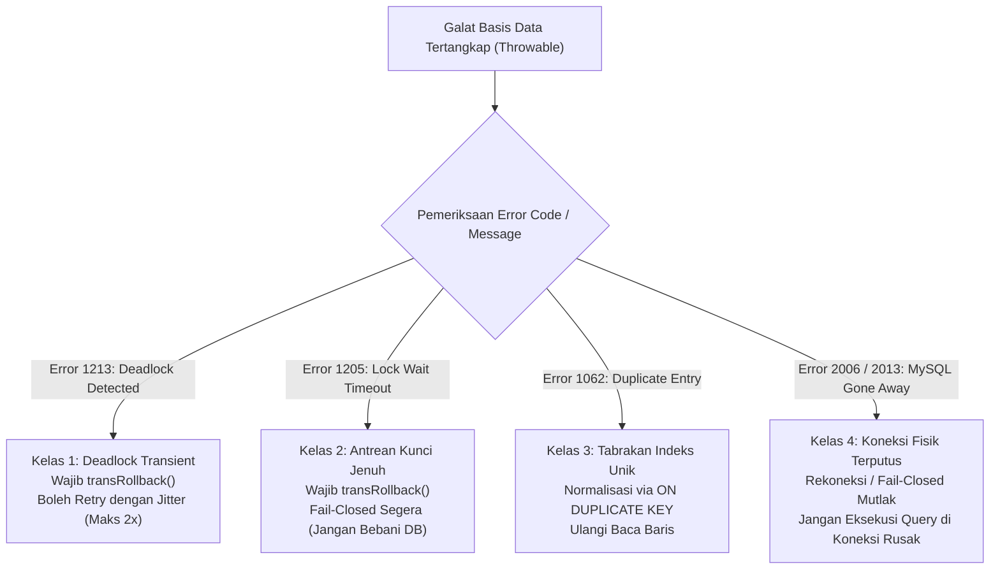

# EAO-DESIGN-2026-006D-DATABASE-RELIABILITY
## Spesifikasi Arsitektur Tingkat Lanjut: Keandalan Basis Data InnoDB, Penanganan Konkurensi Ekstrem, dan Mitigasi Deadlock

**Nomor Dokumen:** EAO-DESIGN-2026-006D-DATABASE-RELIABILITY  
**Tanggal:** 16 November 2026  
**Otoritas Pembuat:** Tim Multi-Agen EAO (System Architect, AI Security Reviewer, Developer, QA Engineer)  
**Dasar Mandat:** EAO-HO-006D (Targeted Design Validation — Butir 4)  
**Status Dokumen:** FINAL ARCHITECTURE SPECIFICATION  
**Batasan Kerja:** Desain arsitektur murni; read-only terhadap kode dan database; tidak ada modifikasi kode sebelum izin tertulis Human Owner.

---

## 1. Analisis Kritis Skema Basis Data `ai_admin_quota_daily`

Tabel `ai_admin_quota_daily` adalah komponen sentral penegak batas finansial dan kuota penggunaan API Key Administrator (maksimal 20 generasi per hari kalender Asia/Jakarta).

### 1.1 Persyaratan Mutlak Storage Engine: InnoDB
Pada lingkungan shared hosting yang heterogen (MySQL 8.x / MariaDB 10.x), pengaturan server dapat memiliki default `default_storage_engine = MyISAM`.
- **Bahaya MyISAM:** MyISAM hanya mendukung penguncian tingkat tabel (*table-level locking*), tidak mendukung transaksi ACID, dan tidak memiliki *row-level locking*. Pemanggilan simultan pada MyISAM akan menyebabkan antrean blokir global yang lambat dan rawan *race condition*.
- **Ketetapan Arsitektur:** Berkas migrasi CodeIgniter 4 WAJIB menyertakan atribut eksplisit:
  ```php
  $attributes = [
      'ENGINE'  => 'InnoDB',
      'CHARSET' => 'utf8mb4',
      'COLLATE' => 'utf8mb4_unicode_ci',
  ];
  $this->forge->createTable('ai_admin_quota_daily', true, $attributes);
  ```

### 1.2 Peran Kunci Unik pada Kolom `quota_date`
Kolom `quota_date` bertipe `DATE` dideklarasikan sebagai **UNIQUE KEY** (`$this->forge->addUniqueKey('quota_date')`).  
Tujuan matematis:
1. Menjamin secara fisik di tingkat storage engine bahwa dalam 1 hari kalender **hanya boleh ada tepat 1 baris record**.
2. Memungkinkan pemanfaatan klausa *atomic upsert* (`INSERT ... ON DUPLICATE KEY UPDATE`) yang mengeliminasi pembacaan ganda.

---

## 2. Evaluasi Strategi Inisialisasi Tanggal Baru (Pergantian Hari 00:00:01 WIB)

Pada saat pergantian hari, baris tanggal baru belum tersedia di basis data. Jika beberapa guru mengirimkan prompt secara serentak pada detik pertama hari baru, sistem harus menginisialisasi baris tersebut tanpa terjadi duplikasi atau tabrakan kunci.

### 2.1 Perbandingan Komparatif 4 Pendekatan:

| Pendekatan | Mekanika Query | Kelebihan | Risiko / Kekurangan pada Konkurensi Tinggi |
|:---|:---|:---|:---|
| **Opsi 1: SELECT FOR UPDATE lalu INSERT** | Cek keberadaan baris dengan pesimistic lock, jika null lakukan `INSERT`. | Logika terlihat intuitif. | **SANGAT BURUK:** Memicu *Gap Lock* pada rentang indeks kosong, berpotensi memicu Deadlock (1213) jika 2 proses membaca null bersamaan. |
| **Opsi 2: Cron Job Malam (Pre-generation)** | Script cron terjadwal membuat baris jam 23:59 untuk esok hari. | Tidak ada overhead query di aplikasi web. | **RAPUH PADA SHARED HOSTING:** Jika cron cPanel gagal berjalan atau server restart, seluruh sistem AI lumpuh esok hari karena baris tidak ada. |
| **Opsi 3: INSERT IGNORE lalu UPDATE** | `INSERT IGNORE INTO ... VALUES (...)`, abaikan error 1062, lalu `UPDATE`. | Tidak melempar fatal exception. | Rentan silent failure; penanganan auto-increment ID melompat liar di beberapa versi MariaDB. |
| **Opsi 4: Atomic Lazy Upsert (Terpilih)** | `INSERT ... ON DUPLICATE KEY UPDATE id=id` | **Unggul Mutlak:** Atomik, independen terhadap cron, tidak memerlukan transaksi panjang, aman pada row-level lock. | Memerlukan *defensive retry* jika terjadi persaingan gap lock sesaat pada mikrodetik awal pembuatan baris. |

---

## 3. Analisis Mendalam 4 Kelas Kesalahan Basis Data (Database Error Classes)

Untuk membangun sistem yang tangguh (*bulletproof*), metode `AdminQuotaManager::acquireSlot()` membedakan karakteristik 4 kelas galat basis data:



### 3.1 Kelas 1: Deadlock (MySQL Error 1213 — `40001: Deadlock found when trying to get lock`)
- **Penyebab:** Dua transaksi konkuren saling memegang dan meminta kunci baris/indeks secara menyilang.
- **Karakteristik:** Bersifat sementara (*transient*). Mesin InnoDB secara otomatis mengorbankan (*rollback*) salah satu transaksi.
- **Penanganan:** Transaksi PHP wajib di-*rollback* secara bersih, diberi jeda waktu acak (*random jitter backoff* 20–50 ms), lalu diulang (*retry*).

### 3.2 Kelas 2: Lock Wait Timeout (MySQL Error 1205 — `HY000: Lock wait timeout exceeded`)
- **Penyebab:** Transaksi menunggu pembebasan kunci baris melebihi ambang batas `innodb_lock_wait_timeout` (standar 50 detik).
- **Karakteristik:** Menandakan server basis data sedang mengalami saturasi ekstrem atau ada transaksi lain yang menggantung (*hanging transaction*).
- **Penanganan:** **TIDAK BOLEH DI-RETRY.** Melakukan retry saat timeout terjadi hanya akan memperparah kelebihan beban (*thundering herd*). Segera ambil jalur **Fail-Closed**.

### 3.3 Kelas 3: Duplicate Entry (MySQL Error 1062 — `23000: Duplicate entry for key 'quota_date'`)
- **Penyebab:** Terjadi ketika `INSERT` tanpa klausa penanganan konflik mencoba memasukkan tanggal yang sudah ada.
- **Penanganan:** Dieliminasi secara struktural menggunakan klausa `ON DUPLICATE KEY UPDATE id=id`.

### 3.4 Kelas 4: Connection Lost / Server Gone Away (MySQL Error 2006 / 2013)
- **Penyebab:** Koneksi TCP ke MySQL terputus karena batas `wait_timeout` tercapai, paket data melebihi `max_allowed_packet`, atau server MySQL me-restart.
- **Penanganan:** Driver basis data tidak boleh dipaksa mengeksekusi query lanjutan pada koneksi yang telah mati. Segera ambil sikap **Fail-Closed**.

---

## 4. Keharusan Transaksi Bersih: Mengapa Wajib Rollback Sebelum Retry?

Dalam pengembangan CodeIgniter 4 / PHP:
```php
// CONTOH KESALAHAN FATAL PADA PENANGANAN DEADLOCK
try {
    $this->db->transStart();
    $this->db->query("...");
    $this->db->transComplete();
} catch (\Throwable $e) {
    if (str_contains($e->getMessage(), '1213')) {
        // SALAH BESAR: Langsung retry tanpa rollback!
        $this->db->query("..."); // Memicu: "Active transaction already exists" / "Commands out of sync"
    }
}
```

### Penjelasan Arsitektur:
1. Meskipun InnoDB di server MySQL telah membatalkan transaksi yang menjadi korban deadlock, status resource koneksi pada driver PHP (PDO / MySQLi) dan layer abstraksi CodeIgniter 4 (`$this->db->transDepth`) **masih mencatat bahwa transaksi berada dalam status aktif dan gagal**.
2. Jika proses PHP langsung mengeksekusi query baru tanpa memanggil `$this->db->transRollback()`, koneksi berada dalam status korup (*unclean transaction state*).
3. **Kaidah Baku EAO:** Setiap kali transaksi menangkap galat sebelum retry, sistem **WAJIB memanggil `$this->db->transRollback()`** untuk mereset kedalaman transaksi (`transDepth = 0`) dan mengembalikan resource koneksi ke kondisi netral (*clean state*).

---

## 5. Analisis Kegagalan Naive 2-Retry Loop

Desain awal mengasumsikan bahwa perulangan 2 kali (*2-attempt loop*) sudah cukup menjamin nol kegagalan deadlock. Audit teknis EAO membantah asumsi tersebut.

### 5.1 Teorema Kegagalan Probabilistik
- Misalkan probabilitas terjadinya deadlock pada saat perebutan baris adalah $p$ (misal $p = 0.05$ pada beban tinggi).
- Pada percobaan pertama ($k=1$), kemungkinan gagal adalah $p$.
- Pada percobaan kedua ($k=2$), jika jeda waktu bersifat tetap (*fixed delay*), kedua proses yang bertabrakan akan terbangun pada saat yang sama dan berpotensi bertabrakan kembali (*re-collision*). Kemungkinan gagal pada percobaan kedua adalah $p_2 \approx p$.
- Probabilitas kegagalan gabungan adalah $P(\text{fail}) = p \times p_2 > 0$.
- **Kesimpulan Ilmiah:** Perulangan 2 kali **TIDAK PERNAH MENJAMIN SECARA MATEMATIS NOL DEADLOCK**. Loop retry hanya menurunkan frekuensi kegagalan, bukan menghilangkannya hingga 0.

### 5.2 Strategi Mitigasi Superior: Exponential Backoff dengan Full Jitter
Untuk meminimalkan tabrakan ulang (*re-collision*), jeda waktu sebelum retry kedua wajib menggunakan algoritma acak (*Full Jitter*):
$$\text{sleep\_time} = \text{random}(15000, 45000) \text{ mikrodetik (15 s.d. 45 ms)}$$
Pemberian variasi waktu acak memastikan proses-proses yang bersaing tidak bangun pada mikrodetik yang sama.

---

## 6. Prinsip Pertahanan Mutlak: Fail-Closed Policy

Apa yang terjadi jika seluruh percobaan retry tetap gagal akibat saturasi server yang parah?

### 6.1 Ketetapan Kebijakan Fail-Closed:
1. **Dilarang Keras Melepaskan Kuota Tanpa Izin:** Jika database tidak dapat mengonfirmasi penambahan counter kuota, sistem **DILARANG MENGANGGAP KUOTA TERSEDIA**.
2. **Penyelamatan Keuangan Sekolah:** Anggap kuota tidak dapat digunakan (`allowed = false`, `reason = 'DB_ERROR'`).
3. **Pengalihan Mulus ke Fallback Lokal:** Permintaan pengguna secara otomatis dialihkan ke template jawaban lokal berbasis aturan non-AI. Pengguna tetap mendapatkan panduan tanpa mengetahui adanya kegagalan di latar belakang.
4. **Pencatatan Telemetri Peringatan:** Sistem mencatat log tingkat *CRITICAL* ke berkas log CI4 agar administrator server dapat memeriksa kesehatan database.

---

## 7. Kode Referensi Final `AdminQuotaManager::acquireSlot()`

Berikut rancangan kode yang telah memenuhi seluruh standar keandalan basis data di atas:

```php
namespace App\Services\Ai;

use CodeIgniter\Database\BaseConnection;

class AdminQuotaManager
{
    private const DAILY_LIMIT = 20;
    private const TIMEZONE    = 'Asia/Jakarta';
    private ?BaseConnection $db;

    public function __construct(?BaseConnection $db = null)
    {
        $this->db = $db ?? \Config\Database::connect();
    }

    public function acquireSlot(): array
    {
        $tz = new \DateTimeZone(self::TIMEZONE);
        $today = (new \DateTime('now', $tz))->format('Y-m-d');

        if (!$this->db) {
            return ['allowed' => false, 'reason' => 'DB_UNAVAILABLE'];
        }

        $maxAttempts = 2;
        $attempt = 0;

        while ($attempt < $maxAttempts) {
            $attempt++;
            
            // Buka transaksi manual untuk row-level isolation
            $this->db->transBegin();

            try {
                // 1. Inisialisasi baris secara atomik jika belum ada
                $this->db->query("
                    INSERT INTO ai_admin_quota_daily (quota_date, used_count, created_at, updated_at)
                    VALUES (?, 0, NOW(), NOW())
                    ON DUPLICATE KEY UPDATE id = id
                ", [$today]);

                // 2. Pemesanan slot bersyarat (Row-Level Lock)
                $this->db->query("
                    UPDATE ai_admin_quota_daily
                    SET used_count = used_count + 1,
                        updated_at = NOW()
                    WHERE quota_date = ?
                      AND used_count < ?
                ", [$today, self::DAILY_LIMIT]);

                $affected = $this->db->affectedRows();

                // 3. Baca nilai mutakhir
                $query = $this->db->query("
                    SELECT used_count 
                    FROM ai_admin_quota_daily 
                    WHERE quota_date = ? 
                    LIMIT 1
                ", [$today]);
                $row = $query->getRowArray();
                $currentUsed = (int) ($row['used_count'] ?? self::DAILY_LIMIT);

                // Commit transaksi
                $this->db->transCommit();

                if ($affected > 0) {
                    return [
                        'allowed'    => true,
                        'used_count' => $currentUsed,
                        'limit'      => self::DAILY_LIMIT,
                        'resets_at'  => $today . ' 23:59:59 WIB',
                    ];
                }

                // Kuota telah penuh (>= 20)
                return [
                    'allowed'    => false,
                    'used_count' => $currentUsed,
                    'limit'      => self::DAILY_LIMIT,
                    'reason'     => 'QUOTA_EXHAUSTED',
                    'resets_at'  => $today . ' 23:59:59 WIB',
                ];

            } catch (\Throwable $e) {
                // WAJIB ROLLBACK SEBELUM MEMUTUSKAN RETRY
                if ($this->db->transStatus() !== false) {
                    $this->db->transRollback();
                }

                $msg = $e->getMessage();
                $isDeadlock = str_contains($msg, '1213') || stripos($msg, 'deadlock') !== false;

                // Hanya retry jika error adalah deadlock dan masih ada sisa percobaan
                if ($attempt < $maxAttempts && $isDeadlock) {
                    // Full Jitter: jeda acak 15 s.d. 45 ms
                    usleep(random_int(15000, 45000));
                    continue;
                }

                // Kelas error lain atau retry habis -> FAIL-CLOSED
                log_message('error', sprintf(
                    '[AdminQuotaManager::acquireSlot] Gagal mengamankan kuota (Attempt %d/%d): %s',
                    $attempt,
                    $maxAttempts,
                    $msg
                ));

                return ['allowed' => false, 'reason' => 'DB_ERROR'];
            }
        }

        return ['allowed' => false, 'reason' => 'DB_ERROR'];
    }

    public function releaseSlot(): bool
    {
        $tz = new \DateTimeZone(self::TIMEZONE);
        $today = (new \DateTime('now', $tz))->format('Y-m-d');

        if (!$this->db) {
            return false;
        }

        try {
            $this->db->query("
                UPDATE ai_admin_quota_daily
                SET used_count = GREATEST(0, used_count - 1),
                    updated_at = NOW()
                WHERE quota_date = ?
                  AND used_count > 0
            ", [$today]);

            return $this->db->affectedRows() > 0;

        } catch (\Throwable $e) {
            log_message('error', '[AdminQuotaManager::releaseSlot] Gagal mengembalikan slot: ' . $e->getMessage());
            return false;
        }
    }
}
```
