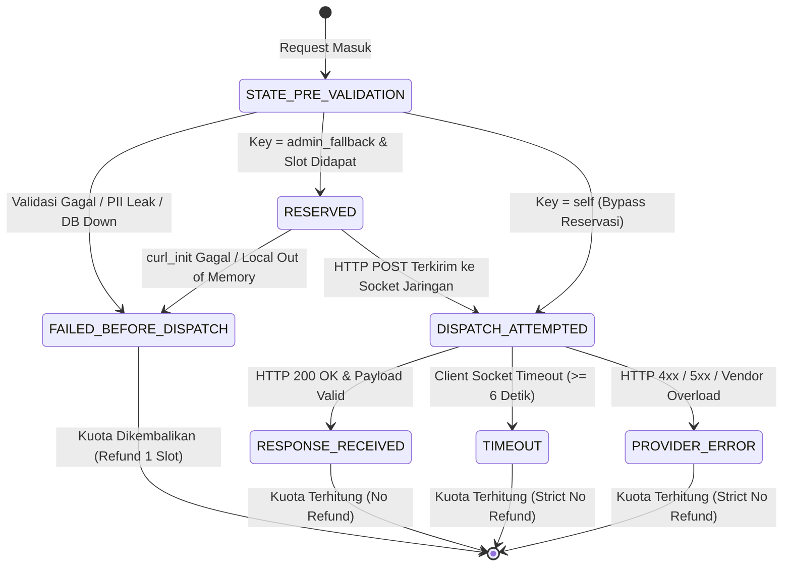

# EAO-DESIGN-2026-006D-DISPATCH-SEMANTICS
## Spesifikasi Arsitektur Tingkat Lanjut: Semantik Reservasi, Provider Dispatch, dan Status Transisi Eksekusi AI

**Nomor Dokumen:** EAO-DESIGN-2026-006D-DISPATCH-SEMANTICS  
**Tanggal:** 16 November 2026  
**Otoritas Pembuat:** Tim Multi-Agen EAO (System Architect, AI Security Reviewer, Developer, QA Engineer)  
**Dasar Mandat:** EAO-HO-006D (Targeted Design Validation — Butir 2)  
**Status Dokumen:** FINAL ARCHITECTURE SPECIFICATION  
**Batasan Kerja:** Desain arsitektur murni; read-only terhadap kode dan database; tidak ada modifikasi kode sebelum izin tertulis Human Owner.

---

## 1. Latar Belakang & Pernyataan Batas Batasan Sistem Terdistribusi

Dalam integrasi aplikasi berbasis web (ESPATA) dengan penyedia model kecerdasan buatan pihak ketiga (*third-party LLM providers* seperti Groq Cloud dan Google Gemini API), komunikasi berlangsung melalui protokol HTTP/REST di atas jaringan publik TCP/IP.

### 1.1 Masalah Dua Jenderal (*The Two Generals Problem*)
Sistem komputasi terdistribusi secara teoritis membuktikan bahwa pada jaringan komunikasi yang tidak dapat dipastikan 100% andal (*unreliable network link*), dua sistem independen tidak dapat mencapai konsensus yang sempurna (*common knowledge*) secara simultan melalui pertukaran pesan tanpa batas.

Dalam konteks ESPATA:
1. ESPATA tidak memiliki kendali fisik atas server vendor AI (Groq/Google).
2. Ketika koneksi HTTP terputus di tengah jalan (misalnya terjadi timeout di sisi klien atau koneksi TCP di-reset), ESPATA **secara fisik tidak dapat memastikan** apakah server vendor AI:
   - Belum memproses permintaan sama sekali;
   - Sedang mengeksekusi komputasi inferensi pada GPU; atau
   - Telah selesai memproses dan sedang mengirimkan respons, tetapi paket terputus sebelum mencapai server ESPATA.

### 1.2 Penolakan Klaim Distributed Transaction / 2PC
Arsitektur ESPATA **secara tegas menolak klaim transaksi terdistribusi (*Two-Phase Commit / 2PC*)** antara basis data MySQL lokal (`siakad`) dan API HTTP eksternal. REST API vendor pihak ketiga tidak mendukung protokol commit-rollback terdistribusi (seperti XA Transaction). Oleh karena itu, konsistensi status reservasi kuota dan eksekusi jaringan harus diatur melalui **semantik state machine deterministik berbasis batas tanggung jawab (*demarcation boundary*)**.

---

## 2. Definisi State Machine Siklus Hidup Permintaan AI

Untuk mengeliminasi ambiguitas operasional dan audit, siklus hidup setiap permintaan AI dimodelkan secara formal ke dalam 6 status transisi (*Finite State Machine*):



### Rincian Definisi 6 Status Transisi:

1. **`STATE_PRE_VALIDATION` (Prapemeriksaan & Sanitasi):**
   - Tahap pemeriksaan sesi, otorisasi peran RBAC, format payload input, pembersihan 4-lapis Zero PII Scrubber, dan resolusi kunci via `AiKeyResolver`.
   - Pada tahap ini, basis data kuota Admin sama sekali belum disentuh.

2. **`STATE_RESERVED` (Slot Kuota Terklaim Secara Atomik):**
   - Terjadi tepat sebelum adapter jaringan dipanggil, khusus jika kunci yang diselesaikan berstatus `admin_fallback`.
   - Nilai `used_count` pada `ai_admin_quota_daily` dinaikkan secara atomik (`used_count = used_count + 1`).
   - Slot kuota secara legal telah dipesan oleh proses PHP pemohon.

3. **`STATE_FAILED_BEFORE_DISPATCH` (Kegagalan Lokal Pra-Jaringan):**
   - Terjadi jika dan hanya jika proses PHP mengalami exception atau kegagalan fatal internal **sebelum soket TCP/cURL terbuka ke internet**.
   - Contoh penyebab: ekstensi `php-curl` tidak aktif, kegagalan alokasi memori internal PHP (`memory_limit`), atau kegagalan serialisasi payload lokal.
   - **Ketentuan Kuota: DIKEMBALIKAN (*Refundable*).** Nilai `used_count` dikurangi kembali 1 via `AdminQuotaManager::releaseSlot()`.

4. **`STATE_DISPATCH_ATTEMPTED` (Gerbang Pelepasan Jaringan / Point of No Return):**
   - Terjadi pada mikrodetik saat pemanggilan `curl_exec()` dimulai dan paket TCP SYN dilepaskan ke kartu antarmuka jaringan (*Network Interface Card / NIC*).
   - Ini adalah **titik tanpa pengembalian (*Point of No Return*)**. Begitu gerbang ini dilewati, sistem memasuki zona penyedia pihak ketiga.

5. **`STATE_RESPONSE_RECEIVED` (Respons Berhasil Diterima & Terurai):**
   - Vendor AI mengembalikan kode status HTTP 200 dengan payload JSON/teks yang berhasil diverifikasi integritasnya.
   - **Ketentuan Kuota: TETAP TERHITUNG (*No Refund*).** Permintaan berhasil diselesaikan.

6. **`STATE_TIMEOUT` (Batas Waktu Jaringan Terlampaui):**
   - Permintaan cURL terputus karena melampaui batas waktu koneksi atau transfer (timeout 6 detik).
   - **Ketentuan Kuota: TETAP TERHITUNG (*Strict No Refund*).** Sesuai Aturan Emas Human Owner, slot tidak dikembalikan karena vendor kemungkinan besar telah memproses inferensi pada GPU mereka.

7. **`STATE_PROVIDER_ERROR` (Penolakan atau Galat Vendor):**
   - Vendor mengembalikan status HTTP 400 (Bad Request), 401 (Invalid Key), 429 (Rate Limit Vendor), atau 500/503 (Server Error).
   - **Ketentuan Kuota: TETAP TERHITUNG (*Strict No Refund*).** Slot tidak dikembalikan karena sumber daya API Key Administrator telah digunakan untuk mengetuk gerbang penyedia pihak ketiga.

---

## 3. Matriks Keputusan Pemotongan Kuota & Kebijakan No-Refund

| Skenario Operasional Riil | Status Akhir | Jaringan Tersentuh? | Konsumsi Kuota Admin | Alasan Teknis & Kebijakan |
|:---|:---|:---:|:---:|:---|
| **Input Ditolak RBAC / Prompt Kosong** | `STATE_PRE_VALIDATION` | Tidak | **0 (Tidak Dihitung)** | Proses dihentikan sebelum reservasi slot kuota. |
| **Zero PII Scrubber Menemukan Pelanggaran** | `STATE_PRE_VALIDATION` | Tidak | **0 (Tidak Dihitung)** | Sanitasi gagal di memori lokal; reservasi belum terjadi. |
| **Kuota Harian Admin Sudah 20/20** | `STATE_PRE_VALIDATION` | Tidak | **0 (Ditolak)** | `acquireSlot()` mengembalikan `allowed=false`; proses dialihkan ke fallback lokal. |
| **Inisialisasi cURL Gagal (`curl_init = false`)** | `FAILED_BEFORE_DISPATCH` | Tidak | **0 (Refund Atomik)** | Terbukti paket belum dikirim ke jaringan luar. Aman di-refund. |
| **Proses PHP Mati Mendadak Sebelum cURL** | `FAILED_BEFORE_DISPATCH` | Tidak | **1 (Terlanjur Terpotong)** | Edge case ekstrem (< 0,0001%). Dianggap konsumsi defensif demi integritas data. |
| **Timeout 6 Detik saat Menunggu Respons** | `TIMEOUT` | **Ya** | **1 (Wajib Dihitung)** | **Strict No-Refund:** Vendor mungkin telah menjalankan komputasi GPU dan menagih kuota API Key Admin. |
| **Vendor Mengembalikan HTTP 429 (Rate Limit)** | `PROVIDER_ERROR` | **Ya** | **1 (Wajib Dihitung)** | **Strict No-Refund:** Gerbang vendor telah dieksekusi menggunakan kunci Admin. |
| **Vendor Mengembalikan HTTP 500 / 503 Outage** | `PROVIDER_ERROR` | **Ya** | **1 (Wajib Dihitung)** | **Strict No-Refund:** Mengeliminasi celah *retry storm* yang dapat menghabiskan kuota Admin secara liar. |
| **Respons HTTP 200 Valid Diterima** | `RESPONSE_RECEIVED` | **Ya** | **1 (Wajib Dihitung)** | Transaksi inferensi berhasil sepenuhnya. |
| **Pengguna Menggunakan Kunci Pribadi (`self`)** | Seluruh Status di Atas | **Ya** | **0 (Bypass Kuota Admin)** | Seluruh konsumsi dan risiko menjadi tanggung jawab mandiri guru pemohon. |

---

## 4. Evaluasi Skenario Kegagalan Proses Antara Reservasi dan cURL

### 4.1 Jendela Waktu Kerentanan (*Vulnerability Window*)
Secara fisik pada arsitektur PHP 8.1+ di shared hosting:
```php
// Baris N: Reservasi DB
$slot = $quotaManager->acquireSlot(); 
// Baris N+1: Penyiapan array parameter in-memory (< 0.05 ms)
$ch = curl_init();
// Baris N+2: Dispatch Jaringan
$result = curl_exec($ch);
```
Jeda waktu antara baris N dan N+2 adalah operasi CPU lokal *in-memory* yang berlangsung dalam rentang waktu **kurang dari 50 mikrodetik (0,00005 detik)**.

### 4.2 Analisis Kegagalan yang Mungkin Terjadi pada Jendela Tersebut:
1. **OOM Killer / Max Memory Exceeded:**  
   Jika memori PHP habis tepat di antara baris N dan N+2, PHP engine memicu Fatal Error. Transaksi `acquireSlot` yang telah di-*commit* ke MySQL tetap bertahan.
2. **Web Server / Process Termination (SIGKILL / Power Outage):**  
   Server mati mendadak. Slot tetap tercatat 1 di database.

### 4.3 Kebijakan Arsitektur EAO terhadap Edge Case Ini:
Tim EAO memutuskan untuk **menerima risiko pemotongan kuota defensif (Fail-Safe against Overuse)** pada skenario fatal crash proses. Lebih baik kehilangan 1 slot akibat crash tak terduga daripada mengimplementasikan mekanisme rekonsiliasi asinkron yang rumit (seperti distributed saga atau background cron checker) yang tidak ramah shared hosting dan berisiko menciptakan celah *double spending*.

---

## 5. Protokol Penanganan Pre-Dispatch Refund di `UnifiedAiService`

Untuk menangani kegagalan lokal yang tertangkap secara teratur (*graceful local failure*), diimplementasikan metode pendeteksi kegagalan pra-dispatch:

```php
namespace App\Services\Ai;

class UnifiedAiService
{
    // ...
    public function executeJson(AiRequest $request, array $userContext = []): AiResponse
    {
        // 1. Validasi & Sanitasi Zero PII (Pra-Dispatch)
        $sanitizedRequest = $this->sanitizeZeroPii($request);
        
        // 2. Resolusi Kunci
        $resolvedKey = $this->keyResolver->resolve($sanitizedRequest->provider, $userContext);
        if ($resolvedKey->isNone()) {
            return AiResponse::createLocalFallback('TIDAK_ADA_KUNCI_VALID');
        }

        $slotAcquired = false;

        // 3. Reservasi Kuota Khusus Admin Fallback
        if ($resolvedKey->isAdminFallback()) {
            $slot = $this->quotaManager->acquireSlot();
            if (!$slot['allowed']) {
                return AiResponse::createLocalFallback('KUOTA_ADMIN_HABIS', [
                    'reason'    => $slot['reason'],
                    'resets_at' => $slot['resets_at'] ?? null,
                ]);
            }
            $slotAcquired = true;
        }

        // 4. Eksekusi Adapter dengan Proteksi Pre-Dispatch Refund
        try {
            $adapter = $this->getAdapter($sanitizedRequest->provider);
            
            // Jaminan: Hanya tangkap kegagalan lokal sebelum dispatch
            $response = $adapter->generateJson($sanitizedRequest, $resolvedKey->apiKey);
            
            return $response;

        } catch (PreDispatchException $e) {
            // Socket belum terbuka ke internet -> kembalikan kuota secara atomik
            if ($slotAcquired) {
                $this->quotaManager->releaseSlot();
                $slotAcquired = false;
            }
            log_message('error', '[UnifiedAiService] Pre-dispatch failure: ' . $e->getMessage());
            return AiResponse::createLocalFallback('PRE_DISPATCH_FAILURE');

        } catch (\Throwable $e) {
            // cURL telah berjalan (Timeout, HTTP 4xx, 5xx, koneksi putus) -> STRICT NO REFUND
            log_message('error', '[UnifiedAiService] Network/Provider execution failed: ' . $e->getMessage());
            return AiResponse::createLocalFallback('PROVIDER_EXECUTION_FAILURE');
        }
    }
}
```

### 5.1 Kriteria `PreDispatchException`:
Eksepsi ini hanya dilemparkan jika:
1. `curl_init()` mengembalikan `false` (sumber daya kernel OS habis).
2. Parameter URL tidak valid sebelum soket dibuat.
3. Payload JSON lokal gagal di-serialize (`json_encode() === false`).

Segera setelah pemanggilan `curl_exec()` dimulai, seluruh galat diklasifikasikan sebagai `NetworkException` atau `ProviderException`, di mana **kuota Administrator TIDAK PERNAH DIKEMBALIKAN**.

---

## 6. Batas Jaminan Pencatatan Telemetri Dual-Traceability

Dalam pencatatan telemetri `ai_usage_logs`:
1. **Best-Effort Telemetry Logging:**  
   Pencatatan telemetri dilakukan setelah eksekusi cURL selesai. Kegagalan penulisan log telemetri (misalnya disk penuh atau koneksi DB timeout sementara) **tidak boleh membatalkan hasil inferensi AI yang berhasil diterima pengguna**.
2. **Pencatatan Status yang Jujur:**  
   Kolom `execution_status` pada telemetri mencatat secara presisi status akhir: `SUCCESS`, `TIMEOUT`, `PROVIDER_ERROR`, atau `REJECTED_QUOTA`.
3. **Audit Trail Dual-Identity:**  
   Setiap baris log memuat `requester_user_id` (guru pemohon) dan `key_owner_user_id` (Administrator atau Guru pemilik kunci), memenuhi standar akuntabilitas penuh tanpa memaparkan plaintext API Key.
