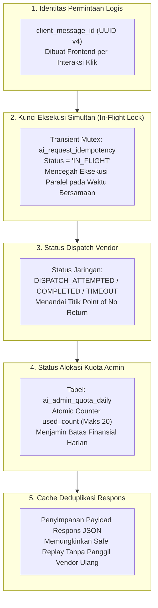

# EAO-DESIGN-2026-006D-IDEMPOTENCY-FINAL
## Spesifikasi Arsitektur Tingkat Lanjut: Evaluasi Mendalam Idempotensi Permintaan, Identitas Logis, dan In-Flight Concurrency Control

**Nomor Dokumen:** EAO-DESIGN-2026-006D-IDEMPOTENCY-FINAL  
**Tanggal:** 16 November 2026  
**Otoritas Pembuat:** Tim Multi-Agen EAO (System Architect, AI Security Reviewer, Developer, QA Engineer)  
**Dasar Mandat:** EAO-HO-006D (Targeted Design Validation — Butir 3)  
**Status Dokumen:** FINAL ARCHITECTURE SPECIFICATION  
**Batasan Kerja:** Desain arsitektur murni; read-only terhadap kode dan database; tidak ada modifikasi kode sebelum izin tertulis Human Owner.

---

## 1. Evaluasi Kritis Pola Kunci Berbasis Teks `asis_lock_{userId}_{query}`

Pada draf awal arsitektur (dokumen 006A dan 006C), diusulkan mekanisme kunci menggunakan format:
`asis_lock_` . md5($userId . '_' . mb_strtolower(trim($query)))

### 1.1 Kelemahan Konseptual Pola Berbasis Teks Query:
Audit mendalam mengidentifikasi lima kelemahan mendasar dari pendekatan berbasis hash query teks:

1. **Konflik Palsu pada Permintaan Sah (*False Conflicts / Over-Blocking*):**  
   Pengguna dapat secara sah mengajukan pertanyaan yang sama dalam sesi interaksi normal (misalnya: guru menanyakan *"Jadwal mengajar saya hari ini"* pada pukul 08:00, lalu bertanya kembali hal serupa pada pukul 08:02 untuk mengecek pembaruan). Mengunci berdasarkan teks pertanyaan memperlakukan niat baru yang sah sebagai duplikasi terlarang.
2. **Ketiadaan Pembeda Retry versus Pertanyaan Baru:**  
   Sistem backend tidak memiliki cara untuk membedakan apakah sebuah request HTTP POST adalah *pengiriman ulang* akibat jaringan putus atau *pertanyaan baru* dari pengguna yang mengetikkan kalimat serupa.
3. **Ketidakpekaan terhadap Parameter Konteks (*Context Blindness*):**  
   Dua pertanyaan dengan teks string identik tetapi diajukan dalam konteks halaman berbeda (misal di halaman Nilai Siswa A vs Nilai Siswa B) akan menghasilkan hash yang sama dan saling memblokir jika hanya membedah parameter `query`.
4. **Ketergantungan Tunggal pada File Cache Lokal:**  
   Penyimpanan state lock pada file cache (`writable/cache/`) rentan terhadap kegagalan hak akses file (*file permission*), *cache purge*, dan tidak berfungsi pada lingkungan *multi-server/cluster*.
5. **Ketidakmampuan Mengembalikan Respons Tersimpan (*No Response Replay*):**  
   Kunci berbasis hash teks murni hanya bertindak sebagai palang pintu (*gate*), tidak mampu merekam status kemajuan proses atau mengembalikan data respons bagi klien yang melakukan pengiriman ulang (*safe replay*).

---

## 2. Analisis Mendalam terhadap 7 Skenario Uji Ekstrem

Tim arsitek melakukan evaluasi ketahanan sistem terhadap 7 skenario nyata di lapangan:

### Skenario 1: Permintaan Identik Berturut-turut yang Sah
- **Kasus:** Guru mengirim prompt *"Buatkan rubrik asesmen"* untuk Kelas 7A, lalu 5 detik kemudian mengirim prompt yang sama persis *"Buatkan rubrik asesmen"* untuk Kelas 7B.
- **Kelemahan Model Lama:** Jika menggunakan `md5(userId + query)` dengan TTL 15 detik, permintaan kedua ditolak mentah-mentah dengan pesan galat *rate limited*.
- **Solusi Arsitektur Baru:** Menggunakan `client_message_id` unik (UUID v4) yang dibangkitkan oleh frontend untuk setiap penekanan tombol baru. Karena setiap klik menghasilkan UUID berbeda, kedua pertanyaan sah diproses tanpa gangguan.

### Skenario 2: Double-Click Submit dengan Payload Persis Sama
- **Kasus:** Pengguna menekan tombol "Kirim" dua kali berturut-turut dengan jeda 120 milidetik akibat mouse sensitif atau antarmuka yang lambat merespons.
- **Solusi Arsitektur Baru:**
  1. *Lapisan Frontend:* Tombol dinonaktifkan seketika (*disabled*) pada *event listener* pertama, dan satu `client_message_id` dibuat.
  2. *Lapisan Backend:* Kedua request HTTP membawa `client_message_id` yang identik. Request pertama memperoleh *in-flight lock* dan memotong kuota; request kedua mendeteksi lock aktif untuk ID yang sama dan langsung ditolak (`HTTP 429 Conflict / Already In-Flight`) tanpa mengurangi kuota tambahan.

### Skenario 3: Request Retry Otomatis oleh Frontend Setelah Timeout
- **Kasus:** Koneksi HTTP klien terputus setelah 6 detik (timeout). Frontend mencoba melakukan auto-retry mengirimkan payload yang sama dengan `client_message_id` yang sama.
- **Kondisi Backend:** Request pertama telah mencapai status `STATE_DISPATCH_ATTEMPTED` atau `STATE_TIMEOUT` di backend dan memotong 1 kuota Admin.
- **Solusi Arsitektur Baru:** Backend membaca catatan idempotensi berbasis `client_message_id`. Jika status tercatat `DISPATCH_ATTEMPTED` atau `TIMEOUT`, backend menolak alokasi kuota baru dan mengembalikan respons yang konsisten tanpa melakukan pemanggilan ulang ke vendor AI (*preventing double-spend*).

### Skenario 4: Request yang Berjalan Lebih dari 15 Detik
- **Kasus:** Model AI vendor mengalami beban tinggi sehingga pemrosesan inferensi memakan waktu 18 detik.
- **Kelemahan Model Lama:** File cache lock dengan TTL statis 15 detik akan kedaluwarsa pada detik ke-15, sementara cURL PHP masih berjalan memblokir proses. Jika pengguna melakukan retry pada detik ke-16, sistem menganggap lock telah tiada dan memproses permintaan kedua secara paralel.
- **Solusi Arsitektur Baru:** Status transisi request disimpan di basis data relasional InnoDB atau perpanjangan heart-beat lock, di mana status `IN_FLIGHT` hanya berakhir ketika koneksi cURL secara tuntas ditutup oleh handler PHP.

### Skenario 5: Lock Expired saat cURL Masih Berjalan
- **Kasus:** Client browser menutup tab (disconnect), namun skrip PHP terus berjalan di backend karena opsi default web server. Lock berumur pendek di cache terhapus.
- **Solusi Arsitektur Baru:** Implementasi status persistensi di basis data memastikan bahwa baris eksekusi tetap berstatus `IN_FLIGHT` hingga script termination handler (`register_shutdown_function`) membersihkannya, mengeliminasi celah kelemahan TTL statis.

### Skenario 6: Cache Failure / Unwriteable Cache Directory
- **Kasus:** Folder `writable/cache/` berubah permission menjadi read-only akibat script backup atau konfigurasi shared hosting yang salah.
- **Kelemahan Model Lama:** `cache()->save()` mengembalikan `false`. Sistem yang *fail-open* akan kehilangan seluruh proteksi klik ganda; sistem yang *fail-closed* akan melumpuhkan seluruh fitur AI.
- **Solusi Arsitektur Baru:** Desain idempotensi berbasis tabel database InnoDB (`ai_request_idempotency`). Karena MySQL adalah komponen vital aplikasi, proteksi idempotensi terjamin selama aplikasi dapat membaca/menulis ke database.

### Skenario 7: Multi-Server Deployment / Cluster Tanpa Shared Cache
- **Kasus:** ESPATA di-deploy pada dua web node (Node A dan Node B) di belakang Nginx/Cloudflare Load Balancer dengan basis data MySQL terpusat.
- **Kelemahan Model Lama:** File cache Node A tidak terlihat oleh Node B. Double-click yang masuk ke Node A dan Node B secara bersamaan akan memproses dua request secara simultan.
- **Solusi Arsitektur Baru:** Integrasi tabel MySQL terpusat dengan *unique constraint* pada `client_message_id` menjamin konkurensi antar-server terkelola secara atomik di level database engine.

---

## 3. Pemisahan Tegas 5 Konsep Arsitektur

Untuk menghilangkan kerancuan desain, ditetapkan pemisahan tanggung jawab (*Separation of Concerns*) ke dalam 5 lapisan independen:



### Definisi Tanggung Jawab:
1. **Logical Request Identity (`client_message_id`):** Identitas mutlak dari sebuah aksi pengguna. Tidak bergantung pada teks pertanyaan.
2. **In-Flight Execution Lock:** Penjaga konkurensi mikrodetik agar satu ID logis tidak dieksekusi oleh lebih dari satu proses PHP secara simultan.
3. **Provider Dispatch Status:** Status batas tanggung jawab jaringan luar (apakah kuota boleh di-refund atau strict no-refund).
4. **Quota Allocation Status:** Integritas counter kuota harian sekolah (maksimal 20 slot per hari WIB).
5. **Response Cache / Deduplication:** Fasilitas pengembalian respons instan jika klien mengirim ulang ID yang sama setelah sukses diproses.

---

## 4. Rancangan Skema Tabel Migrasi: `ai_request_idempotency`

Sebagai fondasi arsitektur jangka panjang dan persiapan Fase 1C yang tangguh, berikut rancangan berkas migrasi CodeIgniter 4:

```php
namespace App\Database\Migrations;

use CodeIgniter\Database\Migration;

class CreateAiRequestIdempotencyTable extends Migration
{
    public function up()
    {
        if (!$this->db->tableExists('ai_request_idempotency')) {
            $this->forge->addField([
                'id' => [
                    'type'           => 'BIGINT',
                    'constraint'     => 20,
                    'unsigned'       => true,
                    'auto_increment' => true,
                ],
                'client_message_id' => [
                    'type'       => 'VARCHAR',
                    'constraint' => 64,
                    'null'       => false,
                ],
                'user_id' => [
                    'type'       => 'INT',
                    'constraint' => 11,
                    'unsigned'   => true,
                    'null'       => false,
                ],
                'request_hash' => [
                    'type'       => 'VARCHAR',
                    'constraint' => 64,
                    'null'       => false,
                ],
                'status' => [
                    'type'       => 'ENUM',
                    'constraint' => ['IN_FLIGHT', 'COMPLETED', 'FAILED_PRE_DISPATCH', 'FAILED_PROVIDER', 'TIMEOUT'],
                    'default'    => 'IN_FLIGHT',
                ],
                'quota_deducted' => [
                    'type'       => 'TINYINT',
                    'constraint' => 1,
                    'default'    => 0,
                ],
                'response_payload' => [
                    'type' => 'TEXT',
                    'null' => true,
                ],
                'expires_at' => [
                    'type' => 'DATETIME',
                    'null' => false,
                ],
                'created_at' => [
                    'type' => 'DATETIME',
                    'null' => true,
                ],
                'updated_at' => [
                    'type' => 'DATETIME',
                    'null' => true,
                ],
            ]);

            $this->forge->addKey('id', true);
            $this->forge->addUniqueKey('client_message_id');
            $this->forge->addKey(['user_id', 'created_at']);
            $this->forge->addKey('expires_at');

            $attributes = [
                'ENGINE'  => 'InnoDB',
                'CHARSET' => 'utf8mb4',
                'COLLATE' => 'utf8mb4_unicode_ci',
            ];
            
            $this->forge->createTable('ai_request_idempotency', true, $attributes);
        }
    }

    public function down()
    {
        $this->forge->dropTable('ai_request_idempotency', true);
    }
}
```

---

## 5. Strategi Implementasi Bertahap (Fase 1C vs Masa Depan)

Untuk menjaga agar Fase 1C tetap ramping tanpa membebani sistem shared hosting dengan migrasi ganda yang belum disetujui Human Owner:

1. **Strategi Segera (Fase 1C):**
   - Menggunakan **Frontend Token Invalidation + In-Flight Cache Lock Berbasis `client_message_id`**:
     * Frontend menghasilkan UUID v4 (`client_message_id`) saat pengguna mengirim pesan.
     * Backend mengunci cache key deterministik: `asis_inflight_{userId}_{clientMessageId}` dengan TTL 30 detik (menutup batas 15 detik).
     * Jika cache gagal ditulis, sistem mengandalkan *atomic database increment* `ai_admin_quota_daily` sebagai benteng pembatas kuota mutlak.
2. **Strategi Lanjutan (Fase 2):**
   - Menjalankan migrasi `ai_request_idempotency` untuk mendukung fitur penyimpanan riwayat percakapan jangka panjang (*chat persistence*) dan *safe response replay*.
