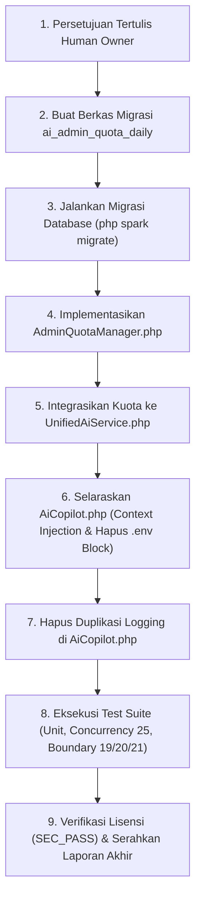

# EAO-IMPLEMENTATION-MANDATE-2026-006A
## Mandat Implementasi Teknis Fase 1C: AiCopilot Alignment, Admin Quota Manager & Dual-Traceability Integration

**Nomor Mandat:** EAO-IMPLEMENTATION-MANDATE-2026-006A  
**Tanggal:** 16 November 2026  
**Otoritas Pembuat:** Tim Multi-Agen EAO (Project Manager, System Architect, AI Security Reviewer, QA Engineer, Developer)  
**Status Dokumen:** PROPOSAL MANDAT IMPLEMENTASI — MENUNGGU PERSETUJUAN EKSEKUSI HUMAN OWNER  
**Tujuan:** Panduan operasional baku penulisan kode, migrasi database terencana, urutan eksekusi, mitigasi risiko, rencana pengujian, dan rencana rollback Fase 1C.

---

## 1. Lingkup Pekerjaan & Ketentuan Otorisasi

Mandat ini menetapkan batasan ketat bagi pengerjaan **Fase 1C**:
* **Pemberi Persetujuan:** Human Owner ESPATA.
* **Pelaksana Teknis:** Tim EAO (Developer, QA Engineer, Security Reviewer).
* **Batas Wewenang:** Belum diizinkan melakukan perubahan kode produksi atau menjalankan migrasi database sebelum persetujuan tertulis diterbitkan.

### Enam Aturan Emas Pelaksanaan:
1. **Pilihan A Resmi Diterapkan:** Kuota Administrator disimpan dalam tabel khusus `ai_admin_quota_daily` dengan batas maksimal **20 generasi/hari kalender `Asia/Jakarta`**.
2. **Kunci Pribadi Bebas Kuota:** Penggunaan API Key pribadi guru (`self`) tidak memotong kuota Administrator dan tidak dibatasi oleh kuota Administrator.
3. **Zero Cross-Teacher Fallback:** Dilarang keras menggunakan API Key milik guru lain.
4. **Proteksi Rahasia Mutlak:** Dilarang merekam API Key mentah ke dalam database, log teks, pesan exception, atau respons JSON.
5. **Kepatuhan Zona Terlindung Lisensi:** Enam berkas keamanan diawasi oleh `SecurityGuard.php` (`SEC_PASS`).
6. **Area Frozen:** Direktori `bayaran/` dan `cbtku/` tetap berstatus FROZEN.

---

## 2. Daftar Berkas yang Akan Dibuat dan Diubah

### A. Berkas Baru yang Akan Dibuat:
1. `app/Database/Migrations/2026-11-16-100000_CreateAiAdminQuotaDailyTable.php`  
   *Berkas migrasi resmi CI4 untuk membuat tabel `ai_admin_quota_daily`.*
2. `app/Services/Ai/AdminQuotaManager.php`  
   *Kelas layanan pengelola kuota harian Administrator, alokasi atomik anti-race condition, evaluasi zona waktu `Asia/Jakarta`, dan fail-closed guard.*
3. `tests/unit/AiCopilotAlignmentTest.php`  
   *Suite pengujian otomatis untuk memvalidasi alur integrasi AiCopilot, kuota batas 19/20/21, pengujian konkurensi 25 proses, dan regresi frontend.*

### B. Berkas Produksi yang Akan Dimodifikasi:
1. `app/Services/Ai/UnifiedAiService.php`  
   *Mengintegrasikan pemeriksaan kuota Administrator saat `ResolvedApiKey` berstatus `admin_fallback` sebelum cURL dikirim.*
2. `app/Controllers/Api/AiCopilot.php`  
   *Menghapus blokade `.env` pada baris 609–612, menyuntikkan `$userContext` ke `executeJson()`, mengeliminasi duplikasi logging pada baris 410, dan menyajikan pesan kuota ramah.*

---

## 3. Spesifikasi Skema Database Migrasi: `ai_admin_quota_daily`

```php
<?php

namespace App\Database\Migrations;

use CodeIgniter\Database\Migration;

class CreateAiAdminQuotaDailyTable extends Migration
{
    public function up()
    {
        if (!$this->db->tableExists('ai_admin_quota_daily')) {
            $this->forge->addField([
                'id' => [
                    'type'           => 'INT',
                    'constraint'     => 11,
                    'unsigned'       => true,
                    'auto_increment' => true,
                ],
                'quota_date' => [
                    'type' => 'DATE',
                    'null' => false,
                ],
                'used_count' => [
                    'type'       => 'INT',
                    'constraint' => 5,
                    'unsigned'   => true,
                    'default'    => 0,
                ],
                'created_at' => [
                    'type' => 'DATETIME',
                    'null' => true,
                ],
                'updated_at' => [
                    'type' => 'DATETIME',
                    'null' => true,
                ],
            ]);

            $this->forge->addKey('id', true);
            $this->forge->addUniqueKey('quota_date');
            $this->forge->createTable('ai_admin_quota_daily', true);
        }
    }

    public function down()
    {
        $this->forge->dropTable('ai_admin_quota_daily', true);
    }
}
```

---

## 4. Urutan Langkah Pelaksanaan Implementasi (Execution Sequence)

Pelaksanaan Fase 1C wajib mengikuti urutan tahapan terkontrol berikut:



1. **Tahap 1 — Database Migration:**  
   Buat dan jalankan berkas migrasi `2026-11-16-100000_CreateAiAdminQuotaDailyTable.php`. Verifikasi tabel terbentuk dengan engine InnoDB dan unique key `uq_quota_date`.
2. **Tahap 2 — Service AdminQuotaManager:**  
   Implementasikan kelas `AdminQuotaManager.php` dengan operasi lazy initialization dan alokasi atomik `UPDATE ... WHERE used_count < 20`.
3. **Tahap 3 — Integrasi Service Layer:**  
   Perbarui `UnifiedAiService.php` agar memanggil `acquireSlot()` khusus saat `keySource === 'admin_fallback'`. Pastikan `self` bypass kuota secara penuh.
4. **Tahap 4 — Penyelarasan Controller:**  
   Perbarui `AiCopilot.php`: hapus blokade kaku `.env` baris 610, suntikkan `$userContext`, hilangkan pemanggilan `$this->logInteraction()` pada cabang AI yang sukses.
5. **Tahap 5 — Pengujian Menyeluruh:**  
   Jalankan 25 skenario pengujian pada `EAO-TEST-PLAN-2026-006A-FINAL.md`. Pastikan kelulusan 100%.
6. **Tahap 6 — Audit Integritas Lisensi:**  
   Jalankan audit `SecurityGuard::verifyCriticalFiles()` $\rightarrow$ wajib `SEC_PASS`.

---

## 5. Rencana Pemulihan & Rollback (Rollback Plan)

Apabila terjadi kendala tidak terduga selama implementasi atau pengujian regresi:

1. **Rollback Kode Aplikasi:**  
   Kembalikan berkas `AiCopilot.php` dan `UnifiedAiService.php` ke commit git terakhir yang stabil menggunakan:
   ```bash
   git checkout HEAD -- app/Controllers/Api/AiCopilot.php app/Services/Ai/UnifiedAiService.php
   ```
2. **Rollback Database:**  
   Hapus tabel kuota jika diperlukan dengan migrasi rollback:
   ```bash
   php spark migrate:rollback
   ```
   Atau jika tabel baru dibuat, tabel tersebut tidak mengganggu tabel eksisting lainnya karena bersifat mandiri (*zero foreign-key collision*).
3. **Jaminan Kontinuitas Layanan:**  
   Jika integrasi kuota mengalami kendala pada produksi, sistem otomatis kembali ke mode offline lokal (*fail-closed*) sehingga pengguna tetap dapat bernavigasi tanpa crash HTTP 500.

---

## 6. Kriteria Penerimaan Akhir (Acceptance Criteria)

Implementasi Fase 1C dinyatakan selesai dan diterima apabila memenuhi 7 kriteria berikut:
- [ ] Tabel `ai_admin_quota_daily` aktif di database dengan constraint unique pada `quota_date`.
- [ ] 25 permintaan konkuren simultan diverifikasi: tepat 20 slot yang diizinkan dan 5 slot ditolak (counter akhir = 20).
- [ ] Permintaan ke-19 dan 20 menggunakan kunci Administrator disetujui; permintaan ke-21 ditolak dan beralih ke lokal.
- [ ] Guru yang memiliki kunci pribadi di tabel `teachers` dapat menggunakan AI tanpa terhambat oleh kuota Administrator yang habis.
- [ ] Kunci guru lain dipastikan **TIDAK PERNAH** terambil oleh pengguna lain (*Zero Cross-Teacher Fallback*).
- [ ] Duplikasi logging tereliminasi: setiap 1 transaksi AI menghasilkan tepat 1 baris di `ai_assistant_logs`.
- [ ] Enam berkas keamanan terlindungi berstatus **`SEC_PASS`** dan area Frozen tetap murni.

---

## 7. Status Kondisi Berhenti (Stop Condition Enforced)

Sesuai arahan Human Owner Directive **EAO-HO-006A**:
> *"Setelah seluruh dokumen selesai, berhenti. Jangan mulai implementasi meskipun tim menganggap desain telah matang. Implementasi hanya boleh dimulai setelah Human Owner memberikan persetujuan eksekusi secara eksplisit."*

Tim EAO saat ini **BERHENTI BEKERJA** dan menunggu keputusan resmi persetujuan eksekusi dari Human Owner.
