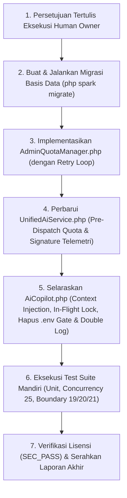

# EAO-IMPLEMENTATION-MANDATE-2026-006C
## Mandat Implementasi Teknis Final Fase 1C: AiCopilot Alignment, Admin Quota Manager & Dual-Traceability Integration

**Nomor Mandat:** EAO-IMPLEMENTATION-MANDATE-2026-006C  
**Tanggal:** 16 November 2026  
**Otoritas Pembuat:** Tim Multi-Agen EAO (Project Manager, System Architect, AI Security Reviewer, QA Engineer, Developer)  
**Status Dokumen:** FINAL PROPOSAL FOR EXECUTION APPROVAL  
**Tujuan:** Panduan operasional baku pelaksanaan implementasi Fase 1C setelah penutupan seluruh temuan audit EAO-006B.

---

## 1. Lingkup Pekerjaan & Otorisasi Pelaksanaan

Mandat ini menetapkan seluruh rincian teknis pelaksanaan **Fase 1C**:
* **Pemberi Persetujuan:** Human Owner ESPATA.
* **Pelaksana:** Tim EAO (Developer, QA Engineer, Security Reviewer).
* **Batas Wewenang:** Belum diizinkan melakukan perubahan kode produksi atau menjalankan migrasi database sebelum persetujuan tertulis diterbitkan.

### Enam Ketentuan Pokok Pelaksanaan:
1. **Dedicated Table dengan Engine InnoDB:** Kuota Administrator disimpan dalam tabel `ai_admin_quota_daily` dengan engine eksplisit InnoDB dan batas maksimal **20 generasi/hari kalender `Asia/Jakarta`**.
2. **Kunci Pribadi Bebas Kuota:** Penggunaan API Key pribadi guru (`self`) diisolasi secara penuh, tidak memotong dan tidak dibatasi kuota Administrator.
3. **Pre-Dispatch Reservation:** Kuota dipotong tepat sebelum cURL dikirim ke vendor AI, setelah Zero PII selesai. Tidak ada pengembalian slot untuk request yang telah dikirim ke vendor (termasuk timeout/error).
4. **Proteksi In-Flight Locking:** Diterapkan penguncian sementara 15 detik pada controller untuk mencegah penekanan tombol ganda (*double-click*) memotong kuota ganda.
5. **Preservasi `matched_id` & Single Logging:** Duplikasi pencatatan log pada controller dihilangkan, sementara kolom `matched_id` dan `intent` dipreservasi secara utuh melalui `UnifiedAiService::recordAuditTelemetry()`. Kolom `matched_id` tetap bebas dari metadata token/kuota.
6. **Kepatuhan Zona Terlindung & Frozen:** Enam berkas keamanan diawasi oleh `SecurityGuard.php` (`SEC_PASS`), serta direktori `bayaran/` dan `cbtku/` tetap berstatus FROZEN.

---

## 2. Daftar Berkas yang Akan Dibuat dan Dimodifikasi

### A. Berkas Baru yang Akan Dibuat:
1. `app/Database/Migrations/2026-11-16-100000_CreateAiAdminQuotaDailyTable.php`  
   *Berkas migrasi resmi CI4 untuk tabel `ai_admin_quota_daily` dengan atribut eksplisit `ENGINE => 'InnoDB'`.*
2. `app/Services/Ai/AdminQuotaManager.php`  
   *Kelas layanan pengelola kuota harian Administrator, alokasi atomik anti-race condition, defensive retry loop (20–50ms backoff), evaluasi zona waktu `Asia/Jakarta`, dan fail-closed guard.*
3. `tests/unit/AiCopilotAlignmentTest.php`  
   *Suite pengujian otomatis untuk memvalidasi alur integrasi AiCopilot, kuota batas 19/20/21, pengujian konkurensi 25 proses, dan regresi frontend.*

### B. Berkas Produksi yang Akan Dimodifikasi:
1. `app/Services/Ai/UnifiedAiService.php`  
   *Memindahkan eksekusi `acquireSlot()` tepat sebelum cURL dispatch, serta memperbarui signature `recordAuditTelemetry()` dengan parameter `$matchedId` dan `$intent`.*
2. `app/Controllers/Api/AiCopilot.php`  
   *Menghapus blokade `.env` baris 609–612, menerapkan in-flight locking 15 detik, menyuntikkan `$userContext`, mengeliminasi duplikasi logging pada baris 410, dan menyajikan pesan kuota habis yang ramah.*

---

## 3. Spesifikasi Kode Berkas Migrasi: `CreateAiAdminQuotaDailyTable.php`

```php
<?php

namespace App\Database\Migrations;

use CodeIgniter\Database\Migration;

class CreateAiAdminQuotaDailyTable extends Migration
{
    public function up()
    {
        if (!$this->db->tableExists('ai_admin_quota_daily')) {
            $this->forge->addField([
                'id' => [
                    'type'           => 'INT',
                    'constraint'     => 11,
                    'unsigned'       => true,
                    'auto_increment' => true,
                ],
                'quota_date' => [
                    'type' => 'DATE',
                    'null' => false,
                ],
                'used_count' => [
                    'type'       => 'INT',
                    'constraint' => 5,
                    'unsigned'   => true,
                    'default'    => 0,
                ],
                'created_at' => [
                    'type' => 'DATETIME',
                    'null' => true,
                ],
                'updated_at' => [
                    'type' => 'DATETIME',
                    'null' => true,
                ],
            ]);

            $this->forge->addKey('id', true);
            $this->forge->addUniqueKey('quota_date');

            // JAMINAN MUTLAK: Deklarasikan InnoDB secara eksplisit
            $attributes = [
                'ENGINE'  => 'InnoDB',
                'CHARSET' => 'utf8mb4',
                'COLLATE' => 'utf8mb4_unicode_ci',
            ];
            $this->forge->createTable('ai_admin_quota_daily', true, $attributes);
        }
    }

    public function down()
    {
        $this->forge->dropTable('ai_admin_quota_daily', true);
    }
}
```

---

## 4. Urutan Langkah Pelaksanaan Implementasi (Execution Sequence)

Pelaksanaan Fase 1C wajib mengikuti 6 tahapan terstruktur berikut:



1. **Tahap 1 — Database Migration:**  
   Buat berkas migrasi `app/Database/Migrations/2026-11-16-100000_CreateAiAdminQuotaDailyTable.php` dan jalankan via `php spark migrate`. Pastikan tabel terbentuk dengan engine InnoDB.
2. **Tahap 2 — Layanan `AdminQuotaManager`:**  
   Buat kelas `app/Services/Ai/AdminQuotaManager.php` lengkap dengan metode `acquireSlot()` (termasuk *two-attempt retry loop* dengan jeda acak 20-50ms) dan `getStatus()`.
3. **Tahap 3 — Penyesuaian `UnifiedAiService`:**  
   - Pindahkan pemesanan kuota tepat sebelum baris pemanggilan `$provider->generateText()` dan `$provider->generateJson()`.
   - Perbarui signature `recordAuditTelemetry()` agar menerima parameter `$matchedId` dan `$intent`.
4. **Tahap 4 — Penyelarasan `AiCopilot`:**  
   - Tambahkan in-flight cache locking (15 detik) berbasis `cache()->get("asis_lock_...")`.
   - Hapus baris 609–612 (pemeriksaan dini `.env`).
   - Bentuk array `$userContext` lengkap dan teruskan ke `$aiService->executeJson($aiRequest, null, $userContext)`.
   - Hapus pemanggilan duplikat `$this->logInteraction()` pada baris 410 untuk respon AI yang sukses, lalu teruskan `$matched['id']` ke telemetri service.
5. **Tahap 5 — Pengujian Otomatis Menyeluruh:**  
   Jalankan seluruh skenario pengujian unit, konkurensi 25 proses, batas 19/20/21, pergantian tanggal `Asia/Jakarta`, dan regresi frontend via runner mandiri.
6. **Tahap 6 — Verifikasi Kepatuhan Lisensi:**  
   Jalankan `SecurityGuard::verifyCriticalFiles()` $\rightarrow$ wajib bernilai `SEC_PASS`.

---

## 5. Rencana Pemulihan & Rollback (Rollback Plan)

Apabila ditemukan kendala teknis tak terduga selama masa implementasi:
1. **Rollback Kode Aplikasi:**  
   Kembalikan berkas yang dimodifikasi ke titik commit stabil:
   ```bash
   git checkout HEAD -- app/Controllers/Api/AiCopilot.php app/Services/Ai/UnifiedAiService.php
   ```
2. **Rollback Database:**  
   Jalankan perintah rollback migrasi:
   ```bash
   php spark migrate:rollback
   ```
   Tabel `ai_admin_quota_daily` akan dihapus secara bersih tanpa mempengaruhi data tabel akademik lainnya.
3. **Jaminan Kontinuitas Pengguna:**  
   Sistem secara otomatis akan tetap dapat bernavigasi menggunakan Smart Local Matcher (*zero application crash*).

---

## 6. Kriteria Penerimaan Akhir (Acceptance Criteria)

Implementasi Fase 1C dinyatakan selesai dan berhasil apabila memenuhi seluruh kriteria berikut:
- [ ] Tabel `ai_admin_quota_daily` terpasang dengan engine InnoDB dan unique constraint pada `quota_date`.
- [ ] 25 permintaan serentak terbukti menghasilkan tepat 20 slot yang disetujui dan 5 slot ditolak (counter akhir tepat 20).
- [ ] Permintaan ke-19 dan 20 menggunakan kunci Administrator disetujui; permintaan ke-21 ditolak dan dialihkan ke lokal.
- [ ] Guru yang memiliki kunci pribadi di tabel `teachers` dapat menggunakan AI tanpa dibatasi oleh kuota Administrator yang habis.
- [ ] Kunci guru lain dipastikan **TIDAK PERNAH** terambil oleh pengguna lain (*Zero Cross-Teacher Fallback*).
- [ ] Klik ganda (*double click*) dalam rentang 1 detik terblokir oleh in-flight lock dan tidak memotong 2 slot kuota.
- [ ] Duplikasi logging tereliminasi: setiap 1 transaksi AI menghasilkan tepat 1 baris di `ai_assistant_logs`.
- [ ] Kolom `matched_id` tetap menyimpan ID aksi navigasi lokal dan bebas dari metadata token/kuota.
- [ ] Enam berkas keamanan terlindungi berstatus **`SEC_PASS`** dan area Frozen tetap murni.

---

## 7. Penegakan Kondisi Berhenti (Stop Condition Enforced)

Sesuai arahan resmi Human Owner:
> *"Setelah dokumen selesai, serahkan kepada Human Owner dan berhenti. Implementasi Fase 1C hanya boleh dimulai setelah persetujuan eksekusi eksplisit dari Human Owner."*

Tim EAO saat ini **BERHENTI TOTAL** dan menunggu keputusan resmi persetujuan eksekusi dari Human Owner untuk memulai pengerjaan kode.
