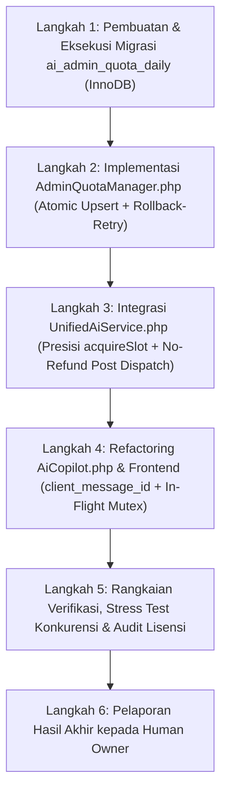

# EAO-IMPLEMENTATION-MANDATE-2026-006D
## Mandat Usulan Implementasi Fase 1C: AI Copilot Alignment, Dual-Traceability, dan Dedicated Admin Quota Management

**Nomor Dokumen:** EAO-MANDATE-2026-006D  
**Tanggal Pengajuan:** 16 November 2026  
**Status Pengajuan:** MENUNGGU PERSETUJUAN TERTULIS HUMAN OWNER (*PENDING APPROVAL*)  
**Tahap Proyek:** Fase 1C — Implementasi Inti AI Copilot & Manajemen Kuota Terpadu  
**Pelaksana Teknis:** Tim Multi-Agen EAO (Project Manager, System Architect, Developer, QA Engineer, Security Reviewer)  
**Tingkat Risiko:** Sedang — Terkendali (*Controlled Medium Risk*)

---

## 1. Latar Belakang & Tujuan Utama

Menyusul keberhasilan implementasi Fase 1B (Multi-Account Core & Groq Override) dan penyelesaian audit validasi arsitektur final (EAO-REP-2026-006D), mandat implementasi ini disusun untuk mengintegrasikan seluruh komponen arsitektur AI ke dalam modul operasional utama **Asis AI Copilot** (`app/Controllers/Api/AiCopilot.php`).

### Sasaran Utama Implementasi:
1. **Penegakan Batas Kuota Administrator (Batas Keras 20 Generasi/Hari):** Memastikan fallback API Key Administrator dikontrol secara agregat melalui tabel dedicated `ai_admin_quota_daily` ber-engine InnoDB dengan penanganan konkurensi tingkat tinggi.
2. **Kepatuhan Semantik Dispatch (Strict No-Refund Post-Dispatch):** Menjamin kuota tidak berkurang sebelum paket terkirim, namun tetap terhitung jika telah melintasi gerbang jaringan.
3. **Pemberantasan Konsumsi Ganda via In-Flight Locking:** Mencegah klik ganda dan retry storm menggunakan identitas logis `client_message_id`.
4. **Dual-Traceability Audit Logging:** Merekam jejak pemohon (`requester_user_id`) dan pemilik kunci (`key_owner_user_id`) secara terpisah di `ai_usage_logs`.
5. **Zero Regression & Protected Files Inviolability:** Menjamin seluruh 6 file lisensi tetap utuh dengan status `SEC_PASS` dan area `bayaran/` serta `cbtku/` berstatus Frozen.

---

## 2. Batasan Wewenang & Batas Area Kerja (*Boundaries & Ground Rules*)

Seluruh agen tim EAO wajib mematuhi batasan mutlak berikut selama proses implementasi:

1. **Aturan Zona Terlindung Lisensi:**
   Dilarang keras menyentuh atau memodifikasi berkas-berkas berikut:
   - `app/Helpers/license_helper.php`
   - `app/Libraries/LicenseGuard.php`
   - `app/Libraries/SecurityGuard.php`
   - `app/Libraries/SecureConfig.php`
   - `app/Filters/LicenseFilter.php`
   - `app/Models/LicenseModel.php`
   - `app/Config/.security_hash` dan `app/Config/.lic_hash`
2. **Zona Beku (*Frozen Areas*):**
   - Direktori `bayaran/` (Modul Keuangan): DILARANG DIUBAH.
   - Direktori `cbtku/` (Varian Standalone CBT): DILARANG DIUBAH.
3. **Disiplin Basis Data:**
   Perubahan skema database HANYA boleh dilakukan melalui migrasi resmi CodeIgniter 4 di `app/Database/Migrations/`. Dilarang menjalankan query DDL `ALTER TABLE` manual.
4. **Kepatuhan Shared Hosting:**
   Wajib memanggil `session_write_close()` sebelum proses eksternal/AI dan tidak boleh menggunakan daemon background persisten.

---

## 3. Daftar Berkas yang Akan Dikerjakan (*File Scope*)

### Berkas Baru yang Akan Dibuat:
1. `app/Database/Migrations/2026-11-16-100000_CreateAiAdminQuotaDailyTable.php` (Migrasi tabel kuota harian).
2. `app/Services/Ai/AdminQuotaManager.php` (Layanan reservasi atomik kuota harian dan mitigasi konkurensi).
3. `tests/unit/AdminQuotaManagerTest.php` (Pengujian unit kuota dan konkurensi).

### Berkas yang Akan Dimodifikasi:
1. `app/Services/Ai/UnifiedAiService.php` (Integrasi `AdminQuotaManager`, penempatan presisi reservasi, Zero PII, dan semantik refund pre-dispatch).
2. `app/Controllers/Api/AiCopilot.php` (Integrasi pipeline `UnifiedAiService`, in-flight lock berbasis `client_message_id`, pelepasan session lock).
3. `public/assets/js/asis-copilot.js` (atau view script terkait) (Pembangkitan UUID v4 `client_message_id` dan button state management).

---

## 4. Tahapan Rencana Kerja Implementasi (Execution Plan)

Implementasi akan dijalankan dalam 5 langkah sekuensial yang terukur:



### Rincian Langkah Kerja:

#### Langkah 1: Migrasi Basis Data `ai_admin_quota_daily`
- Membuat migrasi CI4 dengan atribut eksplisit `ENGINE => 'InnoDB'`, `CHARSET => 'utf8mb4'`.
- Menambahkan *unique key* pada kolom `quota_date`.
- Menjalankan migrasi via CLI `php spark migrate`.

#### Langkah 2: Implementasi Service `AdminQuotaManager.php`
- Menerapkan batas keras 20 per hari kalender Asia/Jakarta.
- Mengimplementasikan `acquireSlot()` dengan transaksi atomik, rollback sebelum retry pada error 1213 deadlock, dan jitter backoff (15–45ms).
- Mengimplementasikan `releaseSlot()` untuk penanganan pre-dispatch refund.
- Menerapkan kebijakan *Fail-Closed* mutlak.

#### Langkah 3: Penyelarasan `UnifiedAiService.php`
- Menempatkan pemanggilan `AdminQuotaManager::acquireSlot()` tepat sebelum adapter cURL dipanggil.
- Menjalankan 4-lapis Zero PII Scrubber sebelum kuota disentuh.
- Mengimplementasikan proteksi `PreDispatchException` (refund aman) versus Network/Provider Exception (strict no-refund).
- Merekam log telemetri dual-traceability secara konsisten.

#### Langkah 4: Penyelarasan Controller `AiCopilot.php` & Frontend
- Memastikan `session_write_close()` dipanggil di awal pemrosesan.
- Menerapkan *short-lived in-flight lock* (TTL 30s) berbasis `client_message_id` unik pengguna.
- Memperbarui frontend chat untuk membangkitkan UUID v4 `client_message_id` dan menonaktifkan tombol submit saat proses aktif.

#### Langkah 5: Pengujian Kualitas & Verifikasi Mutu (QA & Security)
- Uji sintaks PHP (`php -l`) pada seluruh file baru/termodifikasi.
- Eksekusi unit test `AdminQuotaManagerTest.php` dan `AiKeyResolverTest.php`.
- Simulasi konkurensi 25 proses paralel pada kuota batas 20.
- Uji penolakan klik ganda (double-click rejection).
- Audit integritas lisensi via `SecurityGuard::verifyCriticalFiles()` $\rightarrow$ wajib `SEC_PASS`.

---

## 5. Kriteria Penerimaan Proyek (Acceptance Criteria)

Implementasi Fase 1C dinyatakan selesai dan berhasil jika memenuhi seluruh kriteria berikut:

1. [ ] Tabel `ai_admin_quota_daily` tercipta di MySQL dengan engine InnoDB dan indeks unik pada `quota_date`.
2. [ ] Kuota penggunaan API Key Admin berhenti mengizinkan request pada tepat 20 slot berhasil per hari Asia/Jakarta.
3. [ ] Guru yang memiliki API Key pribadi (`self`) dapat terus menggunakan AI tanpa terhalang habisnya kuota Admin.
4. [ ] Penolakan akibat RBAC, format prompt salah, dan Zero PII leak terbukti **TIDAK MENGURANGI KUOTA**.
5. [ ] Kegagalan jaringan setelah cURL berjalan (timeout/error 500) terbukti **TETAP MENGURANGI KUOTA (NO REFUND)**.
6. [ ] Klik ganda dalam rentang < 1 detik tertahan oleh in-flight lock dan hanya mengonsumsi tepat 1 slot kuota.
7. [ ] Tidak ada status korup pada koneksi database saat terjadi konkurensi (transaksi bersih via rollback-before-retry).
8. [ ] Seluruh log penggunaan di `ai_usage_logs` merekam dual-traceability secara akurat.
9. [ ] `SecurityGuard::verifyCriticalFiles()` menghasilkan status `SEC_PASS`.
10. [ ] Area `bayaran/` dan `cbtku/` tetap bersih dan tidak tersentuh (Frozen).

---

## 6. Lembar Pengesahan Human Owner

Dokumen ini diserahkan kepada Pemilik Proyek (Human Owner) untuk memperoleh persetujuan tertulis sebelum pekerjaan implementasi Fase 1C dimulai.

```markdown
PILIHAN KEPUTUSAN HUMAN OWNER:

[   ] DISETUJUI SEPENUHNYA (Pelaksana dipersilakan memulai implementasi Fase 1C sesuai dokumen EAO-MANDATE-2026-006D)
[   ] DISETUJUI DENGAN CATATAN (Uraikan catatan di bawah)
[   ] DITOLAK / DITUNDA (Uraikan alasan di bawah)

Catatan Tambahan:
___________________________________________________________________________________
___________________________________________________________________________________

Tanda Tangan / Persetujuan: ______________________
Tanggal: ______________________
```
