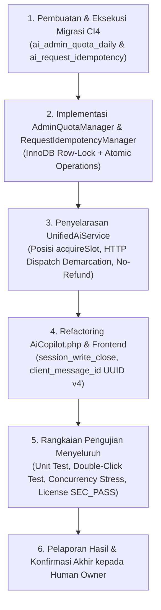

# EAO-IMPLEMENTATION-MANDATE-2026-006E
## Mandat Implementasi Final Fase 1C: AI Copilot Alignment, Dual-Traceability, Dedicated Admin Quota, dan Persistent Request Idempotency

**Nomor Dokumen:** EAO-MANDATE-2026-006E  
**Tanggal Pengajuan:** 16 November 2026  
**Status Pengajuan:** MENUNGGU PERSETUJUAN TERTULIS HUMAN OWNER (*PENDING HUMAN APPROVAL*)  
**Tahap Proyek:** Fase 1C — Implementasi Inti AI Copilot & Penegakan Batas Kuota Terpadu  
**Pelaksana Teknis:** Tim Multi-Agen EAO (Project Manager, System Architect, Developer, QA Engineer, Security Reviewer)  
**Tingkat Risiko:** Sedang — Terkendali Penuh (*Strictly Controlled*)

---

## 1. Latar Belakang & Ruang Lingkup Penyempurnaan 006E

Berdasarkan mandat verifikasi akhir **EAO-HO-006E**, mandat implementasi Fase 1C ini disempurnakan dari versi sebelumnya (006D) untuk memasukkan dua peningkatan arsitektur krusial:
1. **Penyempurnaan Batas Dispatch Jaringan:** Menggantikan konsep ambigu TCP SYN dengan penegakan **`HTTP_DISPATCH_STARTED`** sebagai batas mutlak *Strict No-Refund*.
2. **Peningkatan Idempotensi ke Tingkat Basis Data Persisten:** Mengintegrasikan tabel **`ai_request_idempotency`** untuk mengatasi kegagalan model cache-only pada skenario timeout, server restart, durasi inferensi panjang, dan lingkungan multi-worker.

---

## 2. Batasan Wewenang Mutlak (The 6 Golden Rules)

Seluruh proses implementasi terikat oleh batasan baku:
1. **Dilarang Menyentuh 6 Berkas Lisensi Terlindung:**  
   `license_helper.php`, `LicenseGuard.php`, `SecurityGuard.php`, `SecureConfig.php`, `LicenseFilter.php`, `LicenseModel.php`, `.security_hash`, dan `.lic_hash`. Status wajib `SEC_PASS`.
2. **Dilarang Mengubah Modul Frozen:**  
   Direktori `bayaran/` dan `cbtku/` tetap berstatus Frozen tanpa perubahan apa pun.
3. **Disiplin Basis Data:**  
   Perubahan skema hanya melalui migrasi resmi CodeIgniter 4 di `app/Database/Migrations/`.
4. **Kepatuhan Shared Hosting:**  
   Wajib memanggil `session_write_close()` sebelum proses AI dan tidak boleh menggunakan daemon persisten.

---

## 3. Daftar Berkas yang Akan Dikerjakan (*File Scope*)

### A. Berkas Migrasi Baru (Database Layer):
1. `app/Database/Migrations/2026-11-16-100000_CreateAiAdminQuotaDailyTable.php`  
   *Tabel pencatat kuota harian Admin (batas keras 20 per hari Asia/Jakarta, engine InnoDB, unique key `quota_date`).*
2. `app/Database/Migrations/2026-11-16-100001_CreateAiRequestIdempotencyTable.php`  
   *Tabel pelacak idempotensi persisten, safe replay, dan in-flight concurrency lock (engine InnoDB, unique key `client_message_id`).*

### B. Berkas Service Baru & Diperbarui (Service Layer):
1. `app/Services/Ai/AdminQuotaManager.php` (Baru)  
   *Pengelola reservasi atomik kuota harian, rollback sebelum retry pada deadlock 1213, jitter backoff 15–45ms, dan kebijakan fail-closed.*
2. `app/Services/Ai/RequestIdempotencyManager.php` (Baru)  
   *Pengelola status request idempotensi (`IN_FLIGHT`, `COMPLETED`, `TIMEOUT`), safe replay respons, dan pembersihan data usang.*
3. `app/Services/Ai/UnifiedAiService.php` (Diperbarui)  
   *Integrasi presisi: Zero PII $\rightarrow$ Resolusi Kunci $\rightarrow$ Idempotency Lock $\rightarrow$ Quota Reservation $\rightarrow$ HTTP Dispatch $\rightarrow$ Audit Log.*

### C. Berkas Controller & Frontend (Interface Layer):
1. `app/Controllers/Api/AiCopilot.php` (Diperbarui)  
   *Pelepasan session lock awal (`session_write_close()`), validasi header/body `client_message_id`, integrasi pipeline UnifiedAiService.*
2. Antarmuka Chat Frontend (Diperbarui)  
   *Pembangkitan UUID v4 `client_message_id` per aksi klik, penonaktifan tombol submit saat in-flight.*

### D. Berkas Pengujian (Test Suite):
1. `tests/unit/AdminQuotaManagerTest.php` (Baru)
2. `tests/unit/RequestIdempotencyManagerTest.php` (Baru)

---

## 4. Alur Kerja Implementasi Sekuensial (*Step-by-Step Execution Plan*)



---

## 5. Kriteria Penerimaan Mutlak (*Acceptance Criteria*)

1. [ ] **AC-01:** Dua berkas migrasi CI4 berhasil dieksekusi tanpa galat dan kedua tabel ber-engine InnoDB dengan unique key yang tepat.
2. [ ] **AC-02:** Kuota fallback Admin terkunci tepat pada batas maksimal 20 generasi berhasil per hari kalender Asia/Jakarta.
3. [ ] **AC-03:** Guru dengan API Key pribadi (`self`) bypass kuota Admin dan tidak pernah terhambat oleh kuota Admin yang habis.
4. [ ] **AC-04:** Penolakan sebelum gerbang HTTP (RBAC, format salah, Zero PII leak) terbukti tidak memotong kuota.
5. [ ] **AC-05:** Kegagalan lokal sebelum pengiriman HTTP (`FAILED_BEFORE_HTTP_DISPATCH`) berhasil mengembalikan 1 slot kuota (atomic refund).
6. [ ] **AC-06:** Permintaan yang telah mencapai `HTTP_DISPATCH_STARTED` terbukti **TIDAK DI-REFUND** dalam kondisi apa pun (termasuk timeout dan 500 error vendor).
7. [ ] **AC-07:** Penekanan tombol ganda (*double-click*) dengan UUID yang sama terbukti hanya memproses 1 request dan memotong tepat 1 slot kuota.
8. [ ] **AC-08:** Pengiriman ulang request yang telah selesai mengembalikan respons tersimpan (*safe replay*) secara instan tanpa memotong kuota baru.
9. [ ] **AC-09:** Seluruh berkas terlindung lisensi tetap utuh dengan verifikasi `SecurityGuard::verifyCriticalFiles()` bernilai `SEC_PASS` (1).
10. [ ] **AC-10:** Modul `bayaran/` dan `cbtku/` tetap berstatus Frozen tanpa modifikasi berkas.

---

## 6. Lembar Pengesahan Persetujuan Human Owner

Dokumen ini diserahkan kepada Pemilik Proyek (Human Owner) sebagai gerbang persetujuan akhir (*Final Approval Gate*).

```markdown
STATUS KEPUTUSAN HUMAN OWNER:

[   ] DISETUJUI UNTUK DIIMPLEMENTASIKAN (Tim EAO diizinkan memulai eksekusi Fase 1C sesuai EAO-MANDATE-2026-006E)
[   ] DISETUJUI DENGAN CATATAN (Tuliskan catatan perbaikan di bawah)
[   ] DITOLAK / DITUNDA (Tuliskan arahan perbaikan di bawah)

Catatan / Arahan:
___________________________________________________________________________________
___________________________________________________________________________________

Tanda Tangan Human Owner: ______________________
Tanggal: ______________________
```
