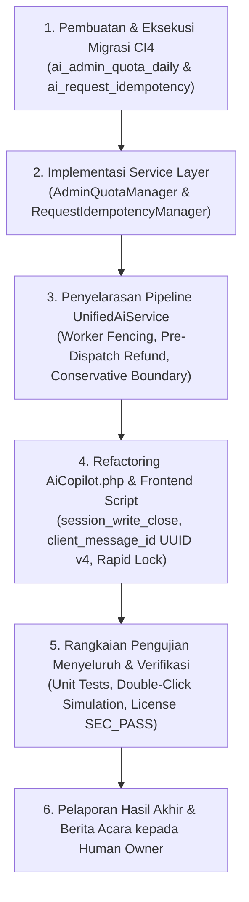

# EAO-IMPLEMENTATION-MANDATE-2026-006G
## Mandat Implementasi Final Fase 1C: AI Copilot Alignment, Dedicated Admin Quota, Worker Fencing, dan Persistent Idempotency Tombstone

**Nomor Dokumen:** EAO-MANDATE-2026-006G  
**Tanggal Pengajuan:** 16 November 2026  
**Status Pengajuan:** DRAF USULAN FINAL — MENUNGGU PERSETUJUAN TERTULIS HUMAN OWNER (*PENDING APPROVAL*)  
**Tahap Proyek:** Fase 1C — Implementasi Inti AI Copilot & Penegakan Batas Kuota Terpadu  
**Pelaksana Teknis:** Tim Multi-Agen EAO (Project Manager, System Architect, Developer, QA Engineer, Security Reviewer)  
**Tingkat Risiko:** Sedang — Terkendali Penuh (*Strictly Controlled*)

---

## 1. Latar Belakang & Ruang Lingkup Penyempurnaan 006G

Mandat implementasi Fase 1C ini telah disempurnakan secara menyeluruh berdasarkan arahan penutupan final **EAO-HO-006G**:
1. **Tombstone Identitas Permanen:** Identitas UUID dan status terminal disimpan secara permanen di basis data untuk mengeliminasi celah *replay amnesia*, dengan pembersihan payload respons setelah 7 hari kalender.
2. **Worker Fencing Token:** Mengintegrasikan kolom `worker_token` dan kueri bersyarat (*conditional update*) guna mencegah *split-brain state* dan pengambilalihan keliru oleh proses recovery.
3. **Pembedaan Titik Kematian Proses:** Menggunakan kolom `dispatch_started_at` untuk menjamin refund kuota hanya diberikan jika proses terbukti mati sebelum HTTP dispatch dimulai.
4. **Rekonsiliasi Transaksi Ambigu:** Mengeliminasi kueri increment membabi buta saat koneksi terputus pasca-commit.

---

## 2. Batasan Wewenang Mutlak (The 6 Golden Rules)

Seluruh pelaksanaan implementasi wajib mematuhi batasan baku:
1. **Dilarang Menyentuh 6 Berkas Lisensi Terlindung:**  
   `license_helper.php`, `LicenseGuard.php`, `SecurityGuard.php`, `SecureConfig.php`, `LicenseFilter.php`, `LicenseModel.php`, `.security_hash`, dan `.lic_hash`. Status wajib `SEC_PASS`.
2. **Dilarang Mengubah Modul Frozen:**  
   Direktori `bayaran/` dan `cbtku/` tetap berstatus Frozen tanpa modifikasi apa pun.
3. **Disiplin Basis Data:**  
   Perubahan skema hanya melalui migrasi resmi CodeIgniter 4 di `app/Database/Migrations/`.
4. **Kepatuhan Shared Hosting:**  
   Wajib memanggil `session_write_close()` sebelum proses AI dan dilarang menggunakan daemon background persisten.

---

## 3. Daftar Berkas yang Akan Dikerjakan (*File Scope*)

### A. Berkas Migrasi Baru (Database Layer):
1. `app/Database/Migrations/2026-11-16-100000_CreateAiAdminQuotaDailyTable.php`  
   *Tabel pencatat kuota harian Admin (batas keras 20 per hari Asia/Jakarta, engine InnoDB, unique key `quota_date`).*
2. `app/Database/Migrations/2026-11-16-100001_CreateAiRequestIdempotencyTable.php`  
   *Tabel pelacak idempotensi persisten, safe replay, worker fencing, dan permanent tombstone (engine InnoDB, unique key `client_message_id`, indeks `user_id`, kolom `worker_token`, `dispatch_started_at`, `quota_status`, `key_source`).*

### B. Berkas Service Baru & Diperbarui (Service Layer):
1. `app/Services/Ai/AdminQuotaManager.php` (Baru)  
   *Pengelola reservasi atomik kuota harian, rollback sebelum retry pada deadlock 1213, jitter backoff 15–45ms, rekonsiliasi commit ambigu, dan kebijakan fail-closed.*
2. `app/Services/Ai/RequestIdempotencyManager.php` (Baru)  
   *Pengelola pendaftaran atomik UUID, worker fencing token, transisi status bersyarat, safe replay (HTTP 200 vs 410), dan pembersihan payload 7 hari.*
3. `app/Services/Ai/UnifiedAiService.php` (Diperbarui)  
   *Integrasi presisi: Zero PII Scrubber $\rightarrow$ Resolusi Kunci $\rightarrow$ Idempotency Claim $\rightarrow$ Quota Reservation $\rightarrow$ HTTP Dispatch Demarcation $\rightarrow$ Response Storage $\rightarrow$ Telemetri.*

### C. Berkas Controller & Frontend (Interface Layer):
1. `app/Controllers/Api/AiCopilot.php` (Diperbarui)  
   *Pelepasan session lock awal (`session_write_close()`), validasi header/body `client_message_id`, integrasi pipeline UnifiedAiService, dan penanganan safe replay.*
2. Antarmuka Chat Frontend (Diperbarui)  
   *Pembangkitan UUID v4 `client_message_id` tunggal per aksi klik, penonaktifan tombol submit saat in-flight, dan pelestarian UUID pada saat retry.*

### D. Berkas Pengujian (Test Suite):
1. `tests/unit/AdminQuotaManagerTest.php` (Baru)
2. `tests/unit/RequestIdempotencyManagerTest.php` (Baru)

---

## 4. Urutan Implementasi dan Rencana Kerja Sekuensial



---

## 5. Prosedur Rollback Lengkap (*Disaster Recovery & Rollback Plan*)

Apabila terjadi kendala fatal yang tidak terduga selama masa implementasi, tim wajib mengikuti prosedur rollback terstruktur:

1. **Rollback Basis Data:**
   ```bash
   php spark migrate:rollback
   ```
   *Memastikan tabel `ai_request_idempotency` dan `ai_admin_quota_daily` dihapus secara bersih tanpa meninggalkan artefak.*
2. **Rollback Berkas Kode:**
   ```bash
   git checkout -- app/Controllers/Api/AiCopilot.php app/Services/Ai/UnifiedAiService.php
   ```
   *Mengembalikan controller dan service ke status git terakhir yang stabil.*
3. **Pembersihan Berkas Baru:**
   Menghapus berkas service baru dan berkas migrasi baru yang belum di-commit.
4. **Verifikasi Integritas Lisensi Pasca-Rollback:**
   ```bash
   php scratch/check_hashes.php
   ```
   *Wajib mengonfirmasi status `SEC_PASS` (1).*

---

## 6. Kriteria Penerimaan Mutlak (*Acceptance Criteria - 14 Poin*)

1. [ ] **AC-01:** Dua migrasi basis data dieksekusi sukses dengan engine InnoDB dan indeks unik terpasang sempurna.
2. [ ] **AC-02:** Kuota fallback Admin terkunci tepat pada batas maksimal 20 generasi berhasil per hari kalender Asia/Jakarta.
3. [ ] **AC-03:** Guru dengan API Key pribadi (`self`) bypass kuota Admin dan tidak pernah terhambat oleh kuota Admin yang habis.
4. [ ] **AC-04:** Penolakan sebelum gerbang HTTP (RBAC, format salah, Zero PII) terbukti tidak memotong kuota sama sekali.
5. [ ] **AC-05:** Kegagalan lokal sebelum pengiriman HTTP (`FAILED_BEFORE_HTTP_DISPATCH`) berhasil mengembalikan 1 slot kuota (atomic refund).
6. [ ] **AC-06:** Permintaan yang telah mencapai status `HTTP_DISPATCH_STARTED` (termasuk timeout dan 500 error vendor) terbukti **TETAP MENGURANGI KUOTA (STRICT NO-REFUND)**.
7. [ ] **AC-07:** Penekanan tombol ganda (*double-click*) dengan UUID yang sama terbukti hanya memproses 1 request dan memotong tepat 1 slot kuota.
8. [ ] **AC-08:** Pengiriman ulang request yang telah selesai mengembalikan respons tersimpan (*safe replay*) secara instan tanpa memotong kuota baru.
9. [ ] **AC-09:** Permintaan dengan UUID yang sama tetapi `user_id` berbeda ditolak dengan status `HTTP 403 Forbidden`.
10. [ ] **AC-10:** Permintaan dengan UUID yang sama tetapi payload hash berbeda ditolak dengan status `HTTP 409 Conflict`.
11. [ ] **AC-12:** UUID lama yang payload-nya telah dibersihkan (> 7 hari) merespons deterministik dengan status `HTTP 410 Gone`.
12. [ ] **AC-12:** Worker lama yang mengalami keterlambatan (*stalled worker*) difencing secara otomatis dan tidak mampu merusak baris yang telah diambil alih.
13. [ ] **AC-13:** Seluruh berkas terlindung lisensi tetap utuh dengan verifikasi `SecurityGuard::verifyCriticalFiles()` bernilai `SEC_PASS` (1).
14. [ ] **AC-14:** Modul `bayaran/` dan `cbtku/` tetap berstatus Frozen tanpa modifikasi berkas.

---

## 7. Lembar Pengesahan Persetujuan Human Owner

Dokumen ini diserahkan kepada Pemilik Proyek (Human Owner) untuk memperoleh persetujuan tertulis sebelum pekerjaan implementasi Fase 1C dimulai.

```markdown
STATUS KEPUTUSAN HUMAN OWNER:

[   ] DISETUJUI UNTUK DIIMPLEMENTASIKAN (Tim EAO diizinkan memulai eksekusi Fase 1C sesuai EAO-MANDATE-2026-006G)
[   ] DISETUJUI DENGAN CATATAN (Tuliskan catatan perbaikan di bawah)
[   ] DITOLAK / DITUNDA (Tuliskan arahan perbaikan di bawah)

Catatan / Arahan Human Owner:
___________________________________________________________________________________
___________________________________________________________________________________

Tanda Tangan Human Owner: ______________________
Tanggal: ______________________
```
