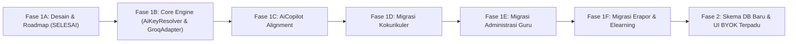

# EAO-IMPLEMENTATION-ROADMAP-2026-005A
## Roadmap Implementasi Bertahap: Unified AI Multi-Account Core & Legacy AI Modules Migration

**Nomor Dokumen:** EAO-IMPLEMENTATION-ROADMAP-2026-005A  
**Tanggal:** 15 November 2026  
**Status:** DRAFT PROPOSAL FOR HUMAN OWNER APPROVAL  
**Otoritas Pembuat:** Tim EAO (AI Project Manager, System Architect, AI Product Analyst, Security Reviewer, QA Engineer)  
**Tujuan:** Panduan pelaksanaan teknis implementasi multi-account AI engine dan migrasi modul warisan secara aman, bertahap, dan tanpa regresi (*zero regression*).

---

## 1. Ringkasan Eksekutif & Prinsip Migrasi

Berdasarkan mandat **EAO-MANDATE-2026-005 (Fase 1A)** dan kebijakan resmi Human Owner mengenai model AI Key per akun (*Bring Your Own Key / BYOK*), arsitektur AI ESPATA ditransformasikan dari sistem yang terfragmentasi menjadi sistem terpusat melalui `App\Services\Ai\UnifiedAiService` dengan mesin resolusi kunci `App\Services\Ai\AiKeyResolver`.

### Tiga Prinsip Utama Roadmap:
1. **Zero Downtime & Zero Regression:** Modul-modul AI yang sudah berjalan (Kokurikuler, Administrasi Guru, AiCopilot) tidak boleh mengalami gangguan operasional. Setiap fase memiliki gerbang verifikasi independen (*acceptance gate*).
2. **Strict Privacy & Dual-Traceability:** Dilarang keras mengambil kunci milik guru lain. Penggunaan kunci Administrator sebagai fallback bersama harus tercatat secara akuntabel (*dual-traceability: requester_id vs key_owner_id*).
3. **No Database Schema Mutation in Phase 1:** Seluruh implementasi Fase 1 (1B s.d. 1F) memanfaatkan struktur tabel yang ada (`ai_assistant_logs`, `teachers`, `users`, `kokurikuler_ai_logs`) tanpa menjalankan migrasi DDL berbahaya, menjamin stabilitas 100% pada lingkungan shared hosting.



---

## 2. Rincian Pelaksanaan per Sub-Fase

---

### FASE 1B: Core Engine Multi-Account Support (AiKeyResolver & GroqAdapter)

* **Tujuan Utama:** Membangun komponen resolusi API Key modular (`AiKeyResolver` & DTO `ResolvedApiKey`), memperbaiki `GroqAdapter` agar menerima `apiKeyOverride`, serta mengintegrasikan resolusi kunci ke dalam `UnifiedAiService`.
* **Estimasi Kompleksitas:** Sedang (*Medium / 3 Story Points*)
* **Dependensi Teknis:** Dokumen arsitektur `EAO-DESIGN-2026-005A-AI-KEY-RESOLVER.md` telah disetujui.
* **Berkas yang Disentuh / Dibuat:**
  1. `app/Services/Ai/DTO/ResolvedApiKey.php` *(Berkas baru)*
  2. `app/Services/Ai/AiKeyResolver.php` *(Berkas baru)*
  3. `app/Services/Ai/Providers/GroqAdapter.php` *(Perubahan pada baris 51: menghormati `$request->apiKeyOverride`)*
  4. `app/Services/Ai/UnifiedAiService.php` *(Refaktor resolusi kunci untuk seluruh provider via `AiKeyResolver`)*
  5. `tests/unit/AiKeyResolverTest.php` *(Berkas uji unit baru)*
* **Langkah Implementasi:**
  1. Buat kelas DTO `App\Services\Ai\DTO\ResolvedApiKey` dengan properti immutabel (`apiKey`, `source`, `ownerId`, `ownerRole`, `provider`).
  2. Buat kelas layanan `App\Services\Ai\AiKeyResolver` yang mengimplementasikan resolusi 4 lapis:
     - Prioritas 1: Kunci pribadi guru (`teachers.gemini_api_key`) jika requestor adalah guru/wali kelas.
     - Prioritas 2: Kunci pribadi admin (`teachers.gemini_api_key` dari user role admin) sebagai fallback bersama.
     - Prioritas 3: Kunci server environment (`.env: GROQ_API_KEY` / `GEMINI_API_KEY`).
     - Prioritas 4: Fallback status `NOT_RESOLVED` (memicu penolakan aman atau local fallback).
  3. Perbarui `GroqAdapter.php` baris 51 agar menggunakan `$request->apiKeyOverride` jika ada:
     ```php
     $apiKey = !empty($request->apiKeyOverride) ? $request->apiKeyOverride : ($this->config->groq['apiKey'] ?? '');
     ```
  4. Perbarui `UnifiedAiService.php` untuk memanggil `AiKeyResolver::resolve()` dan menyuntikkan kunci ke `AiRequest::$apiKeyOverride`.
* **Kriteria Penerimaan (Acceptance Gates):**
  - [ ] Sintaks PHP valid: `php -l` lulus untuk seluruh berkas baru dan modifikasi.
  - [ ] Unit Test `AiKeyResolverTest` lulus 100% (mencakup guru aktif ber-key, guru tanpa key $\rightarrow$ fallback admin, tanpa admin $\rightarrow$ `.env`, dan isolasi guru lain).
  - [ ] `GroqAdapter` berhasil memanggil API Groq menggunakan kunci override tanpa membaca `.env`.
  - [ ] Integritas lisensi `SecurityGuard::verifyCriticalFiles()` bernilai `SEC_PASS`.

---

### FASE 1C: AiCopilot Multi-Account Alignment & Dual-Traceability

* **Tujuan Utama:** Mengaktifkan Asis AI Copilot agar dapat beroperasi penuh menggunakan kunci pengguna atau fallback admin tanpa lagi diblokir oleh ketiadaan `GROQ_API_KEY` pada `.env`, serta mencatat jejak audit ganda (*dual-traceability*) pada `ai_assistant_logs`.
* **Estimasi Kompleksitas:** Sedang (*Medium / 2 Story Points*)
* **Dependensi Teknis:** Fase 1B selesai dan lulus verifikasi.
* **Berkas yang Disentuh:**
  1. `app/Controllers/Api/AiCopilot.php` *(Penyempurnaan pemanggilan `UnifiedAiService` dengan context user session & telemetry)*
* **Langkah Implementasi:**
  1. Tangkap identitas sesi aktif (`user_id`, `role`, `teacher_id`) pada `AiCopilot::chat()`.
  2. Teruskan metadata pengguna ke `UnifiedAiService` saat memanggil `generateContent()`.
  3. Format pencatatan log pada tabel `ai_assistant_logs`:
     - Kolom `user_id`: ID pengguna pemohon (*requester_id*).
     - Kolom `source`: Menyimpan metadata terstruktur, contoh: `groq:self:12` atau `groq:admin_fallback:1` atau `local:fallback`.
     - Kolom `intent`: Menyimpan konteks intent dan status resolusi.
  4. Perbarui response JSON agar menyertakan status `source` yang jujur (`ai` jika menggunakan LLM eksternal, `local_database` jika pencocokan lokal).
* **Kriteria Penerimaan (Acceptance Gates):**
  - [ ] Pengguna guru dengan key pribadi mendapatkan respons AI Groq berlabel `source: ai`.
  - [ ] Pengguna guru tanpa key pribadi mendapatkan respons AI Groq via kunci fallback Administrator berlabel `source: ai`.
  - [ ] Jika tidak ada key sama sekali, Asis AI beralih ke pencarian data lokal berlabel `source: local_database` tanpa error HTTP 500.
  - [ ] Log audit pada tabel `ai_assistant_logs` mencatat pemohon dan pemilik kunci secara akurat.
  - [ ] Integritas lisensi tetap `SEC_PASS`.

---

### FASE 1D: Migrasi Modul Kokurikuler ke Unified AI Service

* **Tujuan Utama:** Mengganti fungsi `callAIAPI()` berbasis cURL mentah dan fungsi `recommendAI()` pada `Kokurikuler.php` dengan `UnifiedAiService`, menghapus duplikasi logika HTTP dan prompt formatting.
* **Estimasi Kompleksitas:** Sedang (*Medium / 3 Story Points*)
* **Dependensi Teknis:** Fase 1B dan Fase 1C selesai.
* **Berkas yang Disentuh:**
  1. `app/Controllers/Admin/Kokurikuler.php` *(Refaktor `callAIAPI` dan `recommendAI`)*
* **Langkah Implementasi:**
  1. Injeksi `UnifiedAiService` ke dalam `Kokurikuler.php`.
  2. Ubah `recommendAI()` untuk membangun `AiRequest` dengan prompt Kokurikuler yang ada, menetapkan `temperature = 0.5`, `maxTokens = 1500`, dan `preferredProvider = 'groq'`.
  3. Delegasikan pemanggilan ke `UnifiedAiService::generateContent()`.
  4. Pertahankan penulisan log ke tabel `kokurikuler_ai_logs` demi audit kelulusan P5/Kokurikuler yang sudah berjalan.
  5. Bungkus fungsi lama `callAIAPI()` sebagai *deprecated proxy* yang memanggil `UnifiedAiService` agar kompatibilitas fungsi internal tetap terjaga jika ada komponen lain yang memanggilnya.
* **Kriteria Penerimaan (Acceptance Gates):**
  - [ ] Fitur "Rekomendasi AI" pada modul Kokurikuler menghasilkan output tema dan dimensi P5/Kokurikuler yang valid.
  - [ ] Resolusi kunci mematuhi aturan Fase 0: Kunci guru $\rightarrow$ Kunci admin $\rightarrow$ Rekomendasi fallback berbasis aturan kurikulum lokal.
  - [ ] Tidak ada cURL manual ke `api.groq.com` yang tersisa di `Kokurikuler.php`.
  - [ ] Log tercatat pada `kokurikuler_ai_logs` dan `ai_assistant_logs`.

---

### FASE 1E: Migrasi Modul Administrasi Guru (Modul Ajar & Bank Soal)

* **Tujuan Utama:** Mengalihkan pembuatan Modul Ajar otomatis (`generateModulAjar`) dan penyusunan instrumen soal ujian (`generateSoal`) dari cURL Groq langsung ke `UnifiedAiService`.
* **Estimasi Kompleksitas:** Sedang (*Medium / 3 Story Points*)
* **Dependensi Teknis:** Fase 1B selesai.
* **Berkas yang Disentuh:**
  1. `app/Controllers/Guru/AdministrasiGuru.php` *(Refaktor pemanggilan AI)*
* **Langkah Implementasi:**
  1. Audit fungsi `generateModulAjar()` dan `generateSoal()` di `AdministrasiGuru.php`.
  2. Ganti blok pemanggilan `curl_exec()` dengan `UnifiedAiService::generateContent()`.
  3. Konfigurasikan parameter khusus modul ajar: output format JSON / Markdown terstruktur, `maxTokens = 3000`.
  4. Tangani timeout gracefully (`timeout = 45` detik) dan berikan umpan balik progresif jika dipanggil via AJAX.
* **Kriteria Penerimaan (Acceptance Gates):**
  - [ ] Pembuatan modul ajar menghasilkan struktur capaian pembelajaran (CP), tujuan pembelajaran (TP), dan rubrik asesmen lengkap.
  - [ ] Penggunaan token tercatat pada telemetri.
  - [ ] Guru yang belum memasukkan API key mendapatkan notifikasi persuasif untuk mengisi key pribadi di profil atau memanfaatkan kuota fallback sekolah.

---

### FASE 1F: Migrasi Modul Erapor & Elearning Package Generator

* **Tujuan Utama:** Menyatukan generator narasi rapor siswa (`Erapor.php`) dan generator materi elearning (`ElearningPackageGeneratorService.php`) ke `UnifiedAiService`.
* **Estimasi Kompleksitas:** Ringan-Sedang (*Low-Medium / 2 Story Points*)
* **Dependensi Teknis:** Fase 1B s.d. Fase 1E selesai.
* **Berkas yang Disentuh:**
  1. `app/Controllers/Guru/Erapor.php` (atau Service terkait)
  2. `app/Services/Elearning/ElearningPackageGeneratorService.php`
* **Langkah Implementasi:**
  1. Refaktor pemanggilan AI untuk pembuatan deskripsi capaian kompetensi siswa (narasi rapor).
  2. Gunakan `UnifiedAiService` dengan kontrol suhu rendah (`temperature = 0.2`) agar narasi rapor formal, objektif, dan konsisten.
  3. Uji integrasi paket e-learning (ringkasan materi dan kuis interaktif).
* **Kriteria Penerimaan (Acceptance Gates):**
  - [ ] Generator narasi rapor berfungsi normal dan menghasilkan kalimat deskriptif sesuai format kurikulum merdeka.
  - [ ] Seluruh modul AI di ESPATA telah 100% menggunakan satu gerbang tunggal: `UnifiedAiService`.

---

## 3. Matriks Dependensi & Estimasi Waktu

| Sub-Fase | Komponen Utama | Estimasi Waktu | Prasyarat | Risiko Regresi |
|:---|:---|:---:|:---|:---:|
| **Fase 1B** | `AiKeyResolver` & `GroqAdapter` override | 1 Hari Kerja | Approval Fase 1A | Sangat Rendah (Add-on core) |
| **Fase 1C** | `AiCopilot` alignment & Telemetry | 1 Hari Kerja | Selesai Fase 1B | Rendah (Hanya 1 Controller API) |
| **Fase 1D** | Migrasi `Kokurikuler.php` | 1 Hari Kerja | Selesai Fase 1C | Rendah (Ada fallback kurikulum) |
| **Fase 1E** | Migrasi `AdministrasiGuru.php` | 1 Hari Kerja | Selesai Fase 1B | Rendah (Fitur AJAX guru) |
| **Fase 1F** | Migrasi `Erapor` & `Elearning` | 1 Hari Kerja | Selesai Fase 1D/E | Rendah (Standar format teks) |
| **Fase 2** | DB Migration & Multi-Key Settings UI | Terjadwal Kemudian | Evaluasi Fase 1 | Membutuhkan backup DB |

---

## 4. Rencana Manajemen Risiko & Mitigasi

| Potensi Risiko | Tingkat Dampak | Probabilitas | Strategi Mitigasi EAO |
|:---|:---:|:---:|:---|
| **Kunci Admin Kehabisan Kuota (Rate Limit Groq)** | Sedang | Sedang | Sistem otomatis menangkap HTTP 429/TPM limit dan mengembalikan fallback kurikulum lokal dengan pesan ramah non-teknis ke pengguna. |
| **Timeout pada Shared Hosting (30-60 detik)** | Tinggi | Rendah | Mengatur timeout cURL adapter ke 25 detik, menggunakan `session_write_close()` sebelum pemanggilan AI agar antarmuka tidak membeku (*locking session*). |
| **Pelanggaran Integritas Lisensi (`SEC_FAIL`)** | Kritikal | Sangat Rendah | Menjalankan audit checksum `SecurityGuard` secara otomatis pada setiap akhir commit/tahapan. |
| **Kegagalan Parser JSON / Output Format** | Sedang | Rendah | Sanitasi markdown block (` ```json `) sebelum `json_decode`, menyertakan skema fallback terdefinisi jika parsing gagal. |

---

## 5. Keputusan yang Memerlukan Persetujuan Human Owner

Sebelum melangkah ke eksekusi kode, Tim EAO memohon arahan dan persetujuan tertulis dari Human Owner mengenai poin-poin kebijakan berikut:

1. **Persetujuan Memulai Eksekusi Fase 1B:**
   - Apakah Tim EAO diizinkan untuk memulai pengkodean kelas `App\Services\Ai\AiKeyResolver` dan pembaruan `GroqAdapter.php` baris 51?
2. **Kebijakan Batasan Penggunaan Fallback Admin:**
   - Apakah fallback API Key Administrator boleh digunakan secara bebas oleh seluruh guru yang belum memiliki key, ataukah perlu dibatasi kuota pemanggilan hariannya (misal: maksimal 20 generasi/hari per guru) demi mencegah penipisan kuota pribadi Administrator?
   - *Rekomendasi EAO:* Untuk Fase 1, izinkan tanpa batasan keras (*unlimited within rate limit*), namun catat penggunaannya via *dual-traceability*. Pembatasan kuota dapat diimplementasikan pada Fase 2 setelah data log terkumpul.
3. **Penyimpanan Kunci Groq Khusus Guru:**
   - Saat ini kolom `teachers.gemini_api_key` digunakan bersama untuk menyimpan kunci Gemini maupun Groq. Apakah Human Owner menyetujui penambahan kolom khusus `groq_api_key` pada skema database Fase 2 nanti?
   - *Rekomendasi EAO:* Ya, disiapkan migrasi khusus pada Fase 2 agar guru dapat mengelola kunci Groq dan Gemini secara independen.

---

## 6. Pernyataan Konsensus Tim Multi-Agen EAO

* **AI Project Manager:** Roadmap telah disusun dengan prinsip kehati-hatian tinggi, tahapan terisolasi, dan tanpa downtime bagi pengguna sekolah.
* **AI System Architect:** Desain `AiKeyResolver` menjamin *Single Responsibility Principle* dan membebaskan controller dari manipulasi cURL langsung.
* **AI Security Reviewer:** Mekanisme isolasi kunci lintas guru dan penyamaran key pada telemetri telah memenuhi standar keamanan data ESPATA.
* **AI QA Engineer:** Rencana pengujian telah mencakup 12 skenario pengujian unit, integrasi, dan regresi pada `EAO-TEST-PLAN-2026-005A.md`.
* **AI Product Analyst:** Pengalaman guru dan kepala sekolah tetap diutamakan dengan adanya fallback lokal dan pesan status yang transparan.

---
**Status Dokumen:** SELESAI & SIAP DILAPORKAN  
*Menunggu persetujuan tertulis Human Owner untuk memulai Fase 1B.*
