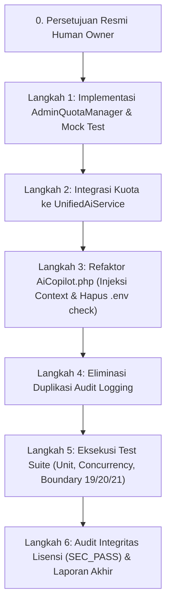

# EAO-IMPLEMENTATION-ROADMAP-2026-006A
## Roadmap Implementasi Fase 1C: AiCopilot Alignment, Admin Quota Manager & Dual-Traceability

**Nomor Dokumen:** EAO-IMPLEMENTATION-ROADMAP-2026-006A  
**Tanggal:** 16 November 2026  
**Otoritas Pembuat:** Tim Multi-Agen EAO (Project Manager, System Architect, AI Security Reviewer, QA Engineer, Developer)  
**Mandat Terkait:** EAO-MANDATE-2026-006 (Bagian 5)  
**Status Roadmap:** PROPOSAL TAHAPAN KERJA UNTUK PERSETUJUAN HUMAN OWNER  
**Batas Eksekusi:** Menunggu persetujuan tertulis sebelum kode apa pun ditulis.

---

## 1. Ringkasan Eksekutif & Sasaran Fase 1C

Fase 1C bertujuan menyelaraskan Asis AI Copilot (`AiCopilot.php`) agar terhubung penuh dengan Core Engine Multi-Account Fase 1B, menerapkan kuota Administrator maksimal 20 generasi/hari secara atomik (*Opsi B*), mengeliminasi ketergantungan usang pada `.env`, serta menjamin kontinuitas kontrak antarmuka frontend tanpa regresi (*zero regression*).

### Tiga Pilar Implementasi:
1. **Penyelarasan Controller:** Mengintegrasikan `AiCopilot` ke `UnifiedAiService` dengan menyuntikkan `$userContext` lengkap dan menghapus pengecekan kaku terhadap `.env`.
2. **Pengendalian Anggaran & Kuota:** Membangun `AdminQuotaManager` dengan mekanisme alokasi slot atomik (maksimal 20 generasi/hari kalender `Asia/Jakarta`).
3. **Pembersihan Logika & Telemetri Tunggal:** Menghilangkan duplikasi penulisan log audit pada `AiCopilot::ask()` sehingga seluruh jejak telemetri tercatat bersih via `UnifiedAiService`.

---

## 2. Daftar Berkas yang Akan Dibuat dan Diubah pada Fase 1C

| Nama Berkas | Aksi | Deskripsi Perubahan |
|:---|:---:|:---|
| `app/Services/Ai/AdminQuotaManager.php` | **Baru** | Service pengelola kuota harian Administrator, operasi atomik anti-race condition, evaluasi zona waktu `Asia/Jakarta`, dan fail-closed guard. |
| `app/Services/Ai/UnifiedAiService.php` | **Diperbarui** | Integrasi pengecekan kuota Administrator saat `ResolvedApiKey` berstatus `admin_fallback`. |
| `app/Controllers/Api/AiCopilot.php` | **Diperbarui** | Menghapus blokade `.env` baris 610, menyuntikkan `$userContext`, mengaktifkan deteksi provider dinamis, mengeliminasi duplikasi logging, dan menyajikan pesan kuota ramah. |
| `app/Database/Migrations/2026-11-16-100000_CreateAiAdminQuotaDailyTable.php` | **Baru (Opsional)** | Migrasi tabel pencatat kuota harian atomik (hanya dieksekusi jika Human Owner mengizinkan migrasi). |
| `tests/unit/AiCopilotAlignmentTest.php` | **Baru** | Rangkaian pengujian unit, integrasi, batas kuota (19, 20, 21), dan pengujian konkurensi 25 proses. |

---

## 3. Urutan Langkah Kerja Implementasi (Work Breakdown Structure)

### Langkah 1: Pembangunan Layanan `AdminQuotaManager`
- Menulis kelas `App\Services\Ai\AdminQuotaManager`.
- Mengimplementasikan alur pemesanan slot atomik `acquireSlot()` dan pengecekan read-only `getStatus()`.
- Menyiapkan mekanisme fallback ke tabel `settings` eksisting jika tabel khusus `ai_admin_quota_daily` belum diizinkan dibuat melalui migrasi.

### Langkah 2: Integrasi Kuota pada `UnifiedAiService`
- Menghubungkan `AdminQuotaManager` ke dalam alur resolusi kunci `UnifiedAiService::execute()` dan `executeJson()`.
- Jika kunci yang teresolusi berstatus `keySource === 'admin_fallback'`, sistem wajib memanggil `acquireSlot()` sebelum mengirim cURL.
- Jika kuota habis, kembalikan `AiResponse::createFailure('KUOTA_ADMIN_HABIS', 'QUOTA_EXHAUSTED')`.
- Jika kunci adalah `self` (milik guru sendiri), alur kuota Administrator dilewati seutuhnya (*bypassed*).

### Langkah 3: Penyelarasan `AiCopilot.php`
- Menghapus baris 609–612 (`if ($groqProvider === null || !$groqProvider->isAvailable())`).
- Menyusun `$userContext = ['user_id' => ..., 'role_id' => ..., 'teacher_id' => ...]`.
- Memanggil `$aiService->executeJson($aiRequest, null, $userContext)`.
- Mengarahkan respons error `QUOTA_EXHAUSTED` ke Smart Local Matcher secara anggun dengan pesan santun.

### Langkah 4: Pembersihan Duplikasi Logging
- Menghapus pemanggilan redundan `$this->logInteraction()` pada baris 410 untuk permintaan yang telah diproses oleh AI.
- Mempertahankan `$this->logInteraction()` hanya untuk permintaan data langsung (*Live Query*), panduan fitur (*Knowledge Base*), dan pencocokan lokal (*Local Matcher*).

### Langkah 5: Pengujian Menyeluruh & Concurrency Stress Test
- Menguji seluruh skenario Domain 1 hingga 6 pada `EAO-TEST-PLAN-2026-006A.md`.
- Memastikan batas 20 generasi tidak dapat ditembus oleh 25 permintaan simultan.
- Memastikan guru dengan kunci pribadi tidak terdampak saat kuota Administrator mencapai 20.

### Langkah 6: Verifikasi Kepatuhan & Laporan
- Memverifikasi enam berkas keamanan terlindungi: `SecurityGuard::verifyCriticalFiles()` $\rightarrow$ `SEC_PASS`.
- Memastikan direktori `bayaran/` dan `cbtku/` tetap berstatus **FROZEN**.
- Menyerahkan laporan implementasi kepada Human Owner dan menghentikan pekerjaan (*stop condition*).

---

## 4. Matriks Risiko & Rencana Mitigasi

| Potensi Risiko | Tingkat Dampak | Probabilitas | Rencana Mitigasi EAO |
|:---|:---:|:---:|:---|
| **Kondisi Balapan (*Race Condition*) Menembus Kuota 20** | Tinggi | Sedang | Menggunakan single SQL `UPDATE ... WHERE used_count < 20` yang memanfaatkan *row-level locking* InnoDB, bukan pengecekan bertahap `SELECT` lalu `UPDATE`. |
| **Perbedaan Zona Waktu Server Hosting** | Sedang | Rendah | Mengunci pembacaan tanggal menggunakan objek `\DateTimeZone('Asia/Jakarta')` secara eksplisit, mengabaikan konfigurasi timezone bawaan PHP/Apache. |
| **Kerusakan Kontrak Frontend (*Frontend Regression*)** | Tinggi | Rendah | Mengunci field respons JSON (`status`, `source`, `explanation`, `matched_action`, `csrf_hash`) agar identik 100% dengan kebutuhan widget JS. |
| **Database Mengalami Gangguan Saat Pengecekan Kuota** | Sedang | Sangat Rendah | Menerapkan prinsip *Fail-Closed for Fallback*: jika status kuota tidak dapat dipastikan, sistem menolak pemakaian kunci Admin dan beralih ke pencocokan lokal. |

---

## 5. Keputusan yang Membutuhkan Persetujuan Human Owner Sebelum Eksekusi

Sebelum memulai penulisan kode Fase 1C, Tim EAO memohon keputusan Human Owner terkait strategi penyimpanan counter kuota:

* **Pilihan A (Rekomendasi EAO — Dedicated Table):**  
  Mengizinkan pembuatan satu tabel khusus `ai_admin_quota_daily` melalui migrasi resmi CodeIgniter 4 (`2026-11-16-100000_CreateAiAdminQuotaDailyTable.php`). Tabel ini berukuran sangat kecil (~1 baris per hari) dan menjamin penguncian baris tercepat dan terbersih.
* **Pilihan B (Tanpa Perubahan Skema Database):**  
  Memanfaatkan tabel `settings` yang sudah ada di database (`setting_key = 'ai_admin_quota_YYYY-MM-DD'`). Pilihan ini tidak memerlukan migrasi database, namun struktur kueri sedikit lebih lambat dibanding tabel khusus.

---

## 6. Pernyataan Kesiapan Tim Multi-Agen EAO & Stop Condition

* **AI Project Manager:** Seluruh 6 dokumen perencanaan teknis Fase 1C telah diselesaikan dengan keterkaitan logis yang solid.
* **AI System Architect:** Desain `AdminQuotaManager` dan penyelarasan `AiCopilot` menjamin prinsip *single source of truth* dan keandalan atomik.
* **AI Security Reviewer:** Prinsip isolasi kunci guru lain, proteksi kuota Administrator, dan integritas 6 berkas lisensi (`SEC_PASS`) telah terjamin.
* **AI QA Engineer:** Rencana pengujian 6 domain telah mencakup uji batas 19, 20, 21, pengujian konkurensi 25 proses, dan uji regresi frontend.

**KONDISI STOP DITEGAKKAN:**  
Seluruh aktivitas dihentikan. Tim EAO tidak akan menulis atau mengubah berkas kode aplikasi apa pun hingga Human Owner memberikan persetujuan tertulis resmi terhadap proposal desain Fase 1C.
