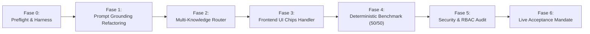

# EAO-IMPLEMENTATION-ROADMAP-2026-056: PETA JALAN IMPLEMENTASI EAKB TAHAP 2E.2
**Rencana Aksi Bertahap, Matriks Regresi 9 Fondasi, dan Penguncian Kebijakan Provider & Privasi**

---

| Parameter Roadmap | Rincian Dokumen |
| :--- | :--- |
| **Nomor Mandat** | `EAO-HO-2026-056` |
| **Tahap Pengembangan** | EAKB Stage 2E.2 (Multi-Knowledge Prompt Grounding & UI Integration) |
| **Status Otorisasi** | DESAIN SELESAI — MENUNGGU MANDAT IMPLEMENTASI HUMAN OWNER |
| **Target Eksekusi** | Implementasi Terkendali Bertahap (Fase 0 s.d. Fase 6) |
| **Prinsip Utama** | Zero Regression, Shared-Hosting Friendly, Strict RBAC `[1, 2, 3, 7]`, 0 Token Short-Circuit |
| **Tim Perencana** | Tim EAO (AI Project Manager, AI System Architect, AI QA Engineer) |
| **Tanggal Terbit** | 17 November 2026 |

---

## 1. MATRIKS REGRESI 9 FONDASI UTAMA SISTEM

Roadmap Tahap 2E.2 dirancang untuk memastikan bahwa integrasi multi-knowledge tidak merusak satupun dari sembilan pencapaian arsitektur yang telah diterima sebelumnya:

```text
┌───────────────────────────────────────┬─────────────────────────────────────┬──────────────────────┐
│ FONDASI SISTEM                        │ KOMPONEN KRITIKAL                   │ STATUS PERLINDUNGAN  │
├───────────────────────────────────────┼─────────────────────────────────────┼──────────────────────┤
│ 1. Fase 1C (Kuota & Idempotensi)      │ AdminQuotaManager (20 limit JKT)    │ 100% INVARIANT       │
│                                       │ RequestIdempotencyManager (Lease)   │ (Tidak Berubah)      │
├───────────────────────────────────────┼─────────────────────────────────────┼──────────────────────┤
│ 2. Fase 1D.1 (Conversational Core)    │ IntentClassifier (8 Kelas Intent)   │ 100% INVARIANT       │
│                                       │ Sanitasi 1000 Karakter Input        │ (Menjadi Dasar Rute) │
├───────────────────────────────────────┼─────────────────────────────────────┼──────────────────────┤
│ 3. Fase 1D.2 (Conversation Memory)    │ ConversationMemoryManager           │ 100% INVARIANT       │
│                                       │ Multi-turn Context (4-6 Turn, 800t) │ (Menyimpan Attribusi)│
├───────────────────────────────────────┼─────────────────────────────────────┼──────────────────────┤
│ 4. Fase 1D.3 (Operational Context)    │ OperationalContextProvider          │ 100% INVARIANT       │
│                                       │ OperationalContextDTO (1.200 char)  │ (Menyuplai Data Guru)│
├───────────────────────────────────────┼─────────────────────────────────────┼──────────────────────┤
│ 5. EAKB Tahap 1 (Katalog 70 Fitur)    │ EspataApplicationKnowledge          │ 100% READ-ONLY       │
│                                       │ EakbCatalogValidator                │ (Sumber Tunggal)     │
├───────────────────────────────────────┼─────────────────────────────────────┼──────────────────────┤
│ 6. EAKB Tahap 2B (Retrieval Engine)   │ EakbRetrievalEngine (In-Memory)     │ 100% INVARIANT       │
│                                       │ Token Scoring & Sub-ms Latency      │ (Mesin Pencarian)    │
├───────────────────────────────────────┼─────────────────────────────────────┼──────────────────────┤
│ 7. EAKB Tahap 2C (RBAC, Graph, Disamb)│ EakbFeatureGraph (1-Hop Max 3)      │ 100% INVARIANT       │
│                                       │ EakbDisambiguationResolver          │ (Penyaring Relasi)   │
├───────────────────────────────────────┼─────────────────────────────────────┼──────────────────────┤
│ 8. EAKB Tahap 2D (Context Assembler)  │ EakbContextAssembler (600 Token Max)│ 100% INVARIANT       │
│                                       │ Tag Grounding & Untrusted Fencing   │ (Penyusun Konteks)   │
├───────────────────────────────────────┼─────────────────────────────────────┼──────────────────────┤
│ 9. EAKB Tahap 2E.1 (Runtime Engine)   │ AiCopilot.php (5 Short-Circuits)    │ 100% INVARIANT       │
│                                       │ 0 Kuota pada Penolakan Lokal        │ (Fondasi Runtime)    │
└───────────────────────────────────────┴─────────────────────────────────────┴──────────────────────┘
```

---

## 2. PENGUNCIAN KEBIJAKAN PROVIDER, AKSES & PRIVASI (POLICY INVARIANTS)

Sebelum memulai tahapan koding, seluruh agen AI dan pengembang terikat pada batas kebijakan berikut:
1. **Kebijakan Akses Asis AI:**  
   Hanya **Role 1 (Admin), Role 2 (Kepsek), Role 3 (Guru), dan Role 7 (Tata Usaha)** yang diizinkan.  
   **Role 4 (Orang Tua), Role 5 (Siswa), Role 6 (Kontributor), dan Role 8 (Coach)** ditolak mutlak (403 Forbidden).
2. **Prioritas BYOK & Kuota Admin:**  
   Kunci pribadi pengguna (`self`) selalu diprioritaskan. Admin fallback tetap menggunakan batas agregat **20 generasi per hari kalender Asia/Jakarta** (tabel `ai_admin_quota_daily`).
3. **Zero Cross-Teacher Fallback:**  
   Dilarang keras mengambil atau menggunakan API Key milik guru lain.
4. **Zero Quota on Short-Circuit:**  
   Seluruh jalur short-circuit (`NEEDS_CLARIFICATION`, `ROLE_NOT_ALLOWED`, `CONTEXT_LIMIT_EXCEEDED`, `INVALID_RETRIEVAL_RESULT`, `NO_MATCH`) wajib menetapkan `quota_status = 'NONE'` dan tidak menyentuh `AdminQuotaManager`.
5. **No Gemini Auto-Failover:**  
   Auto-failover ke vendor Gemini tetap dimatikan secara default (`enableAutoFailover = false`) untuk mencegah biaya tak terduga.
6. **No Global .env API Key:**  
   Tidak ada penambahan kunci global `.env` untuk request pengguna.
7. **Pelepasan Kunci Sesi PHP (FC-02):**  
   `session_write_close()` wajib dieksekusi sebelum pemanggilan HTTP eksternal cURL ke vendor LLM yang memblokir I/O secara sinkron (*synchronous blocking HTTP I/O*). Tujuannya adalah melepaskan kunci berkas sesi (*session file lock*) agar tab browser lain milik pengguna tidak mengalami *lock contention*, **BUKAN** mengubah PHP menjadi proses asinkron. Seluruh variabel sesi wajib diekstrak sebelum pelepasan lock.
8. **Plafon Anggaran Token & Estimasi Heuristik (FC-03 & K-01):**  
   Plafon desain tetap **2.400 estimated tokens mutlak**. Angka **~2.369 token** (hasil pemadatan riwayat 3–4 turn / 450 token) merupakan **estimasi heuristik formula `ceil(total_characters / 3.8)`**, bukan hasil pengukuran tokenizer BPE riil. Ambang batas karakter konservatif ditetapkan maksimal **9.000 karakter UTF-8** untuk seluruh prompt terakit (`ceil(9000 / 3.8) = 2.369 <= 2.400 tokens`, menyisakan safety margin 31 token). Proteksi fail-closed `CONTEXT_LIMIT_EXCEEDED` untuk EAKB dan pemotongan riwayat diterapkan saat implementasi.
9. **Zona Terlarang Lisensi & Sub-Aplikasi:**  
   6 file lisensi diawasi `SecurityGuard.php` (`SEC_PASS: 1`). Direktori `bayaran/` dan `cbtku/` tetap berstatus terhapus permanen.

---

## 3. TAHAPAN AKSI IMPLEMENTASI TAHAP 2E.2



---

### FASE 0: PREFLIGHT & PERSIAPAN TEST HARNESS
- **Tujuan:** Menyiapkan lingkungan verifikasi mandiri sebelum mengubah kode produksi.
- **Aktivitas:**
  1. Pemeriksaan `git status` dan branch aktif.
  2. Verifikasi lisensi `SecurityGuard::verifyCriticalFiles()` = `SEC_PASS: 1`.
  3. Pembuatan skrip pengujian deterministik `tests/test_eakb_stage2e2_benchmark_50.php` berdasarkan spesifikasi EAO-TEST-PLAN-056.
- **Deliverable:** Skrip harness pengujian 50 skenario siap pakai.
- **Gerbang Kelulusan (Gate):** Harness dapat dijalankan dan melaporkan baseline pengujian.

---

### FASE 1: MULTI-KNOWLEDGE PROMPT GROUNDING REFACTORING
- **Tujuan:** Menerapkan struktur prompt grounding multi-pengetahuan terstandarisasi pada `AiCopilot::callUnifiedAiNlu()`.
- **Aktivitas:**
  1. Penataan urutan blok prompt: System Identity -> Security Invariants -> Operational Context -> Application Knowledge -> Educational Guidance -> Strict JSON Output Schema.
  2. Pembersihan kontrol karakter dan pembentengan *untrusted data fencing*.
  3. Pembatasan token budget terpadu (maksimal 2.400 input token).
- **Berkas yang Dimodifikasi:** `app/Controllers/Api/AiCopilot.php` (khusus private/protected method perakitan prompt).
- **Gerbang Kelulusan (Gate):** `php -l` lulus 0 error, prompt tersusun rapi dengan tag pembungkus dan instruksi grounding.

---

### FASE 2: INTENT-BASED MULTI-KNOWLEDGE ROUTER IMPLEMENTATION
- **Tujuan:** Menyempurnakan method `shouldRunEakbRetrieval()` dan logika seleksi sumber pengetahuan.
- **Aktivitas:**
  1. Implementasi tabel routing selektif (Bab 4 Dokumen Desain EAO-REP-056).
  2. Pemisahan jalur kueri pendidikan murni (`KNOWLEDGE_RETRIEVAL`) agar tidak memicu EAKB jika tidak menyebut sistem.
  3. Penanganan kueri gabungan (hybrid) agar menyertakan EAKB dan Educational Guidance sekaligus.
  4. Penanganan ambiguitas penugasan mengajar pada `OperationalContextDTO`.
- **Berkas yang Dimodifikasi:** `app/Controllers/Api/AiCopilot.php`.
- **Gerbang Kelulusan (Gate):** 20 kueri representatif ter-route secara presisi ke kelas pengetahuan yang sesuai.

---

### FASE 3: FRONTEND UI AUDIT & VERIFIKASI (STATUS: NO PRODUCTION CODE CHANGE REQUIRED) (RV-05)
- **Tujuan:** Memverifikasi kesiapan antarmuka pengguna tanpa melakukan perubahan kode yang tidak perlu.
- **Hasil Audit Faktual:**
  Pemeriksaan mendalam terhadap `app/Views/layouts/partials/command_palette.php` membuktikan:
  1. Baris 1123–1137 telah merender `res.suggestions` sebagai tombol chip `<button class="chat-prompt-chip" data-prompt="...">`.
  2. Baris 731–736 telah memiliki event delegation `document.addEventListener('click', ...)` untuk `.chat-prompt-chip` yang langsung memanggil `submitChatMessage(p)`.
  3. Baris 1110–1120 telah mendukung rendering blok draf tugas ajar `res.ai_content`.
- **Status:** **NO PRODUCTION CODE CHANGE REQUIRED**. Antarmuka frontend telah 100% siap menerima payload Stage 2E.2 dari server.

---

### FASE 4: EKSEKUSI BENCHMARK DETERMINISTIK 46 SKENARIO & 4 LIVE OFFLINE (RV-06)
- **Tujuan:** Menjalankan verifikasi otomatis terhadap 46 skenario pengujian deterministik di CI/CD lokal tanpa pemanggilan live LLM API, serta menyiapkan 4 skenario live untuk audit terpisah.
- **Aktivitas:**
  1. Menjalankan `php tests/test_eakb_stage2e2_benchmark_50.php`.
  2. Memverifikasi 4 kelas uji deterministik lokal (46 skenario, 0 token LLM):
     - **Unit Test (12 Skenario):** 12/12 PASS (Logika in-memory, token scoring, alur kurikulum).
     - **Integration Test (18 Skenario):** 18/18 PASS (Orkestrasi routing, assembler, short-circuit).
     - **Security / RBAC Test (8 Skenario):** 8/8 PASS (Batas role, zero PII regex, prompt injection).
     - **Mock Contract Test (8 Skenario):** 8/8 PASS (Schema JSON output & contract parser).
  3. Mengalokasikan 4 skenario penalaran semantik (`BM-EK-10`, `BM-MK-04`, `BM-MK-08`, `BM-MK-10`) untuk **Live Model Evaluation** dengan status **DIRENCANAKAN — BELUM DIJALANKAN (PLANNED — NOT EXECUTED)** (0 token / 0 live API calls pada mandat ini; dialokasikan ke mandat evaluasi terpisah dan tidak dieksekusi pada pengujian lokal).
- **Gerbang Kelulusan (Gate):** **46 / 46 SKENARIO DETERMINISTIK LULUS 100% (0 FAILURES)**.

---

### FASE 5: AUDIT KEAMANAN, RBAC & REKONSILIASI REGRESI INVENTARIS (RV-04 & RV-06)
- **Tujuan:** Memverifikasi ketiadaan regresi dan kepatuhan penuh terhadap tata kelola proyek dengan inventaris asersi yang terbukti transparan.
- **Aktivitas:**
  1. Menjalankan seluruh **12 Test Suite CLI Primer Asis AI & EAKB** (171 skenario, 1.747 asersi):
     - `tests/test_eakb_knowledge_catalog.php` (12 skenario, 1.363 asersi)
     - `tests/test_eakb_retrieval_engine.php` (20 skenario, 76 asersi)
     - `tests/test_eakb_stage2c.php` (26 skenario, 96 asersi)
     - `tests/test_eakb_stage2d.php` (25 skenario, 79 asersi)
     - `tests/test_eakb_stage2e1_integration.php` (25 skenario, 66 asersi)
     - `tests/test_phase1c_regression.php` (13 skenario, 13 asersi)
     - `tests/test_intent_q6_remediation.php` (15 skenario, 15 asersi)
     - `tests/test_cp3_error_diagnostic.php` (11 skenario, 12 asersi)
     - `tests/test_intent.php` (8 skenario, 8 asersi)
     - `tests/test_cp2_bounded_content.php` (7 skenario, 8 asersi)
     - `tests/test_prompt_anchor.php` (5 skenario, 6 asersi)
     - `tests/test_q5_fix.php` (4 skenario, 5 asersi)
     *(Catatan Rekonsiliasi: Total 1.747 asersi adalah basis resmi 12 suite primer. Jika suite tambahan `e2e_phase1d3_stage2_suite.php` [+2 asersi] disertakan, total menjadi 1.749 asersi. Keduanya dibedakan dari 70 test file unit lama di `tests/unit/` yang memuat 591 method test).*
  2. Audit lisensi: `SecurityGuard::verifyCriticalFiles()` wajib `SEC_PASS: 1`.
  3. Audit filesystem: `bayaran/` dan `cbtku/` wajib tetap `False` (absent).
- **Gerbang Kelulusan (Gate):** Seluruh 171 skenario regresi Asis AI/EAKB lulus 100% (0 failures, 0 regressions).

---

### FASE 6: DOKUMENTASI & PERMOHONAN MANDAT LIVE ACCEPTANCE
- **Tujuan:** Melaporkan hasil implementasi kepada Human Owner dan memohon mandat audit penerimaan live.
- **Aktivitas:**
  1. Penyusunan laporan implementasi `EAO-REP-2026-057-EAKB-STAGE-2E2-IMPLEMENTATION.md`.
  2. Pengajuan permohonan pengujian live benchmark (10-Query Benchmark terpandu) dengan otorisasi kuota terpisah.
- **Gerbang Kelulusan (Gate):** Penerimaan tertulis (*formal sign-off*) dari Human Owner.

---

## 4. KESIMPULAN & STATUS OPERASIONAL (FC-05)

Peta jalan implementasi ini telah memetakan seluruh langkah kerja teknis secara presisi, terukur, dan aman dari risiko kerusakan sistem.

### Klasifikasi Tingkat Pembuktian Kesiapan:
1. **Bukti Desain (Design Specification Proof):** Seluruh kontrak multi-knowledge prompt grounding, tabel routing intent, siklus sesi terproteksi, dan arsitektur 2 extension point telah dispesifikasikan 100% konsisten.
2. **Bukti Analisis Statis (Static Control-Flow Proof):** Penelusuran kode sumber `AiCopilot.php` membuktikan secara statis bahwa pemanggilan short-circuit keluar sebelum `UnifiedAiService::executeJson()` dan sebelum `AdminQuotaManager::acquireSlot()`, menjamin 0 mutasi kuota admin.
3. **Rancangan Asersi Pengujian (Designed Assertions):** Asersi pengujian untuk 46 skenario deterministik dan verifikasi database kuota telah **dirancang secara formal** dalam test plan untuk dieksekusi pada harness fase implementasi.
4. **Hasil Pengujian Runtime Aktual:** Pengujian runtime aktual terhadap live tokenizer dan latensi cURL **belum dieksekusi** pada mandat evaluasi desain ini. Pembuktian runtime faktual akan dijalankan pada Fase 4 setelah mandat implementasi diterbitkan.

**STATUS SAAT INI:**  
Dokumen desain dan peta jalan berstatus **DESIGN SPECIFICATION COMPLETE & ANALYTICALLY VERIFIED**. Tim EAO **BERHENTI LENGKAP (STRICT HALT)** tanpa menyentuh kode produksi, menunggu mandat resmi implementasi Tahap 2E.2 dari Human Owner ESPATA.

---
*Roadmap ini disahkan oleh Tim Manajemen Proyek EAO ESPATA.*  
**Status: SELESAI & MENUNGGU PERSETUJUAN HUMAN OWNER.**
