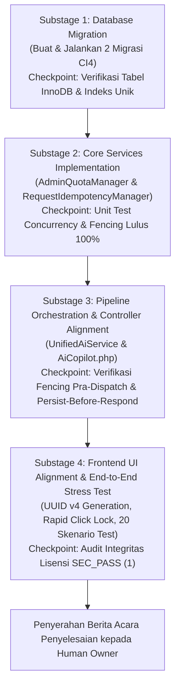

# EAO-OWNER-APPROVAL-PACKAGE-2026-006I
## Paket Otorisasi Implementasi Fase 1C: Integrasi Asis AI Copilot, Penegakan Kuota Admin Terpadu, Fencing Pra-Dispatch, dan Idempotensi Tombstone

**Nomor Dokumen:** EAO-OWNER-APPROVAL-PACKAGE-2026-006I  
**Tanggal Pengajuan:** 16 November 2026  
**Otoritas Pembuat:** Tim Multi-Agen EAO (AI Project Manager, AI System Architect, AI Security Reviewer, AI Developer, AI QA Engineer)  
**Penerima:** Pemilik Proyek ESPATA (Human Owner)  
**Status Dokumen:** DRAF PAKET OTORISASI — MENUNGGU KEPUTUSAN TERTULIS HUMAN OWNER  
**Tingkat Risiko:** Sedang — Terkendali Penuh (*Fully Controlled & Isolated*)

---

## 1. Ringkasan Eksekutif & Tujuan Utama Fase 1C

Paket ini disusun untuk memfasilitasi keputusan akhir Pemilik Proyek (Human Owner) dalam memberikan otorisasi pelaksanaan implementasi **Fase 1C: AI Copilot Alignment & Dual-Traceability Integration**.

### Tujuan Operasional:
1. Menghubungkan antarmuka **Asis AI Copilot** (`app/Controllers/Api/AiCopilot.php`) ke dalam pipeline terpadu `UnifiedAiService` yang telah tervalidasi di Fase 1B.
2. Menegakkan **Batas Kuota Administrator 20 Generasi/Hari (Asia/Jakarta)** melalui tabel terdedikasi `ai_admin_quota_daily` dengan mitigasi deadlock InnoDB.
3. Mengeliminasi pemborosan kuota akibat klik ganda dan network timeout melalui tabel idempotensi persisten `ai_request_idempotency` berkonsep **Permanent Tombstone**.
4. Mengamankan eksekusi multi-worker melalui **Worker Fencing Token** dan protokol **Persist-Before-Respond**.
5. Merekam jejak audit ganda (*Dual-Traceability*) tanpa mengekspos API Key atau data sensitif pribadi.

---

## 2. Rangkuman Keputusan Arsitektur yang Telah Disepakati

Seluruh desain teknis mengikat secara kaku keputusan-keputusan berikut:
- **Prioritas BYOK:** Kunci pribadi guru (`self`) selalu diprioritaskan dan sepenuhnya bypass kuota Admin.
- **Satu-satunya Fallback:** Hanya API Key Administrator yang diizinkan menjadi fallback bersama.
- **Larangan Fallback Silang:** API Key guru lain **DILARANG KERAS** digunakan sebagai fallback otomatis.
- **Peniadaan Fallback `.env`:** Kunci konfigurasi file `.env` tidak digunakan untuk permintaan pengguna.
- **Batas Keras 20 Generasi:** Kuota Admin terkunci mutlak maksimal 20 generasi agregat per hari kalender Asia/Jakarta.
- **Gerbang Fencing Pra-Dispatch Berpagar Lease & Transaksi Refund Konsisten (Adendum 006J, 006K, 006L, & 006M):** Transisi durable dispatch marker wajib sukses dengan syarat sewa aktif (`lease_expires_at > NOW()`) sebelum cURL dipanggil; worker terfencing seketika jika sewa kedaluwarsa atau kehilangan hak kepemilikan. Recovery Kasus B secara eksplisit mewajibkan `dispatch_started_at IS NOT NULL`. Pengembalian slot kuota dieksekusi secara atomik ganda (keduanya wajib `affected_rows == 1` atau rollback penuh) dengan validasi eksplisit `used_count > 0` pada tanggal reservasi awal, serta rekonsiliasi ambiguous commit berpagar kunci pesimistik InnoDB (`SELECT ... FOR UPDATE`).
- **Persist-Before-Respond:** Respons sukses HTTP 200 hanya boleh dikirim ke browser setelah payload tersimpan persisten di database InnoDB.
- **Permanent Tombstone Identity:** Metadata UUID tidak pernah dihapus guna memberantas *replay amnesia*; hanya payload teks respons yang dibersihkan setelah 7 hari kalender. Permintaan pada UUID usang merespons deterministik `HTTP 410 Gone`.
- **Anti-Enumerasi Akun:** Permintaan terhadap UUID milik pengguna lain mengembalikan status generik `HTTP 404` tanpa membocorkan eksistensi data.
- **Zero PII Heuristik:** Diakui sebagai *Defense-in-Depth Heuristic Scrubber* (bukan kesempurnaan matematis), disertai pembatasan respons maksimal 64 KB di backend.
- **Inviolabilitas Berkas Terlindung:** 6 berkas lisensi dan zona Frozen (`bayaran/` dan `cbtku/`) terlindungi 100% tanpa perubahan.

---

## 3. Lingkup Berkas yang Akan Dikerjakan (*Implementation Scope*)

### A. Berkas Migrasi Baru (Database Layer):
1. `app/Database/Migrations/2026-11-16-100000_CreateAiAdminQuotaDailyTable.php`  
   *Tabel agregasi harian Admin (kolom: id, quota_date [UNIQUE], used_count, timestamps; ENGINE=InnoDB).*
2. `app/Database/Migrations/2026-11-16-100001_CreateAiRequestIdempotencyTable.php`  
   *Tabel pelacak idempotensi, worker fencing, dan permanent tombstone (kolom: id, client_message_id [UNIQUE], user_id, request_hash, key_source, quota_date, quota_status, status, response_payload, worker_token, dispatch_started_at, lease_expires_at, timestamps; ENGINE=InnoDB).*

### B. Berkas Service Baru & Diperbarui (Service Layer):
1. `app/Services/Ai/AdminQuotaManager.php` (Baru)  
   *Layanan reservasi kuota harian atomik, rollback-before-retry, jitter backoff 15–45ms, rekonsiliasi commit ambigu, dan fail-closed.*
2. `app/Services/Ai/RequestIdempotencyManager.php` (Baru)  
   *Layanan klaim atomik UUID, worker fencing token, transisi status bersyarat, safe replay (HTTP 200 vs 410), anti-enumerasi 404, dan pruning payload 7 hari.*
3. `app/Services/Ai/UnifiedAiService.php` (Diperbarui)  
   *Penyelarasan pipeline: Zero PII $\rightarrow$ Resolusi Kunci $\rightarrow$ Idempotency Claim $\rightarrow$ Quota Reservation $\rightarrow$ Pre-Dispatch Fencing $\rightarrow$ cURL $\rightarrow$ Persist Response $\rightarrow$ Telemetri.*

### C. Berkas Controller & Frontend (Interface Layer):
1. `app/Controllers/Api/AiCopilot.php` (Diperbarui)  
   *Pelepasan session lock awal (`session_write_close()`), validasi header `X-Client-Message-Id`, penanganan safe replay, dan routing error generik.*
2. `public/assets/js/asis-copilot.js` (Diperbarui)  
   *Pembangkitan UUID v4 tunggal per aksi klik, penonaktifan tombol submit saat in-flight, dan pelestarian UUID pada paket retry.*

### D. Berkas Pengujian Unit:
1. `tests/unit/AdminQuotaManagerTest.php` (Baru)
2. `tests/unit/RequestIdempotencyManagerTest.php` (Baru)

---

## 4. Daftar Berkas dan Area yang DILARANG KERAS Diubah

1. **Enam Berkas Lisensi Terlindung Mutlak:**  
   `app/Helpers/license_helper.php`, `app/Libraries/LicenseGuard.php`, `app/Libraries/SecurityGuard.php`, `app/Libraries/SecureConfig.php`, `app/Filters/LicenseFilter.php`, `app/Models/LicenseModel.php`, serta berkas `.security_hash` dan `.lic_hash`.
2. **Zona Sub-Aplikasi Frozen:**  
   Direktori `bayaran/` dan `cbtku/` tetap beku dan tidak boleh disentuh.
3. **Konfigurasi Lingkungan:**  
   Berkas `.env` dan `composer.json` (dilarang menambah dependency pihak ketiga baru).

---

## 5. Rencana Tahapan Kerja Sekuensial (Substages with Checkpoints)

Pelaksanaan implementasi dibagi menjadi 4 sub-tahap terukur dengan gerbang verifikasi mandiri:



---

## 6. Prosedur Rollback & Perlindungan Data Produksi

Untuk melindungi data historis dan integritas sistem:

### A. Rollback Darurat Aplikasi di Lingkungan Produksi (Safe Code Rollback):
Jika terjadi kendala pada controller/service setelah beberapa hari produksi berjalan:
```bash
git checkout -- app/Controllers/Api/AiCopilot.php app/Services/Ai/UnifiedAiService.php
```
*Tindakan ini mengembalikan logika kode ke versi stabil tanpa menyentuh basis data. Tabel `ai_admin_quota_daily` dan `ai_request_idempotency` TETAP DIPERTAHANKAN agar riwayat transaksi dan tombstone tidak hilang.*

### B. Rollback Penuh di Lingkungan Uji / Development:
Jika terjadi kegagalan fatal pada tahap awal sebelum ada data operasional:
```bash
php spark migrate:rollback
git checkout -- app/Controllers/Api/AiCopilot.php app/Services/Ai/UnifiedAiService.php
```
*Menghapus tabel migrasi baru dan membersihkan file baru.*

### C. Verifikasi Lisensi Pasca-Rollback:
```bash
php scratch/check_hashes.php
```
*Wajib memastikan status kembali `SEC_PASS` (1).*

---

## 7. Analisis Risiko Residual yang Diketahui
1. **Penyedia AI Mengalami Gangguan Global (Outage Groq / Cloudflare):** Ditangani dengan pengalihan otomatis ke fallback lokal tanpa refund (Strict No-Refund) guna mencegah kerugian finansial kuota.
2. **Koneksi Klien Putus Setelah Transaksi Tersimpan:** Klien tidak melihat respons seketika, namun data aman di database dan dapat dibaca kembali via Safe Replay saat halaman dimuat ulang.

---

## 8. Pernyataan Penegasan Otoritas

> **PENTING:**  
> Penerimaan atau persetujuan atas dokumen analisis teknis terdahulu (EAO-006A s.d. EAO-006H) semata-mata merupakan persetujuan atas rancangan arsitektur. **Eksekusi implementasi fisik (pembuatan migrasi dan pengubahan kode) HANYA DAPAT DIMULAI apabila Human Owner menandatangani status APPROVE pada lembar keputusan di bawah.**

---

## 9. Lembar Keputusan Resmi Pemilik Proyek (Human Owner)

Silakan tentukan pilihan keputusan di bawah ini:

```markdown
STATUS KEPUTUSAN HUMAN OWNER:

[   ] APPROVE
      Memberikan otorisasi penuh kepada Tim Multi-Agen EAO untuk memulai eksekusi implementasi 
      Fase 1C sesuai dengan ruang lingkup dan tahapan kerja pada dokumen EAO-OWNER-APPROVAL-PACKAGE-2026-006I.

[   ] REVISE
      Meminta revisi teknis tambahan pada poin tertentu sebelum otorisasi diberikan.
      Catatan revisi: __________________________________________________________________

[   ] REJECT
      Menolak rancangan implementasi Fase 1C.
      Alasan penolakan: ________________________________________________________________

Tanda Tangan Human Owner : ____________________________________
Tanggal Keputusan        : ____________________________________
```
