# EAO-REP-2026-003-PREFLIGHT-REV1
## Addendum Pemeriksaan Praimplementasi Stage 2.3 — Integrasi UnifiedAiService ke AiCopilot

**Nomor Dokumen:** EAO-REP-2026-003-PREFLIGHT-REV1  
**Proyek:** ESPATA — Asis AI  
**Status Tahap:** Tahap 2.3A Selesai (Analisis & Audit Dokumentasi Sahaja — **Nol Perubahan Kode**)  
**Status Tahap 2.3B:** MENUNGGU PERSETUJUAN TERTULIS HUMAN OWNER  
**Pelaksana:** Tim AI Development Organization (EAO)  
- *AI System Architect* (Audit Arsitektur, Keamanan Adapter, & Penegakan Otorisasi)  
- *AI QA Engineer* (Verifikasi Kontrak Frontend & Penelusuran Regresi)  
- *AI Product Analyst* (Analisis Pengalaman Pengguna & Dampak Ketiadaan Kunci)  
- *AI Developer & AI Project Manager* (Pengawasan Batasan, Mitigasi Risiko, & Tata Kelola)  
**Tanggal Evaluasi:** 15 November 2026  

---

### 1. Analisis Dampak Ketiadaan Kunci `GROQ_API_KEY` Sekolah

Audit ini mengkaji secara komparatif dampak ketiadaan kunci resmi `GROQ_API_KEY` di lingkungan `.env` terhadap perilaku sistem dan pengalaman pengguna sekolah:

```mermaid
flowchart TD
    subgraph S1["Sebelum Integrasi (Saat Kunci Gemini Guru/User Aktif)"]
        A1["Perintah Bebas Pengguna"] --> B1["resolveAiKey() (Ambil Kunci Gemini/Groq di DB)"]
        B1 --> C1["callGeminiNlu() (cURL ke Google)"]
        C1 --> D1["Gelembung Respons AI: Teks 'ai_content' + Tombol Aksi ('source' => 'gemini')"]
    end

    subgraph S2["Setelah Integrasi (Jika GROQ_API_KEY di .env Belum Tersedia)"]
        A2["Perintah Bebas Pengguna"] --> B2["UnifiedAiService::resolveActiveProvider()"]
        B2 -- "isAvailable() = FALSE (Kunci Sekolah Kosong)" --> C2["Degradasi Anggun Otomatis"]
        C2 --> D2["matchLocally() (Pencocokan Cepat Lokal)"]
        D2 --> E2["Gelembung Respons Lokal: Penjelasan Indeks + Tombol Aksi ('source' => 'local')"]
    end
```



#### A. Perbandingan Perilaku Sistem Sebelum vs Sesudah Integrasi

| Parameter Perilaku | Sebelum Integrasi (Eksisting) | Setelah Integrasi (Tanpa `GROQ_API_KEY`) |
| :--- | :--- | :--- |
| **Sumber Kunci AI** | Mengambil secara campur aduk dari `teachers.gemini_api_key`, `users.gemini_api_key`, atau `.env`. | **Eksklusif kunci sekolah dari `.env` (`GROQ_API_KEY`)**. Sesuai batasan mutlak, sistem dilarang mengambil kunci guru/user. |
| **Pengecekan Ketersediaan** | Mengabaikan ketiadaan kunci sekolah jika kunci guru ada di tabel DB. | Mendeteksi ketiadaan `GROQ_API_KEY` secara elegan di level arsitektur via `isAvailable() === false`. |
| **Eksekusi Jaringan** | Melakukan cURL keluar ke Google Gemini (rawan gagal jika kunci di DB ternyata bertipe Groq `gsk_`). | **Nol panggilan jaringan keluar**. Tidak ada cURL yang dikirim, menghemat beban server dan latensi 0 ms. |
| **Penanganan Status** | Melempar log warning `HTTP error` jika koneksi luar gagal. | Menjalankan **Degradasi Anggun (*Graceful Degradation*)** seketika tanpa exception, tanpa HTTP 500. |

#### B. Fitur yang Tetap Berfungsi Penuh (100% Operational)
1. **Direct Live Database Queries (`tryExecuteLiveQuery`):**
   - Jadwal mengajar guru hari ini (tabel jam, kelas, mata pelajaran).
   - Rekap presensi guru hari ini (persentase hadir dan tidak hadir).
   - Monitoring ujian online CBT aktif (jumlah siswa aktif di ruang ujian).
   - Pencarian siswa cepat (nama, kelas, NISN, tombol profil siswa).
2. **Built-in Feature Knowledge Base (`EspataFeatureKnowledge`):**
   - Panduan fitur resmi berbasis aturan kata kunci luring (misal: *"cara buat modul ajar"*, *"cara reset CBT"*, *"cara input nilai"*) tetap menghasilkan kartu panduan langkah demi langkah bernomor 1, 2, 3 (`guide_card`) dan tombol menu.
3. **Pencarian Menu & Navigasi Cepat (<kbd>Ctrl</kbd> + <kbd>K</kbd>):**
   - Pencocokan lokal (`matchLocally`) tetap menemukan seluruh menu akademik berizin dan menampilkan saran alternatif terkait.
4. **Morning Voice Briefing (`morningBriefing`):**
   - Pembacaan suara sambutan harian guru dan kepsek tetap 100% aktif karena dibangun secara deterministik dari database akademik tanpa LLM.
5. **Keamanan & Otorisasi RBAC:**
   - Seluruh pemeriksaan peran pengguna dan pembatasan data tetap terkunci rapat.

#### C. Fitur yang Kehilangan Kemampuan AI Eksternal
1. **Pemahaman Bahasa Alami Kompleks (*Natural Language Disambiguation*):**
   - Pertanyaan bebas yang menggunakan bahasa gaul, kalimat multitafsir, atau tidak mengandung kata kunci menu akan diarahkan ke saran menu terdekat atau dinyatakan tidak ditemukan.
2. **Generasi Teks Dinamis (*Dynamic Free-Text Generation*):**
   - Field `ai_content` akan bernilai `null` untuk kueri umum di luar basis pengetahuan bawaan (tidak ada ide materi otomatis atau naskah tutur bebas di luar template).

#### D. Perbedaan Pengalaman Pengguna & Rekomendasi Transparansi Antarmuka
- **Pengalaman Pengguna:** Pengguna tetap memperoleh tombol navigasi ke halaman yang dituju dengan kecepatan seketika (0–5 ms), namun tidak menerima narasi percakapan panjang.
- **Rekomendasi Transparansi:**  
  Sistem **DILARANG** menampilkan badge *"Smart"* atau pesan yang mengindikasikan bahwa AI generatif telah menganalisis kueri jika resolusi berasal dari pencocokan lokal (`source: 'local'`). Kalimat penjelasan (`explanation`) wajib menyatakan secara jujur:  
  *Contoh:* `"Mengarahkan ke Input Nilai (Akademik) berdasarkan pencocokan indeks menu sekolah."* alih-alih mengklaim hasil analisis kecerdasan buatan.

---

### 2. Validasi Kontrak Frontend dan Penelusuran Field `source`

Audit mendalam dilakukan terhadap seluruh skrip tampilan frontend, khususnya pada berkas [command_palette.php](file:///c:/xampp/htdocs/siakad/app/Views/layouts/partials/command_palette.php) (1.348 baris).

#### A. Hasil Penelusuran Field `source`
- **Temuan Faktual:** Frontend JavaScript pada `command_palette.php` **SAMA SEKALI TIDAK MEMILIKI PERCABANGAN (*NO CONDITIONAL LOGIC / NO SWITCH-CASE*) TERHADAP FIELD `source`**.
- Penelusuran fungsi `renderBotResponse(res)` membuktikan bahwa perenderan antarmuka hanya memeriksa percabangan berikut:
  1. `if (res.widget_type === 'schedule_card')` $\rightarrow$ Render tabel jadwal.
  2. `else if (res.widget_type === 'stat_card')` $\rightarrow$ Render kartu statistik presensi.
  3. `else if (res.widget_type === 'cbt_card')` $\rightarrow$ Render badge CBT.
  4. `else if (res.widget_type === 'student_search_card')` $\rightarrow$ Render list group siswa.
  5. `else if (res.widget_type === 'guide_card')` $\rightarrow$ Render tutorial bernomor knowledge base.
  6. `else` $\rightarrow$ Render gelembung teks standar (`res.explanation` dan blok `res.ai_content`), diikuti tombol tindakan langsung `res.matched_action`.
- **Fungsi Asli `source`:** Field `source` murni digunakan sebagai **metadata telemetri dan audit internal** yang dicatat ke tabel `ai_assistant_logs`.
- **Dampak Perubahan dari Gemini ke Groq:** Mengubah nilai `source` dari `'gemini'` menjadi `'groq'` **TIDAK AKAN MEMPENGARUHI RENDERING ANTARMUKA PENGGUNA**.

#### B. Matriks Perbandingan Kontrak Respons: Kontrak Lama vs Kontrak Terencana

| Nama Field JSON | Tipe Data | Kontrak Lama (Eksisting) | Kontrak Terencana (Tahap 2.3) | Kompatibilitas Frontend |
| :--- | :---: | :--- | :--- | :---: |
| `status` | `string` | `'success'` | `'success'` | **100% Identik** |
| `source` | `string` | `'gemini'`, `'local'`, `'knowledge_base'`, `'database'` | `'groq'` (saat AI aktif), `'local'`, `'knowledge_base'`, `'database'` | **100% Kompatibel** |
| `query` | `string` | Teks input bersih | Teks input bersih (disanitasi Zero PII) | **100% Identik** |
| `explanation` | `string` | Penjelasan 1 kalimat | Penjelasan 1 kalimat santun | **100% Identik** |
| `matched_action` | `object\|null` | `{id, title, url, icon, category}` | `{id, title, url, icon, category}` | **100% Identik** |
| `suggestions` | `array` | Array aksi alternatif | Array aksi alternatif | **100% Identik** |
| `ai_content` | `string\|null` | Panduan langkah bernomor atau null | Panduan langkah bernomor atau null | **100% Identik** |
| `widget_type` | `string\|null` | Tipe kartu widget khusus jika ada | Tipe kartu widget khusus jika ada | **100% Identik** |
| `widget_data` | `array\|null` | Data pendukung widget | Data pendukung widget | **100% Identik** |
| `csrf_hash` | `string` | Nilai token CSRF terbaru | Nilai token CSRF terbaru | **100% Identik** |

---

### 3. Audit Keamanan Aktual `GroqAdapter` dan `UnifiedAiService`

Pemeriksaan baris per baris dilakukan terhadap [GroqAdapter.php](file:///c:/xampp/htdocs/siakad/app/Services/Ai/Providers/GroqAdapter.php) dan [UnifiedAiService.php](file:///c:/xampp/htdocs/siakad/app/Services/Ai/UnifiedAiService.php):

| Parameter Audit Keamanan | Status Aktual | Bukti Baris Kode | Catatan & Analisis |
| :--- | :---: | :--- | :--- |
| **1. Verifikasi Sertifikat SSL Aktif** | **TERBUKTI AMAN** | `GroqAdapter.php` baris 124–125:<br>`CURLOPT_SSL_VERIFYPEER => true`<br>`CURLOPT_SSL_VERIFYHOST => 2` | Berbeda dari controller lama (`AiCopilot.php:657`) yang mematikan SSL (`SSL_VERIFYPEER = false`), adapter baru **menegakkan validasi SSL mutlak**, mencegah serangan *Man-in-the-Middle (MITM)*. |
| **2. Batas Waktu (Timeout) Koneksi & Respons** | **TERBUKTI AMAN** | `GroqAdapter.php` baris 122–123:<br>`CURLOPT_CONNECTTIMEOUT => 5 detik`<br>`CURLOPT_TIMEOUT => 25 detik (clamp maks 60)` | Mencegah proses PHP menggantung tak terhingga di shared hosting jika terjadi gangguan koneksi internasional. |
| **3. API Key Tidak Masuk Log Audit** | **TERBUKTI AMAN** | `GroqAdapter.php` baris 145 & 162 (`maskSecret()`)<br>`UnifiedAiService.php` baris 360–388 | Seluruh pesan error disaring dari substring kunci API. Tabel `ai_assistant_logs` hanya mencatat jumlah token, nama model, dan status keberhasilan tanpa mencatat kunci. |
| **4. Validasi Struktur Respons Vendor** | **TERBUKTI AMAN** | `GroqAdapter.php` baris 157–187 & 202–207 | Memeriksa `is_array($decoded)`, keberadaan array `choices`, dan non-null `content`. Pada JSON mode, string diparsing defensif dengan `json_decode()` dan divalidasi `is_array($parsed)`. |
| **5. Error Tidak Mengungkap Detail Internal** | **TERBUKTI AMAN** | `GroqAdapter.php` baris 160–173 | Pesan error numerik teknis diubah menjadi pesan terstandar bahasa Indonesia yang aman bagi pengguna. |
| **6. Penutupan Sesi Sebelum Eksekusi cURL** | **TERBUKTI AMAN** | `UnifiedAiService.php` baris 145–147 & 195–197 | `session_write_close()` dipanggil tepat setelah data autentikasi dibaca dan sebelum koneksi cURL dikirim, **mencegah peramban tab lain terkunci**. |
| **7. Hasil AI Tidak Menembus Batas RBAC** | **TERBUKTI AMAN** | `AiCopilot.php` baris 375 & 674–680 | `matched_id` keluaran AI dicocokkan silang dengan `$allowedActions`. Jika AI mengembalikan ID aksi di luar hak akses role pengguna, hasil ditolak seketika. |

#### Temuan Kekurangan Teknis & Mitigasi Desain (Tanpa Ubah Kode):
> **Lokasi Temuan:** `UnifiedAiService.php` baris 122–123:  
> ```php
> $sessionUserId = session()->get('user_id') ?: null;
> $sessionRoleId = session()->get('role_id') ?: null;
> ```
> **Dampak:** Pada sistem otentikasi CI4 ESPATA (`Auth.php:82`), data pengguna disimpan di sesi dalam bentuk array: `session()->get('user')`. Pemanggilan langsung `session()->get('user_id')` akan mengembalikan `null` jika tidak diset secara skalar.  
> **Rekomendasi Mitigasi:** Pada integrasi Tahap 2.3B, controller `AiCopilot` yang sudah memegang array `$user` akan menyuntikkan ID dan Role secara eksplisit ke dalam `AiRequest` agar telemetri audit log tetap akurat 100%.

---

### 4. Validasi Matriks RBAC (*Role-Based Access Control*)

Pemeriksaan silang terhadap skema hak akses membuktikan bahwa seluruh fungsionalitas `AiCopilot` tunduk pada batasan peran:

| Peran Pengguna (Role) | Quick Actions (`getActions`) | Live Queries (`tryExecuteLiveQuery`) | Built-in Guide | Pemanggilan AI (NLU) | Morning Briefing |
| :--- | :--- | :--- | :--- | :--- | :--- |
| **Role 1 (Admin)** | Akses seluruh menu sistem master | Rekap presensi guru, monitoring CBT, cari siswa | Akses panduan admin | Sesuai menu admin | Briefing Eksekutif Admin |
| **Role 2 (Kepala Sekolah)** | Akses menu supervisi & eksekutif | Rekap presensi guru, monitoring CBT, cari siswa | Akses panduan manajerial | Sesuai menu kepsek | Briefing Eksekutif Kepsek |
| **Role 3 (Guru)** | **Hanya kelas & mapel yang diampu** | **Jadwal mengajarnya sendiri**, cari siswa | Akses panduan KBM/CBT/Nilai | Sesuai menu & kelas guru | Briefing Personal Guru |
| **Role 4 (Orang Tua)** | Terbatas rapor & tagihan anak | Ditolak (return null) | Panduan wali murid | Sesuai menu orang tua | Ditolak (`can_brief => false`) |
| **Role 5 (Siswa)** | Terbatas jadwal & CBT siswa | Ditolak (return null) | Panduan belajar/ujian | Sesuai menu siswa | Ditolak (`can_brief => false`) |
| **Role 6 (Kontributor)** | Menu kontribusi terbatas | Ditolak (return null) | Panduan kontributor | Sesuai menu kontributor | Ditolak (`can_brief => false`) |
| **Role 7 (Staf TU)** | Menu persuratan & tata usaha | Monitoring operasional TU | Panduan administrasi | Sesuai menu staf | Briefing Eksekutif Staf |
| **Role 8 (Pelatih)** | Menu ekskul / pembinaan | Ditolak (return null) | Panduan pelatih | Sesuai menu pelatih | Ditolak (`can_brief => false`) |

#### Prinsip Keamanan Otorisasi yang Terbukti:
1. **Identitas Pengguna Terverifikasi:** Berasal murni dari sesi server `session()->get('user')`, parameter request tidak dapat memalsukan identitas (`role_id` atau `user_id`).
2. **Kekebalan Otorisasi Terhadap Halusinasi AI:** Output model AI (`matched_id`) diverifikasi terhadap tabel hash `$actionMap`. Jika model mencoba mengarahkan siswa ke halaman penilaian guru atau admin, sistem menolaknya secara mutlak.
3. **Minimisasi Data:** Prompt yang dikirimkan ke AI hanya berupa katalog ringkasan judul dan ID aksi (`$actionCatalog`), tanpa menyertakan data sensitif siswa atau sekolah.

---

### 5. Risiko yang Belum Terselesaikan & Strategi Penanganannya

| Risiko yang Ditemukan | Analisis Dampak | Status Saat Ini | Strategi Penanganan Disetujui |
| :--- | :--- | :---: | :--- |
| **1. Ketiadaan Kunci Groq Sekolah di `.env`** | Panggilan ke API luar tidak dapat dilakukan pada pengujian live Tahap 2.3B. | Belum Ada Kunci di `.env` | **Graceful Degradation:** Sistem otomatis mengalihkan ke `matchLocally()`. Pengujian Tahap 2.3B dilakukan via Mock Adapter terisolasi tanpa memodifikasi file `.env`. |
| **2. Pengambilan Data Sesi Skalar di Service Layer** | `user_id` di telemetri service berpotensi null jika hanya membaca sesi skalar. | Perlu Penyelarasan Konteks | Controller `AiCopilot` akan memastikan parameter konteks pengguna dikirimkan secara eksplisit saat memanggil `UnifiedAiService`. |
| **3. Ketidakkonsistenan Format Kunci DB (`gsk_` di kolom `gemini_api_key`)** | Potensi kesalahan asumsi di masa depan bahwa kolom tersebut adalah kunci Gemini. | Data DB Tetap Utuh | **Pencegahan Mutlak:** Integrasi Stage 2.3 menghentikan total ketergantungan pada kolom DB tersebut dan hanya merujuk pada `.env`. |

---

### 6. Rekomendasi Desain Integrasi Paling Aman (Stage 2.3B)

Untuk menjamin prinsip *Zero Regression* dan integritas sistem, Tim EAO merekomendasikan rancangan implementasi bedah minimal berikut:

```php
// RANCANGAN ARSITEKTUR INTEGRASI PADA AiCopilot::ask()
// 1. Instansiasi UnifiedAiService
$aiService = new \App\Services\Ai\UnifiedAiService();

// 2. Bangun AiRequest dengan isolasi instruksi ketat
$aiRequest = new \App\Services\Ai\DTO\AiRequest(
    $query,
    $systemInstruction,
    [],
    'openai/gpt-oss-20b', // Kandidat provider awal
    0.2,
    600,
    6, // Timeout cepat 6 detik
    true // Modus JSON
);

// 3. Eksekusi terpadu (Otomatis: Zero PII, Session Release, Error Trapping)
$aiResponse = $aiService->executeJson($aiRequest, 'groq');

// 4. Evaluasi hasil secara defensif
if ($aiResponse->success && !empty($aiResponse->jsonData['matched_id'])) {
    $matchedId = $aiResponse->jsonData['matched_id'];
    if (isset($actionMap[$matchedId])) {
        // Validasi lolos: kembalikan respons AI terverifikasi
        return $this->respond([
            'status'         => 'success',
            'source'         => 'groq',
            'query'          => $query,
            'explanation'    => $aiResponse->jsonData['explanation'] ?? 'Tindakan yang sesuai ditemukan.',
            'matched_action' => $actionMap[$matchedId],
            'suggestions'    => $resolvedSuggestions,
            'ai_content'     => $aiResponse->jsonData['ai_content'] ?? null,
            'csrf_hash'      => csrf_hash(),
        ]);
    }
}

// 5. Fallback Anggun: Jika Groq gagal/timeout/kunci kosong/format JSON cacat
$localResult = $this->matchLocally($query, $allowedActions);
return $this->respond([
    'status'         => 'success',
    'source'         => 'local',
    'query'          => $query,
    'explanation'    => $localResult['explanation'],
    'matched_action' => $localResult['matched_action'],
    'suggestions'    => $localResult['suggestions'],
    'csrf_hash'      => csrf_hash(),
]);
```

---

### 7. Daftar Berkas yang Akan Diubah pada Tahap 2.3B

Pekerjaan pada Tahap 2.3B dibatasi secara ketat hanya pada **1 berkas aplikasi**:
1. **`app/Controllers/Api/AiCopilot.php`**
   - Menghubungkan pemanggilan ke `UnifiedAiService`.
   - Menggantikan ketergantungan method lama `callGeminiNlu()` dan `resolveAiKey()`.
   - Memastikan kontrak JSON respons ke frontend tidak berubah sedikit pun.

> **Status Berkas Lain (DILARANG BERUBAH):**
> - `app/Libraries/AiActionRegistry.php`: **Tidak Disentuh (0 perubahan)**.
> - `app/Views/layouts/partials/command_palette.php`: **Tidak Disentuh (0 perubahan)**.
> - Berkas `.env`: **Tidak Disentuh (0 perubahan)**.
> - Basis Data / Migrasi: **Tidak Disentuh (0 perubahan)**.
> - Enam berkas perlindungan lisensi: **Terlindungi Mutlak (`SEC_PASS`)**.
> - Direktori `bayaran/` dan `cbtku/`: **Tetap Frozen**.

---

### 8. Bukti Kepatuhan Batasan & Integritas Lingkungan

- [x] **Nol Perubahan Kode:** Tidak ada berkas kode PHP atau JS aplikasi yang disentuh pada tahap addendum ini.
- [x] **Enam Berkas Terlindungi Tetap Aman:** Hasil eksekusi `SecurityGuard::verifyCriticalFiles()` = **`SEC_PASS`**.
- [x] **Git Cleanliness:** `git diff` pada berkas terlacak menghasilkan **0 baris perubahan**.
- [x] **Area Frozen Terjaga:** Direktori `bayaran/` dan `cbtku/` tetap berstatus *Frozen*.
- [x] **Pencegahan Kebocoran Kunci:** Tidak ada kunci rahasia yang diekspos dalam dokumen ini.

---

### 9. Titik Penghentian (Stop Condition)

> **Seluruh 4 pertanyaan teknis pada Addendum Praimplementasi Stage 2.3 telah dijawab dan didokumentasikan secara tuntas.**  
> Sesuai instruksi mutlak Human Owner: **Tim EAO MENGHENTIKAN seluruh aktivitas teknis dan MENUNGGU keputusan serta persetujuan tertulis dari Human Owner sebelum dapat memulai Tahap 2.3B (Integrasi Kode).**
