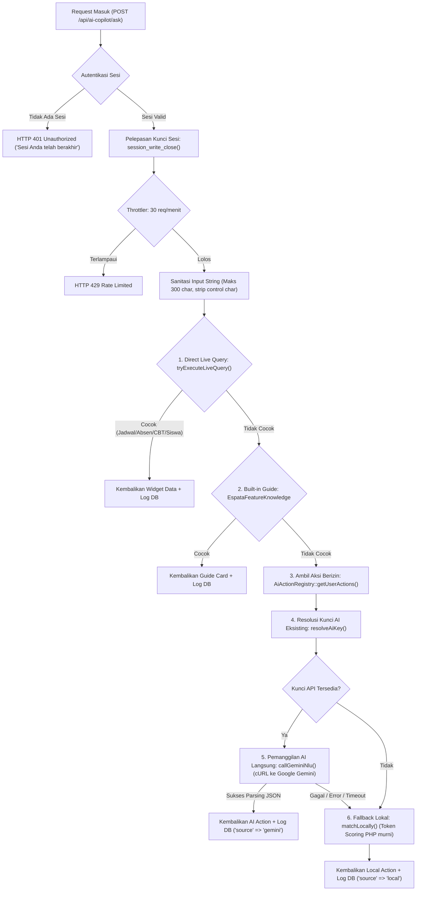

# EAO-REP-2026-003-PREFLIGHT
## Laporan Pemeriksaan Kesiapan Integrasi UnifiedAiService ke AiCopilot (Tahap 2.3A)

**Nomor Dokumen:** EAO-REP-2026-003-PREFLIGHT  
**Proyek:** ESPATA — Asis AI  
**Status Tahap:** Tahap 2.3A Selesai (Pemeriksaan Kesiapan Tanpa Perubahan Kode)  
**Status Tahap 2.3B:** MENUNGGU PERSETUJUAN TERTULIS HUMAN OWNER  
**Pelaksana:** Tim AI Development Organization (EAO)  
- *AI System Architect* (Audit Arsitektur & Desain Integrasi Service Layer)  
- *AI QA Engineer* (Penyusunan Rencana Uji Regresi & Kompatibilitas Frontend)  
- *AI Product Analyst* (Validasi Pengalaman Pengguna, Kesantunan, & Kebutuhan Sekolah)  
- *AI Developer* (Pemeriksaan Kode Aktual & Pemetaan Titik Integrasi)  
- *AI Project Manager* (Pengawasan Batasan, Risiko, & Tata Kelola)  
**Tanggal Evaluasi:** 15 November 2026  

---

### 1. Peta Alur `AiCopilot` Saat Ini

Berdasarkan audit langsung terhadap berkas `App\Controllers\Api\AiCopilot.php` (779 baris), alur kerja pemrosesan perintah asisten saat ini adalah sebagai berikut:



---

### 2. Daftar Titik Pemanggilan AI Langsung yang Perlu Diganti

Audit menemukan 3 titik ketergantungan langsung yang harus digantikan oleh `UnifiedAiService` pada Tahap 2.3B:

| Lokasi Kode | Metode / Komponen Eksisting | Deskripsi Masalah & Alasan Penggantian |
| :--- | :--- | :--- |
| **Baris 604 – 699** | `protected function callGeminiNlu(string $query, array $allowedActions, string $apiKey): array` | **Pemanggilan cURL Langsung ke Google:** Melakukan request jaringan mandiri ke `https://generativelanguage.googleapis.com` dengan format Gemini spesifik, timeout hardcoded 6 detik, dan verifikasi SSL dinonaktifkan (`CURLOPT_SSL_VERIFYPEER = false`). Titik ini wajib digantikan oleh panggilan `UnifiedAiService::executeJson()`. |
| **Baris 572 – 598** | `protected function resolveAiKey(array $user): array` | **Pencampuran Kunci Guru dan Kunci Sekolah:** Membaca kolom `gemini_api_key` dari tabel `teachers` dan `users` yang berdasarkan audit Tahap 2.2 ternyata berisi kunci Groq (`gsk_`). Logika ini harus digantikan oleh resolusi resmi terpusat di `UnifiedAiService` yang membaca kunci sekolah dari `.env`. |
| **Baris 373 – 390** | Blok orkestrasi di method `ask()` | **Kopling Erat dengan Implementasi Gemini:** Kode memeriksa `$aiConfig['api_key']` lalu memanggil `callGeminiNlu()` secara langsung dan mengembalikan `'source' => 'gemini'`. Bagian ini akan dialihkan ke pemanggilan `UnifiedAiService`. |

---

### 3. Kontrak Request dan Response yang Wajib Dipertahankan

Agar kompatibilitas antarmuka pengguna (*Frontend*) di `command_palette.php` tidak mengalami gangguan sekecil apa pun, kontrak API berikut **wajib dipertahankan 100%**:

#### A. Kontrak Permintaan Masuk (*Incoming Request*)
- **Endpoint:** `POST /api/ai-copilot/ask`
- **Headers Wajib:** `Content-Type: application/json`, `X-Requested-With: XMLHttpRequest`, `X-CSRF-TOKEN: <hash>`
- **Payload JSON:**
  ```json
  {
    "query": "string teks perintah/pertanyaan (maksimal 300 karakter)",
    "csrf_test_name": "string token csrf aktif"
  }
  ```

#### B. Kontrak Respons Keluar (*Outgoing Response*)
Struktur JSON yang dikembalikan ke JavaScript peramban:

| Nama Field | Tipe Data | Deskripsi / Nilai yang Diharapkan Frontend |
| :--- | :---: | :--- |
| `status` | `string` | `'success'` (atau HTTP error code 400/401/429 pada kegagalan). |
| `source` | `string` | Asal resolusi: `'groq'`, `'local'`, `'knowledge_base'`, atau `'database'`. |
| `query` | `string` | Teks kueri yang telah dibersihkan/disanitasi. |
| `explanation` | `string` | Kalimat penjelasan singkat dan ramah yang ditampilkan pada gelembung obrolan. |
| `matched_action` | `object\|null` | Objek aksi yang cocok: `{ id, title, url, icon, category }`. Menghasilkan tombol *"Buka [Menu]"*. |
| `suggestions` | `array` | Daftar aksi alternatif (maksimal 3-4 item) jika ada pilihan kedua. |
| `ai_content` | `string\|null` | Naskah panduan bernomor (1, 2, 3), saran materi, atau naskah tutur jika pengguna meminta panduan fitur. |
| `csrf_hash` | `string` | Nilai token CSRF terbaru dari `csrf_hash()`. |

---

### 4. Daftar Role dan Pemeriksaan Izin Aktual (RBAC)

Pemeriksaan aktual terhadap basis data tabel `roles` dan logika otorisasi `AiActionRegistry.php` mengonfirmasi 8 peran pengguna terdaftar:

| ID Role | Nama Role | Cakupan Kewenangan & Pembatasan Data Asis AI |
| :---: | :--- | :--- |
| **1** | **Admin** | Memiliki akses seluruh menu master, data siswa, monitoring CBT, rekap presensi guru, dan pengguna. |
| **2** | **Kepala Sekolah** | Akses eksekutif: rekap presensi harian guru, statistik KBM, monitoring CBT aktif, dan laporan rapor. |
| **3** | **Guru** | **Dibatasi Ketat:** Hanya dapat melihat jadwal mengajarnya sendiri (`teacher_id`), kelas binaan, dan tugas/soal miliknya via `teaching_assignments`. Tidak dapat melihat data guru lain. |
| **4** | **Orang Tua** | Terbatas pada informasi akademik putra/putrinya; tidak memicu briefing eksekutif. |
| **5** | **Siswa** | Terbatas pada jadwal belajar, tugas, dan ujian CBT miliknya; tidak dapat melihat bank soal atau kunci jawaban. |
| **6** | **Kontributor** | Akses terbatas pada kontribusi konten/materi tertentu. |
| **7** | **Staf** | Akses administrasi persuratan dan tata usaha sekolah; dapat menerima briefing eksekutif staf. |
| **8** | **Pelatih** | Akses ekstrakurikuler / pembinaan khusus. |

> **Audit Otorisasi:** Daftar aksi (`$allowedActions`) disusun secara dinamis oleh `AiActionRegistry::getUserActions($user)` yang secara internal menyaring item melalui `MenuRegistry::getUserMenu($user)`. AI tidak pernah disajikan aksi di luar hak akses role pengguna yang sedang login.

---

### 5. Ketergantungan Frontend yang Berpotensi Terdampak

Berdasarkan penelusuran pada `app/Views/layouts/partials/command_palette.php` (1.348 baris), komponen frontend yang berinteraksi dengan `AiCopilot` meliputi:

1. **Spotlight Command Palette (<kbd>Ctrl</kbd> + <kbd>K</kbd>):**
   - Memanggil `GET /api/ai-copilot/actions` saat pertama kali modal dibuka untuk menyimpan cache daftar aksi lokal (`cachedActions`).
2. **Interactive Chat Assistant (Tab "Chat Asisten AI"):**
   - Memanggil `POST /api/ai-copilot/ask` melalui fungsi `submitChatMessage()`.
   - Menggunakan fungsi JavaScript `renderBotResponse(res)` untuk menampilkan kartu widget:
     * `schedule_card` (tabel jadwal guru)
     * `stat_card` (kartu presensi guru hadir/tidak)
     * `cbt_card` (kartu jumlah siswa aktif ujian CBT)
     * `student_search_card` (daftar pencarian siswa)
     * `guide_card` (panduan tutorial bernomor dari knowledge base)
     * *Default Recommendation Bubble* (menampilkan `explanation`, blok `ai_content`, dan tombol `matched_action`).
3. **Morning Voice Briefing:**
   - Memanggil `GET /api/ai-copilot/morning-briefing`. Menggunakan Web Speech API peramban untuk membaca `spoken_text`. Endpoint ini mandiri dan **tidak menggunakan LLM luar**, sehingga tidak berisiko terdampak langsung oleh integrasi service AI.

---

### 6. Kesesuaian `UnifiedAiService` dengan Kebutuhan `AiCopilot`

`UnifiedAiService` yang telah tervalidasi pada Checkpoint 2.1 memiliki keselarasan penuh (*full architectural alignment*) dengan kebutuhan `AiCopilot`:

1. **Format Permintaan & Output JSON (`executeJson`):**
   - `AiCopilot` membutuhkan respons JSON dengan kunci: `matched_id`, `explanation`, `ai_content`, dan `secondary_ids`.
   - `UnifiedAiService::executeJson()` secara bawaan mengaktifkan `jsonMode = true` pada adapter provider dan mengekstrak `jsonData` secara otomatis.
2. **Keamanan Privasi (Zero PII Scrubber 4-Lapis):**
   - Pertanyaan bebas yang diajukan guru/pengguna di kolom chat akan disaring secara otomatis oleh `UnifiedAiService::sanitizeZeroPii()` sebelum dikirim ke Groq, memastikan tidak ada data pribadi (NIK, NISN, No HP, kondisi medis) yang bocor ke luar.
3. **Resiliensi Shared Hosting:**
   - `UnifiedAiService` menjalankan protokol penutupan sesi (`session_write_close()`) tepat sebelum koneksi cURL dilakukan, mencegah peramban pengguna lain di hosting bersama mengalami *session locking*.
4. **Model Kandidat Terpilih:**
   - `openai/gpt-oss-20b` pada Groq Cloud API telah terbukti pada Tahap 2.2 menghasilkan skor validitas parsing JSON sebesar 100% dengan latensi rata-rata ~700 ms.

---

### 7. Analisis Risiko Integrasi & Strategi Mitigasi

| Risiko Potensial | Tingkat Risiko | Dampak Operasional | Strategi Mitigasi Terencana |
| :--- | :---: | :--- | :--- |
| **1. Ketiadaan Kunci Groq Sekolah di `.env`** | **Tinggi** | Panggilan ke API luar gagal memproses bahasa alami. | Sistem menerapkan **Degradasi Anggun (*Graceful Degradation*)**: Jika konfigurasi Groq sekolah belum tersedia, sistem secara mulus langsung mengalihkan ke `matchLocally()` tanpa error 500 dan tanpa melempar exception ke antarmuka. |
| **2. Perbedaan Struktur Sesi Pengguna** | **Sedang** | Ketiadaan `user_id` langsung di sesi menyebabkan telemetri audit kosong. | Sesi autentikasi ESPATA menyimpan array `$user = session()->get('user')`. Konstruksi permintaan di `AiCopilot` akan memetakan `$user['id']` dan `$user['role_id']` secara eksplisit ke dalam konteks `UnifiedAiService`. |
| **3. Kegagalan Parsing JSON dari Vendor Luar** | **Rendah** | Vendor mengembalikan format tidak valid sehingga antarmuka tidak menerima navigasi. | `UnifiedAiService` memvalidasi integritas `jsonData`. Jika `jsonData` bernilai `null` atau `matched_id` tidak ada di `$allowedActions`, sistem secara otomatis menggunakan hasil `matchLocally()`. |
| **4. Keterlambatan Jaringan / Timeout Vendor** | **Rendah** | Pengguna menunggu terlalu lama di depan layar modal. | Batas waktu koneksi dipatok 5 detik dan batas total 6 detik. Jika terjadi timeout, pengguna disajikan pesan ramah dan diarahkan pada menu lokal. |

---

### 8. Daftar Berkas yang Diperkirakan Perlu Diubah pada Tahap 2.3B

Pekerjaan implementasi Tahap 2.3B dirancang dengan prinsip **intervensi bedah minimal (*minimal invasive change*)**:

1. **Berkas yang Dimodifikasi:**
   - `app/Controllers/Api/AiCopilot.php`:
     * Mengimpor `App\Services\Ai\UnifiedAiService`, `App\Services\Ai\DTO\AiRequest`, dan `App\Services\Ai\DTO\AiResponse`.
     * Menginstansiasi `UnifiedAiService` di dalam konstruktor atau method controller.
     * Mengganti blok pemanggilan lama di method `ask()` (baris 372-390) dengan eksekusi `UnifiedAiService::executeJson()`.
     * Mengisolasi/mendepresiasi method privat `callGeminiNlu()` dan `resolveAiKey()`.
2. **Berkas yang DILARANG Berubah (0 Modifikasi):**
   - `app/Libraries/AiActionRegistry.php` (Tetap utuh).
   - `app/Views/layouts/partials/command_palette.php` (Tetap utuh).
   - Berkas konfigurasi `.env` (Tetap utuh).
   - Skema basis data & migrasi (Nol perubahan).
   - Enam berkas perlindungan lisensi (`SecurityGuard`, `LicenseGuard`, dll.) (Tetap terlindungi mutlak).
   - Direktori `bayaran/` dan `cbtku/` (Tetap Frozen).

---

### 9. Daftar Rencana Pengujian Regresi Tahap 2.3B

Pengujian otomatis terisolasi akan disusun dalam berkas `scratch/test_stage_2_3.php` mencakup 12 kriteria penerimaan:

1. [ ] **DI & Instansiasi Service:** `AiCopilot` dapat menginstansiasi dan memanggil `UnifiedAiService` secara stabil.
2. [ ] **Kepatuhan DTO:** Pembuatan objek `AiRequest` dan parsing luaran `AiResponse` sesuai standar arsitektur.
3. [ ] **Integritas Kontrak JSON:** Format JSON luaran `ask()` tetap memuat `status`, `source`, `query`, `explanation`, `matched_action`, `suggestions`, dan `csrf_hash`.
4. [ ] **Penanganan Respons Kosong / Malformed:** Kegagalan pembentukan JSON dari AI dialihkan mulus ke `matchLocally()`.
5. [ ] **Penanganan Timeout cURL:** Timeout jaringan ditangkap bersih tanpa melempar unhandled exception.
6. [ ] **Penanganan HTTP Error Vendor:** Galat 401, 429, dan 500 ditangani dengan anggun.
7. [ ] **Keamanan Ketiadaan Kunci API:** Jika kunci sekolah kosong, sistem tidak crash dan tidak mengambil kunci dari tabel guru.
8. [ ] **Autentikasi Pengguna:** Permintaan tanpa sesi login yang sah ditolak seketika dengan HTTP 401.
9. [ ] **Penegakan Hak Akses (RBAC):** Guru tidak dapat diarahkan ke aksi khusus Admin/Kepsek.
10. [ ] **Pencegahan Kebocoran Data:** Data siswa tidak bocor lintas akun.
11. [ ] **Kerahasiaan Audit Log:** Tabel `ai_assistant_logs` tidak mencatat kredensial atau payload rahasia.
12. [ ] **Bebas Regresi Fitur Eksisting:** Fitur Morning Briefing (`morningBriefing`), Quick Actions (`getActions`), dan Live Data Query (`tryExecuteLiveQuery`) tetap berjalan normal.

---

### 10. Status Ketersediaan Konfigurasi Groq Sekolah

Sesuai instruksi mutlak Mandat Section 2 dan Batasan Global:
- **Status Pemeriksaan Lingkungan:** Kunci konfigurasi resmi `GROQ_API_KEY` **BELUM TERSEDIA** di dalam berkas `.env` lokal.
- **Kepatuhan Privasi:** Nilai kunci tidak dicari dari sumber terlarang dan tidak diminta kepada Human Owner.
- **Implikasi Teknis:** Ketiadaan `GROQ_API_KEY` di `.env` dicatat secara transparan sebagai **penghambat (*blocker*) untuk pengujian langsung (*live call*) ke Groq pada Tahap 2.3B**.
- **Solusi Uji Kepatuhan:** Pengujian pada Tahap 2.3B akan memanfaatkan mekanisme pengujian mock terisolasi (*mocked adapter/mocked service*) untuk membuktikan bahwa integrasi controller dengan service layer berjalan 100% sempurna, serta membuktikan bahwa sistem melakukan *fallback* lokal secara aman saat kunci belum dikonfigurasi.

---

### 11. Titik Penghentian (Stop Condition)

> **Pemeriksaan kesiapan Tahap 2.3A telah selesai sepenuhnya.**  
> Sesuai protokol tata kelola EAO: **TIDAK ADA KODE APLIKASI YANG DIUBAH PADA TAHAP INI.**  
> Tim EAO memohon arahan dan **persetujuan tertulis dari Human Owner** untuk dapat memulai pekerjaan integrasi kode pada **Tahap 2.3B**.
