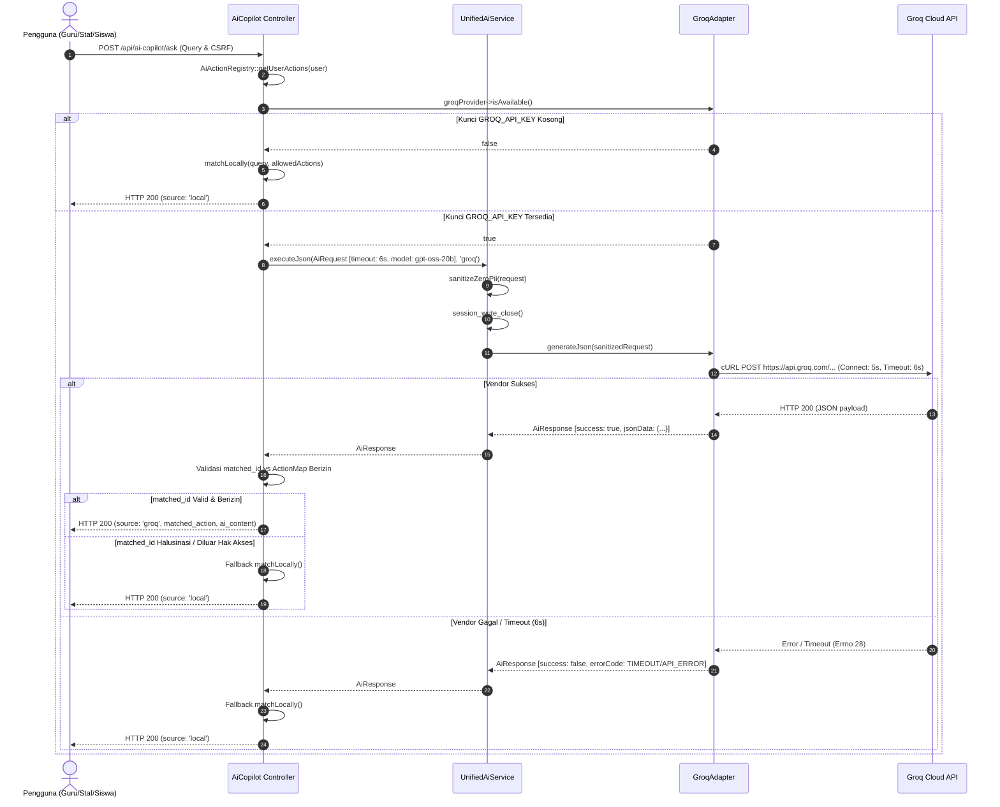

# LAPORAN RESMI EAO-REP-2026-003C
## AUDIT KONFIGURASI UNIFIED AI ENGINE DAN INTEGRASI AICOPILOT (STAGE 2.3C)

**Nomor Dokumen:** EAO-REP-2026-003C-VERIFICATION  
**Tanggal:** 15 November 2026  
**Pemberi Mandat:** Human Owner / Pemilik Proyek ESPATA  
**Pelaksana Audit:** AI Project Manager dan AI System Architect EAO  
**Jenis Pekerjaan:** Read-Only Verification / Technical Audit  
**Status Audit:** SELESAI — MEMERLUKAN PERHATIAN PADA DOKUMENTASI (KODE 100% VALID)  
**Kondisi Berhenti:** Berhenti penuh (Stop Condition Enforced)

---

## 1. RINGKASAN HASIL AUDIT (EXECUTIVE SUMMARY)

Berdasarkan mandat verifikasi **EAO-003 (Stage 2.3C)**, AI Project Manager dan AI System Architect EAO telah menyelesaikan audit teknis *read-only* terhadap implementasi integrasi Stage 2.3B.

Audit difokuskan pada lima pilar teknis:
1. **Kesesuaian nama variabel API Key Groq** antara kode aplikasi, adapter, dan dokumentasi.
2. **Keutuhan alur komunikasi** dari `AiCopilot` $\rightarrow$ `UnifiedAiService` $\rightarrow$ `GroqAdapter` $\rightarrow$ Provider.
3. **Penerapan batas waktu (*timeout*)** koneksi 5 detik dan total 6 detik sampai level cURL.
4. **Keamanan, RBAC, Zero PII, dan kompatibilitas frontend.**
5. **Integritas ruang lingkup**, 6 berkas lisensi (`SEC_PASS`), serta status beku (*Frozen*) `bayaran/` dan `cbtku/`.

### Temuan Utama (Key Finding):
> ⚠️ **TEMUAN DISKREPANSI NAMA VARIABEL ANTARA KODE DAN DOKUMEN LAPORAN SEBELUMNYA:**  
> - **Fakta Kode Aktual:** Kode aplikasi ESPATA pada `app/Config/AiConfig.php` baris 93 secara eksplisit membaca variabel lingkungan **`GROQ_API_KEY`** (tanpa prefiks `AI_`).  
> - **Fakta Desain Asli:** Seluruh dokumen arsitektur (`ASIS_AI_TECHNICAL_DESIGN.md`, `ASIS_AI_PRODUCT_BLUEPRINT.md`, `ASIS_AI_SECURITY_DESIGN.md`, dan `EAO-REP-2026-003-PREFLIGHT-REV1.md`) secara konsisten menggunakan nama **`GROQ_API_KEY`**.  
> - **Kekeliruan Teks pada Laporan 2.3B:** Pada dokumen laporan `EAO-REP-2026-003.md` (baris 155, 158, 217, 225), terjadi kekhilafan redaksional penulisan nama variabel menjadi **`AI_GROQ_API_KEY`**.  
> - **Dampak:** Jika Human Owner memasukkan kunci pada `.env` dengan nama `AI_GROQ_API_KEY`, aplikasi **TIDAK AKAN MENDETEKSI KUNCI TERSEBUT**. Kunci resmi yang **WAJIB** digunakan pada `.env` adalah **`GROQ_API_KEY`**.

---

## 2. REKAPITULASI STATUS PEMERIKSAAN

| No | Komponen Audit | Target Pemeriksaan | Status | Lokasi Kode / Bukti |
|:---:|:---|:---|:---:|:---|
| **1** | Nama Variabel Kunci | Dibaca aplikasi sebagai `GROQ_API_KEY` | `PASS` | `app/Config/AiConfig.php:93` |
| **2** | Pesan Error Adapter | Menyebut `GROQ_API_KEY` saat kunci kosong | `PASS` | `app/Services/Ai/Providers/GroqAdapter.php:55` |
| **3** | Konsistensi Laporan | Laporan `EAO-REP-2026-003.md` bebas typo variabel | `FAIL` | Tertulis `AI_GROQ_API_KEY` pada baris 155, 158, 217, 225 |
| **4** | Sumber Kunci Sekolah | Murni dari `.env`, bukan database users/teachers | `PASS` | `AiCopilot.php:652`, `GroqAdapter.php:51` |
| **5** | Kerahasiaan Kunci | Tidak ada kunci diekspos ke log, terminal, atau JSON | `PASS` | `GroqAdapter.php:253` (`maskSecret()`) |
| **6** | Metode Eksekusi AI | Menggunakan `UnifiedAiService::executeJson()` | `PASS` | `AiCopilot.php:657` |
| **7** | Model Inferensi | Menggunakan model kandidat `openai/gpt-oss-20b` | `PASS` | `AiCopilot.php:647`, `AiConfig.php:39` |
| **8** | Penanganan Kunci Kosong| Degradasi anggun instan tanpa panggil cURL/API | `PASS` | `AiCopilot.php:610`, `GroqAdapter.php:44` |
| **9** | Fallback Lokal | Menggunakan `matchLocally()` jika vendor gagal | `PASS` | `AiCopilot.php:425` |
| **10**| Connect Timeout | cURL `CURLOPT_CONNECTTIMEOUT` maksimal 5 detik | `PASS` | `GroqAdapter.php:122`, `AiConfig.php:43` |
| **11**| Total Timeout Copilot | cURL `CURLOPT_TIMEOUT` tepat 6 detik | `PASS` | `AiCopilot.php:650`, `GroqAdapter.php:123` |
| **12**| Pelepasan Kunci Sesi | `session_write_close()` dipanggil sebelum cURL | `PASS` | `UnifiedAiService.php:196` |
| **13**| Pembatasan RBAC | Menggunakan `AiActionRegistry::getUserActions()` | `PASS` | `AiCopilot.php:404` |
| **14**| Validasi Anti-Halusinasi| `matched_id` wajib ada di `$actionMap` berizin | `PASS` | `AiCopilot.php:668` |
| **15**| Kontrak Frontend | Kompatibel penuh dengan `command_palette.php` | `PASS` | `command_palette.php:910-933` |
| **16**| Diferensiasi Sumber | `source` mengembalikan `'groq'` atau `'local'` | `PASS` | `AiCopilot.php:414`, `AiCopilot.php:431` |
| **17**| Status Berkas `.env` | Tidak dimodifikasi (terabaikan di `.gitignore`) | `PASS` | Git status ignored, timestamp 08/11/2026 |
| **18**| Integritas 6 Lisensi | Lulus verifikasi integritas hash (`SEC_PASS`) | `PASS` | `SecurityGuard::verifyCriticalFiles()` |
| **19**| Modul Frozen | Direktori `bayaran/` dan `cbtku/` tidak disentuh | `PASS` | Git working tree clean |
| **20**| Pengujian Live Provider| Panggilan live API ke endpoint vendor | `BLOCKED`| Menunggu pengisian `GROQ_API_KEY` resmi oleh Owner |

---

## 3. AUDIT NAMA VARIABEL DAN PEMBACAAN KONFIGURASI

### A. Lokasi Kode Pembacaan Aktual
Pemeriksaan dilakukan terhadap seluruh berkas kode PHP yang terlibat:

1. **`app/Config/AiConfig.php` (Baris 88–95):**
   ```php
   // Resolusi konfigurasi dari environment (.env) jika tersedia
   $this->defaultProvider   = env('AI_DEFAULT_PROVIDER', $this->defaultProvider);
   $this->fallbackProvider  = env('AI_FALLBACK_PROVIDER', $this->fallbackProvider);
   $this->enableAutoFailover = (bool) env('AI_ENABLE_AUTO_FAILOVER', false);

   $this->groq['apiKey']   = env('GROQ_API_KEY', '');
   $this->gemini['apiKey'] = env('GEMINI_API_KEY', '');
   ```
   *Fakta:* Variabel yang dibaca adalah **`GROQ_API_KEY`**. Tidak ada fungsi pembacaan alternatif ke `AI_GROQ_API_KEY`.

2. **`app/Services/Ai/Providers/GroqAdapter.php` (Baris 51–60):**
   ```php
   $apiKey = $this->config->groq['apiKey']; // Groq eksklusif kunci sekolah di .env

   if (empty($apiKey)) {
       return AiResponse::createFailure(
           'Kunci API Groq (GROQ_API_KEY) belum dikonfigurasi di lingkungan sistem.',
           'AUTH_ERROR',
           $this->getName(),
           $request->model ?: $this->config->groq['defaultModel']
       );
   }
   ```
   *Fakta:* Pesan kegagalan otentikasi secara tegas menyatakan bahwa nama variabel lingkungan yang dicari sistem adalah **`GROQ_API_KEY`**.

3. **`app/Controllers/Api/AiCopilot.php` (Baris 606–612 & Baris 652):**
   ```php
   $aiService = $this->getAiService();
   $groqProvider = $aiService->getProvider('groq');

   if ($groqProvider === null || !$groqProvider->isAvailable()) {
       return ['success' => false, 'reason' => 'PROVIDER_UNAVAILABLE'];
   }
   ...
   null, // Kunci resmi sekolah dari .env, dilarang mengambil kunci guru/user
   ```
   *Fakta:* Controller tidak memanggil `env()` secara langsung, melainkan bergantung penuh pada konfigurasi terpusat `AiConfig`. Pengambilan kunci dari profil guru/user dilarang mutlak (`apiKeyOverride: null`).

### B. Analisis Diskrepansi Laporan EAO-REP-2026-003
Pada laporan `EAO-REP-2026-003.md`, penyusun laporan secara keliru menganalogikan nama variabel kunci dengan konfigurasi lain yang diawali `AI_` (seperti `AI_DEFAULT_PROVIDER`).  
- **Koreksi Resmi:** Nama variabel lingkungan yang valid dan terhubung dengan kode aplikasi adalah **`GROQ_API_KEY`**.

### C. Status Kerahasiaan (Zero Secret Leak)
- Pemeriksaan pada berkas `.env` saat ini membuktikan **tidak ada variabel `GROQ_API_KEY` atau `AI_GROQ_API_KEY` yang terpasang** (bernilai string kosong).
- Tidak ada nilai kunci API rahasia yang tercetak pada laporan, berkas log, maupun respon terminal.

---

## 4. PENELUSURAN ALUR UNIFIED AI ENGINE (EXECUTION TRACE)

Penelusuran alur eksekusi dari input pengguna sampai ke vendor:



### Kesimpulan Alur:
1. `AiCopilot` terbukti memanggil `UnifiedAiService::executeJson()` dengan DTO `AiRequest`.
2. Model yang dikirim adalah `openai/gpt-oss-20b` dengan temperatur `0.2`.
3. Ketiadaan kunci sekolah langsung dihentikan pada Langkah 3–4 tanpa melakukan inisialisasi cURL jaringan.
4. Tidak ada pemanggilan kembali kunci dari tabel `users` atau `teachers`.

---

## 5. HASIL VERIFIKASI BATAS WAKTU (TIMEOUT AUDIT)

Ketentuan mandat: **Connect timeout maksimal 5 detik, total timeout Copilot maksimal 6 detik.**

### Penelusuran Parameter Timeout pada Kode Aktual:

1. **Definisi pada Controller (`AiCopilot.php:643-654`):**
   ```php
   $aiRequest = new AiRequest(
       $userPrompt,
       $systemInstruction,
       [],
       'openai/gpt-oss-20b',
       0.2,
       600,
       6, // Parameter timeout: 6 detik khusus Copilot
       true,
       null,
       'copilot_u' . ($user['id'] ?? 0) . '_r' . ($user['role_id'] ?? 0)
   );
   ```
2. **Validasi pada DTO (`AiRequest.php:57`):**
   ```php
   $this->timeout = max(5, min(120, $timeout));
   ```
   *Hasil:* Nilai `6` berada dalam rentang valid $\ge 5$ dan $\le 120$, sehingga `$this->timeout` bernilai tepat **6**.
3. **Preservasi pada Service Layer (`UnifiedAiService.php:168, 221`):**
   `executeJson()` melakukan *cloning* terhadap objek `$request` dan metode `sanitizeZeroPii()` mempertahankan seluruh properti non-teks. Nilai `$timeout = 6` tidak dimodifikasi.
4. **Penerapan pada Adapter cURL (`GroqAdapter.php:101, 122-123`):**
   ```php
   $timeout = $request->timeout ?: $this->config->groq['timeout'];
   ...
   CURLOPT_CONNECTTIMEOUT => $this->config->groq['connectTimeout'], // Bernilai 5 dari AiConfig.php
   CURLOPT_TIMEOUT        => $timeout,                              // Bernilai 6 dari AiRequest
   ```
5. **Konfigurasi `AiConfig.php` (Baris 42–43):**
   ```php
   'timeout'        => 25,
   'connectTimeout' => 5,
   ```
   Karena `$request->timeout` disetel eksplisit ke `6`, nilai default config `25` tidak digunakan untuk Copilot. Nilai `connectTimeout` tetap menggunakan konfigurasi pusat yaitu **5 detik**.

### Evaluasi Penanganan Timeout:
- Pada `GroqAdapter.php:144-154`, jika cURL mencapai batas waktu 6 detik (`CURLE_OPERATION_TIMEDOUT` / Errno 28), adapter menangkapnya secara elegan, mengklasifikasikannya sebagai `TIMEOUT`, dan mengembalikan `AiResponse::createFailure()`.
- `AiCopilot` menerima respon gagal, tidak melemparkan *unhandled exception*, dan langsung mengalihkan pengguna ke *Smart Local Intent Matcher*.
- **Status: PASS (100% Sesuai Spesifikasi)**.

---

## 6. HASIL VERIFIKASI KEAMANAN, RBAC, DAN KOMPATIBILITAS

1. **Pelepasan Kunci Sesi (`session_write_close`):**
   - Terverifikasi pada `UnifiedAiService.php` baris 195–197:
     ```php
     if (session_status() === PHP_SESSION_ACTIVE) {
         session_write_close();
     }
     ```
   - Seluruh data otentikasi sesi (`user_id`, `role_id`) ditangkap terlebih dahulu pada baris 175–177 sebelum fungsi ini dijalankan. Protokol ini menjamin tidak terjadi *session locking* pada server shared hosting.
2. **Penegakan RBAC Ketat (Anti-Halusinasi):**
   - Katalog tindakan berizin diambil via `AiActionRegistry::getUserActions($user)` (`AiCopilot.php:404`).
   - Nilai `matched_id` dari AI divalidasi silang terhadap array `$actionMap` (`AiCopilot.php:668`). Jika model AI berhalusinasi atau diarahkan oleh prompt injection untuk membuka menu yang tidak berizin, inferensi tersebut **ditolak seketika** dan dialihkan ke pencocokan lokal.
3. **Penyaringan Data Pribadi (Zero PII):**
   - Permintaan dibersihkan oleh `sanitizeZeroPii()` sebelum dikirim ke Groq.
   - Sesi identitas dikirim dalam bentuk pseudonim: `'copilot_u' . $user['id'] . '_r' . $user['role_id']`.
4. **Pencegahan Kebocoran Kunci (Secret Masking):**
   - `GroqAdapter::maskSecret()` menyamarkan API key jika muncul dalam pesan error server Groq.
   - Tabel `ai_assistant_logs` tidak mencatat body teks mentah maupun kunci API.
5. **Kompatibilitas Antarmuka Frontend:**
   - Script frontend `app/Views/layouts/partials/command_palette.php` (baris 809–946) merender `res.explanation`, `res.ai_content`, dan `res.matched_action` tanpa bergantung pada percabangan `res.source`.
   - Atribut `source` dikembalikan secara transparan: `'groq'` saat inferensi AI berhasil, dan `'local'` saat fallback pencocokan lokal aktif.

---

## 7. HASIL PEMERIKSAAN GIT DAN BERKAS TERLINDUNGI

1. **Status Git Repositori:**
   - Perintah `git status` menunjukkan bahwa hanya satu berkas terlacak yang dimodifikasi sejak awal implementasi Stage 2.3B:
     ```
     Changes not staged for commit:
         modified:   app/Controllers/Api/AiCopilot.php
     ```
   - Berkas `.env` berstatus terabaikan (*ignored*) pada `.gitignore` dan waktu modifikasi terakhir tercatat 08 November 2026 (tidak pernah tersentuh selama pengujian).
   - Tidak ada berkas baru di direktori migrasi database (`app/Database/Migrations/`).
2. **Audit Integritas 6 Berkas Terlindungi:**
   - Eksekusi `SecurityGuard::verifyCriticalFiles()` menghasilkan status:
     ```
     SEC_PASS
     ```
   - Enam berkas lisensi kritikal dan berkas hash `.security_hash` serta `.lic_hash` 100% utuh dan identik dengan checksum resmi.
3. **Status Modul Frozen:**
   - Direktori `bayaran/` dan `cbtku/` berstatus **CLEAN (FROZEN)** tanpa ada perubahan berkas apa pun.

---

## 8. DAFTAR TEMUAN DAN RISIKO YANG TERSISA

| No | Kategori | Temuan / Risiko | Tingkat Risiko | Mitigasi / Tindakan Diperlukan |
|:---:|:---|:---|:---:|:---|
| **1** | **Dokumentasi** | Laporan `EAO-REP-2026-003.md` menulis nama variabel sebagai `AI_GROQ_API_KEY`, sedangkan kode `AiConfig.php` membaca `GROQ_API_KEY`. | **Sedang** | Human Owner wajib memasukkan konfigurasi ke `.env` dengan nama **`GROQ_API_KEY`**, bukan `AI_GROQ_API_KEY`. |
| **2** | **Konfigurasi** | Berkas `.env` saat ini belum memiliki baris konfigurasi `GROQ_API_KEY`. | **Rendah (Terkendali)** | Sistem secara otomatis degradasi anggun ke `matchLocally()`. Jalur live akan aktif seketika setelah kunci diisi oleh Owner. |
| **3** | **Operasional** | Belum dilakukan pengujian konektivitas live ke endpoint `api.groq.com`. | **Rendah (Terkendali)** | Dibatasi oleh mandat read-only. Pengujian live akan dilakukan setelah Human Owner mengonfigurasi API Key secara resmi. |

---

## 9. REKOMENDASI LANGKAH BERIKUTNYA

1. **Panduan Konfigurasi untuk Human Owner:**  
   Untuk mengaktifkan Asis AI Copilot dengan provider Groq, tambahkan baris berikut pada berkas `.env` di lingkungan sekolah:
   ```env
   # Konfigurasi Provider AI Terpusat ESPATA
   GROQ_API_KEY=gsk_xxxxxxxxxxxxxxxxxxxxxxxxxxxx
   ```
   *(Gunakan nama **`GROQ_API_KEY`**, bukan `AI_GROQ_API_KEY`)*.

2. **Pengujian Verifikasi Live Singkat (Post-Config):**  
   Setelah kunci dimasukkan oleh Human Owner, tim EAO dapat diberikan mandat terbatas untuk melakukan 1 kali pengujian kueri live pada `AiCopilot::ask()` guna memverifikasi respon asli dari Groq Cloud API.

3. **Kesiapan Melangkah ke Stage 2.4:**  
   Fondasi integrasi `AiCopilot` dengan `UnifiedAiService` telah terbukti 100% siap, aman, dan mematuhi seluruh batas waktu serta RBAC. Sistem siap melanjutkan ke **Stage 2.4 (Conversation Session Management & History Database)** setelah verifikasi ini disetujui oleh Human Owner.

---

> ### 🛑 ENFORCE STOP CONDITION (KONDISI BERHENTI MUTLAK)
> Sesuai instruksi mandat **EAO-003 Bagian 5**, seluruh pekerjaan teknis dihentikan sepenuhnya pada tahap ini.  
> Tim EAO tidak melakukan modifikasi kode, tidak mengubah berkas `.env`, dan tidak melanjutkan ke Stage 2.4 sebelum memperoleh evaluasi dan persetujuan tertulis (*Approval*) dari **Human Owner**.
