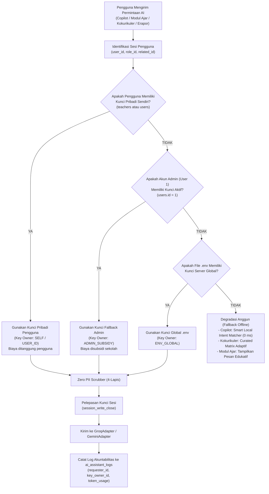
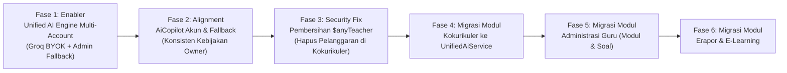

# LAPORAN RESMI EAO-REP-2026-003E
## AUDIT TATA KELOLA API KEY DAN RENCANA MIGRASI MODUL AI LAMA (STAGE 2.3E)

**Nomor Dokumen:** EAO-REP-2026-003E-API-KEY-GOVERNANCE  
**Nomor Mandat:** EAO-MANDATE-2026-003E  
**Tanggal:** 15 November 2026  
**Pemberi Mandat:** Human Owner / Pemilik Proyek ESPATA  
**Pelaksana Audit:** Tim AI Development Organization (EAO)  
**Jenis Pekerjaan:** Read-Only Audit dan Perencanaan Tata Kelola  
**Status Tahap:** SELESAI (Audit Forensik Tuntas & Rencana Diselaraskan)  
**Kondisi Berhenti:** Berhenti Penuh (Enforce Stop Condition)

---

## 1. RINGKASAN EKSEKUTIF

Berdasarkan mandat resmi **EAO-MANDATE-2026-003E**, Tim EAO telah melaksanakan audit forensik *read-only* terhadap seluruh tata kelola API Key AI di ESPATA dan menyusun rencana konsolidasi migrasi modul AI lama ke `UnifiedAiService`.

Mandat ini secara fundamental menegaskan filosofi produk ESPATA:
> **Model API Key per akun (BYOK) adalah keputusan desain produk resmi yang disengaja untuk membagi tanggung jawab biaya token dan mendorong efisiensi penggunaan AI, bukan suatu anomali arsitektur yang harus dihapus.**

### Poin Kunci Temuan Audit:
1. **Penyelarasan Filosofi Kunci:** Tim EAO mengonfirmasi pemahaman penuh atas 6 ketentuan Human Owner. Kunci guru adalah tanggung jawab pribadi masing-masing guru, kunci Administrator adalah kunci pribadi Admin yang secara resmi diizinkan menjadi *fallback* sekolah, dan kunci guru lain **dilarang keras** disedot oleh pengguna lain.
2. **Temuan Pelanggaran Privasi Kritis pada Modul Eksisting:**  
   Pada `app/Controllers/Admin/Kokurikuler.php` (baris 1088–1098), ditemukan mekanisme *Tier 3 Fallback* yang secara otomatis mengambil kunci guru pertama di tabel `teachers` jika Admin tidak memiliki kunci. Mekanisme ini **melanggar ketentuan Human Owner** dan wajib dihapus.
3. **Keterbatasan Arsitektur Unified AI Engine Saat Ini:**  
   `UnifiedAiService` dan `GroqAdapter` hasil implementasi awal Stage 2.1–2.3B mengasumsikan Groq bersifat *eksklusif kunci global di `.env`*. Hal ini menyebabkan kunci Groq pribadi milik guru dan Admin di database tidak dapat diteruskan ke `GroqAdapter`. Dibutuhkan pemutakhiran arsitektur agar `UnifiedAiService` mendukung resolusi multi-akun untuk Groq sebagaimana yang telah berjalan pada Gemini.
4. **Inventarisasi 6 Titik Pemanggilan AI Lama:**  
   Ditemukan 6 titik pemanggilan cURL langsung di modul `AdministrasiGuru.php`, `Kokurikuler.php`, `Erapor.php`, dan `ElearningPackageGeneratorService.php`. Seluruhnya belum memiliki proteksi Zero PII dan pelepasan kunci sesi (`session_write_close`).
5. **Rencana Migrasi 6-Fase Tanpa Gangguan (*Zero Regression*):**  
   Disusun rencana migrasi bertahap yang menjaga kontrak respons antarmuka, menegakkan akuntabilitas biaya, dan mengamankan privasi data.

---

## 2. KONFIRMASI PEMAHAMAN KEBIJAKAN HUMAN OWNER

Tim EAO mencatat, memahami, dan menetapkan 6 pilar kebijakan Human Owner sebagai dasar perancangan tata kelola AI ESPATA:

| No | Ketentuan Kebijakan Human Owner | Interpretasi Teknis & Batasan Arsitektural EAO |
|:---:|:---|:---|
| **1** | **Tanggung Jawab Biaya Mandiri Guru** | Setiap guru menanggung kuota tokennya sendiri melalui kunci pribadi yang tersimpan di baris profilnya (`teachers.gemini_api_key`). Guru yang aktif membuat modul ajar/soal menghabiskan kuotanya sendiri. |
| **2** | **Kunci Admin adalah Kunci Pribadi Admin** | Kunci pada akun Administrator (`users.id = 1`) dimiliki secara sah oleh akun Admin untuk operasional administratif. |
| **3** | **Kunci Admin sebagai Fallback Resmi Sekolah** | Jika seorang pengguna (guru/staf) belum memiliki kunci AI sendiri, sistem secara sengaja dan sah diperbolehkan menggunakan kunci Admin sebagai subsidi dari sekolah. |
| **4** | **Beban Biaya Fallback Ditanggung Sekolah** | Penggunaan token yang terjadi akibat fallback ke Admin disadari sebagai biaya operasional institusi sekolah. |
| **5** | **Larangan Mutlak Fallback Antar-Guru** | Kunci guru A **TIDAK BOLEH SEKALI-KALI** digunakan oleh guru B atau pengguna lain. Setiap kebocoran kunci lintas guru dikategorikan sebagai *Critical Security & Privacy Defect*. |
| **6** | **Akuntabilitas Audit Ganda (*Dual-Traceability*)** | Setiap transaksi AI di `ai_assistant_logs` wajib dapat ditelusuri: **Siapa yang meminta (*Requester User ID*)** dan **Kunci milik siapa yang terpakai (*Key Owner / Source*)**. |

*Prinsip Mutlak:* Tim EAO dilarang memaksakan satu kunci tunggal di `.env` untuk menggantikan sistem multi-akun yang sudah menjadi desain resmi produk.

---

## 3. PETA SELURUH SUMBER API KEY DI SISTEM ESPATA

Audit pemindaian basis data dan konfigurasi lingkungan menghasilkan peta sumber kunci berikut:

```
┌─────────────────────────────────────────────────────────────────────────────────┐
│                           PETA SUMBER API KEY ESPATA                            │
├────────────────────────────────┬───────────────────┬────────────────────────────┤
│ Sumber Penyimpanan             │ Entitas / Akun    │ Status & Sifat Kunci       │
├────────────────────────────────┼───────────────────┼────────────────────────────┤
│ Tabel `users` (Kolom:          │ User ID: 1        │ Kunci Pribadi Admin        │
│ `gemini_api_key`,              │ (Username: admin) │ Sekaligus Kunci Fallback   │
│ `ai_provider: groq`)           │ Hash: db4973df... │ Subsidi Sekolah            │
├────────────────────────────────┼───────────────────┼────────────────────────────┤
│ Tabel `teachers` (Kolom:       │ Teacher ID: 1     │ Kunci Pribadi Guru (BYOK)  │
│ `gemini_api_key`,              │ (Salma Wijaya)    │ Hak Eksklusif Guru 1       │
│ `ai_provider: groq`)           │ Hash: b82dc4e1... │ Dilarang Dipakai Akun Lain │
├────────────────────────────────┼───────────────────┼────────────────────────────┤
│ Tabel `teachers` (Kolom:       │ Teacher ID: 12    │ Kunci Pribadi Guru (BYOK)  │
│ `gemini_api_key`,              │ (Iman Nur Syuhada)│ Hak Eksklusif Guru 12      │
│ `ai_provider: groq`)           │ Hash: ed23da3d... │ Dilarang Dipakai Akun Lain │
├────────────────────────────────┼───────────────────┼────────────────────────────┤
│ File `.env`                    │ Server / Hosting  │ Belum Terisi (String       │
│ (`GROQ_API_KEY`)               │ Lingkungan Global │ Kosong)                    │
├────────────────────────────────┼───────────────────┼────────────────────────────┤
│ File `.env`                    │ Server / Hosting  │ Belum Terisi (String       │
│ (`GEMINI_API_KEY`)             │ Lingkungan Global │ Kosong)                    │
├────────────────────────────────┼───────────────────┼────────────────────────────┤
│ Tabel `school_profile`         │ Profil Sekolah    │ Tidak Ada Kolom Kunci      │
│ Tabel `settings`               │ Pengaturan Umum   │ Tidak Ada Baris Kunci      │
└────────────────────────────────┴───────────────────┴────────────────────────────┘
```

> **Catatan Anomali Nomenklatur:**  
> Kunci Groq (berawalan `gsk_`, panjang 56 karakter) disimpan di dalam kolom bernama `gemini_api_key`. Hal ini terjadi karena penambahan fitur Groq pada modul lama dilakukan dengan menumpangkan kunci pada kolom yang sudah ada tanpa migrasi skema tabel.

---

## 4. DIAGRAM ALUR RESOLUSI API KEY (TARGET STATE)

Diagram berikut menggambarkan alur resolusi ideal yang mematuhi 100% kebijakan Human Owner, memisahkan hak pribadi guru, dan mengamankan fallback sekolah:



---

## 5. MATRIKS PERILAKU FALLBACK AKTUAL DIBANDINGKAN KEBIJAKAN

Audit terhadap seluruh berkas pengontrol AI menunjukkan variasi perilaku yang tajam antarmodul:

| Modul & Fungsi | Alur Fallback Aktual di Kode | Kesesuaian Kebijakan | Status Audit | Konsekuensi & Keterangan |
|:---|:---|:---:|:---:|:---|
| **Administrasi Guru:** `generateModulAjar()` | Guru $\rightarrow$ Gagal.<br>Admin $\rightarrow$ Gagal.<br>*(Tidak ada fallback)* | Sebagian Sesuai | `WARNING` | Guru tanpa kunci langsung ditolak. Belum memanfaatkan subsidi fallback Admin. |
| **Administrasi Guru:** `generateSoal()` | Guru $\rightarrow$ Gagal.<br>Admin $\rightarrow$ Gagal.<br>*(Tidak ada fallback)* | Sebagian Sesuai | `WARNING` | Guru tanpa kunci langsung ditolak. Belum memanfaatkan subsidi fallback Admin. |
| **Kokurikuler:** `callAIAPI()` | Guru $\rightarrow$ Gagal.<br>Admin $\rightarrow$ Gagal.<br>*(Tidak ada fallback)* | Sebagian Sesuai | `WARNING` | Belum memanfaatkan subsidi fallback Admin. |
| **Kokurikuler:** `recommendPlanning()` | Kunci Sendiri $\rightarrow$ Admin (Users) $\rightarrow$ **Guru Siapa Pun (Teachers)** $\rightarrow$ `.env` | **BERTENTANGAN** | `FAIL (CRITICAL)` | **Pelanggaran Kritis:** Menyedot kunci guru lain (`$anyTeacher`) jika admin kosong! |
| **AiCopilot:** `callUnifiedAiNlu()` | Hanya membaca `.env` via `AiConfig` | **TIDAK SELARAS** | `WARNING` | Mengabaikan kunci pribadi guru dan kunci Admin di database. |
| **Erapor:** `callAiPrompt()` | Kunci Sendiri $\rightarrow$ `.env` Gemini | Sebagian Sesuai | `PASS` | Isolasi aman, belum ada fallback Admin. |
| **E-Learning:** `generateActionPlan()` | Kunci Sendiri $\rightarrow$ `.env` Gemini $\rightarrow$ `.env` Groq | Sebagian Sesuai | `PASS` | Isolasi aman, belum ada fallback Admin. |

---

## 6. TEMUAN KETIDAKSESUAIAN DAN TINGKAT RISIKONYA

### Temuan 1: Pelanggaran Privasi Pengambilan Kunci Guru Lain di Kokurikuler
- **Lokasi Kode:** `app/Controllers/Admin/Kokurikuler.php` baris 1088–1098:
  ```php
  // 2. Fallback: Cari API Key milik Guru manapun di tabel teachers
  if (empty($apiKey)) {
      $anyTeacher = $db->table('teachers')
          ->where('gemini_api_key !=', '')
          ->where('gemini_api_key IS NOT NULL')
          ->orderBy('id', 'ASC')
          ->get()->getRowArray();
      if ($anyTeacher && !empty($anyTeacher['gemini_api_key'])) {
          $apiKey = $anyTeacher['gemini_api_key'];
          $aiProvider = $anyTeacher['ai_provider'] ?? 'groq';
      }
  }
  ```
- **Tingkat Risiko:** **KRITIS (CRITICAL / HIGH PRIVACY VIOLATION)**.
- **Dampak:** Kuota API berbayar milik Guru ID 1 (Salma Wijaya) dapat terkuras habis oleh guru lain yang menjalankan rekomendasi kokurikuler tanpa izin.
- **Tindakan Perbaikan:** Blok kode baris 1088–1098 ini **wajib dihapus sepenuhnya**.

### Temuan 2: GroqAdapter dan UnifiedAiService Belum Mendukung BYOK Multi-Akun
- **Lokasi Kode:** `app/Services/Ai/Providers/GroqAdapter.php` baris 51 dan `UnifiedAiService.php` baris 126 & 180:
  ```php
  // GroqAdapter.php:51
  $apiKey = $this->config->groq['apiKey']; // Hanya membaca dari .env!
  
  // UnifiedAiService.php:126
  if ($targetProviderName === 'gemini') {
      $teacherByokKey = $this->resolveCurrentTeacherApiKey($sessionUserId, $sessionRoleId);
  }
  ```
- **Tingkat Risiko:** **TINGGI (HIGH ARCHITECTURAL GAP)**.
- **Dampak:** Meskipun guru dan admin memiliki kunci Groq aktif di database, `UnifiedAiService` mengabaikannya saat memanggil provider `groq`. `AiCopilot` terpaksa degradasi lokal jika `.env` kosong.
- **Tindakan Perbaikan:** `GroqAdapter` harus membaca `$request->apiKeyOverride`, dan `UnifiedAiService` harus meresolusi kunci akun untuk kedua provider (`gemini` maupun `groq`).

### Temuan 3: Ketiadaan Pelacakan Pemilik Kunci pada Telemetri Audit
- **Lokasi Kode:** Tabel `ai_assistant_logs` dan `UnifiedAiService::recordAuditTelemetry()`.
- **Tingkat Risiko:** **SEDANG (MEDIUM GOVERNANCE RISK)**.
- **Dampak:** Sistem mencatat siapa yang mengirim kueri (`user_id`), tetapi tidak mencatat kunci siapa yang dikonsumsi (`key_owner_id` / `key_source`). Admin sekolah tidak dapat membedakan mana penggunaan yang dibiayai guru sendiri dan mana yang membebani subsidi sekolah.
- **Tindakan Perbaikan:** Menambahkan metadata pelacakan kepemilikan kunci pada telemetri audit.

### Temuan 4: Penyimpanan Kunci Groq pada Kolom Bertuliskan `gemini_api_key`
- **Tingkat Risiko:** **SEDANG (TECHNICAL DEBT)**.
- **Dampak:** Kerancuan semantik data. Namun demikian, karena kolom `ai_provider` mendampinginya, aplikasi lama tetap dapat membedakan tipe kunci secara fungsional.

---

## 7. INVENTARISASI SELURUH PEMANGGILAN AI LAMA (LEGACY cURL AUDIT)

Audit menemukan **6 titik pemanggilan langsung (*native cURL*)** ke API eksternal yang belum terintegrasi ke `UnifiedAiService`:

| No | Berkas & Baris | Modul & Fungsi | Provider & Model | Sumber Kunci | Payload & Konteks Data | Timeout & Error Handling | Zero PII | Pelepasan Sesi | Risiko & Kompleksitas Migrasi |
|:---:|:---|:---|:---|:---|:---|:---:|:---:|:---:|:---|
| **1** | `app/Controllers/Admin/AdministrasiGuru.php`<br>Baris 2786–2825 | Modul Ajar:<br>`generateModulAjar()` | Groq (`gpt-oss-120b`, `qwen3.6-27b`, `gpt-oss-20b`, `llama-3.1-8b`) & Gemini | `teachers.gemini_api_key` / `users.gemini_api_key` | Detail ATP, silabus, fasilitas sekolah, identitas guru | 120s;<br>Iterasi model fallback, dieksekusi 2x percobaan | **TIDAK** | **TIDAK** | **Risiko:** Freeze sesi 120s.<br>**Kompleksitas:** Sedang (Response teks panjang). |
| **2** | `app/Controllers/Admin/AdministrasiGuru.php`<br>Baris 4113–4150 | Administrasi Guru:<br>`generateSoal()` | Groq (Model set sama dengan Modul Ajar) & Gemini | `teachers.gemini_api_key` / `users.gemini_api_key` | Deskripsi TP, materi pelajaran, tipe soal (PG/Esai) | 120s;<br>Iterasi model fallback | **TIDAK** | **TIDAK** | **Risiko:** Freeze sesi.<br>**Kompleksitas:** Rendah (Keluaran JSON terstruktur). |
| **3** | `app/Controllers/Admin/Kokurikuler.php`<br>Baris 677–715 | Kokurikuler:<br>`callAIAPI()` | Groq (Model set sama dengan Modul Ajar) & Gemini | `teachers.gemini_api_key` / `users.gemini_api_key` | Profil tema kokurikuler, fase, dimensi PPAI | 90s;<br>cURL native | **TIDAK** | **TIDAK** | **Risiko:** Freeze sesi.<br>**Kompleksitas:** Rendah (Keluaran teks narasi). |
| **4** | `app/Controllers/Admin/Kokurikuler.php`<br>Baris 1272–1315 | Kokurikuler:<br>`callAIPlanningAPI()` | Groq (`gpt-oss-20b`, `qwen3.8-27b`, `gpt-oss-120b`) & Gemini | 5-Tier Fallback Cascade (Termasuk mencuri kunci guru) | Matriks capaian TP seluruh mata pelajaran sekolah | 90s;<br>cURL native, parse JSON | **TIDAK** | **TIDAK** | **Risiko:** Pelanggaran privasi guru & freeze sesi.<br>**Kompleksitas:** Sedang (JSON array paket). |
| **5** | `app/Controllers/Admin/Erapor.php`<br>Baris 991–1025 | Erapor Siswa:<br>`callAiPrompt()` | Groq (`llama-3.3-70b`, `llama-3.1-8b`, `qwen3.6-27b`, `gpt-oss-20b`) & Gemini | `teachers.gemini_api_key` / `users.gemini_api_key` / `.env` | Nilai rata-rata dan capaian TP siswa per mapel | 30s;<br>cURL native | **TIDAK** | **TIDAK** | **Risiko:** Paparan data nilai mentah.<br>**Kompleksitas:** Rendah (Keluaran 1-2 kalimat). |
| **6** | `app/Services/ElearningPackageGeneratorService.php`<br>Baris 437–480 | E-Learning:<br>`generateActionPlan()` | Groq (`llama-3.3-70b`, `llama-3.1-8b`, `gpt-oss-20b`) & Gemini | `teachers.gemini_api_key` / `users.gemini_api_key` / `.env` | Silabus materi e-learning dan tugas belajar | 60s;<br>cURL native, parse JSON | **TIDAK** | **TIDAK** | **Risiko:** Freeze sesi.<br>**Kompleksitas:** Sedang (Struktur segmen aksi). |

---

## 8. ANALISIS RISIKO KEAMANAN, PRIVASI, DAN BIAYA

### A. Dimensi Privasi Data & Zero PII
- **Kondisi Eksisting Modul Lama:** Keenam titik cURL lama mengirimkan data mentah ke server Groq/Google tanpa melalui penyaringan Zero PII. Nama guru, nama sekolah, dan narasi tujuan pembelajaran dikirim apa adanya.
- **Solusi Migrasi:** Melalui `UnifiedAiService`, seluruh prompt akan secara otomatis melewati `sanitizeZeroPii()` 4-lapis sebelum meninggalkan server sekolah, menjamin kepatuhan privasi data pendidikan.

### B. Dimensi Shared Hosting & Session Locking
- **Kondisi Eksisting:** cURL lama berjalan selama 30 hingga 120 detik dalam kondisi sesi PHP terkunci (`PHPSESSID` aktif). Pada server LiteSpeed/cPanel, jika seorang guru meng-generate modul ajar, seluruh tab browser miliknya yang lain akan membeku (*spinning/freeze*) sampai cURL selesai.
- **Solusi Migrasi:** `UnifiedAiService` secara konsisten menjalankan protokol pelepasan kunci sesi (`session_write_close()`) tepat sebelum koneksi jaringan dibuka.

### C. Dimensi Pengendalian Biaya dan Subsidi Sekolah
- **Kebijakan Human Owner Sangat Tepat Sasaran:**
  - Guru aktif yang intensif membuat materi pembelajaran membiayai tokennya sendiri (BYOK), mencegah pembengkakan anggaran sekolah.
  - Sekolah hanya menyubsidi penggunaan fitur-fitur penting yang dijalankan oleh guru/staf yang belum memiliki kunci (via fallback Admin).
- **Mitigasi Risiko Biaya Admin:**  
  Untuk mencegah akun Admin terkuras oleh permintaan tak terbatas dari guru tanpa kunci, sistem dapat menerapkan kuota pelindung harian (*rate-limiting threshold*) khusus untuk subsidi fallback Admin pada masa mendatang.

---

## 9. RENCANA MIGRASI BERTAHAP KE UNIFIEDAISERVICE

Migrasi dirancang dalam **6 langkah bertahap tanpa downtime (*zero-regression gradual cutover*)**:



### Rincian Setiap Tahapan Migrasi:

#### Fase 1: Pemutakhiran Core Unified AI Engine (Fondasi Multi-Akun)
- **Target Berkas:** `app/Services/Ai/UnifiedAiService.php`, `app/Services/Ai/Providers/GroqAdapter.php`, `app/Services/Ai/DTO/AiRequest.php`.
- **Pekerjaan:**
  1. Perbarui `GroqAdapter::generateText()` agar menggunakan `$request->apiKeyOverride` jika tersedia.
  2. Perbarui `UnifiedAiService::resolveActiveProviderApiKey()` agar melakukan resolusi 2-tingkat yang sah:
     - Prioritas 1: Kunci pribadi pengguna (`teachers` untuk guru, `users` untuk admin).
     - Prioritas 2: Kunci fallback Administrator (`users.id = 1`).
     - Prioritas 3: Kunci lingkungan `.env` (jika diisi oleh sekolah).
  3. Tambahkan penandaan `key_source` (`'self'`, `'admin_fallback'`, `'env'`) pada DTO `AiResponse`.
  4. Perbarui `recordAuditTelemetry()` agar mencatat `key_source` pada `ai_assistant_logs`.
- **Dampak Risiko:** Sangat Rendah (Backward compatible, tidak merusak modul lama).

#### Fase 2: Penyelarasan Integrasi `AiCopilot.php`
- **Target Berkas:** `app/Controllers/Api/AiCopilot.php`.
- **Pekerjaan:**
  - Hapus hardcoded `apiKeyOverride = null` pada pemanggilan Copilot. Biarkan `UnifiedAiService` otomatis memilih kunci guru atau fallback Admin.
  - Dengan pembaruan ini, **Copilot langsung aktif secara live** menggunakan kunci Admin (`users.id = 1`) tanpa perlu menunggu pengisian `.env`!
- **Dampak Risiko:** Rendah (Fitur yang sudah diuji pada Stage 2.3B tetap terjaga).

#### Fase 3: Pembersihan Celah Privasi pada `Kokurikuler.php`
- **Target Berkas:** `app/Controllers/Admin/Kokurikuler.php`.
- **Pekerjaan:**
  - Hapus blok baris 1088–1098 (`$anyTeacher` query).
  - Pastikan fallback hanya berhenti pada Admin (`$adminUser`). Jika Admin kosong, langsung fallback ke matriks kurasi lokal (`curated_matrix`).
- **Dampak Risiko:** Nol (Mencegah pencurian kuota guru).

#### Fase 4: Migrasi Modul Kokurikuler ke `UnifiedAiService`
- **Target Berkas:** `app/Controllers/Admin/Kokurikuler.php`.
- **Pekerjaan:**
  - Alihkan fungsi internal `callAIAPI()` dan `callAIPlanningAPI()` untuk memanggil `UnifiedAiService::execute()` dan `executeJson()`.
  - Hapus array cURL manual dan logika deteksi manual.
  - Memanfaatkan `session_write_close()` dan Zero PII bawaan engine.

#### Fase 5: Migrasi Modul Administrasi Guru (Modul Ajar & Soal)
- **Target Berkas:** `app/Controllers/Admin/AdministrasiGuru.php`.
- **Pekerjaan:**
  - Alihkan fungsi internal `generateModulAjar()` dan `generateSoal()` untuk menggunakan `UnifiedAiService`.
  - Pertahankan fallback Admin jika guru belum memiliki kunci (sehingga guru dapat merasakan kemudahan pembuatan modul bersubsidi sekolah).
  - Hilangkan delay freeze browser 120 detik via pelepasan sesi otomatis.

#### Fase 6: Migrasi Modul Erapor & E-Learning
- **Target Berkas:** `app/Controllers/Admin/Erapor.php`, `app/Services/ElearningPackageGeneratorService.php`.
- **Pekerjaan:**
  - Menyatukan sisa pemanggilan cURL ke satu pintu `UnifiedAiService`. Seluruh ekosistem AI ESPATA resmi terpadu 100%.

---

## 10. DAFTAR PENGUJIAN REGRESI PADA TAHAP IMPLEMENTASI

Pada saat setiap fase migrasi diizinkan untuk dikerjakan, matriks pengujian wajib mencakup skenario multi-role berikut:

| ID Uji | Skenario Pengujian | Kondisi Akun & Kunci | Hasil yang Diharapkan |
|:---:|:---|:---|:---|
| **REG-01** | Guru dengan Kunci Pribadi | Guru ID 1 (Memiliki kunci Groq di `teachers`) | Sistem menggunakan kunci Guru 1. Kuota Admin tidak berkurang. Log mencatat `key_source: self`. |
| **REG-02** | Guru Tanpa Kunci Pribadi | Guru Baru (Kolom kunci kosong di `teachers`) | Sistem otomatis beralih ke kunci Admin (`users.id = 1`). Permintaan sukses. Log mencatat `key_source: admin_fallback`. |
| **REG-03** | Admin dengan Kunci Pribadi | Admin ID 1 (Memiliki kunci di `users`) | Sistem menggunakan kunci Admin. Log mencatat `key_source: self`. |
| **REG-04** | Semua Kunci Kosong | Guru kosong, Admin kosong, `.env` kosong | Sistem tidak crash (No HTTP 500), degradasi anggun ke *Smart Local Intent Matcher* / pesan ramah edukatif. |
| **REG-05** | Isolasi Antar-Guru | Guru B tanpa kunci memanggil AI saat Guru A punya kunci | Sistem **TIDAK MENGGUNAKAN** kunci Guru A. Hanya boleh memakai kunci Admin atau degradasi lokal. |
| **REG-06** | Uji Pelepasan Sesi | Pengguna menjalankan generate modul ajar | Tab lain di browser pengguna tetap responsif dan dapat dibuka secara instan (*session_write_close verified*). |
| **REG-07** | Uji Zero PII | Pengguna mengirim teks memuat nama siswa & NIK | Teks prompt yang sampai ke provider disamarkan menjadi `[NAMA_DISAMARKAN]` & `[NIK_DISAMARKAN]`. |

---

## 11. DAFTAR KEPUTUSAN YANG MEMBUTUHKAN PERSETUJUAN HUMAN OWNER

Sebelum implementasi kode dimulai, Tim EAO memohon arahan tertulis Human Owner mengenai 3 aspek kebijakan operasional:

1. **Batas Kuota Subsidi Fallback Admin:**
   - *Pertanyaan:* Apakah guru yang menggunakan kunci fallback Admin perlu diberikan batas maksimal (misal: maksimal 5 kali generate per hari) untuk mencegah kuota sekolah habis dipakai oleh satu guru secara berlebihan, ataukah dibiarkan tanpa batas?
   - *Rekomendasi EAO:* Diberikan kuota wajar harian pada service layer untuk menjaga ketahanan kuota sekolah.
2. **Izin Penghapusan Celah `$anyTeacher` di Kokurikuler:**
   - *Pertanyaan:* Apakah Tim EAO diizinkan menghapus blok kode fallback ke guru lain (`Kokurikuler.php:1088-1098`) sebagai prioritas keamanan pertama sebelum melangkah ke migrasi penuh?
   - *Rekomendasi EAO:* Sangat disarankan untuk segera dihapus pada fase implementasi awal.
3. **Penyelarasan Skema Kolom Database di Masa Depan:**
   - *Pertanyaan:* Apakah nama kolom `gemini_api_key` di tabel `teachers` dan `users` tetap dipertahankan namanya demi kesederhanaan, atau kelak diubah menjadi `ai_api_key` melalui migrasi resmi CI4?
   - *Rekomendasi EAO:* Pada tahap awal, pertahankan nama kolom `gemini_api_key` dengan membaca `ai_provider` untuk menjamin stabilitas 100% tanpa risiko migrasi database.

---

## 12. BUKTI KEPATUHAN RUANG LINGKUP & INTEGRITAS SISTEM

Seluruh proses audit pada Stage 2.3E dilaksanakan secara **read-only mutlak** tanpa melakukan mutasi apa pun:

1. **Pemeriksaan Sintaksis & Integritas 6 Berkas Lisensi:**
   - Perintah: `SecurityGuard::verifyCriticalFiles()`
   - Hasil: **`SEC_PASS`** (Enam berkas lisensi dan berkas hash `.security_hash` serta `.lic_hash` 100% utuh).
2. **Status Modul Frozen:**
   - Direktori `bayaran/` dan `cbtku/` tetap berstatus **CLEAN / FROZEN** (tidak disentuh).
3. **Status Git Repositori:**
   - `git status` membuktikan tidak ada perubahan kode baru yang dilakukan pada Stage 2.3E:
     ```
     Changes not staged for commit:
         modified:   app/Controllers/Api/AiCopilot.php  (Pekerjaan Stage 2.3B sebelumnya)
     ```
   - Berkas konfigurasi `.env` tidak disentuh.
   - Tidak ada skrip migrasi database atau query `ALTER/UPDATE/INSERT` yang dijalankan.
   - Tidak ada nilai rahasia API Key yang dicetak atau diekspos dalam laporan ini.

---

> ### 🛑 ENFORCE STOP CONDITION (KONDISI BERHENTI MUTLAK)
> Sesuai instruksi penutup **Mandat EAO-MANDATE-2026-003E Bagian 7**, seluruh pekerjaan teknis dihentikan sepenuhnya pada tahap ini.  
> Tim EAO tidak melakukan perubahan kode, tidak mengubah database, tidak mengubah `.env`, dan tidak memulai implementasi migrasi sebelum memperoleh evaluasi dan persetujuan tertulis (*Approval*) dari **Human Owner**.
