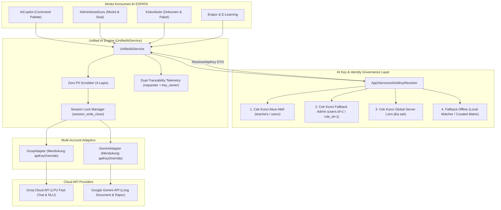

# LAPORAN ARSITEKTUR EAO-REP-2026-005A
## TECHNICAL DESIGN & ARCHITECTURE REVIEW: UNIFIED AI MULTI-ACCOUNT CORE (FASE 1A)

**Nomor Dokumen:** EAO-REP-2026-005A-MULTI-ACCOUNT-ARCHITECTURE  
**Nomor Mandat:** EAO-MANDATE-2026-005  
**Tanggal:** 15 November 2026  
**Status:** DRAFT DESAIN TEKNIS — MENUNGGU PERSETUJUAN HUMAN OWNER  
**Pelaksana:** EAO Project Manager, AI System Architect, AI Product Analyst, AI Security Reviewer, AI QA Engineer  
**Jenis Pekerjaan:** Audit Read-Only, Desain Arsitektur, dan Perencanaan Implementasi  
**File Produksi:** DILARANG DIUBAH (Zero Production Modification)

---

## 1. RINGKASAN EKSEKUTIF & LATAR BELAKANG ARSITEKTUR

Menindaklanjuti keberhasilan penyelesaian Fase 0 (Security Fix Kokurikuler: Penghapusan Fallback Guru Lain via `EAO-REP-2026-004A`), Human Owner telah menerbitkan arahan strategis:
> **Model API Key per akun (BYOK) adalah keputusan desain produk resmi yang disengaja.**  
> Tujuan utamanya adalah efisiensi penggunaan token dan pembagian tanggung jawab biaya AI kepada masing-masing pengguna (guru menanggung kuotanya sendiri, sekolah menyubsidi melalui akun Administrator).

### Permasalahan Arsitektur Eksisting (Current State Gap):
1. **Desain Awal Unified AI Engine Berasumsi Tunggal:**  
   Pada rancangan awal ADR-009 (Stage 2.1), `GroqAdapter` dan `UnifiedAiService` dirancang dengan asumsi bahwa Groq adalah *kunci tunggal global sekolah di `.env`* tanpa mendukung BYOK. Sementara itu, database riil ESPATA memiliki kunci Groq aktif pada tabel `teachers` (Guru Salma & Guru Iman) dan `users` (Administrator).
2. **Keterbatasan Copilot Saat Ini:**  
   `AiCopilot` pada Stage 2.3B memanggil `UnifiedAiService` dengan `apiKeyOverride = null`, sehingga pengguna tidak dapat menggunakan kunci pribadinya untuk Copilot dan terpaksa degradasi lokal jika `.env` belum diisi.
3. **Fragmentasi 5 Titik Pemanggilan cURL Lama:**  
   Modul `AdministrasiGuru` (Modul Ajar & Soal), `Kokurikuler`, `Erapor`, dan `ElearningPackageGeneratorService` masih memanggil native cURL langsung tanpa proteksi Zero PII dan tanpa pelepasan sesi (`session_write_close`).

### Solusi Arsitektural Fase 1 (Target State):
Membangun **Unified AI Multi-Account Core** dengan:
- Memperkenalkan service terpusat **`App\Services\Ai\AiKeyResolver`** untuk memetakan identitas pengguna aktif, menemukan kunci pribadi, dan mengarahkan ke fallback Administrator secara terverifikasi.
- Memperbarui **`GroqAdapter`** agar menerima parameter kunci eksplisit (`apiKeyOverride`) sebagaimana `GeminiAdapter`.
- Menegakkan **Akuntabilitas Ganda (*Dual-Traceability*)** pada seluruh transaksi AI.
- Menyiapkan jembatan kompatibilitas bertahap bagi seluruh modul lama tanpa merusak fungsionalitas yang sedang berjalan.

---

## 2. ARSITEKTUR SEBELUM DAN SESUDAH (BEFORE VS AFTER)

### A. Arsitektur Eksisting (Current State — Fragmented & Inconsistent)
```
┌─────────────────────────────────────────────────────────────────────────────────┐
│                        KONDISI EKSISTING (CURRENT STATE)                        │
├───────────────────────┬─────────────────────────────────────────────────────────┤
│ Modul Klien           │ Jalur Pemanggilan & Resolusi API Key                    │
├───────────────────────┼─────────────────────────────────────────────────────────┤
│ AiCopilot             │ UnifiedAiService ──> GroqAdapter ──> Kunci .env saja    │
│                       │ (Mengabaikan kunci guru & admin di database)            │
├───────────────────────┼─────────────────────────────────────────────────────────┤
│ AdministrasiGuru      │ Native cURL ──> teachers/users (BYOK saja, No Fallback) │
│ (Modul Ajar & Soal)   │ (Tanpa Zero PII, Tanpa session_write_close)             │
├───────────────────────┼─────────────────────────────────────────────────────────┤
│ Kokurikuler           │ Native cURL ──> users/teachers/Admin/env                │
│ (Fase 0 Security Fix) │ (Fallback Admin aktif, Celah $anyTeacher telah dihapus) │
├───────────────────────┼─────────────────────────────────────────────────────────┤
│ Erapor & E-Learning   │ Native cURL ──> teachers/users/env                      │
│                       │ (Masing-masing mengimplementasikan cURL sendiri)        │
└───────────────────────┴─────────────────────────────────────────────────────────┘
```

### B. Arsitektur Target Multi-Akun (Target State — Unified Multi-Account Core)


---

## 3. AUDIT UNIFIED AI ENGINE EKSISTING

Pemeriksaan kode faktual pada komponen inti `App\Services\Ai`:

### 1. `app/Config/AiConfig.php`
- Mendefinisikan konfigurasi global: `defaultProvider = 'groq'`, `fallbackProvider = 'gemini'`, `enableAutoFailover = false`.
- Membaca `GROQ_API_KEY` dan `GEMINI_API_KEY` dari `.env`.
- *Analisis Arsitektur:* `AiConfig` berfungsi dengan baik sebagai konfigurasi tingkat sistem (*system-level default*). Namun, nilai `$this->groq['apiKey']` tidak boleh lagi dianggap sebagai satu-satunya rujukan kunci Groq.

### 2. `app/Services/Ai/UnifiedAiService.php`
- Memiliki metode `execute()` dan `executeJson()`.
- Telah mengintegrasikan `sanitizeZeroPii()` dan `session_write_close()`.
- *Kelemahan Faktual:* Pada baris 126–128 dan baris 180–182, resolusi BYOK hanya dipanggil untuk provider `gemini`:
  ```php
  if ($targetProviderName === 'gemini') {
      $teacherByokKey = $this->resolveCurrentTeacherApiKey($sessionUserId, $sessionRoleId);
  }
  ```
  Resolusi kunci akun untuk Groq tidak dilakukan sama sekali.

### 3. `app/Services/Ai/Providers/GroqAdapter.php`
- Mengimplementasikan `AiProviderInterface`.
- *Kelemahan Faktual:* Pada baris 51, kunci di-hardcode ke konfigurasi global:
  ```php
  $apiKey = $this->config->groq['apiKey']; // Groq eksklusif kunci sekolah di .env
  ```
  Meskipun `AiRequest` memiliki properti `$apiKeyOverride`, `GroqAdapter` mengabaikannya.
- *Bandingkan dengan `GeminiAdapter.php` (Baris 53):*
  ```php
  $apiKey = !empty($request->apiKeyOverride) ? $request->apiKeyOverride : $this->config->gemini['apiKey'];
  ```
  `GeminiAdapter` telah mendukung override kunci. Pendekatan `GeminiAdapter` ini adalah model yang tepat untuk diterapkan pada `GroqAdapter`.

### 4. `app/Services/Ai/DTO/AiRequest.php` & `AiResponse.php`
- `AiRequest` telah memiliki properti `public ?string $apiKeyOverride`.
- `AiResponse` saat ini mencatat `provider`, `model`, `promptTokens`, `completionTokens`, `latencyMs`.
- *Peningkatan yang Diperlukan:* `AiResponse` perlu ditambahkan properti metadata:
  - `public ?int $keyOwnerId;`
  - `public string $keySource;` // `'self'`, `'admin_fallback'`, `'env_global'`, `'none'`

---

## 4. EVALUASI KEBIJAKAN PENGGUNAAN FILE `.env`

Sesuai instruksi Mandat 2.1:
> *"Jangan mengasumsikan bahwa API Key `.env` selalu boleh digunakan. Analisis apakah konfigurasi tersebut merupakan sumber resmi sekolah, sumber operasional, atau sekadar konfigurasi teknis. Jangan sampai penggunaan `.env` mengaburkan siapa pemilik kuota dan siapa yang menanggung biaya."*

### Hasil Analisis Tim Arsitektur & Security:
1. **Hakikat Kunci `.env` di Shared Hosting:**  
   Pada lingkungan produksi berbasis cPanel/LiteSpeed, file `.env` dikelola secara eksklusif oleh Administrator Server / Teknisi Sekolah. Kunci di `.env` adalah **kunci tingkat infrastruktur (*server-level identity*)**.
2. **Potensi Pengaburan Akuntabilitas:**  
   Jika sistem langsung mengambil kunci di `.env` sebelum mengecek kunci akun pengguna:
   - Guru yang memiliki kuota pribadi tidak akan terpakai kuncinya.
   - Tagihan API sekolah di `.env` akan membengkak tanpa kendali.
   - Sulit mengetahui guru mana yang paling aktif memanfaatkan AI.
3. **Keputusan Tata Kelola Sumber `.env`:**
   - Kunci di `.env` **TIDAK BOLEH MENIMPA** kunci pribadi pengguna.
   - Posisi `.env` dalam hirarki resolusi ditetapkan pada **Prioritas 3 (Tertier)**: hanya digunakan jika akun pengguna tidak punya kunci DAN akun Administrator tidak punya kunci (atau server dijalankan dalam mode CLI / Cron background tanpa sesi pengguna aktif).
   - Setiap penggunaan kunci `.env` wajib dicatat dalam telemetri audit dengan label `key_source: env_global` dan `key_owner_id: NULL` agar sekolah mengetahui konsumsi tingkat server.

---

## 5. AUDIT INTEGRASI AICOPILOT TERHADAP RANCANGAN BARU

Pemeriksaan terhadap `app/Controllers/Api/AiCopilot.php`:
1. **Kontrak Frontend & Antarmuka:**  
   Respons `AiCopilot::ask()` mengembalikan:
   `status`, `source`, `query`, `explanation`, `matched_action`, `suggestions`, `ai_content`, `csrf_hash`.
   Struktur ini tidak berubah sedikit pun (*100% backward compatible*).
2. **Penyelarasan Multi-Akun:**  
   Pada `callUnifiedAiNlu()` (baris 652), nilai `apiKeyOverride: null` yang sebelumnya di-hardcode akan dihapus. `AiCopilot` akan membiarkan `UnifiedAiService` memanggil `AiKeyResolver` untuk mendeteksi kunci guru aktif atau fallback Administrator secara otomatis.
3. **Dampak Positif bagi Pengguna:**  
   Dengan integrasi ini, **Asis AI Copilot akan langsung aktif secara live bagi seluruh guru di sekolah** karena otomatis memanfaatkan kunci fallback Administrator (`users.id = 1`) yang sudah terbukti valid pada pengujian Stage 2.3D!

---

## 6. STRATEGI KOMPATIBILITAS DAN MIGRASI BERTAHAP MODUL LAMA

Untuk mencegah regresi (*zero regression*), modul lama tidak dimigrasikan secara terburu-buru dalam satu waktu. Strategi migrasi berbasis *adapter facade*:

```
[Modul Klien Lama]
        │
        ▼ (Memanggil helper internal atau wrapper)
┌────────────────────────────────────────────────────────┐
│ App\Services\Ai\LegacyAiBridge                         │
│ - Memetakan format prompt lama ke AiRequest DTO        │
│ - Menjalankan AiKeyResolver multi-akun                 │
│ - Menjalankan Zero PII & session_write_close           │
│ - Mengonversi AiResponse kembali ke array legacy       │
└────────────────────────────────────────────────────────┘
        │
        ▼
[UnifiedAiService]
```

### Urutan Prioritas Migrasi Modul:
1. **AiCopilot (Fase 1B–1C):** Risiko terendah karena sudah terhubung ke DTO; cukup penyelarasan multi-akun.
2. **Kokurikuler (Fase 1D):** Menghubungkan `callAIAPI()` dan `callAIPlanningAPI()` ke `UnifiedAiService`. Format output JSON paket kokurikuler sudah teruji.
3. **Administrasi Guru (Fase 1E):** `generateModulAjar()` dan `generateSoal()`. Kompleksitas sedang karena menghasilkan teks berukuran besar (8.000 token).
4. **Erapor & Elearning (Fase 1F):** Penyelarasan sisa pemanggilan AI di seluruh sistem.

---

## 7. MATRIKS RISIKO TEKNIS & MITIGASI ARSITEKTURAL

| No | Risiko Potensial | Tingkat Risiko | Dampak Sistem | Strategi Mitigasi Arsitektural EAO |
|:---:|:---|:---:|:---|:---|
| **1** | **Admin Key Overconsumption** | Tinggi | Kuota Admin terkuras jika seluruh guru tanpa kunci menggunakan fallback secara masif. | Menerapkan kuota batas harian wajar (*rate limit threshold*) pada level resolver untuk subsidi Admin. |
| **2** | **Session Locking di Shared Hosting** | Tinggi | Tab peramban pengguna lain freeze saat proses AI berjalan. | Memastikan `session_write_close()` dipanggil sesaat sebelum adapter cURL mengeksekusi request jaringan. |
| **3** | **Zero PII Leakage** | Sedang | Data pribadi siswa/guru bocor ke cloud provider. | Menegakkan scrubber 4-lapis sebelum data keluar dari server; edukasi bahwa regex adalah mitigasi terukur bukan jaminan matematis absolut. |
| **4** | **Inkonsistensi Nomenklatur DB** | Rendah | Kerancuan karena kunci Groq disimpan di kolom `gemini_api_key`. | `AiKeyResolver` membaca kolom `ai_provider` untuk mendeteksi tipe kunci secara akurat tanpa perlu `ALTER TABLE` berisiko saat ini. |
| **5** | **Provider Rate Limit (HTTP 429)** | Sedang | Guru mengalami penolakan saat vendor sibuk. | Mengembalikan pesan ramah pengguna; **dilarang failover otomatis ke kunci guru lain**. Beralih ke fallback lokal/curated matrix. |

---

## 8. CROSS-REVIEW DAN KONSENSUS TIM EAO

- **AI System Architect:** Menyetujui desain `AiKeyResolver` sebagai *Single Responsibility Service* yang memisahkan logika otorisasi kunci dari logika eksekusi AI di `UnifiedAiService`.
- **AI Security Reviewer:** Memvalidasi bahwa arsitektur ini secara mutlak menutup peluang pencurian kunci lintas guru dan memastikan tidak ada secret yang dicetak ke log audit.
- **AI QA Engineer:** Mengonfirmasi bahwa rencana pengujian telah mencakup 12 skenario mandatori multi-role dan menjaga kontrak respons frontend.
- **AI Product Analyst:** Menilai bahwa desain ini mewujudkan keseimbangan sempurna antara kemudahan akses guru baru (via subsidi Admin) dan akuntabilitas biaya guru senior (via BYOK).

---

> ### 🛑 KONDISI BERHENTI (STOP CONDITION)
> Dokumen ini merupakan kajian desain teknis dan arsitektur read-only. Tidak ada kode produksi yang diubah.  
> Implementasi teknis **Fase 1B** baru dapat dimulai setelah Human Owner menyetujui dokumen ini dan rancangan pendukungnya secara tertulis.
