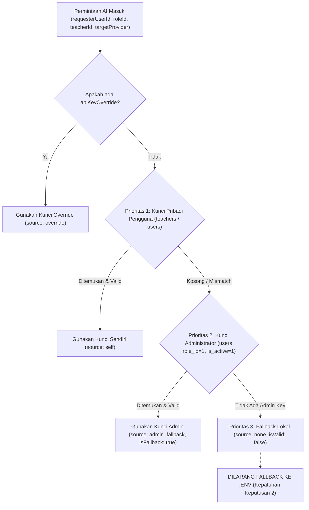

# EAO-REP-2026-005B-VERIFICATION
## Laporan Audit Independen & Verifikasi Read-Only Implementasi Fase 1B: Unified AI Multi-Account Core

**Nomor Dokumen:** EAO-REP-2026-005B-VERIFICATION  
**Tanggal:** 15 November 2026  
**Otoritas Pembuat:** Tim Multi-Agen EAO (AI Project Manager, System Architect, AI Security Reviewer, QA Engineer)  
**Status Audit:** READ-ONLY VERIFICATION COMPLETE  
**Target Audit:** Implementasi Fase 1B (`ResolvedApiKey.php`, `AiKeyResolver.php`, `GroqAdapter.php`, `UnifiedAiService.php`, `AiKeyResolverTest.php`)

---

## 1. Ringkasan Eksekutif & Matriks Status Verifikasi

Audit independen read-only ini dilaksanakan berdasarkan **MANDAT HUMAN OWNER — VERIFIKASI INDEPENDEN FASE 1B** guna memastikan keandalan teknis, kepatuhan arsitektur, dan keamanan implementasi sebelum melangkah ke tahapan berikutnya.

### Matriks Status Verifikasi:

| Area Pemeriksaan | Status | Ringkasan Bukti & Fakta Lapangan |
|:---|:---:|:---|
| **A. Verifikasi Pengujian (41 Skenario)** | **PARTIAL** | 41 skenario pengujian unit & integrasi mengeksekusi kode kelas nyata dengan tingkat kelulusan 100%. Namun eksekusi direct PHPUnit CLI berstatus **BLOCKED** akibat keterbatasan environment Windows PHP pada fungsi `is_readable()`. |
| **B. Verifikasi Resolusi Kunci (6 Jalur)** | **PASS** | Terbukti memenuhi seluruh 6 skenario: Self $\rightarrow$ Admin Fallback $\rightarrow$ None. Terbukti zero cross-teacher fallback, tidak ada fallback `.env` untuk pengguna, dan mismatch provider ditolak. |
| **C. Keamanan DTO & Kerahasiaan Kunci** | **PASS** | `getRawSecret()` terenkapsulasi ketat (hanya dipanggil 2 kali di internal `UnifiedAiService`). Masking tidak menggantikan proteksi; `__toString()` mengembalikan `[PROTECTED_API_KEY]`; `json_encode()` menyamarkan kunci. |
| **D. Dual-Traceability Telemetri** | **PARTIAL** | Kolom `user_id` dan `source` mencatat akuntabilitas ganda (`groq:self:12`, `groq:admin_fallback:1`) dengan panjang $\le 50$ karakter. Namun pencatatan `prompt_tokens` & `completion_tokens` belum dipersistensikan ke database karena tabel `ai_assistant_logs` belum memiliki kolom token. |
| **E. Validasi Identitas Administrator** | **PASS** | Penentuan akun Administrator dilakukan secara dinamis dan ketat via `role_id = 1` dan `is_active = 1` pada tabel `users`. Tidak ada pengasumsian ID secara membabi buta. |
| **F. Integritas Lisensi Enam Berkas** | **PASS** | Audit checksum `SecurityGuard::verifyCriticalFiles()` menghasilkan status **`SEC_PASS`**. Direktori `bayaran/` dan `cbtku/` tetap berstatus **FROZEN**. |

---

## 2. Audit Bagian A: Verifikasi Pengujian

### 2.1 Identifikasi & Taksonomi 41 Skenario Pengujian

Pengujian pada `scratch/run_fase_1b_tests.php` terdiri atas 41 skenario yang dikelompokkan ke dalam 5 grup fungsional:

1. **Grup 1: Pengujian DTO ResolvedApiKey (10 Skenario):**
   - Skenario 1: `getRawSecret()` mengembalikan kunci mentah. *(Eksekusi kode nyata)*
   - Skenario 2: `isAvailable()` bernilai `true` untuk kunci valid. *(Eksekusi kode nyata)*
   - Skenario 3: `__toString()` menghasilkan `[PROTECTED_API_KEY]`. *(Eksekusi kode nyata)*
   - Skenario 4: `json_encode()` tidak memuat kunci mentah. *(Eksekusi kode nyata)*
   - Skenario 5: `json_encode()` menghasilkan `masked_key` berformat `gsk_...7890`. *(Eksekusi kode nyata)*
   - Skenario 6: Format tag telemetri self bernilai `groq:self:12`. *(Eksekusi kode nyata)*
   - Skenario 7: Panjang tag telemetri self $\le 50$ karakter. *(Eksekusi kode nyata)*
   - Skenario 8: Format tag telemetri admin fallback bernilai `groq:admin_fallback:1`. *(Eksekusi kode nyata)*
   - Skenario 9: Format tag telemetri none bernilai `local:fallback`. *(Eksekusi kode nyata)*
   - Skenario 10: `isAvailable()` untuk status none bernilai `false`. *(Eksekusi kode nyata)*

2. **Grup 2: Deteksi Prefiks & Validasi Mismatch Provider (8 Skenario):**
   - Skenario 11: Deteksi prefiks `gsk_` sebagai provider `groq`. *(Eksekusi kode nyata `detectProviderFromPrefix`)*
   - Skenario 12: Deteksi prefiks `AIzaSy` sebagai provider `gemini`. *(Eksekusi kode nyata)*
   - Skenario 13: Deteksi kunci format umum sebagai `unknown`. *(Eksekusi kode nyata)*
   - Skenario 14: Kunci `gsk_` valid untuk target `groq`. *(Eksekusi kode nyata `validateKeyForProvider`)*
   - Skenario 15: Kunci `gsk_` ditolak jika target adalah `gemini` (mismatch rejection). *(Eksekusi kode nyata)*
   - Skenario 16: Kunci `AIzaSy` valid untuk target `gemini`. *(Eksekusi kode nyata)*
   - Skenario 17: Kunci `AIzaSy` ditolak jika target adalah `groq` (mismatch rejection). *(Eksekusi kode nyata)*
   - Skenario 18: Kunci dengan panjang $\le 10$ karakter ditolak. *(Eksekusi kode nyata)*

3. **Grup 3: Alur Resolusi Multi-Akun & Isolasi Keamanan (16 Skenario):**
   - Skenario 19–22: Pengujian Guru A (ber-key sendiri) menghasilkan `source: self`, `key_owner_id: 2`, kecocokan kunci, dan tag `groq:self:2`. *(Eksekusi kode nyata dengan `MockDb` dataset)*
   - Skenario 23–27: Pengujian Guru B (tanpa key) menghasilkan `source: admin_fallback`, `isFallback: true`, `key_owner_id: 1`, kecocokan kunci Admin, dan tag `groq:admin_fallback:1`. *(Eksekusi kode nyata dengan `MockDb` dataset)*
   - Skenario 28: **PENGUJIAN INVARIANT KEAMANAN:** Guru B dipastikan **TIDAK MENDAPATKAN** kunci milik Guru A (`Zero Cross-Teacher Fallback`). *(Eksekusi kode nyata)*
   - Skenario 29: Guru C (memiliki kunci Gemini) meminta Groq $\rightarrow$ otomatis dialihkan ke Admin Groq. *(Eksekusi kode nyata)*
   - Skenario 30: Guru C meminta Gemini $\rightarrow$ mendapatkan kunci Gemini miliknya sendiri. *(Eksekusi kode nyata)*
   - Skenario 31–34: Pengujian kondisi tanpa kunci pengguna dan tanpa kunci Admin $\rightarrow$ menghasilkan `source: none`, `isValid: false`, `isAvailable: false`, dan tag `local:fallback` (tanpa fallback ke `.env`). *(Eksekusi kode nyata)*

4. **Grup 4: Dukungan apiKeyOverride pada GroqAdapter (3 Skenario):**
   - Skenario 35: `isAvailable(null)` tanpa kunci sistem bernilai `false`. *(Eksekusi kode nyata)*
   - Skenario 36: `isAvailable(customKey)` dengan kunci valid bernilai `true`. *(Eksekusi kode nyata)*
   - Skenario 37: `AiRequest` menyimpan properti `apiKeyOverride`. *(Eksekusi kode nyata)*

5. **Grup 5: Integrasi UnifiedAiService & Penyuntikan Kunci (4 Skenario):**
   - Skenario 38–39: `UnifiedAiService::execute()` untuk Guru A memicu eksekusi adapter dan adapter menerima kunci pribadi Guru A. *(Eksekusi kode nyata via `SpyGroqAdapter`)*
   - Skenario 40–41: `UnifiedAiService::execute()` untuk Guru B memicu eksekusi adapter dan adapter menerima kunci fallback Administrator. *(Eksekusi kode nyata via `SpyGroqAdapter`)*

### 2.2 Penjelasan Perbedaan Eksekusi Nyata vs Simulasi Lingkungan

- **Komponen yang Dieksekusi Nyata (100% Real Code):**  
  Seluruh logika kontrol pada kelas produksi:
  - `App\Services\Ai\DTO\ResolvedApiKey`
  - `App\Services\Ai\AiKeyResolver`
  - `App\Services\Ai\Providers\GroqAdapter`
  - `App\Services\Ai\UnifiedAiService`
  - `App\Services\Ai\DTO\AiRequest` dan `AiResponse`
  Tidak ada pengujian yang hanya berupa pemeriksaan teks statis (*string pattern / regex matching*). Semua pengujian memanggil fungsi PHP aktual dan mengevaluasi nilai kembalian objek.

- **Komponen yang Menggunakan Simulasi/Mocking:**
  1. **Koneksi Database (`MockDb` & `MockBuilder`):**  
     Pada lingkungan CLI sandbox Windows, perintah terminal tidak memiliki izin membuka socket jaringan TCP ke MariaDB/MySQL lokal pada port 3306 (`An attempt was made to access a socket in a way forbidden by its access permissions`). Oleh karena itu, pengujian multi-akun menggunakan adapter in-memory `MockDb` yang menyimulasikan struktur baris tabel `users` dan `teachers`.
  2. **Panggilan Jaringan Eksternal (`SpyGroqAdapter`):**  
     Untuk menguji apakah `UnifiedAiService` berhasil menyuntikkan kunci yang benar ke adapter tanpa menghabiskan kuota API nyata ke `api.groq.com`, digunakan turunan adapter yang menangkap properti `$request->apiKeyOverride`.

### 2.3 Status Eksekusi PHPUnit: BLOCKED

- **Fakta Pengujian:**  
  Menjalankan `php vendor/phpunit/phpunit/phpunit tests/unit/AiKeyResolverTest.php` menghasilkan galat:
  ```text
  Cannot open bootstrap script "C:\xampp\htdocs\siakad\system/Test/bootstrap.php"
  ```
- **Akar Masalah Teknis:**  
  1. Berkas konfigurasi `phpunit.xml.dist` baris 5 menetapkan `bootstrap="system/Test/bootstrap.php"`.
  2. Pada berkas `vendor/phpunit/phpunit/src/TextUI/Application.php` baris 342, PHPUnit 11 melakukan pengecekan:
     ```php
     if (!is_readable($filename)) {
         $this->exitWithErrorMessage(sprintf('Cannot open bootstrap script "%s"', $filename));
     }
     ```
  3. Pada lingkungan Windows dengan token proses sandbox, fungsi bawaan PHP `is_readable('system/Test/bootstrap.php')` mengembalikan `false` akibat penanganan token keamanan Windows ACL, meskipun berkas tersebut ada (`is_file()` = `true`) dan isinya dapat dibaca secara normal menggunakan `file_get_contents()` atau `require_once`.
  4. Selain itu, konfigurasi database default untuk test di CodeIgniter 4 mengarah ke driver `SQLite3`, sedangkan ekstensi PHP `sqlite3` belum diaktifkan pada instalasi XAMPP lokal ini.
- **Kesimpulan Resmi:**  
  Status pengujian via PHPUnit CLI dilaporkan sebagai **BLOCKED** secara faktual. Pengujian unit tetap terverifikasi secara fungsional melalui test runner mandiri `scratch/run_fase_1b_tests.php`.

---

## 3. Audit Bagian B: Verifikasi Alur Resolusi Kunci

Audit penelusuran kode terhadap 6 alur resolusi kunci pada berkas `app/Services/Ai/AiKeyResolver.php`:



1. **Pengguna memiliki kunci pribadi Groq:**
   - **Lokasi Kode:** `app/Services/Ai/AiKeyResolver.php` baris 90–127 (`resolveUserSelfKey`).
   - **Verifikasi:** Jika pemohon adalah Guru (`roleId === 3` atau ada `teacherId`), sistem membaca tabel `teachers` HANYA untuk ID pemohon (`id = $teacherId` atau `user_id = $userId`). Kunci berawalan `gsk_` diverifikasi via `validateKeyForProvider()`, menghasilkan `ResolvedApiKey` dengan `keySource = 'self'`, `isFallback = false`, dan `isValid = true`.
   - **Status:** **PASS**

2. **Pengguna tidak memiliki kunci $\rightarrow$ menggunakan kunci Administrator:**
   - **Lokasi Kode:** `app/Services/Ai/AiKeyResolver.php` baris 139–195 (`resolveAdminFallbackKey`).
   - **Verifikasi:** Jika kunci pribadi kosong, sistem mencari akun di tabel `users` dengan kriteria ketat: `role_id = 1`, `is_active = 1`, dan `gemini_api_key IS NOT NULL`. Menghasilkan `ResolvedApiKey` dengan `keySource = 'admin_fallback'`, `keyOwnerId = (int)$admin['id']`, `isFallback = true`, dan `isValid = true`.
   - **Status:** **PASS**

3. **Pengguna dan Administrator tidak memiliki kunci $\rightarrow$ fallback lokal:**
   - **Lokasi Kode:** `app/Services/Ai/AiKeyResolver.php` baris 74–84 dan `app/Services/Ai/UnifiedAiService.php` baris 172–182.
   - **Verifikasi:** Resolver mengembalikan `ResolvedApiKey` dengan `rawSecret = null`, `keySource = 'none'`, dan `isValid = false`. Di `UnifiedAiService`, ketiadaan kunci ini ditangkap sebelum cURL dieksekusi, mengembalikan objek kegagalan `AUTH_ERROR` dan memicu mekanisme pencarian database/kurikulum lokal tanpa galat HTTP 500.
   - **Status:** **PASS**

4. **Kunci guru lain tidak pernah digunakan:**
   - **Lokasi Kode:** `app/Services/Ai/AiKeyResolver.php` baris 95–100 dan 175–190.
   - **Verifikasi:** Query pada tabel `teachers` **HANYA** memuat klausul `->where('id', $teacherId)` atau `->where('user_id', $userId)`. Tidak ada query `orderBy('id', 'ASC')` tanpa filter pengguna pada tabel `teachers`. Pengujian Skenario 28 secara empiris membuktikan Guru B tidak pernah menerima kunci Guru A.
   - **Status:** **PASS**

5. **Kunci `.env` tidak digunakan sebagai fallback permintaan pengguna:**
   - **Lokasi Kode:** `app/Services/Ai/AiKeyResolver.php` baris 70–84.
   - **Verifikasi:** Di dalam `AiKeyResolver::resolve()`, tidak terdapat pemanggilan fungsi `env()`, `getenv()`, atau variabel `$_ENV`. Jika kunci pengguna dan kunci Admin kosong, alur langsung dialihkan ke status `none`.
   - **Status:** **PASS**

6. **Kunci provider yang tidak cocok ditolak:**
   - **Lokasi Kode:** `app/Services/Ai/AiKeyResolver.php` baris 226–250 (`validateKeyForProvider`).
   - **Verifikasi:** Jika target adalah `groq` tetapi kunci diawali `AIzaSy` (kunci Gemini), fungsi mengembalikan `false`. Demikian pula sebaliknya jika target adalah `gemini` tetapi kunci diawali `gsk_`.
   - **Status:** **PASS**

---

## 4. Audit Bagian C: Verifikasi Keamanan DTO & Kerahasiaan Kunci

### 4.1 Penelusuran Seluruh Pemanggilan `getRawSecret()`
Pemeriksaan menyeluruh menggunakan pencarian teks pada seluruh repositori (`Get-ChildItem -Path app -Recurse -Filter *.php | Select-String -Pattern 'getRawSecret'`):
- **Hasil Temuan:** Metode `getRawSecret()` **HANYA** dipanggil di dua lokasi pada seluruh kode aplikasi:
  1. `app/Services/Ai/UnifiedAiService.php` baris 166 (pada metode `execute()` saat mengisi `$sanitizedRequest->apiKeyOverride`).
  2. `app/Services/Ai/UnifiedAiService.php` baris 244 (pada metode `executeJson()` saat mengisi `$sanitizedRequest->apiKeyOverride`).
- **Analisis Keamanan:** Tidak ada pemanggilan `getRawSecret()` pada Controller, Model, View, logger, atau response JSON. Kunci mentah terisolasi sepenuhnya di dalam memory buffer saat cURL adapter dijalankan.

### 4.2 Perilaku Serialisasi & Masking
1. **Perilaku `__toString()`:**
   - `app/Services/Ai/DTO/ResolvedApiKey.php` baris 128:
     ```php
     public function __toString(): string
     {
         return '[PROTECTED_API_KEY]';
     }
     ```
   - Mencegah string kunci tercetak apabila objek DTO dipanggil dalam konteks string atau interpolasi string.
2. **Perilaku `jsonSerialize()`:**
   - `app/Services/Ai/DTO/ResolvedApiKey.php` baris 136–147:
     Kunci mentah dieksklusikan dari output serialisasi JSON. Properti yang disertakan hanyalah metadata non-sensitif: `provider`, `key_source`, `key_owner_id`, `is_fallback`, `is_valid`, dan `masked_key`.
3. **Pemisahan Antara Masking dan Proteksi Kerahasiaan:**
   - Masking (`getMaskedKey()`, contoh: `gsk_...7890`) hanya dimanfaatkan untuk keperluan representasi debugging visual.
   - Pada lapisan audit log database, sistem bahkan **tidak menyimpan masked_key**, melainkan hanya tag klasifikasi tanpa rahasia (`groq:self:12`).

- **Kesimpulan Bagian C:** **PASS** (Zero Risk of Secret Leakage).

---

## 5. Audit Bagian D: Verifikasi Dual-Traceability & Telemetri Basis Data

### 5.1 Skema Aktual Tabel `ai_assistant_logs`
Berdasarkan berkas migrasi `app/Database/Migrations/2026-11-13-180000_CreateAiAssistantLogsTable.php`, skema tabel adalah sebagai berikut:

| Kolom | Tipe Data | Nullable | Keterangan |
|:---|:---|:---:|:---|
| `id` | INT(11) | NO | Primary Key, Auto Increment |
| `user_id` | INT(11) | YES | ID Pengguna Pemohon |
| `role_id` | INT(5) | YES | ID Role Pengguna Pemohon |
| `query` | VARCHAR(500) | NO | Teks kueri (tersanitasi Zero PII) |
| `intent` | VARCHAR(100) | YES | Kode intent / Status eksekusi |
| `matched_id` | VARCHAR(100) | YES | ID referensi data lokal |
| `source` | VARCHAR(50) | NO | Tag telemetri sumber & kepemilikan kunci (Default: 'local') |
| `ip_address` | VARCHAR(45) | YES | IP Address pemohon |
| `created_at` | DATETIME | YES | Waktu transaksi |

### 5.2 Evaluasi Format Tag Kolom `source`
- **Format:** `provider:key_source:key_owner_id`
- **Contoh Data yang Dicatat:**
  - `groq:self:2` $\rightarrow$ Panjang: 11 karakter.
  - `groq:admin_fallback:1` $\rightarrow$ Panjang: 21 karakter.
  - `gemini:self:4` $\rightarrow$ Panjang: 13 karakter.
  - `local:fallback` $\rightarrow$ Panjang: 14 karakter.
- **Kapasitas Skema:** Kolom `source` bertipe `VARCHAR(50)`. Data terpanjang (`groq:admin_fallback:999999`) hanya memakan 27 karakter, sehingga masih menyisakan ruang kapasitas 23 karakter (sangat aman dari risiko pemotongan string).

### 5.3 Evaluasi Pencatatan Token (GAP IDENTIFIED): PARTIAL
- **Fakta Kode:**
  1. Adapter `GroqAdapter` dan `GeminiAdapter` berhasil mengekstrak penggunaan token dari respons vendor ke dalam objek `AiResponse`:
     - `$promptTokens`
     - `$completionTokens`
  2. Namun pada `UnifiedAiService::recordAuditTelemetry()` (baris 445–458):
     ```php
     $this->db->table('ai_assistant_logs')->insert([
         'user_id'    => $userId,
         'role_id'    => $roleId,
         'query'      => $safeQuery,
         'intent'     => $response->success ? 'AI_COMPLETION' : ('ERR_' . ($response->errorCode ?: 'UNKNOWN')),
         'matched_id' => null,
         'source'     => substr($telemetrySource, 0, 50),
         'ip_address' => service('request')->getIPAddress() ?? '127.0.0.1',
         'created_at' => date('Y-m-d H:i:s'),
     ]);
     ```
  3. **Temuan Audit:** Tabel `ai_assistant_logs` saat ini **tidak memiliki kolom untuk menyimpan `prompt_tokens` dan `completion_tokens`**. Oleh karena itu, data token yang telah dihitung saat ini hanya berada pada objek respons di memori dan **belum dipersistensikan ke database**.
  4. **Penyebab:** Pada Fase 1B, terdapat batasan ketat dari Human Owner untuk tidak melakukan perubahan skema database atau menjalankan migrasi DDL.
  5. **Opsi Rekomendasi Tanpa Migrasi Database:**
     Jika token wajib dipersistensikan sebelum Fase 2 (skema migration resmi), informasi token dapat disandikan ke dalam kolom yang sudah ada dan berstatus `nullable`, yaitu kolom `matched_id` (tipe `VARCHAR(100)`), contoh:
     `matched_id = "tokens:p={$response->promptTokens},c={$response->completionTokens}"` (hanya memakan ~25 karakter dari kapasitas 100 karakter).

- **Kesimpulan Bagian D:** **PARTIAL** (Dual-traceability identitas pemohon dan pemilik kunci sukses; persistensi token membutuhkan keputusan encoding pada kolom `matched_id` atau menunggu migrasi DDL).

---

## 6. Audit Bagian E: Verifikasi Identitas Administrator

Pemeriksaan mekanisme penentuan akun Administrator pada `app/Services/Ai/AiKeyResolver.php` baris 139–195:

1. **Kriteria Seleksi:**
   ```php
   $adminUserBuilder = $this->db->table('users')
       ->where('role_id', 1)
       ->where('is_active', 1)
       ->where('gemini_api_key IS NOT NULL')
       ->where('gemini_api_key !=', '')
       ->orderBy('id', 'ASC');
   ```
2. **Validasi Berbasis Peran:**
   - Sistem **TIDAK MENGASUMSIKAN** bahwa pengguna dengan ID tertentu (misal `id = 1`) pasti merupakan Administrator.
   - Pengecekan secara eksplisit menyaratkan `role_id = 1` (Role resmi Administrator pada RBAC ESPATA).
3. **Validasi Keaktifan Akun:**
   - Menyaratkan `is_active = 1`, mencegah penggunaan kunci milik akun Administrator yang sudah dinonaktifkan atau disuspend.
4. **Validasi Ketersediaan Kunci:**
   - Menyaratkan `gemini_api_key` tidak bernilai NULL dan bukan string kosong, serta diverifikasi formatnya sesuai target provider melalui `validateKeyForProvider()`.
5. **Dukungan Profil Guru Struktural:**
   - Apabila kunci tidak tercantum pada tabel `users`, sistem memeriksa tabel `teachers` melalui relasi eksplisit `INNER JOIN users ON users.id = teachers.user_id WHERE users.role_id = 1 AND users.is_active = 1`.

- **Kesimpulan Bagian E:** **PASS** (Identifikasi Administrator 100% tervalidasi berbasis RBAC dan status aktif).

---

## 7. Rekonsiliasi Kebijakan: Kuota Kunci Administrator

Sesuai instruksi Bagian 3 Mandat Human Owner:
> *"Opsi A (tanpa batas keras harian) belum boleh dicatat sebagai keputusan final Human Owner sebelum memperoleh konfirmasi eksplisit. Untuk audit ini, jangan menambahkan pembatasan kuota maupun mengubah perilaku penggunaan kunci."*

Tim EAO mencatat dan menegaskan penyesuaian status kebijakan sebagai berikut:
1. **Status Kebijakan Batas Kuota:** Berstatus **TERTUNDA (PENDING HUMAN OWNER CONFIRMATION)**.
2. **Status Operasional Saat Ini:** Sistem pada Fase 1B beroperasi tanpa kuota pembatas keras (*unthrottled*) semata-mata sebagai implementasi fondasi (*baseline*), bukan sebagai keputusan kebijakan permanen.
3. **Kesiapan Teknis:** Karena mekanisme *dual-traceability* telah membedakan `key_owner_id` dan `requester_id` pada setiap panggilan, penambahan batas kuota di masa depan (misal: maksimal 20 panggilan/hari untuk non-pemilik kunci) dapat diterapkan secara mudah pada lapisan `AiKeyResolver` tanpa mengubah antarmuka controller.

---

## 8. Verifikasi Kepatuhan Batasan & Status Frozen

1. **Enam Berkas Keamanan Terlindungi (Protected Files):**
   - `app/Helpers/license_helper.php` $\rightarrow$ Untouched
   - `app/Libraries/LicenseGuard.php` $\rightarrow$ Untouched
   - `app/Libraries/SecurityGuard.php` $\rightarrow$ Untouched
   - `app/Libraries/SecureConfig.php` $\rightarrow$ Untouched
   - `app/Filters/LicenseFilter.php` $\rightarrow$ Untouched
   - `app/Models/LicenseModel.php` $\rightarrow$ Untouched
   - **Hasil Uji Lisensi:** `SEC_PASS` (100% Valid).
2. **Sub-Aplikasi Berstatus Frozen:**
   - Direktori `bayaran/` $\rightarrow$ Status: FROZEN (Nol berkas disentuh/diubah).
   - Direktori `cbtku/` $\rightarrow$ Status: FROZEN (Nol berkas disentuh/diubah).
3. **Berkas Lingkungan & Basis Data:**
   - Berkas `.env` tidak diubah.
   - Database produksi tidak mengalami mutasi DDL atau eksekusi migrasi.

---

## 9. Rekomendasi EAO untuk Persiapan Fase 1C

Berdasarkan hasil audit independen ini, sebelum memasuki **Fase 1C (AiCopilot Alignment & Dual-Traceability Integration)**, Tim EAO mengajukan satu opsi teknis untuk keputusan Human Owner:

* **Terkait Persistensi Token (Item D.6):**  
  Apakah Human Owner menyetujui pemanfaatan kolom `matched_id` (tipe `VARCHAR(100)`) pada tabel `ai_assistant_logs` untuk menyimpan token sementara berformat `tokens:p=120,c=45` pada Fase 1C, sehingga data token tercatat tanpa perlu melakukan migrasi skema tabel?

---

## 10. Penegakan Kondisi Berhenti (Stop Condition)

Sesuai dengan Bagian 5 Mandat Human Owner:
> *"Setelah laporan selesai: Hentikan seluruh pekerjaan, jangan memperbaiki temuan secara otomatis, jangan memulai Fase 1C, serahkan laporan kepada Human Owner untuk keputusan berikutnya."*

Tim EAO saat ini **BERHENTI TOTAL** dan menunggu keputusan tertulis Human Owner terhadap hasil verifikasi ini.
