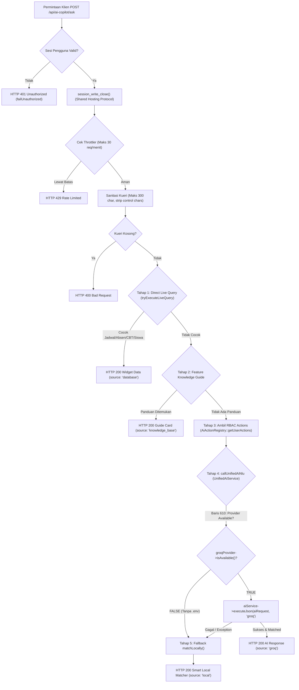

# EAO-REP-2026-006A-AICOPILOT-AUDIT
## Audit Menyeluruh Jalur Permintaan, Tata Kelola Kunci, Kontrak API, dan Telemetri AiCopilot

**Nomor Dokumen:** EAO-REP-2026-006A-AICOPILOT-AUDIT  
**Tanggal:** 16 November 2026  
**Otoritas Pembuat:** Tim Multi-Agen EAO (System Architect, AI Security Reviewer, QA Engineer, AI Product Analyst)  
**Mandat Terkait:** EAO-MANDATE-2026-006 (Persiapan Desain Fase 1C)  
**Status Audit:** READ-ONLY COMPREHENSIVE AUDIT  
**Target Berkas:** `app/Controllers/Api/AiCopilot.php` (790 baris)

---

## 1. Ringkasan Eksekutif Hasil Audit

Audit mendalam terhadap berkas `app/Controllers/Api/AiCopilot.php` menghasilkan temuan-temuan arsitektural krusial yang mendasari perlunya penyelarasan (*alignment*) dengan Core Engine Multi-Account Fase 1B:

1. **Jalur Eksekusi Masih Terblokir oleh Pemeriksaan `.env`:**  
   Pada baris 610, `AiCopilot` melakukan pengecekan `$groqProvider->isAvailable()`. Karena berkas `.env` tidak memiliki `GROQ_API_KEY`, fungsi ini selalu mengembalikan `false` (`PROVIDER_UNAVAILABLE`), sehingga `callUnifiedAiNlu()` langsung membatalkan pemanggilan AI dan memaksa sistem beralih ke pencocokan lokal (`matchLocally()`), meskipun pengguna atau Administrator sebenarnya memiliki API Key valid di database.
2. **Konteks Pengguna & BYOK Belum Terhubung ke Unified AI Service:**  
   Pada baris 652 dan 657, `AiCopilot` memanggil `$aiService->executeJson($aiRequest, 'groq')` tanpa menyuntikkan `$userContext`. Akibatnya, `AiKeyResolver` tidak menerima data `user_id`, `role_id`, atau `teacher_id` pemohon.
3. **Hardcoding Provider 'groq':**  
   Pemanggilan AI dikunci mati ke string `'groq'` pada baris 657, mengabaikan pengguna yang memilih atau memiliki kunci resmi `gemini`.
4. **Duplikasi Pencatatan Audit Log (Redundant Double-Logging):**  
   Ketika AI berhasil merespons, pencatatan log ke tabel `ai_assistant_logs` dilakukan dua kali: pertama oleh `UnifiedAiService::recordAuditTelemetry()` (baris 445), dan kedua oleh `AiCopilot::logInteraction()` (baris 410 & 776).
5. **Kontrak Respons Frontend Sangat Bergantung pada Properti Tertentu:**  
   Frontend Asis AI Copilot mengharapkan respons JSON dengan struktur spesifik (`status`, `source`, `explanation`, `matched_action`, `suggestions`, `csrf_hash`) yang wajib dipertahankan 100% tanpa perubahan format.

---

## 2. Pemetaan Alur Permintaan Aktual (`AiCopilot.php`)



---

## 3. Rincian Temuan Audit Kode Lapangan

### 3.1 Blokade Ketergantungan `.env` pada Baris 607–612
- **Kode Aktual:**
  ```php
  // app/Controllers/Api/AiCopilot.php:606-612
  $aiService = $this->getAiService();
  $groqProvider = $aiService->getProvider('groq');

  // Jika provider Groq belum dikonfigurasi di lingkungan sekolah (.env), degradasi anggun tanpa panggil API
  if ($groqProvider === null || !$groqProvider->isAvailable()) {
      return ['success' => false, 'reason' => 'PROVIDER_UNAVAILABLE'];
  }
  ```
- **Dampak Arsitektural:**  
  Fungsi `$groqProvider->isAvailable()` pada `GroqAdapter.php` baris 42 mengecek apakah kunci server ada di `config->groq['apiKey']` (yang membaca `.env`). Ketika `.env` kosong, fungsi ini mengembalikan `false`. Logika ini bertentangan dengan arsitektur multi-akun BYOK Fase 1B di mana kunci dapat disediakan oleh pengguna atau Administrator dari basis data.
- **Rekomendasi Fase 1C:** Hapus pemeriksaan dini ketersediaan provider berbasis `.env` ini. Serahkan seluruh resolusi ketersediaan kunci kepada `AiKeyResolver` di dalam `UnifiedAiService`.

### 3.2 Ketiadaan Injeksi Konteks Sesi Pengguna pada Baris 652–658
- **Kode Aktual:**
  ```php
  // app/Controllers/Api/AiCopilot.php:651-658
  $aiRequest = new AiRequest(
      $userPrompt,
      $systemInstruction,
      [],
      'openai/gpt-oss-20b',
      0.2,
      600,
      6, // Timeout 6 detik khusus Copilot
      true,
      null, // Kunci resmi sekolah dari .env, dilarang mengambil kunci guru/user
      'copilot_u' . ($user['id'] ?? 0) . '_r' . ($user['role_id'] ?? 0)
  );

  // Eksekusi via UnifiedAiService (dengan Zero PII dan pelepasan sesi aman)
  $response = $aiService->executeJson($aiRequest, 'groq');
  ```
- **Dampak Arsitektural:**  
  Parameter ke-9 `$aiRequest->apiKeyOverride` diisi `null`, dan metode `executeJson()` dipanggil dengan hanya 2 parameter (`$aiRequest`, `'groq'`), tanpa parameter ke-3 `$userContext`. Padahal pada Fase 1B, `UnifiedAiService::executeJson()` telah diperbarui untuk menerima `$userContext = ['user_id' => ..., 'role_id' => ..., 'teacher_id' => ...]`. Akibatnya, `AiKeyResolver` tidak mengetahui identitas pengguna yang mengajukan permintaan dan tidak dapat mencari kunci pribadi guru di tabel `teachers`.
- **Rekomendasi Fase 1C:** Teruskan array konteks pengguna:
  ```php
  $userContext = [
      'user_id'    => (int) ($user['id'] ?? 0),
      'role_id'    => (int) ($user['role_id'] ?? 0),
      'teacher_id' => (int) ($user['teacher_id'] ?? $user['related_id'] ?? 0),
  ];
  $response = $aiService->executeJson($aiRequest, null, $userContext);
  ```

### 3.3 Redundansi Pencatatan Audit Log (Double-Logging)
- **Fakta Lapangan:**
  1. Di dalam `UnifiedAiService::recordAuditTelemetry()` (baris 445), setiap eksekusi dicatat ke tabel `ai_assistant_logs` dengan format telemetri ganda (`source = groq:self:12` atau `groq:admin_fallback:1`).
  2. Namun di `AiCopilot.php` baris 410, controller kembali memanggil:
     ```php
     $this->logInteraction($user, $query, $matched['category'] ?? 'NLU', $matched['id'] ?? null, 'groq');
     ```
     yang melakukan `INSERT` kedua ke tabel `ai_assistant_logs` dengan `source = 'groq'` (polos tanpa detail kepemilikan kunci).
- **Dampak:** Setiap 1 pemanggilan AI menghasilkan 2 baris log duplikat di tabel `ai_assistant_logs`.
- **Rekomendasi Fase 1C:** Hentikan pemanggilan `logInteraction()` pada cabang AI, atau gunakan delegasi tunggal telemetri yang konsisten melalui `UnifiedAiService`.

### 3.4 Sisa Metode Usang (Dead / Deprecated Code)
- **Baris 696–702:** `protected function resolveAiKey(array $user)` (menghasilkan string kosong).
- **Baris 707–710:** `protected function callGeminiNlu(...)` (hanya membungkus `callUnifiedAiNlu()`).
- **Rekomendasi Fase 1C:** Bersihkan atau tandai secara formal metode usang tersebut agar tidak membingungkan pemelihara sistem di masa depan.

---

## 4. Analisis Kontrak API Frontend Asis AI Copilot

Frontend widget Asis AI Copilot (di `public/assets/js/asis-copilot.js` atau view terkait) memproses respon JSON dari endpoint `/api/ai-copilot/ask` dengan ketentuan kontrak berikut:

| Field Respons | Tipe Data | Wajib / Opsional | Deskripsi & Nilai yang Diterima |
|:---|:---|:---:|:---|
| `status` | string | **Wajib** | `'success'`, `'rate_limited'`, atau galat HTTP 400/401/500 |
| `source` | string | **Wajib** | `'database'`, `'knowledge_base'`, `'groq'`, `'gemini'`, `'local'` |
| `query` | string | **Wajib** | Teks pertanyaan pengguna yang sudah disanitasi |
| `explanation` | string | **Wajib** | Kalimat penjelasan ramah 1–2 kalimat untuk pengguna |
| `matched_action` | object / null | Opsional | Objek aksi berizin (`id`, `title`, `url`, `icon`, `category`) |
| `suggestions` | array | Opsional | Daftar aksi alternatif jika ada |
| `ai_content` | string / null | Opsional | Teks instruksi langkah bernomor jika pengguna bertanya panduan |
| `widget_type` | string | Opsional | `'schedule_card'`, `'stat_card'`, `'cbt_card'`, `'guide_card'` |
| `widget_data` | object | Opsional | Data terstruktur untuk rendering kartu interaktif |
| `csrf_hash` | string | **Wajib** | Token CSRF terbaru (`csrf_hash()`) untuk request AJAX berikutnya |

**Invarian Kontrak:**  
Perubahan pada Fase 1C **DILARANG MERUBAH** nama field maupun tipe data di atas, demi menjamin kompatibilitas total antarmuka pengguna (*zero frontend regression*).

---

## 5. Kesimpulan Audit & Pintu Masuk Fase 1C

`AiCopilot.php` memiliki arsitektur dasar yang solid (dengan proteksi session lock, throttler 30 req/min, sanitasi teks, dan fallback berjenjang). Namun keterikatan lama pada `.env` dan ketiadaan passing `$userContext` menjadi satu-satunya penghalang Asis AI Copilot memanfaatkan kekuatan penuh Multi-Account Core Fase 1B.

Penyelarasan pada Fase 1C akan:
1. Menghubungkan `AiCopilot` ke `AiKeyResolver` via `$userContext`.
2. Menerapkan kuota akumulatif 20 generasi/hari untuk kunci Administrator.
3. Mengeliminasi redundansi pencatatan log.
4. Menjaga kontrak JSON frontend tetap 100% utuh.
