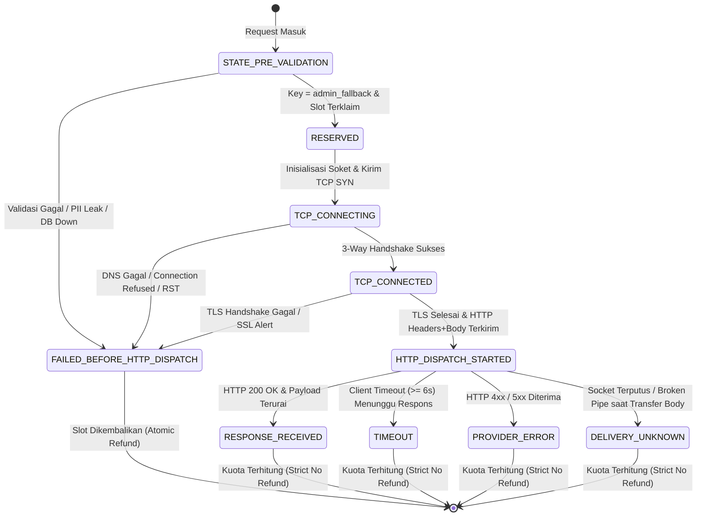

# EAO-REP-2026-006E-DISPATCH-VERIFICATION
## Laporan Verifikasi Semantik Jaringan: Koreksi Siklus Hidup TCP/HTTP, Observabilitas Eksternal, dan Penegakan Kuota

**Nomor Dokumen:** EAO-REP-2026-006E-DISPATCH-VERIFICATION  
**Tanggal:** 16 November 2026  
**Otoritas Pembuat:** Tim Multi-Agen EAO (System Architect, AI Security Reviewer, Developer, QA Engineer)  
**Dasar Mandat:** EAO-HO-006E (Bagian B — Dispatch Semantics)  
**Status Audit:** READ-ONLY VERIFICATION & SPECIFICATION REFINEMENT  
**Batasan Kerja:** Desain & verifikasi arsitektur; dilarang mengubah kode dan database sebelum persetujuan resmi Human Owner.

---

## 1. Koreksi Fundamental: Lapisan Transport (TCP) versus Lapisan Aplikasi (HTTP)

Pada dokumen sebelumnya (`EAO-DESIGN-2026-006D-DISPATCH-SEMANTICS.md`), terdapat ketidakakuratan penggunaan istilah teknis jaringan:
> *"Terjadi pada mikrodetik saat pemanggilan `curl_exec()` dimulai dan paket TCP SYN dilepaskan ke kartu antarmuka jaringan..."*

### 1.1 Analisis Kesalahan Konseptual
Dalam model OSI 7-Layer dan arsitektur TCP/IP:
1. **Paket TCP SYN (Layer 4 - Transport):**  
   Hanya merupakan segmen pembuka dalam proses jabat tangan 3 arah (*Three-Way Handshake*: `SYN -> SYN-ACK -> ACK`) untuk mendirikan sirkuit virtual TCP antara klien dan server.
2. **Jabat Tangan TLS/SSL (Layer 5/6 - Session/Presentation):**  
   Karena endpoint API vendor AI (Groq: `api.groq.com`, Google: `generativelanguage.googleapis.com`) beroperasi melalui HTTPS (Port 443), setelah TCP terhubung masih diperlukan proses pertukaran sertifikat, negosiasi cipher, dan pertukaran kunci enkripsi (*TLS ClientHello -> ServerHello -> Finished*).
3. **HTTP Dispatch (Layer 7 - Application):**  
   Paket permintaan data aplikasi (metode `POST /openai/v1/chat/completions`, header `Authorization: Bearer ...`, dan body JSON prompt) **BARU DIKIRIMKAN SETELAH TLS HANDSHAKE SELESAI SECARA SEMPURNA**.

### 1.2 Koreksi Kebijakan
Paket **TCP SYN BUKAN BUKTI BAHWA PERMINTAAN HTTP SUDAH TERKIRIM**.  
Jika koneksi putus pada saat jabat tangan TCP atau negosiasi TLS (misalnya sertifikat kedaluwarsa atau DNS gagal resolve), server vendor AI **belum menerima 1 byte pun payload aplikasi**. Oleh karena itu, batasan *Point of No Return* harus diposisikan secara presisi pada saat **`HTTP_DISPATCH_STARTED`**, bukan pada TCP SYN.

---

## 2. Pemetaan State Machine 9 Status Transisi

Untuk membedakan tahapan fisik jaringan secara presisi, siklus hidup eksekusi permintaan AI dimodelkan ulang ke dalam **9 status transisi**:

---

## 3. Pembedaan Status: Persisten Basis Data versus Observasi Runtime

Tidak semua 9 status perlu dipersistenkan ke disk/database. Menyimpan setiap transisi mikrodetik jaringan ke basis data akan membebani shared hosting dengan ribuan query I/O yang sia-sia (*excessive disk thrashing*).

### 3.1 Status Observasi Runtime (In-Memory / cURL Telemetry)
Status ini **hanya ada di memori selama proses PHP mengeksekusi cURL** dan dapat diobservasi melalui `curl_getinfo()`:
- `TCP_CONNECTING`: Teramati saat `CURLINFO_NAMELOOKUP_TIME` selesai dan `CURLINFO_CONNECT_TIME` berjalan.
- `TCP_CONNECTED`: Teramati saat `CURLINFO_CONNECT_TIME > 0`.
- `HTTP_DISPATCH_STARTED`: Teramati saat `CURLINFO_APPCONNECT_TIME > 0` (TLS tuntas) dan byte HTTP request terkirim ke soket (`CURLINFO_REQUEST_SIZE > 0`).

### 3.2 Status Persisten (Dicatat pada Database / Telemetri)
Status yang menentukan mutasi kuota harian dan dicatat pada `ai_usage_logs`:
1. `RESERVED`: Kuota harian `used_count` bertambah 1 di `ai_admin_quota_daily`.
2. `FAILED_BEFORE_HTTP_DISPATCH`: Slot kuota dikurangi kembali 1 (`releaseSlot()`) karena terbukti paket HTTP belum terkirim.
3. `RESPONSE_RECEIVED`: Permintaan tuntas sukses, slot kuota sah terpotong.
4. `TIMEOUT`: cURL melampaui 6 detik setelah dispatch, slot kuota sah terpotong (**No Refund**).
5. `PROVIDER_ERROR`: Vendor mengembalikan status 4xx/5xx, slot kuota sah terpotong (**No Refund**).
6. `DELIVERY_UNKNOWN`: Koneksi terputus di tengah pengiriman data payload, slot kuota sah terpotong (**No Refund**).

---

## 4. Matriks Aturan Konsumsi Kuota & Pengembalian (*Quota Rulebook*)

Berikut aturan baku mutlak yang wajib diimplementasikan pada `UnifiedAiService` dan `AdminQuotaManager`:

| No | Kondisi / Status Transisi | Status Pengiriman HTTP | Konsumsi Kuota Admin | Kebijakan Pengembalian (*Refund Policy*) | Justifikasi Teknis & Bisnis |
|:---:|:---|:---:|:---:|:---:|:---|
| 1 | **Validasi & Zero PII Gagal** | Belum Ada Koneksi | **0 (Nol)** | **Tidak Dihitung** | Terhenti di memori lokal; metode `acquireSlot()` belum dipanggil. |
| 2 | **Gagal Pra-Dispatch (`FAILED_BEFORE_HTTP_DISPATCH`)** | Belum Terkirim | **0 (Nol)** | **Refund Atomik (`releaseSlot`)** | Terbukti secara fisik (DNS fail / TLS fail / cURL init fail) payload belum menyentuh server vendor. |
| 3 | **Dispatch Dimulai (`HTTP_DISPATCH_STARTED`) $\rightarrow$ Sukses** | Terkirim & Terproses | **1 Slot** | **Strict No Refund** | Transaksi inferensi berhasil sepenuhnya. |
| 4 | **Status Pengiriman Tidak Diketahui (`DELIVERY_UNKNOWN`)** | Tidak Dapat Dipastikan | **1 Slot** | **Strict No Refund** | Soket putus setelah data sebagian terkirim. Vendor mungkin telah membaca header/token. Refund membuka celah eksploitasi kuota. |
| 5 | **Timeout Setelah Dispatch (`TIMEOUT`)** | Terkirim | **1 Slot** | **Strict No Refund** | Server vendor kemungkinan besar telah/sedang memproses inferensi pada GPU dan menagih biaya token API Key Admin. |
| 6 | **Provider Error Setelah Dispatch (`PROVIDER_ERROR`)** | Terkirim & Ditolak | **1 Slot** | **Strict No Refund** | API Key Admin telah digunakan untuk mengetuk gerbang vendor. Mencegah *retry storm* tak terbatas yang menguras kuota. |

---

## 5. Keterbatasan Observabilitas & Penolakan Klaim Exactly-Once

### 5.1 Asimetri Observabilitas
Aplikasi ESPATA pada shared hosting hanya memiliki visibilitas dari sisi klien (*Client-Side Observability*). ESPATA dapat memverifikasi:
- Apakah soket TCP lokal berhasil terhubung ke IP vendor (`CURLINFO_PRIMARY_IP`).
- Berapa byte data HTTP request yang berhasil didorong ke socket buffer kernel OS (`CURLINFO_REQUEST_SIZE`).

Namun, ESPATA **TIDAK MEMILIKI AKSES** terhadap:
- Apakah web load balancer vendor (Cloudflare / Envoy) telah meneruskan payload ke cluster GPU inferensi.
- Apakah proses inferensi dihentikan saat koneksi TCP klien terputus.

### 5.2 Penolakan Klaim Exactly-Once Delivery
Tim EAO secara tegas menyatakan:
- Pada komunikasi HTTP publik, **Exactly-Once Delivery adalah kemustahilan matematis**.
- Protokol yang diimplementasikan oleh ESPATA adalah **At-Least-Once Dispatch Boundary** yang dipadukan dengan **At-Most-Once Local Quota Allocation (Strict No-Refund Boundary)**.
- Desain ini menjamin bahwa sekolah tidak akan pernah mengalami kebocoran kuota tersembunyi atau biaya liar akibat asumsi optimis yang keliru.
