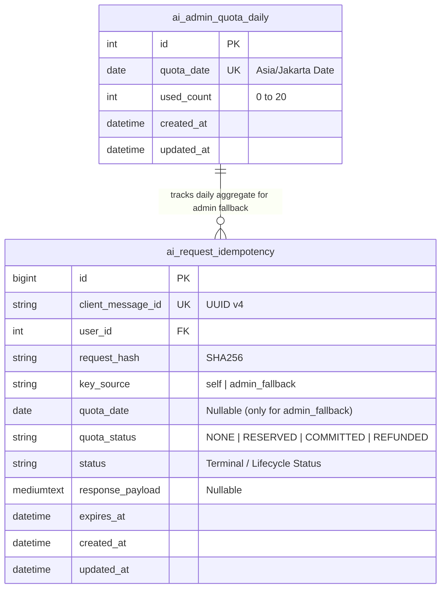

# EAO-REP-2026-006F-ATOMIC-QUOTA-CONSISTENCY
## Laporan Arsitektur: Konsistensi Atomik Transaksi Kuota Harian, Relasi Tabel Idempotensi, dan Ketahanan Basis Data InnoDB

**Nomor Dokumen:** EAO-REP-2026-006F-ATOMIC-QUOTA-CONSISTENCY  
**Tanggal:** 16 November 2026  
**Otoritas Pembuat:** Tim Multi-Agen EAO (System Architect, AI Security Reviewer, Developer, QA Engineer)  
**Dasar Mandat:** EAO-HO-006F (Butir 3.B — Atomic Quota Reservation)  
**Status Dokumen:** READ-ONLY DESIGN SPECIFICATION  
**Batasan Kerja:** Desain & analisis murni; dilarang mengubah kode, database, dan 6 file terlindung lisensi.

---

## 1. Hubungan Relasional antara `ai_admin_quota_daily` dan `ai_request_idempotency`

Untuk menjamin bahwa pemotongan kuota Administrator dan riwayat status permintaan berada dalam keadaan konsisten (*state consistency*), sistem tidak boleh memperlakukan kedua tabel ini sebagai entitas yang terputus.



### 1.1 Penambahan Kolom Penjamin Integritas Kuota pada `ai_request_idempotency`:
1. **`key_source` (`ENUM('self', 'admin_fallback')`):**  
   Menandai sumber kunci secara mutlak. Jika `key_source = 'self'`, seluruh alur pemotongan kuota Administrator di-bypass.
2. **`quota_date` (`DATE NULL`):**  
   Mencatat tanggal kalender Asia/Jakarta yang menjadi rujukan agregasi kuota. Hanya bernilai jika `key_source = 'admin_fallback'`.
3. **`quota_status` (`ENUM('NONE', 'RESERVED', 'COMMITTED', 'REFUNDED')`):**  
   - `NONE`: Untuk request dengan API Key pribadi (`self`). Kuota Admin tidak tersentuh.
   - `RESERVED`: Kuota harian telah dinaikkan 1 slot di `ai_admin_quota_daily`, proses sedang berjalan atau menunggu dispatch.
   - `COMMITTED`: Permintaan telah melewati batas HTTP dispatch, kuota secara permanen menjadi hak Admin yang terpakai (**Strict No-Refund**).
   - `REFUNDED`: Permintaan gagal sebelum dispatch terbukti, slot telah dikembalikan secara atomik ke `ai_admin_quota_daily`.

---

## 2. Jaminan Anti-Double-Deduction & Anti-Double-Refund

### 2.1 Mencegah Pemotongan Kuota Ganda (Anti-Double-Deduction)
Satu permintaan dengan `client_message_id` yang sama **mustahil memotong kuota lebih dari satu kali**:
1. **Pemeriksaan Idempotensi Sebelum Reservasi:**  
   Kueri awal memeriksa baris `ai_request_idempotency` untuk UUID yang bersangkutan.
2. **Penolakan pada Status Terminal atau In-Flight:**  
   Jika baris sudah ada dengan status `IN_FLIGHT`, `COMMITTED`, atau `RESERVED`, metode reservasi **langsung membatalkan pemotongan baru**.
3. **Pemesanan Atomik Terikat ID:**  
   Reservasi kuota diikatkan langsung ke `client_message_id` melalui pembaruan status `quota_status = 'RESERVED'` dalam satu transaksi basis data InnoDB.

### 2.2 Mencegah Pengembalian Kuota Ganda (Anti-Double-Refund)
Sebuah permintaan **mustahil menerima pengembalian slot kuota lebih dari satu kali**:
Kueri pengembalian kuota (`releaseSlot`) dieksekusi secara atomik bersyarat:
```sql
-- Kueri Pengembalian Kuota Bersyarat Atomik
UPDATE ai_request_idempotency
SET quota_status = 'REFUNDED',
    status = 'FAILED_BEFORE_HTTP_DISPATCH',
    updated_at = NOW()
WHERE client_message_id = ?
  AND quota_status = 'RESERVED'; -- SYARAT MUTLAK: Hanya yang berstatus RESERVED!
```
- Jika kueri di atas menghasilkan `affected_rows == 1`, maka dan hanya maka proses boleh menjalankan pengurangan counter:
```sql
UPDATE ai_admin_quota_daily
SET used_count = GREATEST(0, used_count - 1),
    updated_at = NOW()
WHERE quota_date = ?
  AND used_count > 0;
```
- Jika kueri pertama menghasilkan `affected_rows == 0` (misalnya karena refund sudah pernah dipanggil sebelumnya atau status sudah `COMMITTED`), counter kuota harian **TIDAK AKAN DIKURANGI**. Ini secara fisik mematikan risiko *double-refund*.

---

## 3. Penanganan Kegagalan Transaksi dan Koneksi yang Ambigu

Dalam interaksi basis data jaringan, kegagalan saat `COMMIT` adalah kondisi paling berbahaya (*ambiguous commit state*): server PHP mengirim perintah `COMMIT`, tetapi soket MySQL terputus sebelum PHP menerima pesan konfirmasi ACK.

### 3.1 Protokol Rekonsiliasi Ambigu pada Koneksi Terputus:
Jika terjadi exception koneksi (MySQL Error 2006 / 2013) saat atau tepat setelah perintah reservasi kuota:
1. **Dilarang Menjalankan Retry Buta (*No Blind Retry*):**  
   Driver dilarang langsung melakukan `INSERT/UPDATE` ulang yang berisiko menaikkan `used_count` untuk kedua kalinya.
2. **Kueri Verifikasi Status Bersih (*State Inspection on Reconnect*):**  
   Koneksi baru dibuka kembali, lalu memeriksa baris `ai_request_idempotency` berdasarkan `client_message_id`:
   - Jika baris ditemukan dan `quota_status == 'RESERVED'`, transaksi commit sebelumnya terbukti berhasil di server basis data. Proses dapat melanjutkan eksekusi normal tanpa menaikkan counter lagi.
   - Jika baris tidak ditemukan atau status belum terikat, transaksi commit sebelumnya telah di-rollback oleh MySQL server. Sistem dapat dengan aman mencoba reservasi ulang.

---

## 4. Penanganan 4 Kelas Kesalahan Basis Data (Database Error Matrix)

| Kode Error MySQL | Nama Kesalahan | Kondisi Muncul | Protokol Penanganan Wajib | Kebijakan Transaksi |
|:---:|:---|:---|:---|:---|
| **1213** | `Deadlock Detected` | Dua proses konkuren mengunci baris `quota_date` dan `client_message_id` secara bersilangan. | Tangkap Throwable, **wajib panggil `$db->transRollback()`**, jeda acak (*Full Jitter*) 15–45 ms, lalu retry maksimal 1 kali. | **Rollback Sebelum Retry** |
| **1205** | `Lock Wait Timeout` | Antrean penguncian InnoDB melebihi batas waktu (standar 50 detik) akibat saturasi server hosting. | **Dilarang Retry.** Segera catat log *CRITICAL*, eksekusi rollback, dan ambil jalur **Fail-Closed** (tolak alokasi, arahkan ke fallback lokal non-AI). | **Fail-Closed Segera** |
| **1062** | `Duplicate Entry` | Dua worker menerima permintaan dengan `client_message_id` yang sama secara bersamaan. | Proses pertama lolos; proses kedua menangkap 1062, rollback, lalu membaca status baris eksisting untuk safe replay atau penolakan in-flight. | **Handled as Idempotent Match** |
| **2006 / 2013** | `MySQL Server Has Gone Away` | Koneksi TCP ke MySQL putus di tengah operasi (timeout atau reboot). | Jangan jalankan query lanjutan di koneksi rusak. Re-koneksi satu kali untuk cek status `client_message_id`. Jika gagal $\rightarrow$ **Fail-Closed**. | **Fail-Closed Mutlak** |

---

## 5. Kepastian Isolasi Kunci Pribadi Guru (`self`)

Sesuai Kebijakan BYOK ESPATA:
1. Ketika guru menggunakan API Key pribadi miliknya sendiri (`key_source = 'self'`), nilai kolom `quota_status` pada `ai_request_idempotency` bernilai `'NONE'` dan kolom `quota_date` bernilai `NULL`.
2. Kueri `UPDATE ai_admin_quota_daily` **TIDAK PERNAH DIJALANKAN** untuk permintaan bertipe `self`.
3. Guru pemilik kunci pribadi memiliki akses tanpa batas dari kuota sekolah, dan kegagalan/kehabisan kuota Administrator (20/20) sama sekali **tidak pernah menghalangi guru ber-key pribadi**.

---

## 6. Penegakan Batas Keras 20 Generasi Agregat Harian Asia/Jakarta

Batas kuota Administrator ditegakkan melalui satu kueri atomik bersyarat:
```sql
UPDATE ai_admin_quota_daily
SET used_count = used_count + 1,
    updated_at = NOW()
WHERE quota_date = ?
  AND used_count < 20;
```
- Kueri ini memanfaatkan *exclusive row lock* InnoDB.
- Di bawah persaingan 100 proses simultan sekalipun, tepat 20 proses pertama yang akan menghasilkan `affected_rows == 1`.
- Proses ke-21 dan seterusnya akan menghasilkan `affected_rows == 0`, secara fisik menolak penambahan dan menjamin `used_count` tidak pernah melebihi 20.
