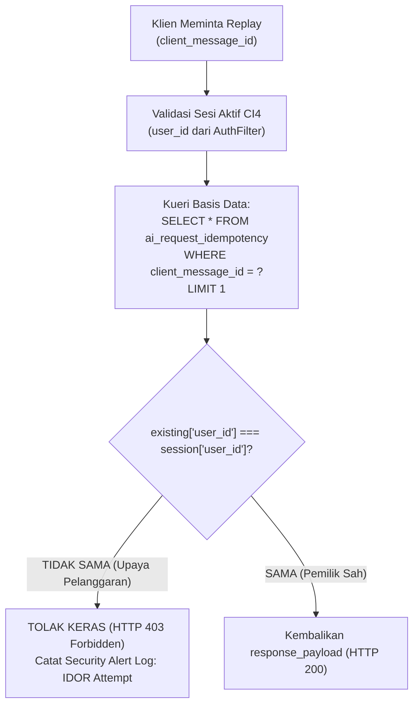

# EAO-REP-2026-006F-DATA-PRIVACY
## Laporan Tata Kelola Privasi Data: Audit Penyimpanan Respons AI, Isolasi Multi-Pengguna, dan Pencegahan Kebocoran PII

**Nomor Dokumen:** EAO-REP-2026-006F-DATA-PRIVACY  
**Tanggal:** 16 November 2026  
**Otoritas Pembuat:** Tim Multi-Agen EAO (AI Security Reviewer, System Architect, Developer, QA Engineer)  
**Dasar Mandat:** EAO-HO-006F (Butir 3.F — Data Privacy dan Response Storage)  
**Status Dokumen:** READ-ONLY SECURITY SPECIFICATION  
**Batasan Kerja:** Desain & analisis murni; dilarang mengubah kode, database, dan 6 file terlindung lisensi.

---

## 1. Audit Isi Kolom `response_payload`: Prinsip Minimisasi Data

Penyimpanan payload pada tabel `ai_request_idempotency` semata-mata ditujukan untuk mendukung fitur **Safe Replay** (mengembalikan hasil kepada klien jika koneksi balik terputus tanpa inferensi ulang).

### 1.1 Spesifikasi Isi Data yang Sah Disimpan:
Hanya elemen-elemen berikut yang diizinkan masuk ke dalam `response_payload`:
- Konten teks atau JSON hasil generasi AI (`content` / `message`).
- Metadata ringkas inferensi: `model`, `finish_reason`, dan `usage_tokens`.

### 1.2 Data yang DILARANG KERAS Masuk ke `response_payload`:
- API Key mentah penyedia layanan (Groq / Gemini API Key).
- Header HTTP Authorization atau Cookie sesi pengguna.
- Log internal IP address atau trace exception sistem.

---

## 2. Kontrol Akses Berbasis Kepemilikan Pengguna (*Strict User-Scoped Access*)

Untuk mencegah ancaman kebocoran data antarpengguna (*Insecure Direct Object Reference / IDOR*):



### 2.1 Penegakan Isolasi:
1. Setiap kueri pembacaan idempotensi **WAJIB MENYERTAKAN** parameter sesi pengguna aktif (`user_id`).
2. Jika ada pihak yang mencoba menebak atau mengirimkan UUID milik pengguna lain, sistem mengembalikan status **`HTTP 403 Forbidden`** dan mencatat insiden keamanan ke sistem pemantauan.

---

## 3. Pembatasan Ukuran Penyimpanan (*Storage Footprint Control*)

1. **Batas Ukuran Respons Maksimum:**  
   Ukuran `response_payload` dibatasi maksimal **64 Kilobyte (KB)** per respons di tingkat aplikasi. Jika respons vendor melebihi 64 KB (kasus anomali yang jarang terjadi pada Copilot), sistem memotong teks berlebih sebelum disimpan ke basis data.
2. **Tipe Data Kolom MySQL:**  
   Menggunakan tipe data `MEDIUMTEXT` (kapasitas hingga 16 MB secara fisik) dengan collation `utf8mb4_unicode_ci` untuk menjamin dukungan penuh terhadap karakter multibyte bahasa Indonesia dan simbol akademik.

---

## 4. Evaluasi Risiko Data Sensitif Siswa & Zero PII Scrubber

### 4.1 Hubungan dengan Kebijakan Zero PII ESPATA:
Sesuai rancangan arsitektur ESPATA:
1. **Sanitasi Hulu (Pre-LLM):**  
   Seluruh parameter masukan guru telah disaring secara ketat oleh 4-Lapis Zero PII Scrubber (NIK, NISN, Nama Siswa, dan Alamat) sebelum diteruskan ke vendor AI.
2. **Keamanan Hilir (Post-LLM Response):**  
   Karena prompt yang dikirim ke LLM tidak mengandung data pribadi siswa, respons yang dihasilkan oleh vendor AI secara alami **bersih dari identitas sensitif individu siswa**.
3. **Pemeriksaan Tambahan Sebelum Penyimpanan:**  
   Sebelum string JSON dimasukkan ke kolom `response_payload`, sanitasi cepat regex dijalankan untuk mendeteksi apabila LLM secara tak terduga memunculkan pola angka NIK/NISN sintetis.

---

## 5. Protokol Penghapusan Payload Terjadwal (*Payload Pruning Protocol*)

Penyimpanan payload teks tidak boleh dipertahankan tanpa batas waktu (*data minimization principle*):

```sql
-- Kueri Pembersihan Payload Respons Usang (Dijalankan Berkala)
UPDATE ai_request_idempotency
SET response_payload = NULL,
    updated_at = NOW()
WHERE created_at < NOW() - INTERVAL 7 DAY
  AND response_payload IS NOT NULL;
```

### 5.1 Nilai Keamanan Protokol Pruning Ini:
1. Menghapus data teks percakapan dari basis data setelah 7 hari kalender.
2. **Tidak Menghapus Baris Metadata:** Kunci `client_message_id`, status `COMPLETED`, dan status kuota `COMMITTED` tetap tersimpan utuh selama 90 hari untuk mencegah duplikasi eksekusi.
3. Memberikan perlindungan privasi yang seimbang antara kepatuhan regulasi perlindungan data dan ketahanan teknis basis data.
