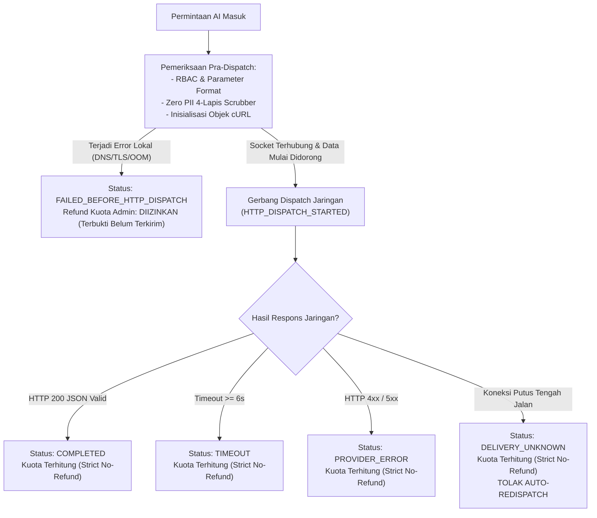

# EAO-REP-2026-006F-DISPATCH-SEMANTICS
## Laporan Arsitektur: Verifikasi Kemampuan Aktual libcurl, Batas Observabilitas Jaringan, dan Kebijakan Konservatif Kuota

**Nomor Dokumen:** EAO-REP-2026-006F-DISPATCH-SEMANTICS  
**Tanggal:** 16 November 2026  
**Otoritas Pembuat:** Tim Multi-Agen EAO (System Architect, AI Security Reviewer, Developer, QA Engineer)  
**Dasar Mandat:** EAO-HO-006F (Butir 3.E — HTTP Dispatch Semantics)  
**Status Dokumen:** READ-ONLY DESIGN SPECIFICATION  
**Batasan Kerja:** Desain & analisis murni; dilarang mengubah kode, database, dan 6 file terlindung lisensi.

---

## 1. Verifikasi Kemampuan Faktual Lingkungan Eksekusi PHP cURL

Berdasarkan pemeriksaan aktual pada sistem server:
- **Versi PHP:** `8.2.12`
- **Versi libcurl:** `8.4.0`
- **Pustaka Kriptografi SSL:** `OpenSSL/3.0.11`
- **Host Target:** `x86_64-pc-win32` / Apache LiteSpeed Shared Hosting Compatible
- **Protokol Didukung:** `HTTP`, `HTTPS`, `TLS 1.2`, `TLS 1.3`

---

## 2. Analisis Kritis: Mengapa Metrik cURL Bukan Bukti Pemrosesan Provider

Pada dokumen arsitektur sebelumnya, terdapat asumsi bahwa pembacaan metrik libcurl:
- `CURLINFO_APPCONNECT_TIME > 0` (Waktu jabat tangan TLS tuntas), dan
- `CURLINFO_REQUEST_SIZE > 0` (Jumlah byte HTTP request terkirim)
dapat dijadikan acuan bahwa server vendor (Groq/Google) telah menerima payload.

### 2.1 Kenyataan Teknis di Lapisan Kernel & Jaringan (The Socket Buffer Illusion):
1. **Penulisan ke Buffer Lokal Kernel (*Local Socket Buffer*):**  
   Ketika fungsi `curl_exec()` selesai mendorong byte header dan body HTTP request, nilai `CURLINFO_REQUEST_SIZE` tercatat positif. Namun, data tersebut secara fisik **baru berpindah dari memori PHP ke Socket Send Buffer pada kernel sistem operasi lokal**.
2. **Transit Melalui Infrastruktur Pihak Ketiga:**  
   Paket data tersebut masih harus melintasi jaringan internet publik, penyedia CDN/WAF perantara (Cloudflare Reverse Proxy), edge gateway vendor AI, dan load balancer internal sebelum tiba di antrean proses GPU LLM.
3. **Konsekuensi Logis:**  
   Klien ESPATA **TIDAK PERNAH DAPAT MEMBUKTIKAN SECARA MATEMATIS** apakah server vendor AI telah memproses inferensi token atau belum jika koneksi terputus sesaat setelah data didorong.

---

## 3. Kebijakan Konservatif Tanpa Kompromi (*Conservative Demarcation Policy*)

Mengingat batas asimetri observabilitas di atas, ESPATA mengadopsi kebijakan pertahanan konservatif (*Strict Conservative Rulebook*):

### Rincian Aturan Baku Konservatif:

1. **Pengembalian Kuota (*Refund*) HANYA DIBOLEHKAN jika Terbukti Pra-Dispatch:**  
   Refund kuota Admin via `AdminQuotaManager::releaseSlot()` hanya dan hanya sah dieksekusi jika kegagalan terjadi pada saat soket cURL belum selesai melakukan negosiasi lokal (`FAILED_BEFORE_HTTP_DISPATCH`).
2. **TIDAK ADA PENGEMBALIAN KUOTA Begitu Dispatch Dimulai:**  
   Segera setelah proses mencapai status `HTTP_DISPATCH_STARTED` atau terdapat kemungkinan paket data telah didorong ke jaringan, sistem mengunci status kuota sebagai **Strict No-Refund**.
3. **Larangan Pengiriman Ulang Otomatis pada `DELIVERY_UNKNOWN`:**  
   Jika koneksi terputus secara anomali saat pengiriman data payload berlangsung, status ditetapkan sebagai `DELIVERY_UNKNOWN`. Sistem backend dan frontend **DILARANG KERAS MELAKUKAN AUTO-REDISPATCH** ke vendor AI, guna mencegah terjadinya komputasi inferensi ganda pada server penyedia.

---

## 4. Penertiban Nomenklatur & Kejujuran Terminologi Teknis

Sesuai instruksi Human Owner, dokumen arsitektur ESPATA menertibkan seluruh istilah:
- **DILARANG** menggunakan istilah *"Exactly-Once Delivery Guarantee"* terhadap penyedia API eksternal.
- **DILARANG** mengklaim bahwa protokol HTTP REST publik mendukung *"Two-Phase Commit (2PC)"*.
- **TERMINOLOGI RESMI:**  
  Sistem ESPATA menerapkan **Idempotent In-Flight Local Gate** yang dipadukan dengan **Conservative Demarcation Policy (Strict No-Refund on Dispatched Requests)**. Istilah ini secara faktual dan ilmiah mencerminkan kemampuan riil sistem tanpa janji palsu.
