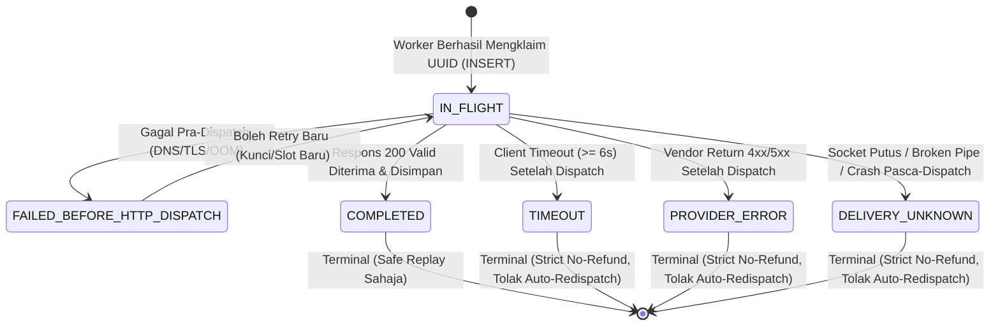
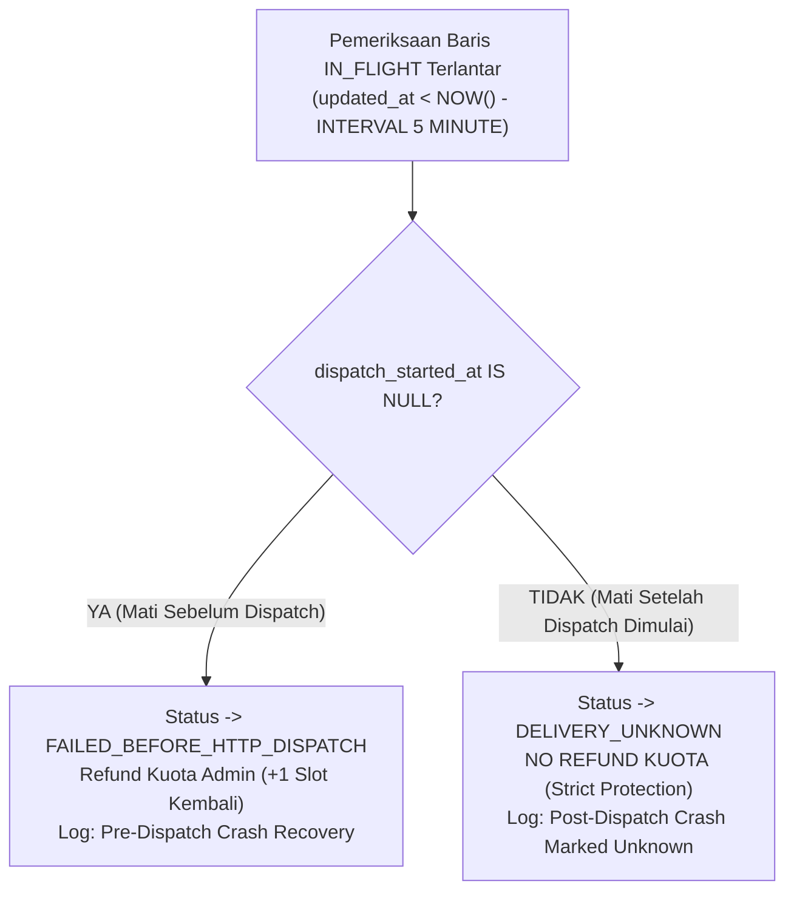

# EAO-REP-2026-006F-IDEMPOTENCY-STATE-MACHINE
## Laporan Arsitektur: State Machine Idempotensi Persisten, Penanganan Orphan Process, dan Resolusi Konkurensi Eksekusi

**Nomor Dokumen:** EAO-REP-2026-006F-IDEMPOTENCY-STATE-MACHINE  
**Tanggal:** 16 November 2026  
**Otoritas Pembuat:** Tim Multi-Agen EAO (System Architect, AI Security Reviewer, Developer, QA Engineer)  
**Dasar Mandat:** EAO-HO-006F (Butir 3.C — Persistent Idempotency State Machine)  
**Status Dokumen:** READ-ONLY DESIGN SPECIFICATION  
**Batasan Kerja:** Desain & analisis murni; dilarang mengubah kode, database, dan 6 file terlindung lisensi.

---

## 1. Peta Transisi Status Idempotensi Lengkap (*Full State Transition Model*)

Untuk mengelola siklus hidup permintaan secara deterministik di tingkat basis data, tabel `ai_request_idempotency` menerapkan mesin status (*State Machine*) dengan 6 status terdefinisi:



---

## 2. Matriks Perilaku Sistem terhadap Status Permintaan

| Status Permintaan | Kategori Status | Apakah Boleh Diulang (*Retryable*)? | Perilaku terhadap Request Masuk yang Membawa UUID Sama | Dampak Kuota Admin Eksisting |
|:---|:---:|:---:|:---|:---:|
| **`IN_FLIGHT`** | Aktif / Transien | **TIDAK** | **Tolak Permintaan Baru (`HTTP 409 Conflict / 429`):** "Permintaan sedang diproses oleh sistem. Harap tunggu." | Tetap `RESERVED` |
| **`COMPLETED`** | Terminal Sukses | **TIDAK** | **Kembalikan Respons Tersimpan (*Safe Replay*):** Mengembalikan `response_payload` dari database seketika tanpa panggil vendor AI. | Tetap `COMMITTED` |
| **`FAILED_BEFORE_HTTP_DISPATCH`** | Terminal Gagal Lokal | **YA** | **Boleh Menginisiasi Ulang:** Karena kuota telah di-refund, klien diizinkan mencoba kembali jika perbaikan koneksi selesai. | Telah `REFUNDED` |
| **`TIMEOUT`** | Terminal Jaringan | **TIDAK** | **Tolak Auto-Redispatch:** Informasikan timeout 6 detik tercapai. Pengguna diarahkan mengajukan prompt baru dengan UUID baru. | Tetap `COMMITTED` |
| **`PROVIDER_ERROR`** | Terminal Vendor | **TIDAK** | **Tolak Auto-Redispatch:** Informasikan galat vendor. Mencegah *retry storm* yang menguras kuota. | Tetap `COMMITTED` |
| **`DELIVERY_UNKNOWN`** | Terminal Anomali | **TIDAK** | **Tolak Auto-Redispatch Mutlak:** Mencegah eksekusi ganda di server vendor yang mungkin telah menerima payload. | Tetap `COMMITTED` |

---

## 3. Pencegahan Dua Worker Memperebutkan UUID yang Sama

Dalam lingkungan web server multithreaded (Apache mpm_worker / multiple PHP-FPM workers):
1. **Hak Eksekusi Tunggal via Atomic Insert:**  
   Ketika request tiba, worker pertama mengeksekusi kueri pendaftaran:
   ```sql
   INSERT INTO ai_request_idempotency (
       client_message_id, user_id, request_hash, key_source, quota_status, status, created_at, updated_at
   ) VALUES (?, ?, ?, ?, 'NONE', 'IN_FLIGHT', NOW(), NOW());
   ```
2. **Eliminasi Race Condition:**  
   Kolom `client_message_id` diproteksi oleh **UNIQUE KEY** di mesin InnoDB.
   - Worker 1 berhasil melakukan `INSERT` $\rightarrow$ memegang hak tunggal untuk mengeksekusi proses.
   - Worker 2 yang mencoba mengeksekusi kueri yang sama secara serentak akan seketika dibatalkan oleh MySQL dengan galat **MySQL Error 1062 (Duplicate entry)**.
3. **Penanganan Elegan Worker 2:**  
   Worker 2 menangkap error 1062, membatalkan transaksinya secara bersih, membaca baris yang dibuat Worker 1, dan langsung merespons klien dengan status `IN_FLIGHT` ("Sedang diproses"), tanpa pernah menyentuh vendor AI atau kuota basis data.

---

## 4. Protokol Pemulihan Baris `IN_FLIGHT` Terlantar (*Orphan Process Recovery*)

Apa yang terjadi jika proses PHP mati mendadak (misalnya karena server reboot mendadak atau *OOM Killer*) saat status masih tertulis `IN_FLIGHT` di database?

### 4.1 Kolom Tambahan Pembeda Titik Kematian: `dispatch_started_at`
Untuk membedakan secara objektif apakah proses mati **sebelum** atau **sesudah** dispatch dimulai, tabel dilengkapi kolom:
- **`dispatch_started_at` (`DATETIME NULL`)**



### 4.2 Algoritma Pemulihan Terlantar (*Lazy / Periodic Recovery*):
Saat request baru masuk atau melalui pembersihan berkala:
1. **Kasus 1 (Mati Pra-Dispatch):**  
   Jika `status = 'IN_FLIGHT'`, usia baris $> 5$ menit, dan `dispatch_started_at IS NULL`:
   - Proses PHP dipastikan mati sebelum soket jaringan dibuka.
   - Sistem secara aman mengubah status menjadi `FAILED_BEFORE_HTTP_DISPATCH`.
   - Kuota Admin dikembalikan 1 slot jika sebelumnya berstatus `RESERVED` (`releaseSlot()`).
2. **Kasus 2 (Mati Pasca-Dispatch):**  
   Jika `status = 'IN_FLIGHT'`, usia baris $> 5$ menit, dan `dispatch_started_at IS NOT NULL`:
   - Proses terbukti telah mengirimkan byte HTTP ke jaringan sebelum mati.
   - Sistem menandai status menjadi `DELIVERY_UNKNOWN`.
   - **KUOTA TIDAK DIKEMBALIKAN (NO REFUND)**, karena ada kemungkinan besar server vendor AI telah mengeksekusi inferensi pada GPU mereka.

---

## 5. Batasan Kejujuran Ilmiah: Tiada Jaminan Exactly-Once Eksternal

Tim Multi-Agen EAO secara tegas mendokumentasikan batas teknis:
- **Di Tingkat Lokal ESPATA:** Kombinasi *InnoDB Unique Constraint + Atomic Status Locking* memberikan jaminan **Exactly-Once Execution di dalam Lingkungan Server Internal ESPATA**.
- **Di Tingkat Vendor Pihak Ketiga (Groq/Google):** ESPATA **TIDAK PERNAH DAPAT MENJAMIN EXACTLY-ONCE EXECUTION PADA SERVER PIHAK KETIGA**. Jika jaringan publik mengalami *packet drop* setelah HTTP request dikirimkan, vendor mungkin mengeksekusi LLM tanpa ESPATA pernah menerima hasilnya.
- Menolak klaim sepihak dan mematuhi batasan terdistribusi ini adalah bentuk kejujuran arsitektur tingkat tinggi yang melindungi sekolah dari ketidakpastian operasional.
