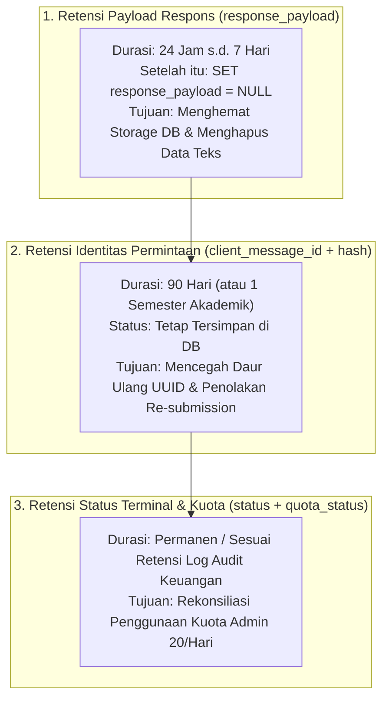

# EAO-REP-2026-006F-SAFE-REPLAY-AND-RETENTION
## Laporan Arsitektur: Protokol Safe Replay, Pemisahan Siklus Retensi Data, dan Kebijakan Identitas Permintaan

**Nomor Dokumen:** EAO-REP-2026-006F-SAFE-REPLAY-AND-RETENTION  
**Tanggal:** 16 November 2026  
**Otoritas Pembuat:** Tim Multi-Agen EAO (System Architect, AI Security Reviewer, Developer, QA Engineer)  
**Dasar Mandat:** EAO-HO-006F (Butir 3.A & 3.D — Safe Replay dan Retensi)  
**Status Dokumen:** READ-ONLY DESIGN SPECIFICATION  
**Batasan Kerja:** Desain & analisis murni; dilarang mengubah kode, database, dan 6 file terlindung lisensi.

---

## 1. Evaluasi Kritis terhadap Kebijakan Penghapusan Penuh 7 Hari (*Full Deletion Flaw*)

Pada draf sebelumnya, diusulkan bahwa data idempotensi akan dibersihkan secara penuh (*hard delete*) setelah 7 hari:
`DELETE FROM ai_request_idempotency WHERE created_at < NOW() - INTERVAL 7 DAY;`

### 1.1 Analisis Celah Keamanan & Konsistensi (*The Replay Amnesia Bug*):
1. **Hilangnya Ingatan Sistem (*System Amnesia*):**  
   Jika sebuah baris dihapus secara fisik dari basis data, sistem kehilangan seluruh catatan bahwa UUID tersebut pernah digunakan.
2. **Bahaya Replay Eksekusi Ganda:**  
   Jika pengguna membuka kembali tab browser lama yang telah tersimpan di memori lokal setelah hari ke-8 dan browser melakukan pengiriman ulang (*form resubmit/refresh*), UUID lama tersebut akan dianggap sebagai **permintaan baru yang belum pernah ada**.
3. **Dampak Buruk:** Sistem akan mengeksekusi inferensi AI baru ke vendor pihak ketiga dan **memotong kuota harian sekolah untuk kedua kalinya** untuk aksi yang seharusnya sudah kadaluwarsa.

---

## 2. Arsitektur Pemisahan Tiga Lapisan Retensi (*Decoupled Retention Model*)

Untuk menutup celah di atas, kebijakan penyimpanan dipisahkan secara tegas ke dalam 3 siklus hidup independen:



### 2.1 Perilaku terhadap UUID Lama Setelah Payload Dihapus (*Payload Pruned State*):
Ketika klien mengirimkan request dengan UUID yang barisnya masih ada di database tetapi kolom `response_payload` telah menjadi `NULL` (karena telah melewati 7 hari):
- **Sistem DILARANG memproses permintaan tersebut sebagai inferensi baru!**
- **Respon Backend Konsisten:**  
  Sistem mengembalikan status `HTTP 410 Gone` atau respons JSON deterministik:
  ```json
  {
      "status": "expired_idempotency_key",
      "message": "Sesi respons untuk pesan ini telah kedaluwarsa. Silakan ajukan pertanyaan baru melalui antarmuka percakapan.",
      "client_message_id": "asis-uuid-v4-terkait"
  }
  ```
- **Hasil:** Nol pemotongan kuota, nol pemanggilan vendor AI, dan integritas data tetap 100% terlindungi.

---

## 3. Aturan Baku Client Message Identity (Frontend & Backend Integrity)

Untuk menjamin keabsahan dan isolasi pengguna pada antarmuka Asis AI Copilot:

### 3.1 Aturan Pembangkitan di Sisi Klien (Frontend Rules):
1. **Pembangkitan Tunggal per Aksi:**  
   Fungsi `crypto.randomUUID()` HANYA dipanggil tepat satu kali pada saat pengguna menekan tombol "Kirim" atau tombol Enter.
2. **Kunci Penekanan Ganda (*Rapid Click Lock*):**  
   Pada mikrodetik pertama tombol ditekan, elemen tombol segera dinonaktifkan (`btn.disabled = true; btn.classList.add('loading');`). Penekanan berulang tidak membangkitkan UUID baru.
3. **Penggunaan Ulang UUID pada Retry Otomatis:**  
   Jika terjadi timeout koneksi HTTP lokal (6 detik), paket pengiriman ulang (*retry attempt*) WAJIB membawa `client_message_id` yang sama persis.

### 3.2 Aturan Validasi Keamanan di Sisi Server (Backend Integrity Rules):

```php
// Pemeriksaan Integritas Identitas di AiCopilot Controller
$clientMessageId = $request->getHeaderLine('X-Client-Message-Id') ?: $request->getPost('client_message_id');
$userId          = (int) $userSession['id'];
$requestHash     = hash('sha256', $userId . '|' . trim($query));

$existing = $idempotencyModel->findByClientMessageId($clientMessageId);

if ($existing) {
    // 1. ISOLASI MUTLAK: UUID yang sama dengan user_id berbeda WAJIB DITOLAK
    if ((int)$existing['user_id'] !== $userId) {
        log_message('critical', "[SecurityAlert] Cross-user idempotency collision detected for UUID: {$clientMessageId}");
        return $this->response->setStatusCode(403)->setJSON([
            'status'  => 'forbidden',
            'message' => 'Akses ditolak: Identitas pesan tidak sah untuk akun Anda.'
        ]);
    }

    // 2. ANTI-TAMPERING: UUID yang sama dengan payload berbeda WAJIB DITOLAK
    if ($existing['request_hash'] !== $requestHash) {
        log_message('warning', "[IdempotencyAlert] Payload hash mismatch for UUID: {$clientMessageId}");
        return $this->response->setStatusCode(409)->setJSON([
            'status'  => 'conflict',
            'message' => 'Konflik identitas: Isi permintaan tidak sesuai dengan kunci transaksi yang terdaftar.'
        ]);
    }

    // 3. SAFE REPLAY: Jika status COMPLETED dan payload ada, kembalikan instan
    if ($existing['status'] === 'COMPLETED' && !empty($existing['response_payload'])) {
        return $this->response->setJSON(json_decode($existing['response_payload'], true));
    }
}
```

---

## 4. Jendela Jaminan Idempotensi kepada Frontend (*Contract SLA*)

Kepada antarmuka pengguna (Frontend JavaScript & User Experience), ditetapkan kontrak jaminan layanan (*Service Level Agreement*):

| Jendela Jaminan | Durasi Waktu | Garansi Perilaku Sistem |
|:---|:---:|:---|
| **Jendela Replay Instan (*Instant Safe Replay*)** | **24 Jam** | Pengiriman ulang permintaan dijamin mengembalikan payload jawaban lengkap tanpa delay dan tanpa kuota terpotong. |
| **Jendela Kunci Anti-Duplikasi (*Key Deduplication*)** | **90 Hari** | Sistem menjamin UUID yang sama tidak dapat digunakan kembali untuk memicu pemanggilan inferensi baru ke vendor AI. |
| **Batas Waktu Pengarsipan Data (*Data Retention*)** | **180 Hari** | Baris identitas diarsipkan ke log jangka panjang sebelum dilakukan pembersihan metadata lama. |
