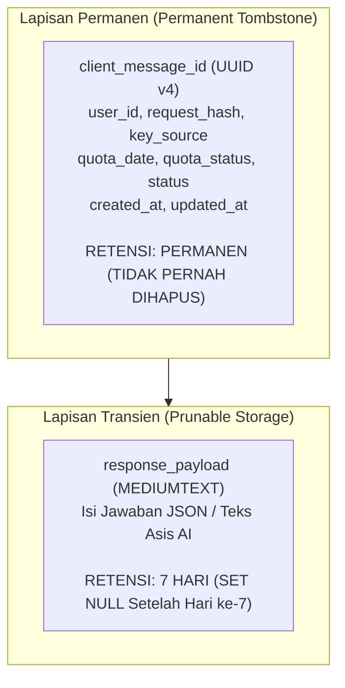

# EAO-REP-2026-006G-IDEMPOTENCY-RETENTION-FINAL
## Spesifikasi Arsitektur Tingkat Lanjut: Kebijakan Tombstone Permanen, Eliminasi Replay Amnesia, dan Penanganan Payload Usang

**Nomor Dokumen:** EAO-REP-2026-006G-IDEMPOTENCY-RETENTION-FINAL  
**Tanggal:** 16 November 2026  
**Otoritas Pembuat:** Tim Multi-Agen EAO (System Architect, AI Security Reviewer, Developer, QA Engineer)  
**Dasar Mandat:** EAO-HO-006G (Butir B.1 — UUID Identity Retention)  
**Status Dokumen:** FINAL SPECIFICATION — READ-ONLY DESIGN REFINEMENT  
**Batasan Kerja:** Desain & analisis murni; dilarang mengubah kode, database, dan 6 file terlindung lisensi.

---

## 1. Latar Belakang & Eliminasi Celah Replay Amnesia

Pada desain sistem idempotensi terdistribusi, salah satu kesalahan paling fatal adalah menerapkan kebijakan penghapusan fisik (*hard delete*) pada data kunci idempotensi setelah jangka waktu tertentu.

### 1.1 Masalah "Replay Amnesia":
Jika sebuah baris `ai_request_idempotency` dihapus secara fisik dari basis data setelah 7 hari:
1. Basis data kehilangan seluruh memori bahwa sebuah `client_message_id` pernah diproses dan pernah memotong kuota.
2. Jika pengguna membuka tab browser lama, memuat ulang halaman (*form resubmission*), atau terjadi replay request dari proxy jaringan di hari ke-8, UUID lama tersebut akan masuk ke sistem sebagai **data yang tidak dikenal**.
3. Sistem secara keliru akan memperlakukan UUID lama tersebut sebagai **permintaan baru**, mengeksekusi inferensi AI ke vendor eksternal, dan **memotong kuota harian sekolah untuk kedua kalinya**.

---

## 2. Kebijakan Tombstone Identitas Permanen (*Permanent Identity Tombstone*)

Untuk menutup celah di atas secara permanen, arsitektur ESPATA memisahkan secara fisik antara **Metadata Identitas Transaksi** dan **Payload Respons Percakapan**:



### 2.1 Ketetapan Aturan Penyimpanan:
1. **Identitas UUID dan Status Terminal Bersifat Permanen:**  
   Baris metadata identitas pada tabel `ai_request_idempotency` **TIDAK PERNAH DIHAPUS SECARA FISIK DARI BASIS DATA**. Baris ini bertindak sebagai *Tombstone* permanen yang mencatat bahwa UUID tersebut telah sah dikonsumsi dan tidak boleh didaur ulang seumur hidup aplikasi.
2. **Pruning Payload Respons setelah 7 Hari:**  
   Untuk menjaga efisiensi ruang disk pada shared hosting dan mematuhi prinsip minimisasi data, hanya kolom `response_payload` yang dibersihkan secara berkala (*lazy pruning* atau *scheduled cleanup*):
   ```sql
   -- Kueri Pembersihan Payload Terjadwal (Hanya Mengosongkan Teks)
   UPDATE ai_request_idempotency
   SET response_payload = NULL,
       updated_at = NOW()
   WHERE created_at < NOW() - INTERVAL 7 DAY
     AND response_payload IS NOT NULL;
   ```
   Kueri ini menyisakan baris tombstone dengan seluruh kolom identitas tetap utuh.

---

## 3. Protokol Respons Deterministik untuk UUID Tanpa Payload

Ketika sebuah permintaan HTTP tiba membawa `client_message_id` yang sudah ada di database, tetapi kolom `response_payload` telah bernilai `NULL` (karena telah melewati masa retensi 7 hari):

### 3.1 Larangan Mutlak:
**SISTEM DILARANG MEMPROSES PERMINTAAN SEBAGAI INFERENSI BARU.**  
Sistem tidak boleh mengirimkan prompt ke vendor AI dan tidak boleh menyentuh kuota harian Administrator.

### 3.2 Respon Terstandarisasi Backend:
Sistem mengembalikan kode status **`HTTP 410 Gone`** dengan payload JSON deterministik:

```json
{
    "status": "payload_expired",
    "code": "IDEMPOTENCY_PAYLOAD_EXPIRED",
    "message": "Respons untuk permintaan ini telah kedaluwarsa dan dibersihkan dari server sesuai kebijakan retensi data (7 hari). Silakan ajukan pertanyaan baru melalui antarmuka Asis AI.",
    "client_message_id": "asis-3f8a4b2c-9d1e-4c7a-8f3b-5e2a1b4c6d8e",
    "terminal_status": "COMPLETED",
    "created_at": "2026-11-09 10:15:00"
}
```

### 3.3 Penanganan di Sisi Antarmuka Frontend:
Antarmuka JavaScript chat Asis AI mendeteksi kode `IDEMPOTENCY_PAYLOAD_EXPIRED`:
1. Menghentikan indikator *loading* / tombol *disabled*.
2. Menampilkan gelembung pesan informatif (*system bubble*) kepada pengguna:  
   *"Riwayat jawaban untuk pesan ini telah kedaluwarsa (lebih dari 7 hari). Silakan ketik kembali pertanyaan Anda untuk memulai sesi baru."*
3. Tombol input kembali diaktifkan sehingga guru dapat mengetikkan pertanyaan baru yang akan membangkitkan UUID v4 baru.

---

## 4. Matriks Siklus Hidup dan Perilaku UUID Berdasarkan Umur Permintaan

| Umur Permintaan | Keberadaan Baris DB | Isi `response_payload` | Perilaku terhadap Request Masuk yang Membawa UUID Sama | Dampak Kuota Admin |
|:---|:---:|:---:|:---|:---:|
| **0 s.d. 6 Detik** (In-Flight) | Ada (`IN_FLIGHT`) | `NULL` | Tolak sebagai benturan konkurensi (`HTTP 409 Conflict` / `HTTP 429`). | Nol Kuota Baru (Tetap `RESERVED`) |
| **6 Detik s.d. 7 Hari** | Ada (`COMPLETED`) | Ada (JSON Teks) | **Safe Replay Instan:** Kembalikan isi `response_payload` seketika (`HTTP 200 OK`). | Nol Kuota Baru (Tetap `COMMITTED`) |
| **> 7 Hari (Permanen)** | Ada (`COMPLETED`) | `NULL` (Pruned) | **Tombstone Response:** Tolak eksekusi ulang, kembalikan status terstruktur (`HTTP 410 Gone`). | Nol Kuota Baru (Tetap `COMMITTED`) |
| **UUID Baru (Belum Ada)** | Belum Ada | Belum Ada | **Eksekusi Baru:** Daftarkan baris tombstone, alokasikan slot kuota, dan jalankan pipeline inferensi. | Alokasi 1 Slot Kuota (Jika `admin_fallback`) |

---

## 5. Ringkasan Jaminan Keamanan Sistem
1. **Perlindungan Finansial 100%:** Sekolah dijamin tidak akan pernah mengalami kebocoran kuota Admin akibat pengiriman ulang pesan lama.
2. **Kepatuhan Privasi Data:** Teks percakapan dihapus secara teratur setelah 7 hari, meminimalkan jejak data di server shared hosting.
3. **Ketahanan Jangka Panjang:** Baris tombstone permanen berukuran sangat ringkas (~150 byte per baris) sehingga 10.000 transaksi hanya memakan ruang ~1,5 MB di MySQL InnoDB.
