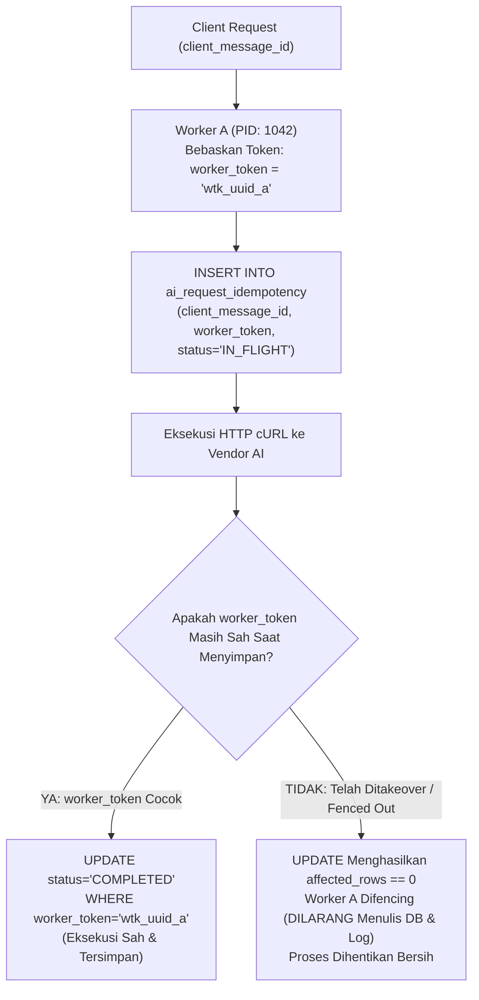
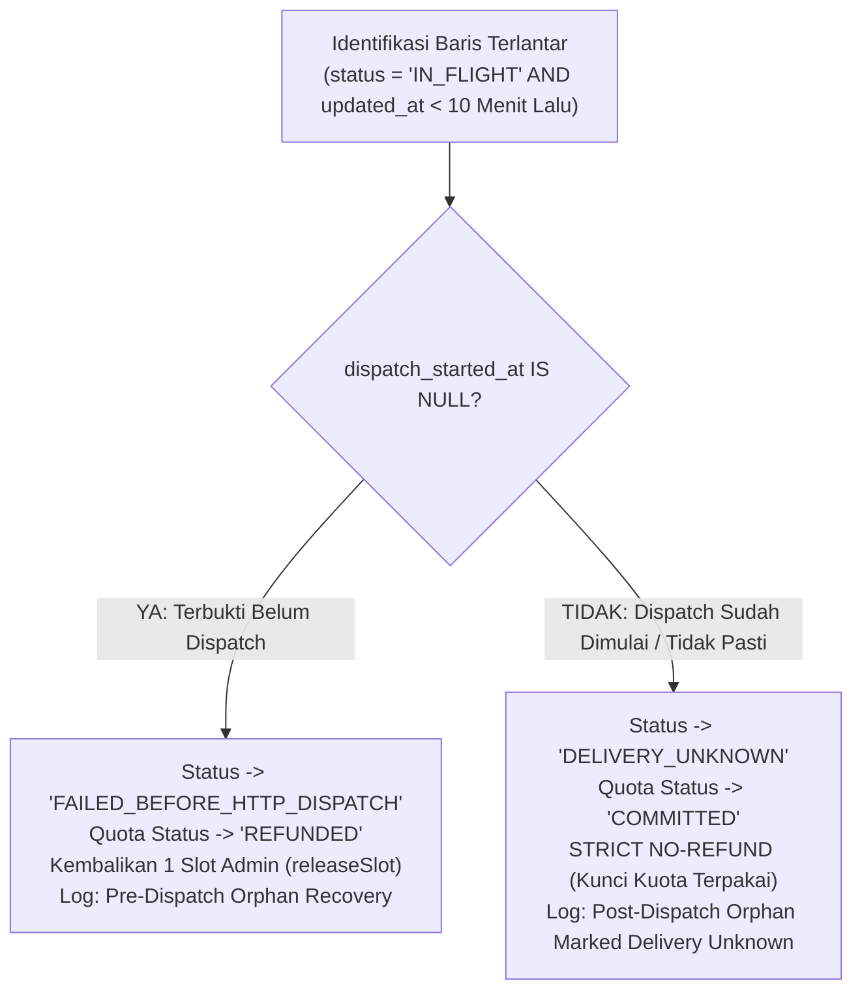

# EAO-REP-2026-006G-WORKER-FENCING-FINAL
## Spesifikasi Arsitektur Tingkat Lanjut: Mekanisme Worker Fencing Token, Penanganan Orphan Process Terkoreksi, dan Mitigasi Race Condition Eksekusi

**Nomor Dokumen:** EAO-REP-2026-006G-WORKER-FENCING-FINAL  
**Tanggal:** 16 November 2026  
**Otoritas Pembuat:** Tim Multi-Agen EAO (System Architect, AI Security Reviewer, Developer, QA Engineer)  
**Dasar Mandat:** EAO-HO-006G (Butir B.2 — Orphan Recovery dan Worker Fencing)  
**Status Dokumen:** FINAL SPECIFICATION — READ-ONLY DESIGN REFINEMENT  
**Batasan Kerja:** Desain & analisis murni; dilarang mengubah kode, database, dan 6 file terlindung lisensi.

---

## 1. Analisis Masalah Fencing: Bahaya Pengambilalihan Keliru (*Zombie Worker Hazard*)

Pada arsitektur sistem berbasis web multi-proses (Apache MPM Event/Worker atau PHP-FPM):
1. **Skenario Latensi Ekstrem (*Temporary Process Stalling*):**  
   Sebuah proses PHP (Worker A) sedang menunggu respons inferensi dari vendor AI. Karena antrean GPU di sisi vendor sedang lambat, proses memakan waktu 25 detik.
2. **Kekeliruan Deteksi Terlantar (*False Orphan Takeover*):**  
   Jika sistem recovery latar belakang atau request baru secara agresif menduga Worker A telah "mati" pada detik ke-15 dan langsung mengubah status baris menjadi `TIMEOUT` atau `FAILED_BEFORE_HTTP_DISPATCH`, maka terjadi anomali ganda:
   - Status di database telah diubah oleh Recovery Worker.
   - Pada detik ke-26, Worker A tiba-tiba terbangun karena paket HTTP dari Groq/Google akhirnya tiba.
3. **Dampak Zombie Worker:**  
   Jika Worker A dibiarkan menulis hasil respons ke basis data tanpa verifikasi kepemilikan, Worker A akan menimpa status baris secara liar (*blind overwrite*), merusak status konsistensi kuota, dan memicu *split-brain state*.

---

## 2. Desain Token Kepemilikan Eksekusi (*Worker Fencing Token*)

Untuk mengisolasi hak eksekusi secara matematis, setiap proses PHP yang mengklaim tugas eksekusi wajib menyertakan **`worker_token`** unik berbasis kriptografi:



### 2.1 Spesifikasi Kolom Basis Data Tambahan:
Pada berkas migrasi `ai_request_idempotency`, ditambahkan kolom penegak hak eksekusi:
- **`worker_token` (`VARCHAR(64) NULL`):**  
  Token kepemilikan unik berupa string acak berkekuatan kriptografis (`bin2hex(random_bytes(16))` atau UUID v4) yang dibangkitkan oleh proses PHP saat baris pertama kali didaftarkan.
- **`dispatch_started_at` (`DATETIME NULL`):**  
  Penanda waktu mikrodetik tepat sebelum fungsi `curl_exec()` dipanggil ke kartu jaringan.

---

## 3. Protokol Pembaruan Bersyarat (*Conditional State Update*)

Seluruh kueri mutasi status yang dijalankan oleh worker **WAJIB MENGGUNAKAN KUERI BERSYARAT KETAT (*CONDITIONAL UPDATE*)**:

### 3.1 Penyelesaian Sukses oleh Worker yang Sah:
```sql
UPDATE ai_request_idempotency
SET status = 'COMPLETED',
    quota_status = 'COMMITTED',
    response_payload = ?,
    updated_at = NOW()
WHERE client_message_id = ?
  AND worker_token = ?           -- SYARAT MUTLAK: Hanya worker pemilik sah!
  AND status = 'IN_FLIGHT';      -- SYARAT MUTLAK: Status belum diubah pihak lain!
```
- Jika kueri menghasilkan `affected_rows === 1`: Penyimpanan berhasil, transaksi inferensi sah.
- Jika kueri menghasilkan `affected_rows === 0`: Worker secara otomatis menyadari bahwa hak eksekusinya telah dicabut (*fenced off*). Worker **DILARANG** melakukan operasi kuota lanjutan dan wajib keluar secara bersih.

---

## 4. Protokol Orphan Recovery yang Aman (*Conservative Recovery Protocol*)

Untuk memastikan bahwa proses pemulihan baris terlantar tidak pernah salah mengambil alih worker yang masih hidup:

### 4.1 Ambang Batas Waktu Konservatif (10 Menit):
Proses recovery **HANYA DIIZINKAN MENYENTUH** baris yang memenuhi kriteria:
`status = 'IN_FLIGHT' AND updated_at < NOW() - INTERVAL 10 MINUTE`  
Ambang batas 10 menit ini memberikan jendela keamanan yang sangat luas (100x lebih panjang dari batas timeout klien 6 detik), sehingga mustahil memvonis keliru worker yang masih aktif.

### 4.2 Prosedur Pemulihan Terkoreksi:



### 4.3 Kueri Recovery Terpagari (*Fenced Recovery Queries*):

#### Kasus A: Terbukti Gagal Sebelum HTTP Dispatch:
```sql
UPDATE ai_request_idempotency
SET status = 'FAILED_BEFORE_HTTP_DISPATCH',
    quota_status = 'REFUNDED',
    worker_token = NULL,
    updated_at = NOW()
WHERE client_message_id = ?
  AND status = 'IN_FLIGHT'
  AND dispatch_started_at IS NULL
  AND updated_at < NOW() - INTERVAL 10 MINUTE;
```
Jika `affected_rows === 1`, eksekusi pengurangan counter harian:
```sql
UPDATE ai_admin_quota_daily
SET used_count = GREATEST(0, used_count - 1),
    updated_at = NOW()
WHERE quota_date = ?
  AND used_count > 0;
```

#### Kasus B: Dispatch Telah Dimulai atau Status Tidak Pasti:
```sql
UPDATE ai_request_idempotency
SET status = 'DELIVERY_UNKNOWN',
    quota_status = 'COMMITTED', -- Kuota terkunci permanen sebagai terpakai
    worker_token = NULL,
    updated_at = NOW()
WHERE client_message_id = ?
  AND status = 'IN_FLIGHT'
  AND (dispatch_started_at IS NOT NULL OR updated_at < NOW() - INTERVAL 10 MINUTE);
```
**KUOTA TIDAK DIKEMBALIKAN (STRICT NO-REFUND)**, dan baris ini secara permanen menolak redispatch otomatis.

---

## 5. Ringkasan Jaminan Ketahanan Sistem
1. **Nol Tabrakan Worker (*Zero Worker Collision*):** Worker lama yang tertunda tidak akan pernah mampu merusak baris yang telah diambil alih oleh proses pemulihan.
2. **Eliminasi Pengembalian Kuota Keliru:** Setiap pengembalian slot kuota mewajibkan bukti fisik mutlak (`dispatch_started_at IS NULL`). Jika terdapat keraguan atau dispatch telah berjalan, status dipatok pada `DELIVERY_UNKNOWN` tanpa refund.
3. **Kepatuhan ACID Penuh:** Seluruh transisi status dikunci di level baris InnoDB MySQL, menjamin konsistensi mutlak pada lingkungan shared hosting.
