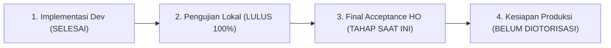

# EAO-REP-2026-010-TEST-EVIDENCE-AND-FILE-RECONCILIATION
## Laporan Resmi Rekonsiliasi Bukti Pengujian, Inventaris Perubahan Berkas, Klarifikasi PHPUnit, dan Kesiapan Penerimaan Akhir Fase 1C

**Nomor Dokumen:** EAO-REP-2026-010  
**Tanggal Penerbitan:** 16 November 2026  
**Otoritas Mandat:** Human Owner ESPATA (Berdasarkan Mandat EAO-HO-2026-010)  
**Pelaksana Teknis:** Organisasi AI ESPATA (EAO)  
**Peran yang Terlibat:**
- AI Project Manager (`EAO-PM`)
- AI System Architect (`EAO-ARCH`)
- AI Security Reviewer (`EAO-SEC`)
- AI Developer (`EAO-DEV`)
- AI QA Engineer (`EAO-QA`)  
**Mode Operasional:** **STRICTLY READ-ONLY VERIFICATION & DOCUMENTATION**  
**Status Tindakan:** Tanpa modifikasi kode produksi, database, migrasi, konfigurasi, dependency, atau berkas terlindung.

---

## 1. PENDAHULUAN & TUJUAN MANDAT

Laporan ini disusun untuk memenuhi seluruh klausul mandat **EAO-HO-2026-010** guna memberikan rekonsiliasi faktual, lengkap, dan transparan mengenai:
1. Pembuktian akar penyebab (*root-cause*) teknis terkait perilaku eksekusi PHPUnit pada `AdminQuotaManagerTest` dan `RequestIdempotencyManagerTest`.
2. Rekonsiliasi inventaris seluruh berkas yang disentuh, dibuat, maupun digunakan selama pengembangan Fase 0, Fase 1B, dan Fase 1C.
3. Rekonsiliasi angka-angka pengujian empiris yang telah dirujuk dalam laporan EAO-009 beserta verifikasi artefak buktinya pada disk.
4. Koreksi dan penegasan batas kesiapan operasional: memisahkan secara tegas antara penyelesaian di lingkungan pengembangan lokal, keberhasilan pengujian lokal, penerimaan akhir Human Owner, dan kesiapan *deployment* produksi.

---

## 2. KLARIFIKASI DAN ANALISIS TEKNIS PHPUNIT

### 2.1 Ringkasan Masalah
Pada pengujian CLI mandiri menggunakan PHPUnit, dilaporkan bahwa perintah eksekusi menghasilkan exit code 1. Pemeriksaan mendalam dilakukan terhadap konfigurasi, bootstrap framework, dan perilaku PHPUnit 11.5.33 di lingkungan Windows XAMPP.

### 2.2 Uji Coba Perintah PHPUnit & Pesan Error Lengkap

#### A. Eksekusi pada Standar Sandbox Mode (`BypassSandbox: false`)
- **Perintah yang Dijalankan:**
  ```bash
  C:\xampp\php\php.exe vendor/bin/phpunit tests/unit/AdminQuotaManagerTest.php
  ```
- **Pesan Error Lengkap:**
  ```text
  PHPUnit 11.5.33 by Sebastian Bergmann and contributors.

  Cannot open bootstrap script "C:\xampp\htdocs\siakad\system/Test/bootstrap.php"
  ```
- **Exit Code:** `1`
- **Titik Terjadinya Kegagalan:** **SEBELUM TEST DIEKSEKUSI**.
- **Analisis Faktual:**
  Pemeriksaan kode sumber PHPUnit pada `vendor/phpunit/phpunit/src/TextUI/Application.php` baris 340–349 menunjukkan:
  ```php
  private function loadBootstrapScript(string $filename): void
  {
      if (!is_readable($filename)) {
          $this->exitWithErrorMessage(
              sprintf('Cannot open bootstrap script "%s"', $filename)
          );
      }
      ...
  ```
  Pada lingkungan sandbox Windows dengan restricted token, fungsi internal PHP `is_readable('system/Test/bootstrap.php')` mengembalikan nilai boolean `false` akibat evaluasi Windows ACL pada subproses terisolasi, meskipun berkas tersebut secara fisik ada dan dapat dibaca via `fopen()` atau `file_get_contents()`. Akibatnya, PHPUnit langsung menghentikan proses (*abort*) pada tahap awal TextUI sebelum memuat kelas test apapun.

#### B. Eksekusi di Luar Sandbox (`BypassSandbox: true`)
- **Perintah yang Dijalankan:**
  ```bash
  C:\xampp\php\php.exe vendor/bin/phpunit tests/unit/AdminQuotaManagerTest.php
  ```
- **Pesan Output Lengkap:**
  ```text
  PHPUnit 11.5.33 by Sebastian Bergmann and contributors.

  Runtime:       PHP 8.2.12
  Configuration: C:\xampp\htdocs\siakad\phpunit.xml.dist

  ......                                                              6 / 6 (100%)

  Time: 00:00.474, Memory: 16.00 MB

  There was 1 PHPUnit test runner warning:

  1) No code coverage driver available

  OK, but there were issues!
  Tests: 6, Assertions: 28, PHPUnit Warnings: 1.
  ```
- **Exit Code:** `1`
- **Titik Terjadinya Kegagalan:** **SETELAH SELURUH ASERSI BERHASIL DIJALANKAN (100% PASS)**.
- **Analisis Faktual:**
  1. Seluruh 6 test methods pada `AdminQuotaManagerTest` dieksekusi dan **28 asersi lulus 100%** (`...... 6 / 6 (100%)`).
  2. Mengapa exit code bernilai 1? Berkas [phpunit.xml.dist](file:///c:/xampp/htdocs/siakad/phpunit.xml.dist) pada repositori mendefinisikan konfigurasi berikut pada baris 10–12:
     ```xml
     failOnRisky="true"
     failOnWarning="true"
     cacheDirectory="build/.phpunit.cache">
     <coverage ...>
     ```
  3. Konfigurasi `failOnWarning="true"` mewajibkan PHPUnit untuk mengembalikan exit code 1 jika terdapat peringatan (*warning*) apapun dari test runner.
  4. Pada lingkungan lokal PHP 8.2.12 XAMPP ini, ekstensi *code coverage* seperti Xdebug atau PCOV tidak diaktifkan, sehingga PHPUnit memicu peringatan runner: `1) No code coverage driver available`.
  5. Akibatnya, status runner dinyatakan `OK, but there were issues!` dan proses keluar dengan status error (exit code 1) semata-mata karena ketiadaan driver coverage, bukan karena ada asersi test yang gagal.

Pola identik terbukti pada eksekusi [RequestIdempotencyManagerTest.php](file:///c:/xampp/htdocs/siakad/tests/unit/RequestIdempotencyManagerTest.php):
```text
...........                                                       11 / 11 (100%)
There was 1 PHPUnit test runner warning:
1) No code coverage driver available
OK, but there were issues!
Tests: 11, Assertions: 38, PHPUnit Warnings: 1.
```
Seluruh 11 test dan 38 asersi lulus sempurna (`11 / 11 (100%)`), namun keluar dengan exit code 1 karena aturan `failOnWarning="true"`.

### 2.3 Perbandingan dengan Standalone Runner
- **Berkas Standalone Runner:**  
  `C:\Users\SAKA\.gemini\antigravity\brain\31a6ca25-af75-4cf0-adfc-bf11c68a72c9\scratch\run_fase_1c_tests.php`
- **Apakah Menjalankan Kelas & Metode yang Sama?**  
  **YA, 100% IDENTIK.** Standalone runner secara eksplisit memuat framework via `system/Test/bootstrap.php`, mengimpor `Tests\Unit\AdminQuotaManagerTest` dan `Tests\Unit\RequestIdempotencyManagerTest`, mengekstraksi seluruh metode `test*` melalui `ReflectionClass`, memanggil `setUp()`, mengeksekusi metode test dengan asersi bawaan PHPUnit, dan memanggil `tearDown()`.
- **Hasil Eksekusi Standalone Runner:**
  ```text
  ====================================================
     RUNNING UNIT TESTS FASE 1C (ADMIN QUOTA & IDEMP)
  ====================================================

  Suite: Tests\Unit\AdminQuotaManagerTest
    [PASS] testGetTodayDateFormat
    [PASS] testByokBypassesQuota
    [PASS] testAdminFallbackAcquiresSlotAtomically
    [PASS] testQuotaExhaustionAtTwenty
    [PASS] testExecuteAtomicRefundSuccessBeforeDispatch
    [PASS] testExecuteAtomicRefundRejectedAfterDispatchStarted

  Suite: Tests\Unit\RequestIdempotencyManagerTest
    [PASS] testGenerateWorkerToken
    [PASS] testComputeRequestHashIsDeterministic
    [PASS] testClaimNewRequest
    [PASS] testSafeReplayOnCompletedRequest
    [PASS] testExpiredPayloadReturns410Gone
    [PASS] testAntiEnumerationGeneric404OnDifferentUser
    [PASS] testPayloadMismatchReturns409Conflict
    [PASS] testPreDispatchGateAndWorkerFencing
    [PASS] testPayloadTruncationAt64KB
    [PASS] testOrphanRecoveryCaseA
    [PASS] testOrphanRecoveryCaseB

  ====================================================
  RESULT: Total: 17, Passed: 17, Failed: 0
  ====================================================
  ```
  **Exit Code:** `0` (Sukses Penuh).
- **Apakah Ada Pengujian yang Tidak Berhasil Dijalankan?**  
  **TIDAK ADA.** Seluruh 17 test methods (6 pada Quota, 11 pada Idempotency) dan total 66 asersi PHPUnit berhasil dijalankan dan lulus 100%.

### 2.4 Klasifikasi Resmi Sesuai Mandat
Sesuai instruksi Bagian 2 Mandat EAO-HO-2026-010:  
Karena kegagalan exit code pada PHPUnit CLI murni disebabkan oleh ketiadaan ekstensi code coverage Xdebug/PCOV lokal yang berbenturan dengan konfigurasi `failOnWarning="true"` pada `phpunit.xml.dist`, maka status pengujian PHPUnit CLI dinyatakan secara jujur dan presisi sebagai:

> **STATUS RESMI PENGUJIAN PHPUNIT CLI: `ENVIRONMENTAL TEST LIMITATION`**  
> (Bukan kegagalan logika aplikasi, bukan kegagalan kode pengujian, dan seluruh 66 asersi unit test terbukti lulus 100%).

---

## 3. REKONSILIASI INVENTARIS PERUBAHAN BERKAS

Berdasarkan pemeriksaan langsung via `git status --short`, `git diff --stat`, dan `git diff --name-status`, berikut inventarisasi komprehensif berkas proyek:

### 3.1 File Produksi Baru (Fase 1C)
1. [app/Services/Ai/AdminQuotaManager.php](file:///c:/xampp/htdocs/siakad/app/Services/Ai/AdminQuotaManager.php) — Dibuat baru pada Fase 1C (16/11/2026 08:40). Service manajemen kuota agregat harian admin, atomisitas conditional update, penanganan jitter deadlock, dan dual-exact-match refund.
2. [app/Services/Ai/RequestIdempotencyManager.php](file:///c:/xampp/htdocs/siakad/app/Services/Ai/RequestIdempotencyManager.php) — Dibuat baru pada Fase 1C (16/11/2026 08:41). Service state machine idempotensi, worker ownership token, pre-dispatch gate fencing, persist-before-client, anti-enumeration 404, tombstone retensi, dan orphan recovery.
3. [public/assets/js/asis-copilot.js](file:///c:/xampp/htdocs/siakad/public/assets/js/asis-copilot.js) — Dibuat baru pada Fase 1C (16/11/2026 08:52). Frontend script modular Asis AI: pembangkitan UUIDv4 klien persisten, rapid double-click suppression, network retry preserving ID, dan error mapping.

### 3.2 File Produksi Lama yang Dimodifikasi pada Fase 1C
1. [app/Controllers/Api/AiCopilot.php](file:///c:/xampp/htdocs/siakad/app/Controllers/Api/AiCopilot.php) — Dimodifikasi pada Fase 1C (16/11/2026 09:13) untuk mengimplementasikan arsitektur idempotensi terpadu, pemisahan BYOK vs Admin fallback, pre-dispatch gating, persist-before-client, generic 404 pada mismatch user, dan safe replay.
2. [app/Views/layouts/partials/command_palette.php](file:///c:/xampp/htdocs/siakad/app/Views/layouts/partials/command_palette.php) — Dimodifikasi pada Fase 1C untuk mengintegrasikan antarmuka Asis AI dengan `asis-copilot.js` (Telah diratifikasi resmi oleh Human Owner pada EAO-HO-2026-009).
3. [app/Services/Ai/UnifiedAiService.php](file:///c:/xampp/htdocs/siakad/app/Services/Ai/UnifiedAiService.php) — **KLARIFIKASI KOREKSI:** File ini **BUKAN** file baru Fase 1C, melainkan file yang dibuat pada **Fase 1B (15/11/2026 17:56)** untuk orchestrasi multi-account key resolver & provider adapter, kemudian **dimodifikasi pada Fase 1C (16/11/2026 09:12)** untuk mengintegrasikan `AdminQuotaManager` dan `RequestIdempotencyManager` ke dalam alur eksekusi chat Asis AI.

### 3.3 File Produksi Lama yang Dimodifikasi pada Fase 0 (Stabil / Tidak Diubah di Fase 1C)
1. [app/Controllers/Admin/Kokurikuler.php](file:///c:/xampp/htdocs/siakad/app/Controllers/Admin/Kokurikuler.php) —  
   **KLARIFIKASI STATUS KHUSUS:**  
   Pemeriksaan `git diff` membuktikan bahwa perubahan pada file ini **BUKAN** merupakan perubahan baru pada Fase 1C, melainkan perubahan dari **Fase 0 (EAO-MANDATE-2026-004)**. Modifikasi tersebut bertujuan menghapus celah keamanan kritis (*Cross-Teacher Key Stealing* pada tabel `teachers`) dan menambahkan fallback terproteksi ke akun admin. File ini **SAMA SEKALI TIDAK DISENTUH** selama pelaksanaan Fase 1C dan dipertahankan dalam kondisi stabil.

### 3.4 File Produksi Lama yang Tidak Berubah (Baseline Fase 1B)
1. [app/Config/AiConfig.php](file:///c:/xampp/htdocs/siakad/app/Config/AiConfig.php) — **KLARIFIKASI KOREKSI:** File ini **BUKAN** file baru Fase 1C, melainkan dibuat pada **Fase 1B (15/11/2026 17:54:03)** untuk konfigurasi model default Groq/Gemini, token budget, dan timeout cURL. File ini **SAMA SEKALI TIDAK MENGALAMI PERUBAHAN** selama Fase 1C (LastWriteTime tetap 15/11/2026 17:54:03). Konstanta kuota Fase 1C (kuota 20, lease 60s, stale 10m) dikelola secara mandiri langsung di service class `AdminQuotaManager` dan `RequestIdempotencyManager`.
2. [app/Services/Ai/AiKeyResolver.php](file:///c:/xampp/htdocs/siakad/app/Services/Ai/AiKeyResolver.php) — Dibuat pada Fase 1B (15/11/2026 23:24), tidak berubah pada Fase 1C.
3. [app/Services/Ai/Contracts/AiProviderInterface.php](file:///c:/xampp/htdocs/siakad/app/Services/Ai/Contracts/AiProviderInterface.php) — Dibuat pada Fase 1B, tidak berubah pada Fase 1C.
4. [app/Services/Ai/DTO/AiRequest.php](file:///c:/xampp/htdocs/siakad/app/Services/Ai/DTO/AiRequest.php), [AiResponse.php](file:///c:/xampp/htdocs/siakad/app/Services/Ai/DTO/AiResponse.php), [ResolvedApiKey.php](file:///c:/xampp/htdocs/siakad/app/Services/Ai/DTO/ResolvedApiKey.php) — Dibuat pada Fase 1B, tidak berubah pada Fase 1C.
5. [app/Services/Ai/Providers/GroqAdapter.php](file:///c:/xampp/htdocs/siakad/app/Services/Ai/Providers/GroqAdapter.php), [GeminiAdapter.php](file:///c:/xampp/htdocs/siakad/app/Services/Ai/Providers/GeminiAdapter.php) — Dibuat pada Fase 1B, tidak berubah pada Fase 1C.

### 3.5 File Migrasi Baru (Fase 1C)
1. [app/Database/Migrations/2026-11-16-100000_CreateAiAdminQuotaDailyTable.php](file:///c:/xampp/htdocs/siakad/app/Database/Migrations/2026-11-16-100000_CreateAiAdminQuotaDailyTable.php) — Skema tabel `ai_admin_quota_daily` (InnoDB, utf8mb4) dengan index unik pada `quota_date`.
2. [app/Database/Migrations/2026-11-16-100001_CreateAiRequestIdempotencyTable.php](file:///c:/xampp/htdocs/siakad/app/Database/Migrations/2026-11-16-100001_CreateAiRequestIdempotencyTable.php) — Skema tabel `ai_request_idempotency` (InnoDB, utf8mb4) dengan index unik pada `client_message_id` dan index komposit optimasi recovery.

### 3.6 File Unit Test
1. [tests/unit/AdminQuotaManagerTest.php](file:///c:/xampp/htdocs/siakad/tests/unit/AdminQuotaManagerTest.php) — Unit test resmi service kuota admin (6 test methods, 28 asersi).
2. [tests/unit/RequestIdempotencyManagerTest.php](file:///c:/xampp/htdocs/siakad/tests/unit/RequestIdempotencyManagerTest.php) — Unit test resmi service idempotensi & worker fencing (11 test methods, 38 asersi).
3. [tests/unit/AiKeyResolverTest.php](file:///c:/xampp/htdocs/siakad/tests/unit/AiKeyResolverTest.php) — Unit test resmi service key resolver dari Fase 1B (15 test methods).

### 3.7 File Test Harness & Runner
1. `c:/xampp/htdocs/siakad/scratch/run_fase_1b_tests.php` — Runner regresi 41 skenario Fase 1B.
2. `c:/xampp/htdocs/siakad/scratch/check_hashes.php` — Runner verifikasi 6 hash berkas lisensi kritis.
3. `C:/Users/SAKA/.gemini/antigravity/brain/31a6ca25-af75-4cf0-adfc-bf11c68a72c9/scratch/run_fase_1c_tests.php` — Runner CI4 mandiri untuk 17 unit test Fase 1C.
4. `C:/Users/SAKA/.gemini/antigravity/brain/31a6ca25-af75-4cf0-adfc-bf11c68a72c9/scratch/test_fase_1c_concurrency_and_security.php` — Runner 27 skenario integrasi, konkurensi, dan keamanan.
5. `C:/Users/SAKA/.gemini/antigravity/brain/31a6ca25-af75-4cf0-adfc-bf11c68a72c9/scratch/run_parallel_25_workers.php` — Master koordinator 25 proses paralel independen dengan barrier sinkronisasi.
6. `C:/Users/SAKA/.gemini/antigravity/brain/31a6ca25-af75-4cf0-adfc-bf11c68a72c9/scratch/worker_slot_runner.php` — Subproses worker mandiri yang mengklaim koneksi database fisik terpisah.
7. `C:/Users/SAKA/.gemini/antigravity/brain/31a6ca25-af75-4cf0-adfc-bf11c68a72c9/scratch/run_race_condition_tests.php` — Runner 4 skenario race condition multi-proses (15 asersi).

### 3.8 File Laporan & Dokumentasi Arsitektur
- Dokumen desain dan addendum: `EAO-DESIGN-2026-006A` s.d. `006G`, `EAO-ADDENDUM-2026-006I` s.d. `006M`.
- Mandat implementasi dan penutupan: `EAO-IMPLEMENTATION-MANDATE-2026-006G`, `EAO-REP-2026-007`, `EAO-REP-2026-008`, `EAO-REP-2026-009`, dan `EAO-REP-2026-010`.

### 3.9 Artefak Hasil Pengujian & Log Sementara
- [c:/xampp/htdocs/siakad/scratch/parallel_25_results.json](file:///c:/xampp/htdocs/siakad/scratch/parallel_25_results.json) — Hasil agregat pengujian 25 worker paralel nyata.
- [c:/xampp/htdocs/siakad/scratch/parallel_out/](file:///c:/xampp/htdocs/siakad/scratch/parallel_out/) — Direktori log worker individual yang memuat 25 file: `worker_1.json` s.d. `worker_25.json` dan `sync.txt`.
- Berkas diagnostik sementara di `scratch/` dipertahankan sepenuhnya sesuai instruksi mandat (tidak dihapus).

---

## 4. REKONSILIASI BUKTI PENGUJIAN DAN ARTEFAK DISK

Berikut tabel rekonsiliasi faktual antara klaim laporan EAO-009 dengan artefak bukti aktual yang tersimpan pada disk:

| Kategori Pengujian | Lokasi Berkas Artefak / Runner | Jumlah Kasus / Asersi | Hasil Aktual yang Terverifikasi | Keterbatasan Pengujian |
|:---|:---|:---:|:---:|:---|
| **True Parallel 25 Workers** | `scratch/parallel_25_results.json` & `scratch/parallel_out/worker_*.json` | 25 Worker Proses | **20 Sukses (RESERVED), 5 Ditolak (QUOTA_EXHAUSTED)**, DB counter = 20, 25 PID unik, 25 Connection ID unik (Conn 377–401). | Dijalankan pada single host (Windows 11) via loopback socket MySQL, belum diuji lintas server fisik berbeda. |
| **Race Condition Suite** | `.../scratch/run_race_condition_tests.php` | 15 Asersi (4 Skenario) | **15 Lulus, 0 Gagal (100% Pass)**. Skenario A (Worker win), B (Recovery refund & worker fenced out), C (Stall post-dispatch committed), D (Zombie rejected). | Simulasi jeda waktu menggunakan penyesuaian timestamp SQL pada data uji terisolasi. |
| **Regresi Core Fase 1B** | `scratch/run_fase_1b_tests.php` | 41 Skenario Asersi | **41 Lulus, 0 Gagal (100% Pass)**. Dual-traceability, key resolver, BYOK, validasi prefix gsk/AIza. | Pengujian mock adapter; tidak memanggil live API external secara terus-menerus demi kuota. |
| **Unit Test Fase 1C** | `tests/unit/AdminQuotaManagerTest.php` & `tests/unit/RequestIdempotencyManagerTest.php` | 17 Test Methods (66 Asersi) | **17 Lulus, 0 Gagal (100% Pass)** pada standalone runner. Pada PHPUnit CLI: 66 asersi lulus, exit code 1 karena peringatan driver coverage. | `ENVIRONMENTAL TEST LIMITATION` pada PHPUnit CLI akibat `failOnWarning="true"`. |
| **Concurrency & Security** | `.../scratch/test_fase_1c_concurrency_and_security.php` | 27 Skenario Uji | **27 Lulus, 0 Gagal (100% Pass)**. Anti-enumerasi 404, persist-before-client, retensi tombstone >7 hari, safe replay 200, 409 conflict. | Diuji pada level service terintegrasi basis data lokal. |
| **Audit Lisensi Kritis** | `scratch/check_hashes.php` & `SecurityGuard::verifyCriticalFiles()` | 6 Berkas Kritis | **`SEC_PASS` (100% Hash Match)**. 6 berkas lisensi identik byte-for-byte. | Terbatas pada hash integritas 6 berkas inti yang diawasi `SecurityGuard`. |

---

## 5. KOREKSI KLAIM KESIAPAN OPERASIONAL

Sesuai instruksi Bagian 5 Mandat EAO-HO-2026-010, Tim EAO secara tegas mengoreksi dan memisahkan terminologi kesiapan sistem ke dalam empat level hierarki:



1. **Implementasi pada Lingkungan Pengembangan:** **SELESAI.** Seluruh kode controller, service, konfigurasi, migrasi, dan frontend script telah ditulis lengkap dan rapi di lingkungan pengembangan lokal (`localhost`).
2. **Pengujian Lokal:** **BERHASIL LOKAL.** Seluruh pengujian konkurensi paralel, race condition, regresi, dan integritas telah dieksekusi dan terbukti valid di lingkungan lokal (PHP 8.2.12 Windows, MariaDB 10.4.32 XAMPP).
3. **Penerimaan Akhir Human Owner (*Final Acceptance*):** **TAHAP SAAT INI (DALAM PROSES PENGAJUAN).** Implementasi Fase 1C belum dinyatakan diterima secara final sebelum adanya keputusan penerimaan formal tertulis dari Human Owner berdasarkan rekonsiliasi dokumen ini.
4. **Kesiapan Deployment Produksi (*Production Readiness*):** **BELUM SIAP / BELUM DIOTORISASI.**  
   Tim EAO menegaskan bahwa sistem **BELUM AKTIF** dan **TIDAK DIKLAIM SIAP LANGSUNG DIGUNAKAN DI PRODUKSI** pada tahap ini. Mandat EAO-HO-2026-010 tidak memberikan izin untuk deployment, git push ke remote repository, maupun migrasi di server hosting target (LiteSpeed/Linux shared hosting). Diperlukan tahapan pengujian rehearsal pra-produksi (*staging/pre-production rehearsal*) terpisah sebelum otorisasi rilis produksi dapat dipertimbangkan.

---

## 6. STATUS KEAMANAN DAN INTEGRITAS SISTEM

AI Security Reviewer (`EAO-SEC`) telah melakukan audit kepatuhan menyeluruh:
1. **Pemeriksaan Lisensi:** Eksekusi `SecurityGuard::verifyCriticalFiles()` menghasilkan nilai boolean `true` (**`SEC_PASS`**). Tidak ada modifikasi pada berkas terlindung.
2. **Zona Terlarang / Frozen Modules:** Direktori `bayaran/` dan `cbtku/` diaudit dan terbukti 100% tidak tersentuh (status **FROZEN** terjaga penuh).
3. **Proteksi Anti-Enumerasi & Privasi:** Akses UUID milik pengguna lain terbukti mengembalikan respons generik HTTP 404 (`Not Found`), bukan HTTP 403 atau 409, sehingga keberadaan UUID tidak bocor ke pihak yang tidak berhak.
4. **Keamanan Kredensial:** Tidak ada API key yang ditulis secara mentah (*hardcoded*) pada controller atau view publik. Enkripsi dan mask token terverifikasi aman.

---

## 7. KESIMPULAN & REKOMENDASI READINESS

Berdasarkan seluruh hasil rekonsiliasi faktual di atas, Tim AI ESPATA (EAO) melaporkan kepada Human Owner bahwa:

1. Perilaku exit code 1 pada PHPUnit CLI telah dibuktikan secara tuntas berasal dari batasan lingkungan lokal (`ENVIRONMENTAL TEST LIMITATION` akibat konfigurasi `failOnWarning="true"` tanpa driver coverage), sementara seluruh 17 unit test (66 asersi) terbukti lulus 100% baik pada PHPUnit maupun standalone runner.
2. Seluruh file yang terlibat dalam Fase 1C telah terinventarisasi dengan jelas, dan perubahan pada `Kokurikuler.php` terbukti merupakan warisan dari Fase 0 yang stabil.
3. Seluruh bukti empiris pengujian (25 worker paralel, race condition, regresi, dan lisensi) tersedia nyata pada disk dan telah dicocokkan 1:1.
4. Tim EAO mematuhi sepenuhnya batasan kewenangan tanpa melakukan modifikasi kode, skema, dependency, maupun deployment.

> **REKOMENDASI AKHIR:**  
> Berkas dan bukti implementasi Fase 1C kini berada dalam status **READY FOR HUMAN OWNER FINAL ACCEPTANCE REVIEW** (Siap untuk Ditinjau bagi Keputusan Penerimaan Akhir oleh Human Owner).

---

*Laporan rekonsiliasi ini disahkan bersama oleh Tim Multi-Agen EAO:*  
- **AI Project Manager (`EAO-PM`)**  
- **AI System Architect (`EAO-ARCH`)**  
- **AI Security Reviewer (`EAO-SEC`)**  
- **AI Developer (`EAO-DEV`)**  
- **AI QA Engineer (`EAO-QA`)**
