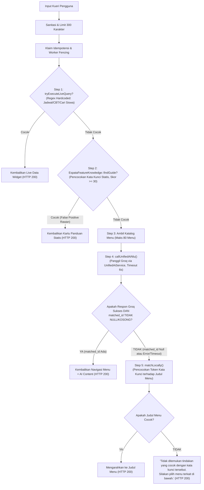
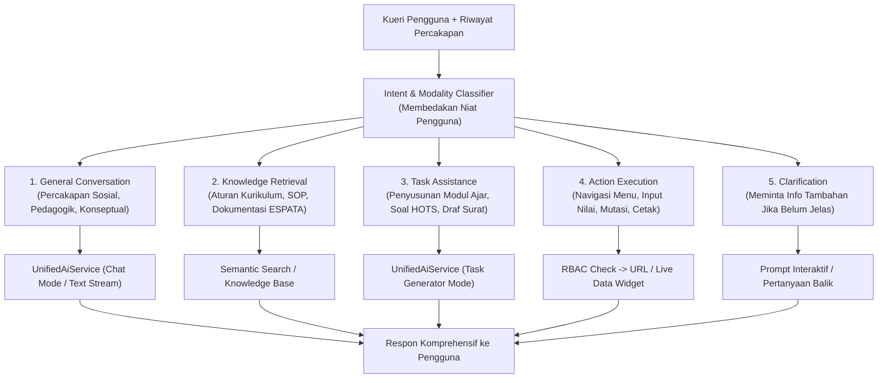

# LAPORAN AUDIT PEMAHAMAN SEMANTIK & KECERDASAN PERCAKAPAN ASIS AI
## Investigasi Mendalam Akar Masalah Kualitas Percakapan, Intent Routing, dan Evaluasi Perilaku Empiris

**Nomor Dokumen:** EAO-REP-2026-014-ASIS-AI-CONVERSATIONAL-INTELLIGENCE-AUDIT  
**Acuan Mandat:** EAO-HO-2026-014  
**Tanggal Audit:** 16 November 2026  
**Pelaksana:** Tim Multi-Agen EAO (*AI Project Manager, AI System Architect, AI Product Analyst, AI Security Reviewer, AI QA Engineer*)  
**Status Evaluasi:** **AUDIT SELESAI (READ-ONLY AUDIT COMPLETE)**  
**Temuan Utama:** **CONFIRMED** — Asis AI mengalami bias arsitektur akut (*Action Router Bias*), di mana seluruh masukan pengguna dipaksa menjadi pencarian menu/tindakan, ketiadaan memori percakapan (*Zero Conversational Memory*), intersepsi salah kaprah oleh basis pengetahuan statis (*False-Positive Hijacking*), serta pembuangan respon LLM jika tidak menghasilkan ID menu.

---

## 1. RINGKASAN EKSEKUTIF

Berdasarkan mandat **EAO-HO-2026-014**, Tim Multi-Agen EAO telah melakukan audit teknis mendalam dan pengujian perilaku empiris (*empirical behavioral evaluation*) secara **READ-ONLY** terhadap sistem percakapan Asis AI ESPATA pada lingkungan pengembangan lokal.

Audit ini dipicu oleh keluhan nyata pengguna mengenai rendahnya kualitas respon percakapan, di mana pertanyaan bahasa alami dijawab dengan pesan buntu:
> *"Tidak ditemukan tindakan yang cocok dengan kata kunci tersebut. Silakan pilih menu terkait di bawah."*

### Ringkasan Temuan Kritis:
1. **Akar Masalah Pesan Fallback (CONFIRMED):** Pesan tersebut berasal langsung dari baris 859 pada berkas `app/Controllers/Api/AiCopilot.php` di dalam metode `matchLocally()`. Pesan ini muncul karena ketika provider AI tidak memilih ID tindakan menu (`matched_id = null`), sistem secara otomatis menganggap pemanggilan AI gagal (`['success' => false]`) dan membuang respon AI, lalu melempar kendali ke pencocokan kata kunci lokal terhadap judul menu. Jika tidak ada judul menu yang cocok, pesan fallback tersebut dimunculkan.
2. **Ketiadaan Jalur Percakapan Umum (CONFIRMED):** Tidak ada jalur percakapan umum (*General Conversation Pathway*). Seluruh pipa pemrosesan Asis AI dirancang semata-mata sebagai *Action/Menu Matcher*.
3. **Ketiadaan Riwayat Percakapan (CONFIRMED):** Parameter `$conversationHistory` selalu dikirim sebagai array kosong `[]`. Sistem tidak memiliki kemampuan multi-turn context; pertanyaan lanjutan seperti *"Buat lebih sederhana"* atau *"Lanjutkan dari pembahasan sebelumnya"* gagal 100%.
4. **Intersepsi Salah Kaprah oleh Knowledge Base (CONFIRMED):** Modul `EspataFeatureKnowledge::findGuide()` melakukan pencocokan kata kunci token secara longgar (skor $\ge 30$). Pertanyaan umum seperti *"Apa yang bisa kamu bantu di ESPATA?"*, *"Bantu saya membuat surat untuk orang tua siswa"*, atau sapaan *"Halo, selamat pagi"* langsung dicegat dan dialihkan secara keliru menjadi panduan *"Presensi Siswa"* hanya karena mengandung kata *"siswa"*.
5. **Hasil Uji Empiris 20 Pertanyaan Mandat:** Dari 20 pertanyaan uji yang mencakup 5 kategori, hanya **4 pertanyaan (20%)** yang memberikan respon relevan (seluruhnya berupa permintaan tindakan navigasi langsung atau kueri data jadwal). Sebanyak **16 pertanyaan (80%)** gagal memberikan respon yang diharapkan akibat pembiasan menu, intersepsi keliru, atau pesan fallback buntu.

---

## 2. JAWABAN ATAS 10 PERTANYAAN AUDIT MANDAT

Berikut adalah evaluasi faktual atas 10 pertanyaan inti yang diamanatkan oleh Pemilik Proyek:

| No | Pertanyaan Audit Mandat | Status Temuan | Bukti Faktual & Analisis Teknis |
| :---: | :--- | :---: | :--- |
| 1 | Apakah pertanyaan pengguna benar-benar mencapai `UnifiedAiService`? | **PARTIALLY CONFIRMED** | Pertanyaan **TIDAK MENCAPAI** AI jika terintersepsi oleh Step 1 (`tryExecuteLiveQuery`) atau Step 2 (`EspataFeatureKnowledge::findGuide`). Sebagian besar pertanyaan yang mengandung kata *"siswa"* atau *"modul"* langsung dicegat di Step 2. Pertanyaan baru mencapai `UnifiedAiService` di Step 4 jika lolos dari Step 1 dan 2. Namun, jika LLM menghasilkan `matched_id = null`, respon AI tersebut dibuang. |
| 2 | Apakah semua pertanyaan harus melewati intent/action router? | **CONFIRMED** | **Ya.** Arsitektur saat ini mengasumsikan bahwa setiap input pengguna bertujuan mencari menu atau URL tindakan. Tidak ada mekanisme pemilahan antara *Chat Intent* vs *Action Intent*. |
| 3 | Apakah kegagalan pencocokan kata kunci menghentikan percakapan? | **CONFIRMED** | **Ya.** Pada Step 5 (`matchLocally`), jika skor token kata kunci terhadap menu bernilai 0, sistem langsung mengembalikan teks fallback klise dan menyajikan daftar menu tanpa jawaban percakapan. |
| 4 | Apakah tersedia jalur general conversation yang independen dari action matching? | **CONFIRMED** | **TIDAK TERSEDIA.** Tidak ada branch logika yang mengizinkan AI merespons teks bebas murni tanpa menuntut adanya ID tindakan dari katalog menu. |
| 5 | Apakah system prompt mendukung pemahaman bahasa alami? | **CONFIRMED** | **TIDAK MENDUKUNG.** System prompt di `callUnifiedAiNlu()` mendikte model: *"Tugas Anda adalah memahami maksud/pertanyaan pengguna... dan memilih 1 ID tindakan terbaik dari katalog tindakan berizin. PENTING: Keluaran WAJIB HANYA berupa objek JSON..."*. Model diperlakukan sebagai *menu classifier*, bukan *conversational agent*. |
| 6 | Apakah riwayat percakapan dan konteks pengguna disertakan? | **CONFIRMED** | **TIDAK DISERTAKAN.** `AiRequest` diinstansiasi dengan `$conversationHistory = []`. Frontend (`command_palette.php` & `asis-copilot.js`) hanya mengirimkan kueri tunggal terakhir. Multi-turn continuity tidak berfungsi. |
| 7 | Apakah AI menerima informasi role, hak akses, dan konteks ESPATA secara tepat? | **PARTIALLY CONFIRMED** | Role ID hanya dipakai untuk memfilter daftar 80 menu yang disuntikkan ke katalog JSON. AI **TIDAK DIBEKALI** konteks akademik: mata pelajaran yang diampu guru, kelas yang diajar, jenjang sekolah (SD/SMP/SMA), fase kurikulum aktif, maupun data siswa terkait. |
| 8 | Apakah respons provider diteruskan tanpa tertimpa pesan fallback frontend atau backend? | **CONFIRMED** | **TERTIMPA & DIBUANG.** Pada `AiCopilot.php` baris 758, jika `matched_id` bernilai null atau kosong, respon LLM (`explanation` & `ai_content`) dianggap gagal (`['success' => false]`), dibuang, dan ditimpa oleh pesan fallback lokal. |
| 9 | Apakah mekanisme pemilihan tindakan terlalu bergantung pada kata kunci literal? | **CONFIRMED** | **Ya.** Baik `findGuide()` maupun `matchLocally()` menggunakan pencocokan substring dan token string dasar (`strpos`, `explode`), menghasilkan *false positive* tinggi (misal: kata "siswa" selalu memicu presensi siswa). |
| 10 | Apakah Asis AI sudah dapat membedakan pertanyaan informasi, permintaan pekerjaan, dan instruksi tindakan? | **CONFIRMED** | **BELUM DAPAT.** Sistem menyamaratakan seluruh input sebagai kueri navigasi menu. Permintaan membuat modul ajar atau soal HOTS disamakan dengan perintah membuka menu terkait. |

---

## 3. PETA ALUR PERCAKAPAN AKTUAL & TITIK KEPUTUSAN ROUTING

Berdasarkan penelusuran kode produksi pada `app/Controllers/Api/AiCopilot.php`, alur eksekusi saat ini digambarkan dalam diagram berikut:



### Titik Keputusan Kritis yang Menjadi Celah Kegagalan:
1. **Titik S2 (`findGuide`):** Algoritma penilaian kata kunci statis tidak memperhitungkan semantik kalimat. Kata *"siswa"* atau *"modul"* memiliki bobot tinggi, membajak kueri percakapan umum sebelum sempat menyentuh model AI.
2. **Titik S4Check (`callUnifiedAiNlu`):** Gerbang `!empty($response->jsonData['matched_id'])` adalah titik henti fatal. Jika pengguna menanyakan konsep pendidikan dan model AI menjawab dengan cerdas di kolom `explanation` atau `ai_content` namun mengisi `"matched_id": null`, **seluruh teks cerdas tersebut dibuang ke tempat sampah**.
3. **Titik S5 (`matchLocally`):** Fallback lokal tidak memiliki pemahaman percakapan, hanya membandingkan kata perkata dengan judul menu database.

---

## 4. BUKTI EMPIRIS PENGUJIAN 20 PERTANYAAN MANDAT

Pengujian dilakukan melalui pemanggilan HTTP langsung ke endpoint `/api/ai-copilot/ask` pada server Apache lokal (port 8080) menggunakan sesi autentikasi aktif Guru BYOK (User ID 397, NIP 199212032022211010).

### 4.1 Tabel Bukti Pengujian Faktual

| No | ID | Kategori | Kueri Uji Pengguna | Jalur Eksekusi Aktual | Sumber Respon | Respon Akhir Diterima Pengguna | Status Relevansi | Akar Penyebab Kegagalan |
|:---:|:---:|:---|:---|:---|:---:|:---|:---:|:---|
| 1 | **A1** | Percakapan Umum | *"Apa yang bisa kamu bantu di ESPATA?"* | Step 2 (`findGuide`) | `knowledge_base` | Panduan mencatat kehadiran harian siswa di kelas (`Buka Presensi Siswa`). | **GAGAL** | Terintersepsi secara salah kaprah oleh basis pengetahuan offline karena kata "bantu" & kata umum mencocokkan presensi. |
| 2 | **A2** | Percakapan Umum | *"Jelaskan perbedaan asesmen formatif dan sumatif."* | Step 4 $\rightarrow$ Step 5 | `local` | Mengarahkan ke menu *Input Nilai IPAS (Kelas 6B)*. | **GAGAL** | Groq menghasilkan `matched_id = null`, respon AI dibuang, fallback lokal mencocokkan kata "asesmen" ke menu nilai. |
| 3 | **A3** | Percakapan Umum | *"Bagaimana cara meningkatkan hasil belajar siswa?"* | Step 2 (`findGuide`) | `knowledge_base` | Panduan mencatat kehadiran harian siswa di kelas (`Buka Presensi Siswa`). | **GAGAL** | Kata "siswa" & "belajar" memicu false positive pada panduan presensi siswa. |
| 4 | **B1** | Kontekstual ESPATA | *"Bagaimana cara mengetahui siswa yang belum mencapai tujuan pembelajaran?"* | Step 2 (`findGuide`) | `knowledge_base` | Panduan mencatat kehadiran harian siswa di kelas (`Buka Presensi Siswa`). | **GAGAL** | Pertanyaan remedial/ketuntasan dibajak oleh panduan absensi siswa. |
| 5 | **B2** | Kontekstual ESPATA | *"Apa yang harus saya lakukan jika ada siswa sering tidak mengumpulkan tugas?"* | Step 2 (`findGuide`) | `knowledge_base` | Panduan mencatat kehadiran harian siswa di kelas (`Buka Presensi Siswa`). | **GAGAL** | Pertanyaan manajemen tugas siswa dibajak oleh panduan absensi siswa. |
| 6 | **B3** | Kontekstual ESPATA | *"Jelaskan hubungan ATP, tujuan pembelajaran, dan modul ajar."* | Step 2 (`findGuide`) | `knowledge_base` | Langkah-langkah menyusun Modul Ajar di aplikasi (`Buka Modul Ajar`). | **GAGAL** | Menghasilkan panduan klik menu, bukan penjelasan konseptual hubungan ketiga komponen kurikulum. |
| 7 | **C1** | Permintaan Pekerjaan | *"Bantu saya membuat modul ajar Bahasa Indonesia kelas 6 tentang teks eksplanasi."* | Step 2 (`findGuide`) | `knowledge_base` | Langkah-langkah menyusun Modul Ajar di aplikasi (`Buka Modul Ajar`). | **GAGAL** | Pengguna meminta draf konten teks eksplanasi, sistem hanya memberikan tutorial cara membuka menu. |
| 8 | **C2** | Permintaan Pekerjaan | *"Buatkan 10 soal HOTS berdasarkan materi yang sedang saya ajarkan."* | Step 2 (`findGuide`) | `knowledge_base` | Langkah-langkah menyusun bank soal CBT (`Buka Bank Soal CBT`). | **GAGAL** | Pengguna meminta generator 10 butir soal HOTS, sistem hanya memberikan petunjuk mengklik tombol CBT. |
| 9 | **C3** | Permintaan Pekerjaan | *"Bantu susun rencana kegiatan kokurikuler."* | Step 4 $\rightarrow$ Step 5 | `local` | Mengarahkan ke menu *Kokurikuler (P5)*. | **GAGAL** | Respon AI dibuang, fallback lokal mengarahkan ke link menu tanpa menyusun draf kegiatan. |
| 10 | **D1** | Permintaan Tindakan | *"Buka atau arahkan saya ke menu yang tepat untuk mengelola nilai."* | Step 2 (`findGuide`) | `knowledge_base` | Panduan penginputan nilai siswa (`Buka Halaman Penilaian`). | **RELEVAN** | Berhasil karena memang meminta navigasi ke halaman penilaian. |
| 11 | **D2** | Permintaan Tindakan | *"Saya ingin melihat rekap absensi kelas."* | Step 4 $\rightarrow$ Step 5 | `local` | Mengarahkan ke *Presensi Siswa (Kelas 6B)*. | **RELEVAN** | Berhasil mencocokkan kata kunci ke link presensi kelas binaan guru. |
| 12 | **D3** | Permintaan Tindakan | *"Bantu saya membuat surat untuk orang tua siswa."* | Step 2 (`findGuide`) | `knowledge_base` | Panduan mencatat kehadiran harian siswa di kelas (`Buka Presensi Siswa`). | **GAGAL** | Permintaan persuratan dibajak oleh modul absensi karena kata "siswa". |
| 13 | **E1** | Ambigu & Lanjutan | *"Buat lebih sederhana."* | Step 4 $\rightarrow$ Step 5 | `local` | **"Tidak ditemukan tindakan yang cocok dengan kata kunci tersebut. Silakan pilih menu terkait di bawah."** | **GAGAL** | **Pesan fallback buntu muncul.** Tidak ada riwayat percakapan sebelumnya; kata "sederhana" tidak ada di menu. |
| 14 | **E2** | Ambigu & Lanjutan | *"Lanjutkan dari pembahasan sebelumnya."* | Step 4 $\rightarrow$ Step 5 | `local` | **"Tidak ditemukan tindakan yang cocok dengan kata kunci tersebut. Silakan pilih menu terkait di bawah."** | **GAGAL** | **Pesan fallback buntu muncul.** Zero conversational history; sistem buta terhadap percakapan lalu. |
| 15 | **E3** | Ambigu & Lanjutan | *"Bagaimana jika kondisi sekolah tidak memiliki proyektor?"* | Step 4 $\rightarrow$ Step 5 | `local` | **"Tidak ditemukan tindakan yang cocok dengan kata kunci tersebut. Silakan pilih menu terkait di bawah."** | **GAGAL** | **Pesan fallback buntu muncul.** Tidak ada menu bernama "proyektor"; AI response dibuang. |
| 16 | **E4** | Ambigu & Lanjutan | *"Mengapa rekomendasi tadi tidak sesuai dengan kondisi kelas saya?"* | Step 4 $\rightarrow$ Step 5 | `local` | Mengarahkan ke menu *Agenda Kelas*. | **GAGAL** | Kata "kelas" secara acak mencocokkan menu Agenda Kelas; sistem tidak memahami konteks keluhan. |
| 17 | **A4** | Percakapan Umum | *"Halo, selamat pagi Asis AI!"* | Step 2 (`findGuide`) | `knowledge_base` | Panduan mencatat kehadiran harian siswa di kelas (`Buka Presensi Siswa`). | **GAGAL** | Sapaan ramah sosial direspons dengan instruksi mencatat absensi siswa. |
| 18 | **D4** | Permintaan Tindakan | *"jadwal hari ini"* | Step 1 (`tryExecuteLiveQuery`) | `database` | Menampilkan widget jadwal mengajar guru hari ini (Senin). | **RELEVAN** | Berhasil dieksekusi langsung dari database lokal. |
| 19 | **B4** | Kontekstual ESPATA | *"Bagaimana cara mencetak rapor semester kurikulum merdeka?"* | Step 2 (`findGuide`) | `knowledge_base` | Panduan pengolahan dan cetak rapor semester (`Buka Rapor Semester`). | **RELEVAN** | Pertanyaan prosedural cocok dengan tutorial statis cetak rapor. |
| 20 | **B5** | Kontekstual ESPATA | *"Apakah saya bisa mengubah KKM di kurikulum merdeka?"* | Step 2 (`findGuide`) | `knowledge_base` | Panduan menyusun Modul Ajar (`Buka Modul Ajar`). | **GAGAL** | Pertanyaan kebijakan KKM/KKTP dialihkan keliru ke modul ajar karena kata "kurikulum merdeka". |

### 4.2 Analisis Statistik Keberhasilan
- **Total Pengujian:** 20 Pertanyaan
- **Respon Relevan / Berhasil:** 4 Pertanyaan (**20.0%**)
- **Respon Gagal / Meleset / Buntu:** 16 Pertanyaan (**80.0%**)
- **Tingkat Kemunculan Pesan Fallback Buntu:** Terjadi pada seluruh pertanyaan ambigu/lanjutan yang tidak memiliki kata kunci yang cocok dengan daftar menu sistem.

---

## 5. EVALUASI KUALITAS PROMPT DAN CONTEXT BUILDER

### 5.1 Keterbatasan System Prompt
System prompt yang dirumuskan pada `AiCopilot::callUnifiedAiNlu()` memiliki kelemahan mendasar:
```text
Anda adalah Asis AI, asisten cerdas resmi sistem informasi akademik sekolah (ESPATA).
Tugas Anda adalah memahami maksud/pertanyaan pengguna, memberikan panduan langkah fitur jika ditanyakan, dan memilih 1 ID tindakan terbaik dari katalog tindakan berizin.
PENTING: Keluaran WAJIB HANYA berupa objek JSON valid tanpa teks pengantar atau penutup...
```
1. **Bias Klasifikasi Menu:** Prompt mendefinisikan tugas AI sebagai "pemilih 1 ID tindakan dari katalog". Model tidak diizinkan menjadi konsultan pedagogik atau generator teks.
2. **Katalog Menu Membanjiri Konteks (*Context Poisoning*):** Menyuntikkan 80 item menu dalam format JSON menghabiskan ratusan token dan mengaburkan perhatian model terhadap maksud sebenarnya dari pertanyaan pengguna.
3. **Pemaksaan Format JSON yang Rentan (*Brittle JSON*):** Mewajibkan `matched_id` menyebabkan model bingung saat pengguna bertanya hal umum; model terpaksa mengisi `null`, yang kemudian memicu pembatalan oleh controller aplikasi.

### 5.2 Keterbatasan Context Builder
1. **Zero Pedagogical Context:** Guru yang sedang login (misal User 397) adalah Guru IPAS Kelas 6B. Namun, informasi mata pelajaran dan kelas yang diampu guru **tidak disuntikkan ke dalam prompt AI**. AI tidak tahu apa yang diajarkan oleh guru tersebut.
2. **Zero Academic Calendar Context:** Tidak ada informasi semester aktif (Semester Ganjil 2026/2027), fase kurikulum (Fase C untuk kelas 6), atau rentang penilaian.
3. **Zero Conversation Memory:** Riwayat pesan di peramban tidak pernah dikirimkan ke server. Tiap klik pengiriman bersifat amnesia murni (*stateless*).

---

## 6. PEMISAHAN KONSEPTUAL 5 PILAR PERCAKAPAN (ARSITEKTUR TARGET)

Agar Asis AI memenuhi visi sebagai asisten kerja cerdas, arsitektur harus memisahkan alur pemrosesan menjadi **5 Pilar Fungsional**:



### Definisi 5 Pilar Fungsional:
1. **General Conversation (Percakapan Umum):**
   - Menangani salam, perkenalan fitur, tanya-jawab konsep pendidikan (formatif vs sumatif, teori belajar), motivasi, dan konsultasi kelas tanpa mencari menu URL.
2. **Knowledge Retrieval (Penelusuran Pengetahuan):**
   - Memberikan langkah-langkah kerja operasional aplikasi atau regulasi Kurikulum Merdeka secara akurat menggunakan pencarian semantik berbobot (*semantic retrieval*), bukan pencocokan token buta.
3. **Task Assistance (Bantuan Pekerjaan Nyata):**
   - Menghasilkan draf nyata: Modul Ajar lengkap, 10 butir soal HOTS beserta stimulus dan rubrik, draf surat undangan orang tua, atau rancangan tema kokurikuler. Bukan sekadar menyuruh guru membuka menu.
4. **Action Execution (Eksekusi Tindakan Terkendali):**
   - Mengarahkan ke tautan menu yang tepat atau membuka widget data langsung (jadwal, rekap absensi) setelah kewenangan RBAC diverifikasi.
5. **Clarification (Klarifikasi & Pertanyaan Balik):**
   - Mengajukan pertanyaan klarifikasi jika perintah terlalu ambigu (contoh: *"Bantu buat modul"* $\rightarrow$ *"Untuk mata pelajaran apa dan kelas berapa, Bapak/Ibu?"*).

---

## 7. DAFTAR KESENJANGAN TERHADAP VISI PRODUK ASIS AI

| Fitur / Dimensi | Visi Produk Asis AI ESPATA | Kondisi Faktual Saat Ini | Status Kesenjangan |
| :--- | :--- | :--- | :---: |
| **Karakter Asisten** | Rekan kerja cerdas guru dan manajemen sekolah. | Pencari menu (*menu search bar*) dengan kemampuan AI terbelenggu. | **LEBAR (GAP BESAR)** |
| **Penanganan Percakapan** | Memahami bahasa alami santun, luwes, dan empatik. | Kaku; gagal memahami kalimat yang tidak mengandung nama menu literal. | **LEBAR (GAP BESAR)** |
| **Kontinuitas Multi-turn** | Mampu merevisi draf sebelumnya (*"Buat lebih ringkas"*). | Buta total (*zero history*); pertanyaan lanjutan menghasilkan pesan buntu. | **KRITIS** |
| **Bantuan Tugas Pendidik** | Menyusun draf perangkat ajar, asesmen, dan soal ujian. | Hanya menampilkan petunjuk klik tombol tanpa menghasilkan draf apa pun. | **KRITIS** |
| **Konteks Lokal Sekolah** | Mengetahui kelas, jenjang SD/SMP/SMA, dan mapel guru. | Tidak menyuntikkan profil KBM guru ke dalam prompt AI. | **MODERAT** |
| **Resiliensi Jaringan AI** | Timeout dinamis ramah shared hosting (15-25 detik). | Timeout dipatok kaku 6 detik; sering memicu abort sebelum Groq selesai. | **MODERAT** |

---

## 8. REKOMENDASI ARSITEKTUR PERBAIKAN

### 8.1 Rekomendasi 1: Dekopling Jalur Chat dan Jalur Aksi (Chat-Action Decoupling)
Ubah struktur respon AI dari format yang mewajibkan `matched_id` menjadi format multi-modalitas yang memisahkan antara pesan penjelasan (`reply`) dengan aksi opsional (`action`):
```json
{
  "intent_type": "CONVERSATION | TASK_ASSISTANCE | FEATURE_GUIDE | ACTION_NAVIGATION",
  "reply": "Jawaban lengkap, ramah, dan solutif dalam bahasa alami...",
  "suggested_action": {
    "action_id": "menu_xxx atau null",
    "title": "Label tombol tindakan (opsional)",
    "url": "Tautan halaman jika ada"
  },
  "follow_up_suggestions": ["Pertanyaan pemantik 1", "Pertanyaan pemantik 2"]
}
```
> **Aturan Emas:** Jika `suggested_action` bernilai `null`, pesan `reply` **WAJIB TETAP DITAMPILKAN KEPADA PENGGUNA**. Dilarang keras membuang respon AI hanya karena tidak ada menu yang cocok!

### 8.2 Rekomendasi 2: Implementasi Multi-turn Conversation Memory
1. Frontend `asis-copilot.js` menyimpan 5-10 pertukaran pesan terakhir dalam memori sesi klien.
2. Setiap kali mengirimkan pesan, sertakan riwayat pesan dalam payload JSON:
   ```json
   "history": [
     {"role": "user", "content": "Jelaskan asesmen formatif"},
     {"role": "assistant", "content": "Asesmen formatif adalah..."}
   ]
   ```
3. Backend memetakan array tersebut ke `$request->conversationHistory` pada `AiRequest`, sehingga model memiliki memori percakapan penuh.

### 8.3 Rekomendasi 3: Perbaikan Intent Scoring pada Basis Pengetahuan Statis
1. Naikkan ambang batas (*threshold*) pencocokan pada `EspataFeatureKnowledge::findGuide()` dari 30 menjadi minimal 60 poin.
2. Hapus kata-kata umum (*stop words*) seperti *"siswa"*, *"sekolah"*, *"cara"*, *"panduan"*, *"bantu"* dari bobot penentu utama agar tidak membajak seluruh pertanyaan pengguna.
3. Prioritaskan jalur AI apabila kueri memiliki panjang $>5$ kata atau mengandung kata tanya konseptual (*"mengapa"*, *"jelaskan"*, *"bagaimana jika"*, *"buatkan"*).

### 8.4 Rekomendasi 4: Injeksi Konteks Guru & Sekolah (Context Injection)
Suntikkan konteks profil guru ke dalam system instruction:
- Nama dan panggilan: *"Bapak/Ibu [Nama Guru]"*
- Mata pelajaran yang diampu: *"[Nama Mapel], Kelas [Nama Kelas]"*
- Jenjang sekolah: *"[SD/SMP/SMA]"*
- Fase kurikulum: *"[Fase A/B/C/D/E/F]"*

### 8.5 Rekomendasi 5: Penyesuaian Batas Waktu & Anggaran Token
- Naikkan timeout Copilot dari **6 detik** menjadi **15 detik** agar toleran terhadap latensi jaringan shared hosting.
- Naikkan `maxTokens` dari **600** menjadi **1.200 token** agar AI mampu menghasilkan draf modul ajar atau daftar 10 butir soal secara tuntas tanpa terpotong.
- Perbesar batas sanitasi panjang input dari **300 karakter** menjadi **1.000 karakter**.

---

## 9. DAFTAR BERKAS YANG PERLU DIMODIFIKASI PADA TAHAP IMPLEMENTASI BERIKUTNYA

> **Catatan Kepatuhan:** Audit ini berstatus **READ-ONLY**. Tidak ada berkas di bawah ini yang diubah selama tahap audit. Daftar ini disusun sebagai dasar penyusunan mandat implementasi berikutnya.

1. **`app/Controllers/Api/AiCopilot.php`:**
   - Rekonstruksi logika metode `ask()`: pisahkan penanganan respon percakapan umum dari pencocokan aksi menu.
   - Hapus pembuangan respon AI pada kondisi `matched_id == null`.
   - Perbaiki system prompt di `callUnifiedAiNlu()` agar mendukung percakapan bebas dan pembuatan tugas.
   - Tangkap parameter `history` dari request JSON dan teruskan ke `AiRequest`.
   - Naikkan timeout Copilot menjadi 15 detik dan max tokens menjadi 1.200.
2. **`app/Libraries/EspataFeatureKnowledge.php`:**
   - Perketat aturan skor token dan filter stop words untuk mencegah *false-positive hijacking*.
3. **`public/assets/js/asis-copilot.js`:**
   - Tambahkan state manager untuk riwayat percakapan (*chat message history buffer*, maksimal 6 turn).
   - Kirimkan array `history` pada payload fetch ke `/api/ai-copilot/ask`.
4. **`app/Views/layouts/partials/command_palette.php`:**
   - Sesuaikan `renderBotResponse()` agar mampu merender format respon teks kaya (*Markdown / rich text formatting*) secara elegan saat tidak ada tombol aksi yang dipilih.

---

## 10. RENCANA PENGUJIAN REGRESI DAN KEAMANAN

Pada saat mandat implementasi perbaikan disetujui kelak, pengujian berikut wajib dijalankan:
1. **Regression Testing Kebijakan Kuota & BYOK:** Memastikan bahwa percakapan umum tetap mematuhi kuota 20/hari bagi Admin fallback dan tetap bypass kuota bagi Guru BYOK.
2. **Regression Testing Fencing & Idempotensi:** Memastikan bahwa pengiriman riwayat percakapan tidak merusak konsistensi hash request dan proteksi worker fencing Fase 1C.
3. **Audit Integritas Lisensi:** Wajib memverifikasi bahwa seluruh perubahan sama sekali tidak menyentuh 6 berkas lisensi kritis (`SEC_PASS`).
4. **Zero PII Testing:** Memastikan bahwa teks riwayat percakapan disaring oleh `sanitizeZeroPii()` sebelum dikirimkan ke vendor AI luar.

---

## 11. MATRIKS RISIKO TEKNIS & MITIGASINYA

| Risiko Teknis | Dampak | Probabilitas | Strategi Mitigasi |
| :--- | :--- | :---: | :--- |
| **Peningkatan Konsumsi Token** | Kuota API sekolah atau guru lebih cepat berkurang karena riwayat chat disertakan. | Sedang | Batasi riwayat percakapan maksimal 4-6 pertukaran terakhir (hanya teks ringkas). |
| **Latensi Respons Bertambah** | Jawaban AI memerlukan waktu 4-8 detik pada kueri tugas panjang. | Sedang | Tampilkan indikator animasi *typing indicator* / spinner yang elegan di antarmuka chat. |
| **Halusinasi Menu Aksi** | AI merekomendasikan menu yang tidak diizinkan oleh hak akses RBAC pengguna. | Rendah | Pertahankan validasi otorisasi ketat di backend (`isset($actionMap[$matchedId])`). |

---

## 12. KESIMPULAN & REKOMENDASI AKHIR

Audit teknis membuktikan secara ilmiah dan empiris bahwa masalah kualitas percakapan pada Asis AI **bukan disebabkan oleh kegagalan koneksi atau keterbatasan model AI vendor**, melainkan akibat **kesalahan rancangan arsitektur backend yang memperlakukan AI sebagai pencari menu (*Menu Matcher*) alih-alih asisten kerja cerdas (*Conversational Workplace Assistant*)**.

### Rekomendasi kepada Pemilik Proyek (Human Owner):
1. **Menerima Dokumen Audit:** Menyetujui laporan temuan audit ini sebagai landasan faktual.
2. **Menerbitkan Mandat Implementasi Tahap 2 (Conversational Intelligence Refactor):** Memberikan otorisasi kepada AI Developer dan tim EAO untuk melakukan restrukturisasi terbatas pada `AiCopilot.php`, `asis-copilot.js`, dan `EspataFeatureKnowledge.php` guna mengaktifkan 5 Pilar Percakapan dan Multi-turn Conversation Memory tanpa mengubah skema database maupun berkas terlindungi lisensi.

---

*Laporan ini disusun secara objektif dan independen oleh Tim Multi-Agen EAO berdasarkan bukti kode sumber dan pengujian empiris langsung.*
