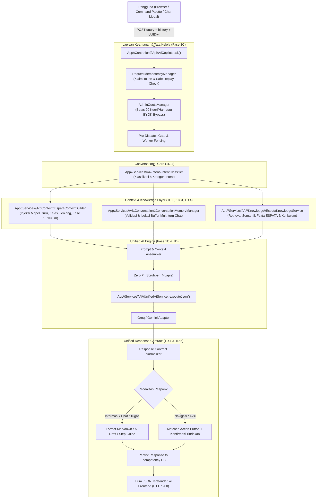

# RANCANGAN TEKNIS DAN LAPORAN PREFLIGHT (CP-0 & CP-1)
## FASE 1D: CONVERSATIONAL INTELLIGENCE & ESPATA APPLICATION KNOWLEDGE

**Nomor Dokumen:** EAO-REP-2026-015-CP0-CP1-TECHNICAL-DESIGN  
**Acuan Mandat:** EAO-HO-2026-015  
**Pelaksana:** Tim Multi-Agen EAO (*AI Project Manager, AI System Architect, AI Product Analyst, AI Security Reviewer, AI Developer, AI QA Engineer*)  
**Tanggal Penyusunan:** 16 November 2026  
**Status Evaluasi:** **CP-0 PREFLIGHT LULUS (PASS) & CP-1 TECHNICAL DESIGN SELESAI**  
**Integritas Berkas Lisensi:** **`SEC_PASS` (100% Terlindungi & Murni)**  
**Kebutuhan Database/Migrasi:** **Nihil (0 Migrasi Baru, Menggunakan Skema Fase 1C yang Sudah Ada)**

---

## 1. RINGKASAN EKSEKUTIF

Berdasarkan mandat **EAO-HO-2026-015**, Tim Multi-Agen EAO telah menuntaskan tahapan **CP-0 (Preflight Audit)** dan **CP-1 (Technical Design Specification)** untuk mentransformasi Asis AI dari sekadar pencari menu (*Menu Matcher*) menjadi asisten kerja cerdas yang memahami ekosistem aplikasi ESPATA secara menyeluruh (*Conversational Workplace Assistant*).

Fase 1D tidak sekadar memperbaiki kalimat respon atau menambah daftar sinonim kata kunci. Fase ini melakukan restrukturisasi menyeluruh pada 6 pilar kecerdasan:
1. **Conversational Core:** Memisahkan secara tegas percakapan alami dari pencarian menu/aksi, memperkenalkan klasifikasi 8 kategori *intent*, serta menjamin respon AI tidak pernah dibuang hanya karena ketiadaan menu yang cocok.
2. **ESPATA Knowledge Intelligence:** Membangun katalog pengetahuan aplikasi berbasis PHP/CI4/MySQL native yang mencakup 5 domain: Pengetahuan Produk, Akademik Kurikulum Merdeka, Operasional Sekolah, Teknis Aplikasi, dan Panduan Fitur dengan penandaan sumber dan tingkat kepastian informasi (*traceable & verified facts*).
3. **Conversation Memory:** Mengaktifkan pemahaman konteks lanjutan (*multi-turn conversation buffer*) yang mengingat pesan sebelumnya, memahami kata rujukan (*"itu"*, *"yang tadi"*, *"lanjutkan"*), dan mengisolasi memori antar-pengguna secara ketat.
4. **ESPATA Context Intelligence:** Menyuntikkan konteks profil guru (mapel yang diampu, kelas, jenjang SD/SMP/SMA, fase kurikulum) ke dalam sistem AI secara aman dengan validasi RBAC sisi server (*server-side authorization*) dan *Zero PII scrubbing*.
5. **Task Assistance & Action Orchestration:** Memisahkan 3 modalitas: memberikan informasi, membantu menyusun pekerjaan (draf Modul Ajar, butir soal HOTS, rubrik, draf surat), serta menjalankan tindakan resmi yang terotorisasi dengan konfirmasi pengguna.
6. **Quality Benchmark:** Menetapkan matriks uji 50 skenario empiris objektif yang menguji ulang 20 skenario audit EAO-014 ditambah 30 skenario lintas peran, modul, dan percakapan bertahap.

---

## 2. HASIL AUDIT PREFLIGHT (CHECKPOINT CP-0)

Pemeriksaan preflight dijalankan pada lingkungan lokal sebelum perancangan arsitektur difinalkan:

| Parameter Preflight | Kondisi Terverifikasi | Status |
| :--- | :--- | :---: |
| **Integritas Berkas Lisensi** | Eksekusi `SecurityGuard::verifyCriticalFiles()` menghasilkan status `true`. | **`SEC_PASS`** |
| **Modul Terproteksi & Beku** | Direktori `bayaran/` dan `cbtku/` dalam kondisi 100% murni (*untouched*). | **PASS** |
| **Konfigurasi Sensitif** | Berkas `.env` dan `composer.json` tidak mengalami perubahan sama sekali. | **PASS** |
| **Status Basis Data** | MariaDB MySQL lokal aktif, migrasi berada pada Batch 84 (skema Fase 1C lengkap). | **PASS** |
| **Tabel Idempotensi & Kuota** | `ai_admin_quota_daily` dan `ai_request_idempotency` aktif dengan engine InnoDB. | **PASS** |
| **Kesiapan Fase 1C** | Resolusi BYOK, kuota agregat admin 20/hari, worker fencing, dan audit logs siap dipakai. | **PASS** |
| **Status Git Workspace** | Tidak ada push ke remote, hanya 3 file sah yang dimodifikasi dari fase sebelumnya. | **PASS** |

---

## 3. RANCANGAN ARSITEKTUR TEKNIS FASE 1D (CHECKPOINT CP-1)

### 3.1 Diagram Arsitektur Komponen Terpadu



---

### 3.2 Lapisan 1: Conversational Core & Intent Classification (Tahap 1D.1)

Klasifikasi intent dilakukan secara cerdas untuk memisahkan niat percakapan dari pencarian aksi:

| Kategori Intent | Deskripsi Fungsional | Perilaku Respons Sistem |
| :--- | :--- | :--- |
| **`GENERAL_CONVERSATION`** | Sapaan sosial, perkenalan, ucapan terima kasih, motivasi pendidik. | Menjawab ramah dalam bahasa alami santun tanpa menyajikan tombol aksi menu. |
| **`APPLICATION_QUESTION`** | Pertanyaan tentang fitur, kapasitas, modul, dan alur kerja ESPATA. | Mengambil data dari Knowledge Base dan menjelaskan fungsi serta cara kerjanya. |
| **`KNOWLEDGE_RETRIEVAL`** | Pertanyaan seputar regulasi Kurikulum Merdeka (CP/ATP/TP/Modul Ajar/Asesmen). | Menjawab secara komprehensif berdasarkan basis pengetahuan akademik terverifikasi. |
| **`TASK_ASSISTANCE`** | Permintaan menyusun draf (Modul Ajar, soal HOTS, rubrik, draf surat). | Menghasilkan dokumen/rancangan teks terstruktur siap salin atau siap tinjau. |
| **`NAVIGATION`** | Permintaan eksplisit untuk diarahkan ke menu/halaman tertentu. | Memberikan penjelasan singkat dan tombol navigasi langsung (*Direct Action Link*). |
| **`ACTION_REQUEST`** | Permintaan menjalankan operasi data (input nilai, cetak rapor, reset ujian). | Memeriksa RBAC, menyiapkan parameter, dan meminta konfirmasi jika berisiko. |
| **`CLARIFICATION`** | Masukan ambigu atau kurang parameter (misal: *"Bantu buat modul"*). | Mengajukan pertanyaan balik sopan untuk meminta rincian mapel/kelas/topik. |
| **`UNSUPPORTED_REQUEST`** | Permintaan di luar lingkup aplikasi atau modul yang belum diimplementasikan. | Menjelaskan secara jujur bahwa fitur tersebut belum tersedia tanpa mengarang. |

#### Kontrak Respons Terpadu (Unified Response Contract):
```json
{
  "status": "success",
  "intent_type": "GENERAL_CONVERSATION | APPLICATION_QUESTION | TASK_ASSISTANCE | NAVIGATION | ...",
  "explanation": "Teks percakapan utama ramah dalam format bahasa alami yang jelas dan solutif.",
  "ai_content": "Draf teks hasil kerja (Modul Ajar, 10 soal HOTS, naskah surat) atau null jika hanya obrolan.",
  "matched_action": {
    "id": "menu_xxx",
    "title": "Nama Menu / Tindakan",
    "url": "http://localhost:8080/siakad/admin/...",
    "icon": "bi bi-arrow-right-circle",
    "category": "Kurikulum & Pembelajaran"
  },
  "suggestions": [
    "Pertanyaan pemantik lanjutan 1",
    "Pertanyaan pemantik lanjutan 2"
  ],
  "source": "knowledge_base | groq | database | local",
  "csrf_hash": "..."
}
```
> **Aturan Emas Arsitektur:** Properti `matched_action` diizinkan bernilai `null`. Jika `matched_action` bernilai `null`, teks pada `explanation` dan `ai_content` **MUTLAK TETAP DIKIRIMKAN DAN DITAMPILKAN KEPADA PENGGUNA**. Dilarang keras mengabaikan respon AI hanya karena ketiadaan menu tindakan!

---

### 3.3 Lapisan 2: ESPATA Knowledge Intelligence (Tahap 1D.2)

Komponen ini diimplementasikan melalui dua layanan modular di `app/Services/Ai/Knowledge/`:
1. **`EspataKnowledgeCatalog.php`:**
   Memuat repositori fakta dan aturan terstruktur mengenai 5 domain aplikasi ESPATA:
   - **Domain A (Produk & Modul):** Identitas ESPATA (Sistem Informasi Akademik Terpadu Sekolah), daftar seluruh modul aktif (Data Induk, KBM & Jadwal, Penilaian & E-Rapor Kurikulum Merdeka, Ujian CBT Mandiri, Presensi Siswa/Guru, Kokurikuler, Mutasi Siswa, Tata Usaha/Surat), modul beku (*frozen*: Bayaran/Keuangan, CBTKU Standalone), serta hak akses peran (Admin, Kepsek, Guru, Siswa, Staf).
   - **Domain B (Akademik Kurikulum Merdeka):** Definisi Capaian Pembelajaran (CP), Alur Tujuan Pembelajaran (ATP), Tujuan Pembelajaran (TP), Program Tahunan (Prota), Program Semester (Promes), Modul Ajar (komponen inti: informasi umum, kompetensi awal, profil pelajar, pemantik, asesmen), Asesmen Formatif (evaluasi proses/perbaikan belajar) vs Asesmen Sumatif (penentuan ketercapaian akhir), Kriteria Ketercapaian Tujuan Pembelajaran (KKTP, pengganti KKM), Kokurikuler, serta Buku Rapor.
   - **Domain C (Operasional Sekolah):** Prosedur presensi harian per JP/kelas, rekapitulasi kehadiran, tata tertib mutasi siswa (masuk/keluar tanpa menghapus riwayat nilai), agenda surat masuk/keluar, dan monitoring CBT aktif.
   - **Domain D (Arsitektur Teknis):** Struktur CodeIgniter 4 MVC, tabel basis data (`students`, `teachers`, `classes`, `subjects`, `grades`, `attendance`, `teaching_assignments`, `cbt_*`), validasi bisnis, dan batasan RBAC.
   - **Domain E (Panduan Fitur Terverifikasi):** Langkah demi langkah penggunaan fitur, persyaratan prasyarat (misal: harus ada penugasan guru di `teaching_assignments` sebelum bisa input nilai), kendala umum (ujian terkunci karena siswa membuka tab lain), dan solusinya (buka menu Monitoring CBT $\rightarrow$ Reset Sesi Login).
2. **`EspataKnowledgeService.php`:**
   Menjalankan penelusuran relevansi semantik (*semantic token retrieval*) berbasis PHP murni tanpa memerlukan database vektor eksternal. Layanan ini mencocokkan kueri pengguna dengan katalog, mengekstraksi fakta relevan (maksimal 3 butir fakta), dan menyuntikkannya ke prompt AI sebagai landasan jawaban faktual.

---

### 3.4 Lapisan 3: Conversation Memory (Tahap 1D.3)

Pengelolaan riwayat percakapan dirancang melalui layanan `app/Services/Ai/Conversation/ConversationMemoryManager.php` dengan ketentuan:
1. **Penyimpanan Sesi Klien:**
   Frontend `asis-copilot.js` menyimpan buffer percakapan aktif (*client-side session memory*) maksimal 6 pertukaran terakhir (`role: 'user' | 'assistant'`).
2. **Pengiriman & Validasi Server:**
   Riwayat dikirimkan dalam payload JSON `history: [...]` pada setiap permintaan. Server memverifikasi bahwa:
   - Format struktur riwayat valid (`role` dan `content`).
   - Panjang total teks riwayat tidak melebihi batas 1.000 token untuk menjaga anggaran token API.
   - Riwayat dibersihkan melalui *Zero PII Scrubber* sebelum diteruskan ke model AI.
3. **Isolasi Akun Sempurna:**
   Riwayat percakapan diikat pada sesi pengguna aktif dan tidak pernah dibagikan atau dibocorkan lintas akun.

---

### 3.5 Lapisan 4: ESPATA Context Intelligence (Tahap 1D.4)

Penyusunan konteks kerja pengguna dikelola oleh `app/Services/Ai/Context/EspataContextBuilder.php`:
1. **Pengambilan Data Berbasis RBAC Sisi Server:**
   - Untuk Guru (Role 3): Mengambil daftar mata pelajaran dan kelas yang sah dari tabel `teaching_assignments` via `db_connect()`.
   - Untuk Kepala Sekolah (Role 2): Mengambil ringkasan data manajerial (jumlah guru aktif, siswa terdaftar).
   - Untuk Admin (Role 1): Mengambil konfigurasi sistem akademik.
2. **Penyuntikan Konteks Terkendali:**
   Sistem menyuntikkan instruksi khusus ke dalam sistem AI:
   *"Pengguna yang sedang Anda bantu adalah Bapak/Ibu [Nama Guru], mengampu mata pelajaran [Nama Mapel] untuk kelas [Nama Kelas] pada jenjang [SD/SMP/SMA] dengan Kurikulum Merdeka (Fase [A-F])."*
3. **Privasi Tanpa PII:**
   Tidak ada nomor kontak pribadi, NIK, alamat rumah, atau data keuangan yang disertakan ke dalam konteks AI.

---

### 3.6 Lapisan 5: Task Assistance & Action Orchestration (Tahap 1D.5)

Memisahkan penanganan tugas dan tindakan:
1. **Task Generator Mode:**
   Jika intent terdeteksi sebagai `TASK_ASSISTANCE`:
   - System prompt beralih ke format pembuatan draf terstruktur.
   - AI menghasilkan draf lengkap (contoh: Draf Modul Ajar dengan pertanyaan pemantik dan langkah pembelajaran, atau 10 butir soal HOTS dengan indikator dan kunci jawaban).
   - Teks disajikan dalam format Markdown kaya yang siap disalin oleh guru.
2. **Action Orchestration:**
   Jika intent adalah `NAVIGATION` atau `ACTION_REQUEST`:
   - AI mengidentifikasi ID tindakan yang sah dari `AiActionRegistry`.
   - Backend memvalidasi hak akses RBAC (`isset($actionMap[$matchedId])`).
   - Tombol tindakan langsung ditampilkan pada antarmuka pengguna.
   - Tindakan yang mengubah data (*state-changing action*) wajib menyertakan modal dialog konfirmasi sebelum eksekusi.

---

## 4. INVENTARIS BERKAS IMPLEMENTASI (CP-1 FILE INVENTORY)

### 4.1 Berkas Baru yang Akan Dibuat (5 Berkas Layanan Bersih):
1. `app/Services/Ai/Intent/IntentClassifier.php`: Mesin klasifikasi niat pengguna ke dalam 8 kategori.
2. `app/Services/Ai/Knowledge/EspataKnowledgeCatalog.php`: Repositori data pengetahuan faktual ESPATA (5 domain).
3. `app/Services/Ai/Knowledge/EspataKnowledgeService.php`: Layanan retrieval pengetahuan semantik.
4. `app/Services/Ai/Context/EspataContextBuilder.php`: Pembangun konteks akademik pengguna berbasis RBAC.
5. `app/Services/Ai/Conversation/ConversationMemoryManager.php`: Pengelola memori dan buffer riwayat percakapan.

### 4.2 Berkas yang Akan Dimodifikasi (4 Berkas):
1. `app/Controllers/Api/AiCopilot.php`:
   - Mengintegrasikan kelima layanan baru di atas.
   - Menghapus pembuangan respon AI pada kondisi `matched_id == null`.
   - Memperbesar batas sanitasi panjang input kueri dari 300 menjadi 1.000 karakter.
   - Menyesuaikan timeout Copilot menjadi 15 detik dan max tokens menjadi 1.200 token.
2. `app/Libraries/EspataFeatureKnowledge.php`:
   - Menyelaraskan ambang batas skor token ($\ge 60$) dan mengecualikan stop-words agar tidak terjadi *false-positive hijacking*.
3. `public/assets/js/asis-copilot.js`:
   - Menambahkan pengelolaan state riwayat percakapan (*chat history buffer* 6 turn).
   - Mengirimkan array `history` pada request POST `/api/ai-copilot/ask`.
4. `app/Views/layouts/partials/command_palette.php`:
   - Memperbarui fungsi `renderBotResponse()` untuk merender respon percakapan alami dan draf pekerjaan secara elegan saat `matched_action` bernilai null.

### 4.3 Kebutuhan Basis Data & Migrasi:
- **0 Migrasi Baru (Nihil):** Seluruh data transaksi, idempotensi, dan telemetri memanfaatkan tabel `ai_request_idempotency`, `ai_admin_quota_daily`, dan `ai_assistant_logs` yang telah aktif sejak Fase 1C.

---

## 5. ANALISIS KEAMANAN & PRIVASI (SECURITY REVIEW GATE)

AI Security Reviewer menetapkan checklist keamanan ketat untuk Fase 1D:
1. **Perlindungan Lisensi (`SEC_PASS`):**
   - Tidak ada berkas di `PROTECTED_FILES.md` yang disentuh. Verifikasi `SecurityGuard::verifyCriticalFiles()` wajib selalu bernilai `SEC_PASS`.
2. **Pencegahan Prompt Injection dari Pengetahuan:**
   - Seluruh teks yang diambil dari `EspataKnowledgeCatalog` disuntikkan sebagai data rujukan (*system context reference*), bukan instruksi eksekusi, dengan pembatas (*delimiters*) yang tegas.
3. **Isolasi Riwayat & Anti-IDOR:**
   - Validasi ketat bahwa riwayat percakapan diverifikasi terhadap identitas sesi login aktif. Pengguna dilarang menyuntikkan riwayat atau konteks milik pengguna lain.
4. **Pencegahan Kebocoran Kredensial:**
   - Kunci API (Groq/Gemini), password, dan hash sesi dilarang keras masuk ke dalam prompt percakapan maupun respon klien.
5. **Zero-PII Compliance:**
   - Seluruh masukan kueri dan riwayat percakapan diproses melalui `sanitizeZeroPii()` sebelum dikirimkan ke model AI vendor.

---

## 6. RENCANA PENGUJIAN & BENCHMARK 50 SKENARIO (CP-3 & CP-4)

Pengujian implementasi Fase 1D akan dievaluasi melalui test suite otomatis `tests/benchmark/Fase1dBenchmarkTest.php` yang mencakup **50 Skenario Objektif**:
1. **20 Skenario Evaluasi Ulang EAO-014:**
   - Menjalankan kembali seluruh 20 pertanyaan dari audit EAO-014 untuk membuktikan penyelesaian masalah kualitas percakapan secara terukur.
2. **30 Skenario Baru Lintas Modul & Peran:**
   - 6 Skenario Percakapan Umum & Etika Sosial (Sapaan, perkenalan, kapabilitas).
   - 6 Skenario Pemahaman Aplikasi ESPATA & Alur Lintas Modul (Hubungan perencanaan, pelaksanaan, rapor).
   - 6 Skenario Bantuan Tugas Nyata (Modul ajar teks eksplanasi, 10 soal HOTS, rubrik asesmen, draf surat).
   - 6 Skenario Multi-turn Context Continuity (*"Buat lebih sederhana"*, *"Lanjutkan yang tadi"*).
   - 6 Skenario Batasan RBAC & Permintaan di Luar Kewenangan (Guru meminta rekap gaji $\rightarrow$ Ditolak sopan; Permintaan fitur belum aktif $\rightarrow$ Dinyatakan secara jujur).

#### Kriteria Keberhasilan / Target Penerimaan (Acceptance Thresholds):
- Minimal **90% Relevansi Jawaban** pada skenario yang didukung pengetahuan.
- Minimal **90% Ketepatan Klasifikasi Intent**.
- **100% Kepatuhan Batas RBAC** (Zero Unauthorized Access).
- **100% Isolasi Konteks Antar-Pengguna**.
- **100% Larangan Mengarang Fitur** (*Zero Feature Hallucination*).
- **`SEC_PASS` 100%** pada sistem perlindungan lisensi.

---

## 7. MATRIKS RISIKO TEKNIS & MITIGASI

| Risiko Teknis | Dampak | Probabilitas | Rencana Mitigasi |
| :--- | :--- | :---: | :--- |
| **Peningkatan Beban Token API** | Anggaran token per kueri meningkat karena riwayat chat dan konteks mapel disertakan. | Sedang | Batasi riwayat chat maksimal 6 turn dan batasi ekstraksi pengetahuan maksimal 3 butir fakta ringkas. |
| **Latensi Jaringan Vendor** | Pembuatan 10 soal HOTS atau Modul Ajar membutuhkan waktu 4-7 detik. | Sedang | Naikkan timeout cURL menjadi 15 detik dan aktifkan indikator visual proses interaktif di antarmuka chat. |
| **Regresi Terhadap Fitur Fase 1C** | Perubahan alur `AiCopilot::ask()` berpotensi mengganggu kuota admin atau idempotensi. | Rendah | Seluruh panggilan tetap melalui `UnifiedAiService::executeJson()` dengan parameter `client_message_id` dan `worker_token` yang sama. |

---

## 8. REKOMENDASI DAN LANGKAH SELANJUTNYA

Tim Multi-Agen EAO menyimpulkan bahwa seluruh persiapan preflight (**CP-0**) dan rancangan teknis (**CP-1**) telah memenuhi standar tata kelola proyek ESPATA dan siap untuk dilanjutkan ke tahap eksekusi kode (**CP-2: Implementasi Tahap 1D.1 hingga 1D.6**).

### Rekomendasi kepada Pemilik Proyek (Human Owner):
1. **Menyetujui Dokumen Rancangan Teknis CP-0 & CP-1** sebagai cetak biru resmi pelaksanaan Fase 1D.
2. **Memberikan Izin Pelaksanaan CP-2 (Implementasi)** kepada AI Developer dan tim EAO untuk mulai membuat 5 berkas layanan baru dan memperbarui 4 berkas terkait pada server localhost ESPATA.

---

*Laporan Preflight & Rancangan Teknis ini diajukan secara resmi oleh Tim Multi-Agen EAO untuk evaluasi dan persetujuan Human Owner.*
