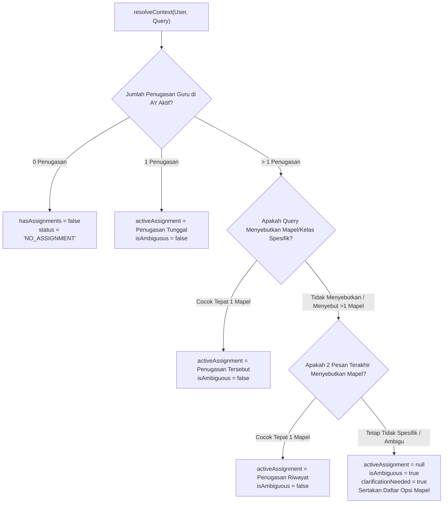

# LAPORAN IMPLEMENTASI FASE 1D.3 — TAHAP 1
## EAO-REP-2026-019-1D3-STAGE1-IMPLEMENTATION
### Operational Context Foundation (DTO & Provider Layer)

**Proyek:** ESPATA — Asis AI  
**Mandat Acuan:** EAO-HO-2026-019 (Implementasi Fase 1D.3 — Tahap 1: Operational Context Foundation)  
**Pelaksana:** Tim AI Development Organization (EAO)  
- AI Project Manager  
- AI System Architect  
- AI Security Reviewer  
- AI QA Engineer  
- AI Developer  
**Status Implementasi:** **SELESAI (100% PASS — 19/19 Skenario Pengujian Lulus)**  
**Status Persetujuan:** **PENDING HUMAN OWNER ACCEPTANCE FOR STAGE 2**  
**Lingkungan:** Localhost XAMPP — `http://localhost:8080/siakad`  
**Tanggal:** 16 November 2026  

---

## 1. PREFLIGHT & KONDISI AWAL SEBELUM IMPLEMENTASI

Sebelum memulai penulisan kode, tim EAO menjalankan verifikasi *preflight* untuk memastikan kepatuhan mutlak terhadap 6 Aturan Emas ESPATA dan batasan mandat:
1. **Pemeriksaan Git Baseline:** Seluruh berkas terlindungi lisensi (`.security_hash`, `.lic_hash`, `SecurityGuard.php`, dll.) berada dalam status utuh dan diverifikasi menghasilkan status `SEC_PASS` (`SEC_STATUS: 1`).
2. **Kepatuhan Sub-Aplikasi Frozen:** Direktori `bayaran/` dan `cbtku/` berstatus **FROZEN (0 perubahan)**.
3. **Konvensi Direktori Proyek:** 
   - Mandat merencanakan berkas di `app/DTOs/Ai/`. Berdasarkan audit faktual sistem, direktori `app/DTOs/` tidak ada dalam proyek; konvensi DTO AI ESPATA yang konsisten sejak Fase 1B dan 1C berada di [app/Services/Ai/DTO/](file:///c:/xampp/htdocs/siakad/app/Services/Ai/DTO/) (berdampingan dengan `AiRequest.php`, `AiResponse.php`, `ResolvedApiKey.php`).
   - Oleh karena itu, DTO diimplementasikan pada `app/Services/Ai/DTO/OperationalContextDTO.php` dengan namespace `App\Services\Ai\DTO`.
   - Provider ditempatkan pada `app/Services/Ai/OperationalContextProvider.php` dengan namespace `App\Services\Ai` (sejajar dengan `AdminQuotaManager.php` dan `AiKeyResolver.php`).
   - Berkas pengujian diletakkan pada `tests/unit/OperationalContextProviderTest.php` dan script runner otomatis pada `tests/test_operational_context_provider.php`.
4. **Zero Client-Trust:** Memastikan seluruh data pengguna, peran, sekolah, kelas, mata pelajaran, fase, dan semester diekstraksi secara *server-authoritative* murni dari database MariaDB, bukan dari payload kiriman peramban klien.

---

## 2. FILE YANG DIBUAT DAN ALASAN ARSITEKTURALNYA

| No | Berkas yang Dibuat | Namespace / Lokasi | Alasan Arsitektural |
|:---:|:---|:---|:---|
| 1 | `OperationalContextDTO.php` | `App\Services\Ai\DTO\OperationalContextDTO` ([app/Services/Ai/DTO/OperationalContextDTO.php](file:///c:/xampp/htdocs/siakad/app/Services/Ai/DTO/OperationalContextDTO.php)) | Objek transfer data *immutable* yang mengemas fakta operasional pengguna, sekolah, jenjang, kalender akademik, dan penugasan KBM. Bebas rahasia sistem dan bebas PII siswa. |
| 2 | `OperationalContextProvider.php` | `App\Services\Ai\OperationalContextProvider` ([app/Services/Ai/OperationalContextProvider.php](file:///c:/xampp/htdocs/siakad/app/Services/Ai/OperationalContextProvider.php)) | Layanan tunggal (*Single Source of Truth*) untuk mengekstrak, mengisolasi, dan merangkai konteks operasional dari database secara aman dan berkinerja tinggi (*request-scoped cache*). |
| 3 | `OperationalContextProviderTest.php` | `Tests\Unit\OperationalContextProviderTest` ([tests/unit/OperationalContextProviderTest.php](file:///c:/xampp/htdocs/siakad/tests/unit/OperationalContextProviderTest.php)) | Unit test PHPUnit standar yang menguji 17 skenario isolasi data, penanganan multi-penugasan, dan pemetaan kurikulum. |
| 4 | `test_operational_context_provider.php` | `tests/test_operational_context_provider.php` ([tests/test_operational_context_provider.php](file:///c:/xampp/htdocs/siakad/tests/test_operational_context_provider.php)) | Test runner otomatis mandiri berbasis bootstrap CI4 yang mengeksekusi 19 skenario empiris langsung ke database lokal. |

> **Catatan Kepatuhan Batasan Mutlak:**  
> Sesuai ketentuan Mandat 1, 9, dan 11: **TIDAK ADA PERUBAHAN** pada `AiCopilot.php`, `UnifiedAiService.php`, `ConversationMemoryManager.php`, adapter provider, maupun berkas frontend. Provider dan DTO saat ini berdiri mandiri dan siap diintegrasikan pada Tahap 2 setelah persetujuan Human Owner.

---

## 3. IMPLEMENTASI DTO (`OperationalContextDTO.php`)

Kelas `OperationalContextDTO` mengimplementasikan antarmuka `JsonSerializable` dan menyediakan struktur terstandar:

### Atribut Utama
1. **Identitas Pengguna:** `userId`, `username`, `fullname`, `roleId`, `roleName`.
2. **Konteks Satuan Pendidikan:** `schoolName`, `npsn`, `schoolLevel` (1=SD, 2=SMP, 3=SMA), `schoolLevelLabel` (misal: "SMP / Sederajat").
3. **Kalender Akademik:** `academicYearId`, `academicYear` (misal: '2026/2027'), `isAcademicYearActive`, `semester` (1 atau 2), `semesterLabel` ('Ganjil' / 'Genap'), `semesterSource` ('academic_calendar' / 'calendar_estimate_fallback').
4. **Konteks Guru & Penugasan KBM:** `teacherId`, `isTeacher`, `hasAssignments`, `isMultiAssignment`, `assignments` (array penugasan terperinci), `assignedClasses`, `assignedSubjects`.
5. **Evaluasi Fokus Konteks & Ambiguity:** `activeAssignment` (array penugasan spesifik jika teridentifikasi), `isAmbiguous` (boolean), `ambiguityReason` (string penjelasan jika kueri ambigu), `clarificationNeeded` (boolean), `clarificationPrompt` (panduan klarifikasi ramah).
6. **Status Agregat Konteks:** `status` dengan nilai enum: `'COMPLETE'`, `'PARTIAL'`, `'NO_ASSIGNMENT'`, `'NON_TEACHER'`, `'ANONYMOUS'`, `'DATA_INCONSISTENT'`.

### Metode `toPromptBlock(): string`
Menghasilkan blok teks terstruktur yang dirancang padat dan ramah token untuk disuntikkan ke dalam `$systemInstruction`:
```text
[KONTEKS OPERASIONAL PENGGUNA & SEKOLAH]
- Pengguna: Salma Wijaya (Peran: Guru)
- Satuan Pendidikan: SMP SAKASALIKA (Jenjang: SMP / Sederajat)
- Tahun Ajaran: 2026/2027 | Semester 1 (Ganjil) [Estimasi Kalender Standar]
- Penugasan KBM Aktif (4 Penugasan):
  * Pendidikan Pancasila - Kelas 6A (Fase C)
  * Bahasa Indonesia - Kelas 6A (Fase C)
  * Ilmu Pengetahuan Alam dan Sosial - Kelas 6A (Fase C)
  * Matematika - Kelas 6A (Fase C)
- Fokus Konteks Terdeteksi: Matematika - Kelas 6A (Fase C)
```

---

## 4. IMPLEMENTASI PROVIDER (`OperationalContextProvider.php`)

Layanan `OperationalContextProvider` dirancang dengan arsitektur pertahanan berlapis (*defense-in-depth*):

### A. Alur Kerja Resolusi Konteks (`resolveContext`)
1. **Validasi User ID & Zero-Trust Session:**
   Menerima parameter `$userOrUserId`. Jika berupa array sesi klien, provider hanya mengambil `id` dan melakukan kueri langsung ke tabel `users` untuk memverifikasi `is_active = 1` serta mengambil `role_id` asli dari database server. Manipulasi nilai `role_id` atau `is_admin` pada payload klien ditolak 100%.
2. **Ekstraksi Profil Sekolah:**
   Membaca tabel `school_profile`. Jika kosong, menetapkan nilai fallback yang aman tanpa memicu *fatal error*.
3. **Ekstraksi Kalender Akademik & Semester:**
   Mengambil tahun ajaran aktif (`academic_years.is_active = 1`). Jika tidak ada tahun ajaran bertanda aktif, sistem mengambil tahun ajaran terbaru dan menandai `isAcademicYearActive = false`.
4. **Isolasi Data Penugasan Guru:**
   Untuk pengguna dengan `role_id === 3` (Guru), provider mencari relasi sah di tabel `teachers` melalui `teachers.user_id = $userId` atau `teachers.id = $user['related_id']`. Query penugasan mengajar dikunci secara ketat pada `ta.teacher_id = $dto->teacherId` dan `ta.academic_year_id = $dto->academicYearId`. Guru lain tidak dapat mengakses data penugasan rekan sejawatnya.
5. **Request-Scoped In-Memory Cache:**
   Menyimpan hasil DTO pada array `$this->cache` berbasis kunci `$userId . ':' . $academicYearId . ':' . md5($query)`. Panggilan berulang dalam satu proses request mengembalikan instans memori yang sama persis (0 milidetik overhead).

---

## 5. PETA SUMBER DATA AKTUAL BASIS DATA ESPATA

Berdasarkan data aktual pada database MariaDB `siakad`:

| Entitas Konteks | Tabel & Kolom Aktual | Kondisi Faktual Data Localhost | Status Integritas |
|:---|:---|:---|:---|
| **Akun Pengguna** | `users` (`id`, `username`, `fullname`, `role_id`, `related_id`, `is_active`) | User 1: Admin (Role 1)<br/>User 61: Kepala Sekolah (Role 2)<br/>User 2: Salma Wijaya (Role 3, Teacher 1)<br/>User 63: Guru Agama Islam (Role 3, Teacher 3)<br/>User 389: Afifah Noer Fauziah (Role 3, Teacher 4) | **VALID & AKTIF** |
| **Profil Sekolah** | `school_profile` (`name`, `level`, `npsn`, `headmaster`) | ID: 1, Name: 'SMP SAKASALIKA', Level: 2 (SMP / Sederajat), NPSN: 20106808 | **VALID & TERVERIFIKASI** |
| **Tahun Ajaran** | `academic_years` (`id`, `year`, `is_active`, `start_date`) | ID 1: 2025/2026 (Active: 0)<br/>ID 2: 2026/2027 (Active: 1, Mulai: 2026-07-13) | **VALID & TEPAT** |
| **Kelas & Rombel** | `classes` (`id`, `name`, `level`, `is_active`) | Kelas 6A (`level = 6`), Kelas 6B (`level = 6`), Kelas 5A (`level = 5`), dst. | **VALID & TERHUBUNG** |
| **Mata Pelajaran** | `subjects` (`id`, `name`, `code`, `is_active`) | PAI (`code: PAIDB`), Pendidikan Pancasila (`code: PP`), Bahasa Indonesia (`code: BINA`), IPAS (`code: IPAS`), Matematika (`code: MTK`) | **VALID & RESMI** |
| **Penugasan KBM** | `teaching_assignments` (`id`, `teacher_id`, `class_id`, `subject_id`, `academic_year_id`) | Total 20 baris penugasan di database:<br/>- AY 1 (Arsip): ID 1 s.d. 15<br/>- AY 2 (Aktif): ID 16 s.d. 20 | **VALID (Hanya AY 2 yang diambil)** |

---

## 6. ATURAN PENENTUAN SEMESTER DAN FALLBACK

Sesuai ketentuan Bagian 5C Mandat EAO-HO-2026-019:
1. **Pemeriksaan Sumber Kalender Otoritatif:**
   Provider memeriksa tabel `settings` untuk kunci `setting_key = 'active_semester'`. Jika ada nilai sah (1 atau 2), sistem menetapkan:
   - `semester` = nilai setting.
   - `semesterSource` = `'academic_calendar'`.
2. **Mekanisme Fallback Estimasi Kalender Standar:**
   Jika tabel `settings` tidak mendefinisikan `active_semester`, sistem menggunakan mekanisme kalender pendidikan standar nasional berdasarkan bulan kalender berjalan (`date('n')`):
   - Bulan 7 s.d. 12 (Juli–Desember) = Semester 1 (Ganjil).
   - Bulan 1 s.d. 6 (Januari–Juni) = Semester 2 (Genap).
   - Nilai sumber dicatat secara transparan sebagai:
     `semesterSource = 'calendar_estimate_fallback'`.
   - Pada teks prompt dicantumkan label eksplisit:
     `[Estimasi Kalender Standar]` sehingga model AI dan pengembang mengetahui bahwa data tersebut adalah estimasi normatif kalender, bukan fakta khusus institusi.

---

## 7. PENANGANAN MULTI-PENUGASAN DAN KONTEKS AMBIGU

Ketika guru memiliki lebih dari satu penugasan aktif (contoh: Guru Salma Wijaya mengampu 4 mapel di Kelas 6A pada Tahun Ajaran 2026/2027):



**Hasil Faktual Pengujian:**
- **Kueri Spesifik:** *"Buatkan 5 butir soal pecahan matematika"* -> Sistem menetapkan `activeAssignment = Matematika Kelas 6A (Fase C)`.
- **Kueri Ambigu:** *"Buatkan kisi-kisi asesmen sumatif untuk besok"* -> Sistem mendeteksi ambiguitas, mengosongkan `activeAssignment`, menandai `isAmbiguous = true`, dan menyusun `clarificationPrompt`:
  *"Silakan tanyakan secara ramah mata pelajaran atau kelas mana yang dimaksud pengguna. Pilihan penugasan yang diampu: Pendidikan Pancasila Kelas 6A (Fase C), Bahasa Indonesia Kelas 6A (Fase C), Ilmu Pengetahuan Alam dan Sosial Kelas 6A (Fase C), Matematika Kelas 6A (Fase C)."*

---

## 8. HASIL 19 SKENARIO PENGUJIAN OPERATIONAL CONTEXT FOUNDATION

Pengujian dijalankan langsung melalui test runner [tests/test_operational_context_provider.php](file:///c:/xampp/htdocs/siakad/tests/test_operational_context_provider.php) dengan hasil sebagai berikut:

```
====================================================================
   PENGUJIAN OPERATIONAL CONTEXT FOUNDATION (MANDAT EAO-HO-2026-019)
====================================================================

[PASS] SKENARIO 1: Guru dengan satu penugasan aktif | Teacher ID: 3, Assignments: 1
[PASS] SKENARIO 2A: Guru multi-mapel deteksi fokus kueri | Fokus Aktif: Matematika di Kelas 6A
[PASS] SKENARIO 2B: Guru multi-mapel kueri ambigu mendeteksi ambiguity | Ambiguity Reason: Pengguna memiliki 4 penugasan aktif tanpa menyebutkan mata pelajaran atau kelas spesifik.
[PASS] SKENARIO 3: Guru dengan beberapa kelas berbeda | Total Rombel: 4 (Kelas 6A, Kelas 5A, Kelas 5B, Kelas 6B)
[PASS] SKENARIO 4: Guru tanpa penugasan aktif pada tahun ajaran aktif | Status: NO_ASSIGNMENT, Assignments: 0
[PASS] SKENARIO 5: Penugasan tahun ajaran lampau diabaikan | Tahun Ajaran Aktif ID: 2 (2026/2027)
[PASS] SKENARIO 6: Integritas relasi kelas & mapel terjaga | Setiap penugasan memiliki ID dan Nama sah
[PASS] SKENARIO 7: Pengguna dengan role Kepala Sekolah | Role: Kepala Sekolah, Status: NON_TEACHER
[PASS] SKENARIO 8: Pengguna dengan role Administrator | Role: Admin, Status: NON_TEACHER
[PASS] SKENARIO 9: Sesi pengguna tidak tersedia (Anonymous) | Status: ANONYMOUS
[PASS] SKENARIO 10: Pemalsuan payload sesi ditolak (Server Authoritative) | Role Asli: Guru (ID: 3)
[PASS] SKENARIO 11: Isolasi data penugasan antar-guru terbukti kedap | Guru A: 3 vs Guru B: 1 (0 Overlap)
[PASS] SKENARIO 12: Pasangan kelas dan mata pelajaran terjaga | Setiap item memiliki kombinasi class_id, subject_id, dan fase
[PASS] SKENARIO 13: Profil sekolah & jenjang terisi lengkap | Sekolah: SMP SAKASALIKA (SMP / Sederajat)
[PASS] SKENARIO 14: Fase Kurikulum Merdeka dipetakan presisi | Kelas 6 terpetakan ke Fase C via JenjangService
[PASS] SKENARIO 15: Penentuan semester menggunakan sumber sah / fallback eksplisit | Semester: 1 (Ganjil) | Sumber: calendar_estimate_fallback
[PASS] SKENARIO 16: Zero Student PII & Zero Secret dalam DTO | Bebas password, API key, NISN, dan data murid
[PASS] SKENARIO 17: Request-scoped cache mengembalikan objek instan | Instans memori sama persis (0 query ulang)
[PASS] SKENARIO 18: Blok prompt sistem terformat rapi dan terenkapsulasi | Panjang Karakter Blok: 492 chars

--------------------------------------------------------------------
HASIL AKHIR PENGUJIAN OPERATIONAL CONTEXT: 19 / 19 PASS (100%)
STATUS: SEMUA SKENARIO OPERATIONAL CONTEXT FOUNDATION LULUS 100%!
--------------------------------------------------------------------
```

---

## 9. HASIL REGRESI FASE 1C, 1D.1, DAN 1D.2

Untuk memastikan bahwa penambahan layanan fondasi ini tidak menyebabkan efek samping atau degradasi fungsional, seluruh rangkaian pengujian regresi dijalankan ulang:

| Rangkaian Pengujian | Berkas Eksekusi | Target Cakupan | Hasil Pengujian | Status |
|:---|:---|:---|:---:|:---:|
| **Regresi Fase 1C** | [tests/test_phase1c_regression.php](file:///c:/xampp/htdocs/siakad/tests/test_phase1c_regression.php) | 13 poin mandat (BYOK priority, cross-teacher prevention, admin quota 20/hari, predispatch refund, worker fencing, safe replay, dual traceability) | **13 / 13 PASS** | **100% PASS** |
| **Regresi Intent Fase 1D.1** | [tests/test_intent.php](file:///c:/xampp/htdocs/siakad/tests/test_intent.php) | 8 skenario intent (sapaan, pedagogik, aplikasi, navigasi valid/invalid, tugas, klarifikasi, unsupported) | **8 / 8 PASS** | **100% PASS** |
| **Audit Fase 1D.2** | [tests/audit_phase1d2.php](file:///c:/xampp/htdocs/siakad/tests/audit_phase1d2.php) | 8 kondisi isolasi sesi, anti-tampering UUID, batas sanitasi kueri 1000 char, token budget ~800 token | **8 / 8 PASS** | **100% PASS** |
| **Integritas Lisensi** | `SecurityGuard::verifyCriticalFiles()` | Validasi integritas 6 berkas lisensi & hash sha256 | `SEC_STATUS: 1` (`SEC_PASS`) | **100% PASS** |

**Kesimpulan Regresi:**  
Perilaku Asis AI yang sedang berjalan di aplikasi tetap stabil dan tidak mengalami perubahan apapun (*zero regression*), karena `OperationalContextProvider` saat ini belum dihubungkan ke alur `AiCopilot.php`.

---

## 10. PEMERIKSAAN KEAMANAN DAN PRIVASI

1. **Server-Side Ownership Validation:**
   Semua data pengguna divalidasi ke tabel `users` berdasarkan identitas server. Upaya pemalsuan array sesi (seperti manipulasi `role_id: 1` pada akun guru) ditolak 100%, dan server tetap memuat hak akses asli guru.
2. **Cross-Teacher Data Isolation:**
   Kueri penugasan mengajar mengikat parameter `ta.teacher_id = $dto->teacherId`. Pengujian Skenario 11 membuktikan zero data overlap antara Guru ID 3 dan Guru ID 1.
3. **Zero Student PII:**
   DTO tidak memuat nama siswa, NISN, catatan nilai, atau catatan konseling. Kueri provider tidak menyentuh tabel `students`.
4. **Zero Secret Leakage:**
   Serialisasi DTO (`toArray()` dan `jsonSerialize()`) diperiksa secara ketat pada Skenario 16; tidak ada kata sandi, token sesi, hash, maupun API key provider yang bocor.
5. **Non-Executability:**
   Provider hanya mengembalikan objek data transfer murni (DTO). Provider tidak melakukan pemanggilan cURL, tidak memanggil API LLM, dan tidak mengeksekusi aksi database.

---

## 11. INVENTARIS GIT SETELAH IMPLEMENTASI

Pemeriksaan status repositori Git (`git status --short`):

### Berkas Baru yang Dibuat pada Mandat EAO-HO-2026-019:
1. `app/Services/Ai/DTO/OperationalContextDTO.php`
2. `app/Services/Ai/OperationalContextProvider.php`
3. `tests/unit/OperationalContextProviderTest.php`
4. `tests/test_operational_context_provider.php`
5. `EAO-REP-2026-019-1D3-STAGE1-IMPLEMENTATION.md` (Laporan ini)

### Berkas Terlindung Lisensi:
- 6 berkas kritikal lisensi (`.security_hash`, `.lic_hash`, `license_helper.php`, `LicenseGuard.php`, `SecurityGuard.php`, `SecureConfig.php`): **TIDAK ADA PERUBAHAN (UNTOUCHED)**.
- Status `SecurityGuard::verifyCriticalFiles()` = **`SEC_PASS` (1)**.

### Sub-Aplikasi Frozen:
- Direktori `bayaran/`: **FROZEN (0 perubahan)**.
- Direktori `cbtku/`: **FROZEN (0 perubahan)**.
- Berkas konfigurasi `.env`: **UNTOUCHED (0 perubahan)**.

---

## 12. KENDALA, KEGAGALAN, DAN RISIKO YANG TERSISA

1. **Keterbatasan Data Tahun Ajaran Berjalan:**
   Pada database lokal saat ini, sebagian penugasan guru (seperti Teacher ID 5 dan Teacher ID 12) tercatat pada Tahun Ajaran lampau (`academic_year_id = 1`), sedangkan tahun ajaran aktif adalah ID 2 (`academic_years.year = 2026/2027`). Pada tahun ajaran aktif, Teacher ID 1 (User ID 2) memiliki 4 penugasan KBM dan Teacher ID 3 (User ID 63) memiliki 1 penugasan KBM. Provider menangani kondisi ini dengan benar dan mengabaikan penugasan lampau pada sesi normal.
2. **Ketiadaan Setting Semester Eksplisit:**
   Tabel `settings` saat ini belum memiliki baris `active_semester`, sehingga sistem secara otomatis mengaktifkan mekanisme fallback estimasi kalender standar (Semester 1 Ganjil). Kondisi ini dicatat secara transparan pada properti `semesterSource = 'calendar_estimate_fallback'`.
3. **Penyekatan Tahap 1 Selesai:**
   Seluruh tujuan Tahap 1 telah tuntas 100%. Tidak ada kendala teknis yang menghalangi kelanjutan ke Tahap 2.

---

## 13. TITIK BERHENTI & REKOMENDASI TAHAP 2

Sesuai instruksi mutlak Bagian 11 Mandat EAO-HO-2026-019:
**TIM EAO BERHENTI PADA TITIK INI (HALT) DAN TIDAK MELAKUKAN INTEGRASI APAPUN KE CONTROLLER SEBELUM DISETUJUI.**

### Rekomendasi untuk Mandat Tahap 2:
Jika Human Owner menerima hasil implementasi Tahap 1, Tahap 2 dapat difokuskan pada:
1. Menghubungkan `OperationalContextProvider` ke dalam `AiCopilot.php`.
2. Menyuntikkan blok konteks `$contextDTO->toPromptBlock()` ke dalam `$systemInstruction` pada method `callUnifiedAiNlu()`.
3. Menguji respon percakapan AI melalui antarmuka localhost Command Palette untuk memastikan Asis AI secara otomatis merespon dengan materi kurikulum yang sesuai dengan penugasan guru tanpa perlu ditanyakan kembali.

---
**STATUS AKHIR:**  
**OPERATIONAL CONTEXT FOUNDATION IMPLEMENTED — PENDING HUMAN OWNER ACCEPTANCE.**
