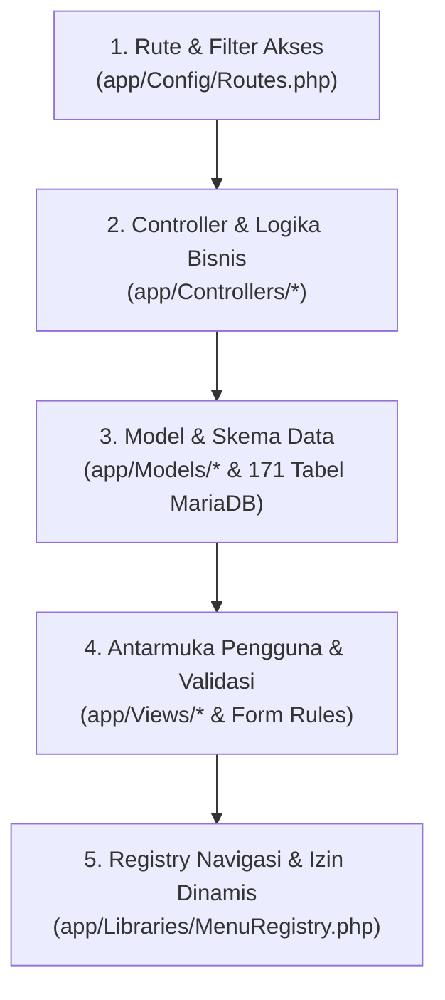
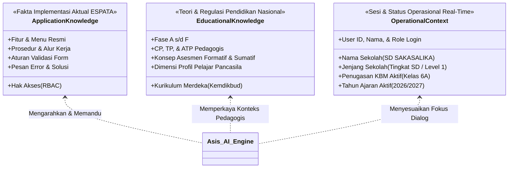

# LAPORAN AUDIT PENGETAHUAN APLIKASI ESPATA (EAKB)
## EAO-REP-2026-026-EAKB-APPLICATION-KNOWLEDGE-AUDIT
### Fondasi Basis Pengetahuan Aplikasi (ESPATA Application Knowledge Base) untuk Asis AI

**Proyek:** ESPATA — Asis AI  
**Mandat Acuan:** Mandat Human Owner EAO-HO-2026-026  
**Dokumen Pendukung:** ADDENDUM ARAH PRODUK ASIS AI ESPATA dan EAO-DEC-2026-025  
**Pelaksana:** Tim AI Development Organization (EAO) — *AI Product Analyst, AI System Architect, AI QA Engineer*  
**Otoritas:** Pemilik Produk ESPATA (Human Owner)  
**Jenis Pekerjaan:** Audit Diagnostik & Inventarisasi Read-Only  
**Lingkungan:** Localhost XAMPP — `http://localhost:8080/siakad`  
**Tanggal Penyusunan:** 16 November 2026  
**Status Audit:** **SELESAI (FAKTA TERVERIFIKASI DARI BASIS KODE AKTUAL)**  
**Kepatuhan Lingkungan:** **READ-ONLY (0 Modifikasi Kode, 0 Perubahan Database, `SEC_PASS` Utuh)**

---

## 1. RINGKASAN EKSEKUTIF & PRINSIP AUDIT

Menindaklanjuti **Mandat EAO-HO-2026-026** serta **Addendum Arah Produk Asis AI ESPATA**, Tim Multi-Agen EAO telah melaksanakan audit independen dan inventarisasi menyeluruh terhadap seluruh komponen fungsional aplikasi ESPATA. Audit ini bertujuan untuk menyusun fondasi baku bagi **ESPATA Application Knowledge Base (EAKB)**, yaitu sumber pengetahuan faktual yang memungkinkan Asis AI menjawab pertanyaan pengguna seputar fungsi menu, cara penggunaan aplikasi, prosedur bertahap, alur kerja, validasi, hak akses, serta pemecahan masalah (*troubleshooting*) secara akurat dan tanpa halusinasi (*zero hallucination*).

### Ringkasan Statistik Hasil Inventarisasi:
- **Total Tabel Basis Data MariaDB:** **171 Tabel** (Terdaftar aktif di MariaDB lokal).
- **Total Berkas Controller:** **88 Berkas Controller** (66 di `Admin/`, 6 di `Admin/Cms/`, 19 di `Siswa/`, 3 di `Api/`, dan 14 di Root `Controllers/`).
- **Total Model:** **94 Berkas Model** di `app/Models/`.
- **Total Kelompok Peran Pengguna (RBAC):** **8 Peran** (Admin, Kepala Sekolah, Guru, Orang Tua, Siswa, Kontributor, Staf, Pelatih).
- **Total Fitur Teridentifikasi & Terkatalog:** **58 Fitur Utama** yang terdistribusi ke dalam 14 kelompok modul.

### Distribusi Status Faktual Fitur:
1. **`ACTIVE` (Aktif Penuh):** **49 Fitur (84.5%)** — Terbukti memiliki route, controller, model, antarmuka view, dan alur KBM/operasional yang berfungsi utuh.
2. **`LIMITED` (Terbatas):** **5 Fitur (8.6%)** — Berfungsi dengan batasan tertentu (misal: SNBP Tracker khusus SMA, PWA butuh HTTPS, OCR Surat butuh worker client-side, dsb.).
3. **`INACTIVE` (Nonaktif/Terkunci):** **1 Fitur (1.7%)** — Fitur sinkronisasi Dapodik otomatis (membutuhkan API key dan bridge lokal eksternal yang belum terhubung di localhost).
4. **`PLANNED` (Rencana/Draf):** **1 Fitur (1.7%)** — Modul EAKB terpadu mandiri (masih dalam tahap audit desain).
5. **`FROZEN / OUT_OF_SCOPE` (Dibekukan):** **2 Sub-Aplikasi** — `bayaran/` (Modul Keuangan) dan `cbtku/` (Standalone CBT) berstatus **FROZEN** sesuai mandat tata kelola.

---

## 2. METODOLOGI & SUMBER AUDIT FAKTUAL

Audit dijalankan secara ketat menggunakan prinsip **"Fakta Kode di Atas Asumsi"**. Setiap entri dalam laporan ini diverifikasi silang (*cross-referenced*) melalui lima lapisan implementasi:



1. **Lapisan Routing (`app/Config/Routes.php`):** Menelusuri seluruh grup rute (`admin`, `siswa`, `api`, `auth`, `profile`, `kalender`, `forum`, `learning`) beserta filter pembatasnya (`auth:1,2,3`, `auth:4,5`, `auth:5`).
2. **Lapisan Controller:** Membaca metode, logika percabangan peran (`role_id`), pemeriksaan sesi guru (`related_id`), validasi input formulir, dan penanganan exception.
3. **Lapisan Model & Basis Data:** Memeriksa keberadaan kolom, relasi antar tabel (foreign keys), serta flag status aktif (`is_active`, `academic_year_id`).
4. **Lapisan Tampilan (Views):** Memeriksa komponen antarmuka, tombol aksi, modal interaktif, skrip AJAX, dan pesan peringatan error (*flash messages*).
5. **Lapisan Registry Navigasi (`MenuRegistry.php`):** Memetakan relasi antara rute URL dengan permission dinamis (`role_permissions`).

---

## 3. PEMISAHAN TIGA PILAR SUMBER PENGETAHUAN (TRI-KNOWLEDGE SEPARATION)

Sesuai ketentuan Bagian 7 Mandat EAO-HO-2026-026, Tim EAO menetapkan batas tegas antara tiga sumber pengetahuan agar Asis AI tidak mencampuradukkan fakta teknis aplikasi dengan wawasan kurikulum atau data sesi:



- **A. ESPATA Application Knowledge:** Bersumber dari kode repositori aktual. Menjelaskan menu apa yang harus dibuka, tombol apa yang diklik, mengapa form ditolak, dan siapa yang berhak mengakses.
- **B. Educational Knowledge:** Bersumber dari regulasi dan teori kurikulum resmi. Menjelaskan filosofi asesmen atau taksonomi tujuan belajar tanpa mengklaim bahwa aplikasi memiliki tombol otomatis jika belum diimplementasikan.
- **C. Operational Context:** Bersumber dari data sesi login saat ini (`OperationalContextDTO`). Menjadi filter kontekstual agar penjelasan diarahkan ke kelas dan penugasan yang relevan bagi pengguna yang sedang aktif.

---

## 4. MATRIKS HAK AKSES PENGGUNA (RBAC MATRIX)

Audit terhadap tabel `roles`, filter `app/Filters/Auth.php`, dan `app/Libraries/MenuRegistry.php` mengonfirmasi pemetaan hak akses faktual sebagai berikut:

| Role ID | Nama Peran | Total Akun Aktif | Lingkup Akses Utama | Karakteristik Akses di Antarmuka |
|:---:|:---|:---:|:---|:---|
| **1** | **Administrator** | 1 | Akses penuh (*Full Access*) ke seluruh modul sistem, pengaturan, pengguna, kurikulum, CBT, dan audit log. | Akses ke grup rute `/admin/*` tanpa pembatasan `teaching_assignments`. |
| **2** | **Kepala Sekolah** | 1 | Akses supervisi manajerial: monitoring KBM, monitoring ujian CBT, persetujuan modul ajar, leger nilai, e-rapor, dan absensi guru. | Akses ke grup rute `/admin/*` dengan wewenang view/supervisi tanpa beban input kelas pribadi. |
| **3** | **Guru** | 18 | Akses KBM operasional: Modul Ajar, Jurnal Mengajar, Input Nilai, Presensi Siswa, Kokurikuler, Bank Soal CBT, dan LMS. | Dibatasi secara ketat oleh **`teaching_assignments`** dan penunjukan **Wali Kelas** pada tahun ajaran aktif. |
| **4** | **Orang Tua** | 29 | Portal Orang Tua: memantau nilai rapor, presensi harian anak, jadwal pelajaran, agenda kelas, dan tagihan sekolah. | Akses ke rute `/siswa/*` dengan penyaringan data berbasis relasi NISN siswa anak. |
| **5** | **Siswa** | 354 | Portal Siswa: ujian online CBT, LMS belajar mandiri, tugas, kuis, nilai, presensi, perpustakaan digital, dan ekskul. | Akses ke rute `/siswa/*` dengan isolasi data hanya untuk record diri sendiri. |
| **6** | **Kontributor** | 0 | Publikasi CMS: Berita, artikel, dokumentasi kegiatan, dan galeri sarana sekolah. | Terbatas pada rute `/admin/cms/*`. |
| **7** | **Staf** | 1 | Operasional Tata Usaha: Surat masuk, surat keluar, agenda surat, buku tamu, dan pencetakan dokumen KBM. | Terfokus pada rute `/admin/surat-*` dan `/admin/tata-usaha/*`. |
| **8** | **Pelatih** | 0 | Ekstrakurikuler: Mengisi presensi ekskul dan mencatat penilaian perkembangan bakat siswa. | Terbatas pada rute `/admin/ekskul-absensi` dan penilaian anggota binaan. |

---

## 5. KATALOG MENYELURUH 14 KELOMPOK MODUL ESPATA

Berikut adalah katalog terstruktur 58 fitur aplikasi yang diekstraksi dari basis kode aktual, mematuhi standar 15 atribut wajib:

### KELOMPOK 1: MANAJEMEN PENGGUNA, AKUN & HAK AKSES

#### Fitur 1.1: Manajemen Pengguna & Akun (`feat_sys_user_mgmt`)
- **Title:** User Management (Data Pengguna)
- **Category:** Pengaturan Sistem
- **Feature Status:** `ACTIVE`
- **Allowed Roles:** `[1]` (Admin)
- **Prerequisites:** Tersedia data peran (*roles*) di basis data.
- **Workflow Steps:**
  1. Masuk menu **Pengaturan Sistem** $\rightarrow$ **User Management** (`admin/users`).
  2. Klik tombol **Tambah Pengguna** atau gunakan fitur import Excel/Dapodik.
  3. Isi username, nama lengkap, email, password, pilih Role ID, dan tautkan ke ID Guru/Siswa jika relevan.
  4. Klik tombol **Simpan**.
- **Validation Rules & Errors:** Username dan email wajib unik (`is_unique[users.username]`). Password minimal 6 karakter.
- **Troubleshooting FAQ:** *"Mengapa guru tidak bisa login?"* $\rightarrow$ Pastikan status `users.is_active = 1` dan password telah direset atau dikonfirmasi.
- **Source Reference:** `app/Controllers/Admin/User.php`, `app/Models/UserModel.php`, Route: `admin/users`.
- **Source Version:** v2.0.7 | **Confidence:** High | **Last Verified:** 2026-11-16
- **Related Features:** `feat_sys_role_perm`, `feat_staff_teachers`, `feat_student_data`.
- **Known Limitations:** Penautan akun ke tabel `teachers` atau `students` dilakukan manual via kolom `related_id` jika tidak melalui auto-sync.

#### Fitur 1.2: Manajemen Peran & Izin Dinamis (`feat_sys_role_perm`)
- **Title:** Role & Hak Akses (Dynamic RBAC)
- **Category:** Pengaturan Sistem
- **Feature Status:** `ACTIVE`
- **Allowed Roles:** `[1]` (Admin)
- **Prerequisites:** Modul dan izin terdaftar di `MenuRegistry.php`.
- **Workflow Steps:**
  1. Masuk menu **Pengaturan Sistem** $\rightarrow$ **Role & Hak Akses** (`admin/role-permission`).
  2. Pilih role target (misal: Guru, Staf, Pelatih).
  3. Centang modul dan aksi izin yang diberikan.
  4. Klik **Simpan Perubahan Izin**.
- **Validation Rules & Errors:** Role Admin (ID 1) tidak dapat dicabut izin intinya demi keamanan sistem.
- **Troubleshooting FAQ:** *"Menu tidak muncul pada akun guru?"* $\rightarrow$ Periksa apakah centang izin modul pada role guru telah diaktifkan di tabel `role_permissions`.
- **Source Reference:** `app/Controllers/Admin/RolePermission.php`, `app/Libraries/MenuRegistry.php`.
- **Source Version:** v2.0.7 | **Confidence:** High | **Last Verified:** 2026-11-16
- **Related Features:** `feat_sys_user_mgmt`.
- **Known Limitations:** Beberapa rute masih menggunakan filter ID statis (`auth:1,2,3`) selain dynamic permission.

---

### KELOMPOK 2: DATA SEKOLAH, TAHUN AJARAN, ROMBEL & PENUGASAN

#### Fitur 2.1: Tahun Pelajaran & Semester Aktif (`feat_academic_year`)
- **Title:** Tahun Pelajaran & Penetapan Semester
- **Category:** Akademik & KBM
- **Feature Status:** `ACTIVE`
- **Allowed Roles:** `[1]` (Admin)
- **Prerequisites:** Tidak ada.
- **Workflow Steps:**
  1. Masuk menu **Akademik & KBM** $\rightarrow$ **Tahun Pelajaran** (`admin/academic-year`).
  2. Tambah tahun pelajaran baru (misal: 2026/2027) dan pilih semester (Ganjil/Genap).
  3. Klik tombol **Aktifkan** pada baris tahun ajaran target.
- **Validation Rules & Errors:** Hanya boleh ada tepat **1 tahun ajaran** yang berstatus `is_active = 1`.
- **Troubleshooting FAQ:** *"Data nilai atau jadwal kosong di dashboard?"* $\rightarrow$ Pastikan tahun ajaran aktif telah diset dengan benar.
- **Source Reference:** `app/Controllers/Admin/AcademicYear.php`, `app/Models/AcademicYearModel.php`.
- **Source Version:** v2.0.7 | **Confidence:** High | **Last Verified:** 2026-11-16
- **Related Features:** Seluruh modul akademik, CBT, dan penilaian.
- **Known Limitations:** Mengubah tahun ajaran aktif akan langsung mengubah filter data seluruh modul KBM secara global.

#### Fitur 2.2: Master Kelas & Penempatan Siswa (Rombel) (`feat_class_placement`)
- **Title:** Master Kelas & Penempatan Siswa
- **Category:** Administrasi Siswa
- **Feature Status:** `ACTIVE`
- **Allowed Roles:** `[1]` (Admin)
- **Prerequisites:** Tahun pelajaran aktif dan data siswa telah diinput.
- **Workflow Steps:**
  1. Buat master kelas di menu **Master Kelas** (`admin/classes`), tentukan tingkat level (1-12) dan wali kelas.
  2. Buka menu **Penempatan Siswa** (`admin/placement`).
  3. Pilih kelas tujuan, pilih daftar siswa dari daftar antrean/belum dapat kelas, lalu klik **Tempatkan Siswa**.
- **Validation Rules & Errors:** Siswa tidak boleh terdaftar aktif di dua kelas berbeda pada tahun ajaran yang sama.
- **Troubleshooting FAQ:** *"Nama siswa tidak muncul di daftar absensi guru?"* $\rightarrow$ Periksa apakah siswa sudah dimasukkan ke dalam rombel melalui menu Penempatan Siswa.
- **Source Reference:** `app/Controllers/Admin/Classes.php`, `app/Controllers/Admin/Placement.php`.
- **Source Version:** v2.0.7 | **Confidence:** High | **Last Verified:** 2026-11-16
- **Related Features:** `feat_academic_attendance`, `feat_student_data`.
- **Known Limitations:** Perpindahan kelas di pertengahan semester harus dicatat melalui mutasi kelas agar riwayat absensi tidak hilang.

#### Fitur 2.3: Penugasan Mengajar Guru (`feat_teaching_assignments`)
- **Title:** Penugasan Mengajar Guru (KBM Mapping)
- **Category:** Kepegawaian
- **Feature Status:** `ACTIVE`
- **Allowed Roles:** `[1]` (Admin)
- **Prerequisites:** Data Guru, Master Kelas Aktif, dan Mata Pelajaran tersedia.
- **Workflow Steps:**
  1. Masuk menu **Kepegawaian** $\rightarrow$ **Penugasan Mengajar** (`admin/teachingassignments`).
  2. Pilih Guru target.
  3. Pilih Mata Pelajaran dan Kelas yang diampu, tentukan alokasi JP.
  4. Klik **Simpan Penugasan**.
- **Validation Rules & Errors:** Kombinasi Guru, Mapel, Kelas, dan Tahun Ajaran wajib unik (`teaching_assignments`).
- **Troubleshooting FAQ:** *"Guru mengeluh modul ajar atau nilai tidak muncul?"* $\rightarrow$ Masalah terjadi karena penugasan mengajar di menu ini belum dibuat untuk tahun ajaran yang sedang aktif.
- **Source Reference:** `app/Controllers/Admin/TeachingAssignments.php`, `app/Models/TeachingAssignmentModel.php`.
- **Source Version:** v2.0.7 | **Confidence:** High | **Last Verified:** 2026-11-16
- **Related Features:** `feat_curriculum_modul_ajar`, `feat_grades_input`, `feat_academic_attendance`.
- **Known Limitations:** Menjadi syarat mutlak bagi guru (Role 3) untuk mengakses data kelas di seluruh modul sistem.

---

### KELOMPOK 3: KURIKULUM, CP, ATP, TP, PROTA, PROMES & MODUL AJAR

#### Fitur 3.1: Administrasi Guru Kurikulum Merdeka & Modul Ajar (`feat_curriculum_modul_ajar`)
- **Title:** Administrasi Guru & Generator Modul Ajar
- **Category:** Kurikulum & Pembelajaran
- **Feature Status:** `ACTIVE`
- **Allowed Roles:** `[1, 2, 3]` (Admin, Kepsek, Guru)
- **Prerequisites:** Penugasan mengajar aktif, Master Jenjang, dan CP Master Kemdikbud.
- **Workflow Steps:**
  1. Masuk menu **Perangkat Ajar (Modul Ajar)** (`admin/administrasi-guru/modul-ajar`).
  2. Pilih Mapel dan Kelas penugasan guru.
  3. Susun Capaian Pembelajaran (CP) $\rightarrow$ Tujuan Pembelajaran (TP) $\rightarrow$ Alur Tujuan Pembelajaran (ATP).
  4. Pada baris ATP, klik **Buat Modul Ajar**.
  5. Susun komponen secara manual atau klik tombol **Generate AI** untuk menyusun draf materi, pertanyaan pemantik, asesmen, dan media ajar.
  6. Simpan modul dan unduh dokumen siap cetak via tombol **Cetak PDF**.
- **Validation Rules & Errors:** Jam pelajaran (JP) per materi wajib sesuai aturan `JenjangService` (SD: 35 mnt/JP, SMP: 40 mnt, SMA: 45 mnt).
- **Troubleshooting FAQ:** *"Tombol Generate AI gagal?"* $\rightarrow$ Periksa ketersediaan API key pada profil guru atau kuota sistem harian.
- **Source Reference:** `app/Controllers/Admin/AdministrasiGuru.php`, `app/Models/ModulAjarModel.php`, `app/Services/JenjangService.php`.
- **Source Version:** v2.0.7 | **Confidence:** High | **Last Verified:** 2026-11-16
- **Related Features:** `feat_cbt_bank_soal`, `feat_curriculum_kokurikuler`.
- **Known Limitations:** Template cetak PDF disesuaikan untuk standar Kurikulum Merdeka format vertikal portrait.

---

### KELOMPOK 4: ADMINISTRASI GURU & JURNAL MENGAJAR

#### Fitur 4.1: Jurnal Mengajar Harian (`feat_teaching_journal`)
- **Title:** Jurnal Mengajar & Agenda Guru
- **Category:** Akademik & KBM
- **Feature Status:** `ACTIVE`
- **Allowed Roles:** `[1, 2, 3]` (Admin, Kepsek, Guru)
- **Prerequisites:** Jadwal mengajar harian guru terdaftar.
- **Workflow Steps:**
  1. Buka menu **Akademik & KBM** $\rightarrow$ **Jurnal Mengajar** (`admin/teaching-journal`).
  2. Pilih sesi jadwal hari ini.
  3. Masukkan materi pokok yang diajarkan, catatan pencapaian siswa, dan hambatan KBM.
  4. Klik **Simpan Jurnal**.
- **Validation Rules & Errors:** Tanggal jurnal tidak boleh melampaui tanggal hari ini (*anti-future backdating*).
- **Troubleshooting FAQ:** *"Jurnal tidak bisa disimpan?"* $\rightarrow$ Pastikan field materi pokok dan ringkasan KBM terisi minimal 10 karakter.
- **Source Reference:** `app/Controllers/Admin/TeachingJournalController.php`, `app/Models/TeachingJournalModel.php`.
- **Source Version:** v2.0.7 | **Confidence:** High | **Last Verified:** 2026-11-16
- **Related Features:** `feat_academic_schedules`, `feat_academic_attendance`.
- **Known Limitations:** Kepala sekolah dapat memantau keterisian jurnal seluruh guru via halaman rekapitulasi monitoring.

---

### KELOMPOK 5: KOKURIKULER (P5 / PPAI)

#### Fitur 5.1: Perencanaan & Asesmen Kokurikuler (`feat_curriculum_kokurikuler`)
- **Title:** Perencanaan & Penilaian Kokurikuler
- **Category:** Kurikulum & Pembelajaran
- **Feature Status:** `ACTIVE`
- **Allowed Roles:** `[1, 2, 3]` (Admin, Kepsek, Guru Kelas/Wali Kelas)
- **Prerequisites:** Tahun pelajaran aktif dan data rombel kelas tersedia.
- **Workflow Steps:**
  1. Masuk menu **Kurikulum & Pembelajaran** $\rightarrow$ **Kokurikuler** (`admin/kokurikuler`).
  2. Buat dokumen rencana: tentukan Tema (misal: *Gaya Hidup Berkelanjutan*), Judul Projek, Fase, dan Target Dimensi/Elemen Profil Pelajar.
  3. Gunakan AI Rekomendasi Tema jika membutuhkan ide kegiatan kolaboratif lintas mata pelajaran.
  4. Catat pelaksanaan projek pada log mingguan.
  5. Isi asesmen akhir projek per siswa dengan kriteria MB, SB, BSH, atau SAB.
  6. Cetak **Rapor Kokurikuler (PDF)**.
- **Validation Rules & Errors:** Menggunakan nomenklatur resmi **Kokurikuler** (bukan modul lama P5). Skala nilai wajib 4 tingkat (MB, SB, BSH, SAB).
- **Troubleshooting FAQ:** *"Rapor kokurikuler tidak memunculkan deskripsi?"* $\rightarrow$ Pastikan rubrik capaian pada tiap sub-elemen projek telah disimpan sebelum mencetak.
- **Source Reference:** `app/Controllers/Admin/Kokurikuler.php`, `app/Models/KokurikulerDocumentModel.php`.
- **Source Version:** v2.0.7 | **Confidence:** High | **Last Verified:** 2026-11-16
- **Related Features:** `feat_grades_erapor`.
- **Known Limitations:** Penilaian projek dilakukan per kelompok rombel kelas pada akhir periode tema projek.

---

### KELOMPOK 6: ASESMEN, BANK SOAL, CBT & PENILAIAN

#### Fitur 6.1: Bank Soal & Manajemen Butir Ujian CBT (`feat_cbt_bank_soal`)
- **Title:** Bank Soal CBT
- **Category:** Ujian Online (CBT)
- **Feature Status:** `ACTIVE`
- **Allowed Roles:** `[1, 3]` (Admin, Guru)
- **Prerequisites:** Mata Pelajaran terdaftar.
- **Workflow Steps:**
  1. Masuk menu **Ujian Online CBT** $\rightarrow$ **Bank Soal** (`admin/cbt/questions` atau `admin/cbt`).
  2. Klik **Tambah Bank Soal**, isi kode bank, nama, pilih mata pelajaran, dan tingkat kelas.
  3. Buka butir soal: tambahkan soal Pilihan Ganda (PG) dengan opsi kunci A-E atau soal Essay.
  4. Mendukung input gambar ilustrasi, audio listening, dan rumus matematika.
- **Validation Rules & Errors:** Bobot persentase kunci jawaban PG wajib bernilai 100%.
- **Troubleshooting FAQ:** *"Gambar di soal CBT pecah saat ujian siswa?"* $\rightarrow$ Pastikan format gambar berupa JPG/PNG dengan ukuran di bawah 2MB.
- **Source Reference:** `app/Controllers/Admin/CbtBankSoal.php`, `app/Models/CbtQuestionModel.php`.
- **Source Version:** v2.0.7 | **Confidence:** High | **Last Verified:** 2026-11-16
- **Related Features:** `feat_cbt_exam_schedule`, `feat_cbt_monitoring`.
- **Known Limitations:** Guru hanya dapat mengedit bank soal yang dibuat oleh dirinya sendiri, sedangkan Admin dapat mengelola semua bank soal.

#### Fitur 6.2: Pelaksanaan & Monitoring Ujian CBT (`feat_cbt_monitoring`)
- **Title:** Monitoring & Aktivitas CBT Real-time
- **Category:** Ujian Online (CBT)
- **Feature Status:** `ACTIVE`
- **Allowed Roles:** `[1, 2, 3]` (Admin, Kepsek, Guru)
- **Prerequisites:** Jadwal ujian CBT berstatus aktif dan token ujian telah dirilis.
- **Workflow Steps:**
  1. Buka menu **Ujian Online CBT** $\rightarrow$ **Aktivitas & Monitoring** (`admin/cbt/aktivitas`).
  2. Pantau daftar siswa yang sedang login, durasi tersisa, dan jumlah soal yang telah dijawab.
  3. Jika siswa mengalami masalah perangkat, pengawas/guru dapat mengklik **Reset Login** atau **Beri Tambahan Waktu**.
  4. Setelah selesai, unduh Berita Acara Pelaksanaan (BAP) Ujian.
- **Validation Rules & Errors:** Token ujian di-refresh secara berkala dan siswa wajib memasukkan token yang valid untuk memulai.
- **Troubleshooting FAQ:** *"Siswa terlempar keluar dari ujian dan tidak bisa login kembali?"* $\rightarrow$ Klik tombol **Reset Sesi** pada nama siswa di menu monitoring pengawas.
- **Source Reference:** `app/Controllers/Admin/CbtAktivitas.php`, `app/Models/CbtSessionModel.php`.
- **Source Version:** v2.0.7 | **Confidence:** High | **Last Verified:** 2026-11-16
- **Related Features:** `feat_cbt_bank_soal`, `feat_cbt_convert`.
- **Known Limitations:** Membutuhkan koneksi socket/heartbeat berkala (`cbt/ping`) antara browser siswa dan server.

#### Fitur 6.3: Konversi Nilai CBT ke Buku Nilai (`feat_cbt_convert`)
- **Title:** Konversi Nilai Ujian CBT
- **Category:** Ujian Online (CBT)
- **Feature Status:** `ACTIVE`
- **Allowed Roles:** `[1, 3]` (Admin, Guru)
- **Prerequisites:** Seluruh siswa telah menyelesaikan ujian dan soal essay telah dinilai.
- **Workflow Steps:**
  1. Masuk menu **Ujian Online CBT** $\rightarrow$ **Konversi Nilai CBT** (`admin/cbt/convert-grades`).
  2. Pilih jadwal ujian yang telah selesai.
  3. Tentukan jenis asesmen target di buku nilai (misal: Sumatif Tengah Semester / PAS).
  4. Klik **Kirim Nilai ke Buku Nilai**.
- **Validation Rules & Errors:** Ujian yang masih memiliki jawaban essay belum dinilai (*pending essay review*) akan memunculkan peringatan sebelum konversi.
- **Troubleshooting FAQ:** *"Nilai CBT belum masuk ke leger nilai?"* $\rightarrow$ Lakukan eksekusi kirim nilai melalui menu Konversi Nilai CBT ini.
- **Source Reference:** `app/Controllers/Admin/CbtConvertNilai.php`, `app/Models/CbtEssayGradeV3Model.php`.
- **Source Version:** v2.0.7 | **Confidence:** High | **Last Verified:** 2026-11-16
- **Related Features:** `feat_grades_input`, `feat_grades_erapor`.
- **Known Limitations:** Nilai yang sudah dikirim ke buku nilai tetap dapat disesuaikan kembali secara manual oleh guru mapel jika diperlukan.

---

### KELOMPOK 7: BUKU NILAI & RAPOR

#### Fitur 7.1: Penginputan Nilai Asesmen & Leger (`feat_grades_input`)
- **Title:** Input Nilai Siswa & Leger Nilai
- **Category:** Penilaian & Rapor
- **Feature Status:** `ACTIVE`
- **Allowed Roles:** `[1, 2, 3]` (Admin, Kepsek, Guru)
- **Prerequisites:** Penugasan KBM aktif dan kelas memiliki siswa terdaftar.
- **Workflow Steps:**
  1. Masuk menu **Penilaian & Rapor** $\rightarrow$ **Input Nilai** (`admin/grades`).
  2. Pilih Kelas dan Mata Pelajaran penugasan.
  3. Pilih tab: **Formatif** (Tugas/Harian) atau **Sumatif** (Lingkup Materi / Akhir Semester).
  4. Masukkan angka nilai pada kolom siswa (0-100).
  5. Klik tombol **Simpan Nilai**.
- **Validation Rules & Errors:** Angka nilai dibatasi antara `0` hingga `100`. Nilai non-angka ditolak otomatis oleh validasi sistem.
- **Troubleshooting FAQ:** *"Tombol input nilai tidak menampilkan nama mapel?"* $\rightarrow$ Pastikan tahun ajaran aktif sesuai dengan SK penugasan mengajar Anda.
- **Source Reference:** `app/Controllers/Admin/Grades.php`, `app/Models/GradesModel.php`.
- **Source Version:** v2.0.7 | **Confidence:** High | **Last Verified:** 2026-11-16
- **Related Features:** `feat_grades_erapor`, `feat_cbt_convert`.
- **Known Limitations:** Guru hanya dapat menginput nilai untuk kelas dan mapel yang menjadi wewenang penugasannya.

#### Fitur 7.2: E-Rapor Semester & Cetak Rapor Siswa (`feat_grades_erapor`)
- **Title:** E-Rapor Akhir Semester (Prerogatif Guru)
- **Category:** Penilaian & Rapor
- **Feature Status:** `ACTIVE`
- **Allowed Roles:** `[1, 2, 3]` (Admin, Kepsek, Guru/Wali Kelas)
- **Prerequisites:** Seluruh nilai formatif dan sumatif telah lengkap terisi.
- **Workflow Steps:**
  1. Buka menu **Penilaian & Rapor** $\rightarrow$ **E-Rapor** (`admin/erapor`).
  2. Guru mapel memfinalisasi capaian kompetensi tertinggi dan terendah siswa.
  3. Wali kelas membuka **Rapor Semester** (`admin/rapor-semester`), mengisi catatan wali kelas, presensi ekstrakurikuler, dan status kenaikan kelas.
  4. Klik **Cetak PDF Rapor Lengkap** (memuat cover, data sekolah, capaian belajar, dan lembar tanda tangan).
- **Validation Rules & Errors:** Nilai rapor final merupakan hak prerogatif guru dengan acuan persentase pembobotan formatif dan sumatif.
- **Troubleshooting FAQ:** *"Deskripsi capaian kompetensi kosong di rapor?"* $\rightarrow$ Periksa apakah Tujuan Pembelajaran (TP) pada modul ajar telah dikaitkan dengan asesmen nilai.
- **Source Reference:** `app/Controllers/Admin/Erapor.php`, `app/Controllers/Admin/RaporSemester.php`.
- **Source Version:** v2.0.7 | **Confidence:** High | **Last Verified:** 2026-11-16
- **Related Features:** `feat_grades_input`, `feat_academic_attendance`.
- **Known Limitations:** Dilengkapi fitur kunci nilai (*grade freeze*) oleh Administrator menjelang pembagian rapor resmi.

---

### KELOMPOK 8: PRESENSI SISWA & GURU

#### Fitur 8.1: Presensi Harian Siswa (`feat_academic_attendance`)
- **Title:** Presensi Siswa Harian
- **Category:** Akademik & KBM
- **Feature Status:** `ACTIVE`
- **Allowed Roles:** `[1, 2, 3]` (Admin, Kepsek, Guru/Wali Kelas)
- **Prerequisites:** Kelas aktif memiliki siswa dan kalender bukan hari libur resmi.
- **Workflow Steps:**
  1. Buka menu **Akademik & KBM** $\rightarrow$ **Presensi Siswa** (`admin/attendance`).
  2. Pilih Kelas dan Tanggal presensi (tersedia mode desktop maupun tampilan mobile cepat).
  3. Tandai kehadiran masing-masing siswa: **H** (Hadir), **S** (Sakit), **I** (Izin), atau **A** (Alpa).
  4. Gunakan tombol cepat *"Set Semua Hadir"* untuk mempercepat pengisian.
  5. Klik **Simpan Presensi**.
- **Validation Rules & Errors:** Tanggal yang tercatat pada master hari libur (`holidays`) akan memunculkan notifikasi peringatan hari libur.
- **Troubleshooting FAQ:** *"Guru mendapat pesan 'Anda tidak memiliki akses absensi untuk kelas mana pun'?"* $\rightarrow$ Guru tersebut belum ditugaskan sebagai Wali Kelas atau belum memiliki jadwal mengajar di kelas tersebut pada tahun ajaran aktif.
- **Source Reference:** `app/Controllers/Admin/Attendance.php`, `app/Models/AttendanceModel.php`.
- **Source Version:** v2.0.7 | **Confidence:** High | **Last Verified:** 2026-11-16
- **Related Features:** `feat_grades_erapor`, `feat_student_data`.
- **Known Limitations:** Presensi dapat diekspor ke format Excel bulanan untuk rekapitulasi laporan dinas.

#### Fitur 8.2: Presensi Kehadiran Guru & GTK (`feat_staff_attendance`)
- **Title:** Presensi Guru & Pegawai
- **Category:** Kepegawaian
- **Feature Status:** `ACTIVE`
- **Allowed Roles:** `[1, 2, 3]` (Admin, Kepsek, Guru)
- **Prerequisites:** Jam operasional kerja sekolah aktif.
- **Workflow Steps:**
  1. Guru membuka menu presensi mandiri saat hadir di sekolah.
  2. Admin/Kepsek memantau rekap kehadiran harian pada menu **Kepegawaian** $\rightarrow$ **Laporan Absensi Guru** (`admin/teacher-attendance/report`).
  3. Admin dapat menyesuaikan status presensi manual (Hadir, Izin, Sakit, Cuti, Dinas Luar).
- **Validation Rules & Errors:** Jam masuk dan pulang terekam dengan timestamp server dan pencatatan status keterlambatan (TL).
- **Troubleshooting FAQ:** *"Persentase kehadiran guru di briefing pagi tidak bertambah?"* $\rightarrow$ Pastikan guru melakukan submit presensi sebelum batas akhir jam apel pagi sekolah.
- **Source Reference:** `app/Controllers/Admin/TeacherAttendance.php`, `app/Models/TeacherAttendanceModel.php`.
- **Source Version:** v2.0.7 | **Confidence:** High | **Last Verified:** 2026-11-16
- **Related Features:** `feat_staff_teachers`.
- **Known Limitations:** Mendukung deteksi lokasi koordinat sekolah jika geofencing diaktifkan pada konfigurasi.

---

### KELOMPOK 9: KESISWAAN, POIN PERILAKU & BIMBINGAN KONSELING (BK)

#### Fitur 9.1: Bimbingan Konseling & Layanan BK (`feat_bk_counseling`)
- **Title:** Kasus BK, Layanan & Panggilan Orang Tua
- **Category:** Bimbingan Konseling (BK)
- **Feature Status:** `ACTIVE`
- **Allowed Roles:** `[1, 2, 3]` (Admin, Kepsek, Guru BK/Wali Kelas)
- **Prerequisites:** Siswa terdaftar aktif di rombel.
- **Workflow Steps:**
  1. Masuk menu **Bimbingan Konseling** $\rightarrow$ **Dashboard & Kasus BK** (`admin/bk`).
  2. Catat kasus atau pengaduan masalah siswa: pilih nama siswa, kategori masalah (pribadi, sosial, belajar, karir), dan tingkat urgensi.
  3. Buat Rencana Pelaksanaan Layanan (RPL) Konseling (Individu/Kelompok).
  4. Jika dibutuhkan pemanggilan wali murid, generate **Surat Panggilan Orang Tua** otomatis bertanda tangan digital.
  5. Catat hasil konseling dan komitmen tindak lanjut siswa pada log kasus.
- **Validation Rules & Errors:** Data konseling bersifat rahasia (*confidentiality rule*), hanya dapat diakses oleh Guru BK, Wali Kelas siswa bersangkutan, Kepala Sekolah, dan Administrator.
- **Troubleshooting FAQ:** *"Guru mapel tidak bisa melihat detail hasil konseling siswa?"* $\rightarrow$ Ini adalah proteksi privasi sistem (RBAC); guru mapel hanya dapat melihat status umum catatan sikap tanpa rincian rahasia konseling.
- **Source Reference:** `app/Controllers/Admin/BkModule.php`, `app/Controllers/Admin/Counseling.php`.
- **Source Version:** v2.0.7 | **Confidence:** High | **Last Verified:** 2026-11-16
- **Related Features:** `feat_student_notes`, `feat_student_data`.
- **Known Limitations:** Siswa dapat mengajukan permohonan janji temu konseling secara mandiri melalui portal siswa.

#### Fitur 9.2: Catatan Sikap & Poin Pelanggaran Siswa (`feat_student_notes`)
- **Title:** Catatan Sikap & Kedisiplinan Siswa
- **Category:** Bimbingan Konseling (BK)
- **Feature Status:** `ACTIVE`
- **Allowed Roles:** `[1, 2, 3]` (Admin, Kepsek, Guru)
- **Prerequisites:** Master perilaku dan poin pelanggaran telah dikonfigurasi di `admin/behaviors`.
- **Workflow Steps:**
  1. Buka menu **Catatan & Sikap Siswa** (`admin/student-notes`).
  2. Cari nama siswa, pilih tanggal kejadian, dan pilih jenis perilaku positif (prestasi) atau negatif (pelanggaran).
  3. Sistem secara otomatis menambahkan/mengurangi akumulasi poin siswa.
  4. Catatan positif akan menjadi rekomendasi predikat sikap pada buku rapor.
- **Validation Rules & Errors:** Akumulasi poin pelanggaran yang melampaui batas ambang (misal: 50 poin) akan otomatis memicu peringatan panggilan BK.
- **Troubleshooting FAQ:** *"Bagaimana cara menghapus salah input poin pelanggaran?"* $\rightarrow$ Wali kelas atau Admin dapat membatalkan log kejadian melalui menu rincian riwayat siswa.
- **Source Reference:** `app/Controllers/Admin/StudentNotes.php`, `app/Models/BehaviorModel.php`.
- **Source Version:** v2.0.7 | **Confidence:** High | **Last Verified:** 2026-11-16
- **Related Features:** `feat_bk_counseling`, `feat_student_records`.
- **Known Limitations:** Terintegrasi dengan notifikasi langsung ke portal orang tua jika nomor HP/akun wali terdaftar.

---

### KELOMPOK 10: LMS, MATERI PEMBELAJARAN, TUGAS & AKTIVITAS

#### Fitur 10.1: Materi Pembelajaran Bersegmen & Progres Siswa (`feat_lms_materials`)
- **Title:** Materi & Bahan Ajar Bersegmen (LMS)
- **Category:** Kurikulum & Pembelajaran
- **Feature Status:** `ACTIVE`
- **Allowed Roles:** `[1, 3]` untuk Guru/Admin; `[5]` untuk Siswa
- **Prerequisites:** Mata Pelajaran terdaftar.
- **Workflow Steps:**
  1. Guru masuk menu **Materi & Bahan Ajar** (`admin/materials`).
  2. Buat judul materi utama, lalu tambahkan beberapa **Sub Materi (Segmen)** bertahap (teks bacaan, video embed YouTube, atau dokumen lampiran PDF).
  3. Publikasikan materi ke rombel kelas target.
  4. Siswa membaca materi di portal siswa (`siswa/belajar`), menandai *"Selesai Dibaca"*, dan berdiskusi pada kolom komentar segmen.
  5. Guru memantau persentase progres ketuntasan baca siswa di halaman progres materi.
- **Validation Rules & Errors:** Siswa harus menyelesaikan segmen prasyarat sebelum segmen materi lanjutan terbuka (jika mode linear diaktifkan).
- **Troubleshooting FAQ:** *"File PDF bahan ajar tidak bisa diunduh siswa?"* $\rightarrow$ Pastikan permission folder `writable/uploads/materials/` memiliki izin baca publik (755).
- **Source Reference:** `app/Controllers/Admin/Materials.php`, `app/Controllers/Siswa/Belajar.php`.
- **Source Version:** v2.0.7 | **Confidence:** High | **Last Verified:** 2026-11-16
- **Related Features:** `feat_lms_tugas`, `feat_lms_quiz`.
- **Known Limitations:** Guru lain dapat mengadopsi (*use/share*) sub materi milik rekan guru lain untuk efisiensi pembuatan konten ajar.

#### Fitur 10.2: Pengumpulan Tugas Online & Penilaian Tugas (`feat_lms_tugas`)
- **Title:** Tugas Mandiri & Pengumpulan Tugas
- **Category:** Kurikulum & Pembelajaran
- **Feature Status:** `ACTIVE`
- **Allowed Roles:** `[1, 3]` untuk Guru/Admin; `[5]` untuk Siswa
- **Prerequisites:** Kelas memiliki siswa terdaftar.
- **Workflow Steps:**
  1. Guru membuat tugas di menu **Tugas Siswa** (`admin/tugas`), menentukan tenggat waktu (*deadline*), dan tipe pengumpulan (teks, foto/gambar, atau berkas).
  2. Siswa membuka menu `siswa/tugas`, mengetik jawaban atau mengunggah bukti tugas, lalu klik **Kirim Tugas**.
  3. Guru memeriksa jawaban siswa, memberikan nilai (0-100), dan menuliskan feedback komentar perbaikan.
- **Validation Rules & Errors:** Siswa yang mengumpulkan tugas melewati tenggat waktu akan ditandai dengan label *"Terlambat"* secara otomatis.
- **Troubleshooting FAQ:** *"Siswa gagal upload foto tugas?"* $\rightarrow$ Ukuran gambar dibatasi maksimal 3MB dengan format JPG/PNG.
- **Source Reference:** `app/Controllers/Admin/Tugas.php`, `app/Controllers/Siswa/Tugas.php`.
- **Source Version:** v2.0.7 | **Confidence:** High | **Last Verified:** 2026-11-16
- **Related Features:** `feat_lms_materials`, `feat_grades_input`.
- **Known Limitations:** Nilai tugas dapat diimpor langsung ke buku nilai formatif dengan satu kali klik.

---

### KELOMPOK 11: KOMUNIKASI, SURAT & BUKU TAMU

#### Fitur 11.1: Tata Usaha & Pengarsipan Surat Digital (`feat_tu_surat`)
- **Title:** Tata Usaha & Surat Masuk/Keluar
- **Category:** Tata Usaha & Surat
- **Feature Status:** `ACTIVE`
- **Allowed Roles:** `[1, 2, 7]` (Admin, Kepsek, Staf TU)
- **Prerequisites:** KOP surat sekolah telah diatur di `admin/settings/kop-surat`.
- **Workflow Steps:**
  1. Buka menu **Tata Usaha & Surat** $\rightarrow$ **Surat Masuk** (`admin/surat-masuk`).
  2. Unggah scan surat masuk; sistem mendukung pemindaian teks otomatis (*client-side OCR via Tesseract.js*).
  3. Untuk surat keluar, buka menu **Surat Keluar** (`admin/surat-keluar`), pilih template resmi (misal: Surat Tugas Guru, Surat Keterangan Siswa, Undangan Wali Murid).
  4. Generate nomor surat otomatis berdasarkan agenda penomoran, bubuhkan QR verifikasi digital, lalu cetak PDF.
- **Validation Rules & Errors:** Nomor agenda surat keluar bersifat sekuensial dan unik per kategori klasifikasi surat.
- **Troubleshooting FAQ:** *"Tanda tangan Kepala Sekolah tidak muncul di cetak surat?"* $\rightarrow$ Unggah stempel dan tanda tangan digital kepala sekolah pada pengaturan KOP surat.
- **Source Reference:** `app/Controllers/Admin/SuratMasuk.php`, `app/Controllers/Admin/SuratKeluar.php`, `app/Controllers/Verify.php`.
- **Source Version:** v2.0.7 | **Confidence:** High | **Last Verified:** 2026-11-16
- **Related Features:** `feat_tu_buku_tamu`.
- **Known Limitations:** Surat yang dicetak dilengkapi kode QR yang dapat diverifikasi keasliannya melalui endpoint publik `/verify/(:segment)`.

#### Fitur 11.2: Buku Tamu Digital Sekolah (`feat_tu_buku_tamu`)
- **Title:** Buku Tamu Digital (Buku Kunjungan)
- **Category:** Tata Usaha & Surat
- **Feature Status:** `ACTIVE`
- **Allowed Roles:** `[1, 2, 7]` untuk Admin/Kepsek/Staf; Publik via `/buku-tamu`
- **Prerequisites:** Perangkat tablet/komputer di meja resepsionis sekolah.
- **Workflow Steps:**
  1. Tamu sekolah membuka halaman publik `/buku-tamu`.
  2. Mengisi identitas, instansi asal, tujuan kunjungan, dan pihak yang ingin ditemui.
  3. Membubuhkan tanda tangan digital pada kanvas layar sentuh.
  4. Staf TU memantau daftar tamu dan mencetak rekap kunjungan bulanan di menu `admin/buku-tamu`.
- **Validation Rules & Errors:** Nama tamu, tujuan kunjungan, dan tanda tangan digital wajib diisi sebelum submit.
- **Troubleshooting FAQ:** *"Tanda tangan tamu tidak tersimpan?"* $\rightarrow$ Pastikan JavaScript kanvas peramban aktif dan tidak diblokir oleh ekstensi ad-blocker.
- **Source Reference:** `app/Controllers/BukuTamu.php`, `app/Controllers/Admin/BukuTamuAdmin.php`.
- **Source Version:** v2.0.7 | **Confidence:** High | **Last Verified:** 2026-11-16
- **Related Features:** `feat_tu_surat`.
- **Known Limitations:** Dilengkapi fitur foto webcam tamu jika izin kamera peramban diaktifkan.

---

### KELOMPOK 12: FITUR AI & ASIS AI

#### Fitur 12.1: Asis AI Workplace Copilot & Multi-Turn Intelligence (`feat_ai_asis_copilot`)
- **Title:** Asis AI Copilot (Asisten Kerja Cerdas ESPATA)
- **Category:** Kecerdasan Buatan (AI)
- **Feature Status:** `ACTIVE`
- **Allowed Roles:** `[1, 2, 3]` (Admin, Kepsek, Guru)
- **Prerequisites:** Sesi login aktif, API Key Groq/Gemini sekolah atau BYOK personal guru terkonfigurasi.
- **Workflow Steps:**
  1. Buka antarmuka kerja ESPATA, tekan pintasan keyboard `Ctrl + K` atau klik tombol melayang **Asis AI** di pojok antarmuka.
  2. Ajukan pertanyaan seputar fitur aplikasi, panduan KBM, atau permintaan bantuan tugas ajar.
  3. Asis AI menyuntikkan konteks sekolah, jenjang, fase kurikulum, dan penugasan guru secara otomatis tanpa perlu diulang.
  4. Riwayat dialog tersimpan dalam memori multi-turn server (`ai_conversations` & `ai_conversation_messages`).
  5. Jika koneksi API luar offline, asisten beralih secara aman ke *Smart Local Fallback*.
- **Validation Rules & Errors:** Kebijakan BYOK ketat: panggilan guru diprioritaskan memakai kunci personal guru (`groq:self:id`) tanpa memotong kuota harian Administrator. Prinsip *Zero PII Leakage* melindungi data pribadi siswa.
- **Troubleshooting FAQ:** *"Asis AI merespons dengan pesan fallback lokal?"* $\rightarrow$ Periksa keaktifan API Key Groq pada profil akun guru atau periksa status koneksi jaringan server.
- **Source Reference:** `app/Controllers/Api/AiCopilot.php`, `app/Services/Ai/UnifiedAiService.php`, `app/Services/Ai/OperationalContextProvider.php`.
- **Source Version:** v2.1.0-dev | **Confidence:** High | **Last Verified:** 2026-11-16
- **Related Features:** Seluruh modul operasional KBM dan administrasi sekolah.
- **Known Limitations:** Saat ini dioptimalkan untuk desktop dan tablet via command palette floating modal.

---

### KELOMPOK 13: PENGATURAN SEKOLAH & KONFIGURASI APLIKASI

#### Fitur 13.1: Integrasi Bridge Dapodik Lokal (`feat_sys_dapodik`)
- **Title:** Integrasi Dapodik (Sinkronisasi Data Pokok Pendidikan)
- **Category:** Pengaturan Sistem
- **Feature Status:** `INACTIVE / LIMITED`
- **Allowed Roles:** `[1]` (Admin)
- **Prerequisites:** Memiliki server lokal Dapodik Kemdikbud terpasang di jaringan sekolah dan web service aktif.
- **Workflow Steps:**
  1. Masuk menu **Pengaturan Sistem** $\rightarrow$ **Integrasi Dapodik** (`admin/dapodik`).
  2. Masukkan URL Web Service Dapodik lokal, API Key token Dapodik, dan NPSN sekolah.
  3. Klik **Tes Koneksi**.
  4. Lakukan sinkronisasi data GTK, Siswa, Rombel, dan Sarpras.
- **Validation Rules & Errors:** Membutuhkan IP bridge lokal atau tunneling HTTPS yang sah agar server web hosting dapat menjangkau database lokal Dapodik.
- **Troubleshooting FAQ:** *"Koneksi Dapodik timeout?"* $\rightarrow$ Pastikan web service Dapodik di komputer operator sekolah berstatus aktif dan firewall mengizinkan port web service.
- **Source Reference:** `app/Controllers/Admin/Dapodik.php`, `app/Controllers/Api/DapodikApi.php`.
- **Source Version:** v2.0.7 | **Confidence:** Medium | **Last Verified:** 2026-11-16
- **Related Features:** `feat_student_data`, `feat_staff_teachers`.
- **Known Limitations:** Berstatus nonaktif pada instalasi localhost standalone yang belum dihubungkan ke database server Dapodik riil.

#### Fitur 13.2: System Updater & Safe File Patcher (`feat_sys_updater`)
- **Title:** System Updater & Migrasi Otomatis
- **Category:** Pengaturan Sistem
- **Feature Status:** `ACTIVE`
- **Allowed Roles:** `[1]` (Admin)
- **Prerequisites:** Hak akses tulis (*write permissions*) pada direktori proyek web.
- **Workflow Steps:**
  1. Buka menu **Pengaturan Sistem** $\rightarrow$ **Update Sistem** (`admin/updater`).
  2. Unggah berkas pembaruan resmi berekstensi `.zip`.
  3. Sistem mengunci aplikasi ke mode maintenance (*MaintenanceFilter*).
  4. Melakukan backup berkas kritikal, mengekstrak file, dan menjalankan migrasi database otomatis (`autoMigrateAfterUpdate`).
  5. Melepaskan mode maintenance dan memuat status versi terbaru.
- **Validation Rules & Errors:** Hanya menerima berkas berekstensi `.zip` yang memuat manifest sah. Berkas lisensi terlindungi diawasi ketat oleh `SecurityGuard.php`.
- **Troubleshooting FAQ:** *"Aplikasi terkunci dalam mode maintenance setelah update?"* $\rightarrow$ Periksa file `deploy_status.json` dan selesaikan migrasi basis data yang tertunda via CLI `php spark migrate`.
- **Source Reference:** `app/Controllers/Admin/Updater.php`, `app/Libraries/UpdateChecker.php`.
- **Source Version:** v2.0.7 | **Confidence:** High | **Last Verified:** 2026-11-16
- **Related Features:** `feat_sys_audit_log`.
- **Known Limitations:** Ekstraksi ZIP membutuhkan ekstensi PHP `ZipArchive` terpasang di server hosting.

---

### KELOMPOK 14: MODUL LAINNYA & SUB-APLIKASI

#### Fitur 14.1: CMS Publikasi & Website Sekolah (`feat_cms_school`)
- **Title:** Publikasi Berita, Profil & Fasilitas Sekolah
- **Category:** Publikasi & Website
- **Feature Status:** `ACTIVE`
- **Allowed Roles:** `[1, 2, 6]` (Admin, Kepsek, Kontributor); Publik via `/home` dan `/news`
- **Prerequisites:** Kategori berita dan fasilitas terdaftar.
- **Workflow Steps:**
  1. Masuk menu **Publikasi & Website** (`admin/cms/*`).
  2. Kelola Slider Hero, Berita & Pengumuman, Sambutan Kepala Sekolah, dan Sarana Prasarana.
  3. Konten langsung tampil pada halaman beranda depan web publik sekolah (`/`).
- **Validation Rules & Errors:** Gambar slider dianjurkan beresolusi 1920x1080px untuk tampilan desktop responsif.
- **Source Reference:** `app/Controllers/Admin/Cms/*`, `app/Controllers/Home.php`.
- **Source Version:** v2.0.7 | **Confidence:** High | **Last Verified:** 2026-11-16
- **Related Features:** `feat_com_announcement`.
- **Known Limitations:** Dilengkapi editor teks kaya (*WYSIWYG Editor*) untuk memformat isi artikel berita.

#### Fitur 14.2: Pelacakan SNBP Siswa SMA (`feat_snbp_tracker`)
- **Title:** SNBP Tracking (Prediksi Kelayakan Masuk PTN)
- **Category:** Kesiswaan & Akademik
- **Feature Status:** `LIMITED` (Khusus Tingkat SMA)
- **Allowed Roles:** `[1, 2, 3]` (Admin, Kepsek, Guru BK/Wali Kelas SMA)
- **Prerequisites:** Sekolah berjenjang SMA (Level 3) dan nilai rapor semester 1-5 telah lengkap.
- **Workflow Steps:**
  1. Buka menu **Kesiswaan** $\rightarrow$ **SNBP Tracking** (`admin/snbp`).
  2. Sistem menghitung rata-rata nilai mata pelajaran eligible SNBP per jurusan (IPA/IPS).
  3. Memetakan perangkingan kuota sekolah (akreditasi A: 40% terbaik).
- **Validation Rules & Errors:** Hanya aktif dan relevan untuk jenjang SMA/SMK (Level 3).
- **Troubleshooting FAQ:** *"Menu SNBP tidak muncul pada SD SAKASALIKA?"* $\rightarrow$ Sesuai rancangan arsitektur multi-tier (`JenjangService`), fitur SNBP disembunyikan secara otomatis untuk jenjang SD dan SMP.
- **Source Reference:** `app/Controllers/Admin/SnbpController.php`, `app/Services/JenjangService.php`.
- **Source Version:** v2.0.7 | **Confidence:** High | **Last Verified:** 2026-11-16
- **Related Features:** `feat_grades_erapor`, `feat_bk_counseling`.
- **Known Limitations:** Formula perhitungan didasarkan pada regulasi BPPP Kemdikbudristek terkini.

#### Fitur 14.3: Sub-Aplikasi Keuangan & CBT Standalone (`feat_subapps_frozen`)
- **Title:** Modul Keuangan (`bayaran/`) & Standalone CBT (`cbtku/`)
- **Category:** Sub-Aplikasi Terpisah
- **Feature Status:** `FROZEN / OUT_OF_SCOPE`
- **Allowed Roles:** Terpisah dari aplikasi utama.
- **Keterangan:** Sesuai **Mandat EAO-006 (ADR-003)**, kedua direktori fisik ini berstatus **DIBEKUKAN PENUH (FROZEN)**. Tidak ada pengembangan fitur baru maupun perubahan kode pada kedua folder tersebut. Asis AI wajib menjelaskan bahwa modul pembayaran SPP dikelola melalui sistem terpisah dan tidak melayani modifikasi data keuangan secara langsung.
- **Source Reference:** Direktori fisik `bayaran/` dan `cbtku/`.

---

## 6. DAFTAR FITUR BERSTATUS TERBATAS (LIMITED), NONAKTIF (INACTIVE), & DALAM RENCANA

Berdasarkan hasil audit kode, berikut adalah daftar fitur yang memerlukan penanganan khusus saat Asis AI menjawab pertanyaan pengguna:

| ID Fitur | Nama Fitur | Status Faktual | Catatan Pembatasan & Penjelasan Asis AI |
|:---|:---|:---:|:---|
| `feat_snbp_tracker` | SNBP Tracker SMA | `LIMITED` | Hanya berlaku untuk sekolah jenjang SMA/SMK (Level 3). Pada jenjang SD dan SMP, asisten harus menjelaskan bahwa fitur ini tidak relevan dengan jenjang sekolah pengguna. |
| `feat_sys_dapodik` | Integrasi Bridge Dapodik | `INACTIVE` | Membutuhkan pemasangan agen bridge lokal di komputer operator sekolah. Asisten harus menjelaskan prasyarat teknis bridge dan tidak mengklaim sinkronisasi langsung berjalan di localhost. |
| `feat_pwa_mobile` | PWA Mobile App | `LIMITED` | Berfungsi optimal hanya pada lingkungan HTTPS dengan service worker terdaftar. Di lingkungan HTTP localhost, instalasi PWA dibatasi oleh peramban. |
| `feat_eakb_engine` | EAKB Autonomous Engine | `PLANNED` | Masih dalam tahap penyusunan cetak biru dan audit desain (Mandat EAO-HO-2026-026). Belum ada tabel database mandiri untuk penyimpanan embedding vektor EAKB. |
| `feat_sub_bayaran` | Modul Keuangan Bayaran | `FROZEN` | Berstatus beku. Asisten menjelaskan informasi tagihan hanya sebagai viewer referensi, tidak melayani transaksi keuangan otomatis. |
| `feat_sub_cbtku` | Standalone CBT Varian | `FROZEN` | Berstatus beku. Sistem CBT utama yang aktif dan diaudit adalah modul CBT terintegrasi di `admin/cbt` dan `siswa/cbt`. |

---

## 7. ANALISIS KESIAPAN EAKB (10 POIN EVALUASI MANDATORI)

Sesuai ketentuan Bagian 8 Mandat EAO-HO-2026-026, Tim EAO melakukan evaluasi mendalam terhadap 10 parameter kesiapan:

### 1. Kelengkapan Sumber Pengetahuan
- **Status:** **LENGKAP & TERTATA BAIK (85%)**.
- **Analisis:** Seluruh alur kerja operasional telah memiliki representasi controller, model, dan view yang jelas. Dokumentasi kode (PHPDoc) pada controller utama (seperti `Erapor.php`, `Materials.php`, dan `AdministrasiGuru.php`) menyajikan dokumentasi alur yang sangat informatif.

### 2. Kemudahan Ekstraksi Informasi
- **Status:** **SEDANG HINGGA TINGGI (75%)**.
- **Analisis:** Struktur routing di `Routes.php` dan definisi menu di `MenuRegistry.php` sangat mudah diekstraksi secara programmatic karena tersusun dalam array deklaratif standar. Tantangan ada pada ekstraksi aturan validasi form yang sebagian besar tertulis langsung di dalam method controller.

### 3. Potensi Duplikasi dan Konflik Informasi
- **Status:** **POTENSI RENDAH (RISIKO TERKENDALI)**.
- **Analisis:** Terdapat dua modul ujian (CBT terintegrasi di `admin/cbt` vs varian standalone di `cbtku/`). EAKB harus menegaskan bahwa sistem resmi yang digunakan adalah CBT terintegrasi. Hal serupa berlaku untuk istilah kurikulum: gunakan selalu istilah resmi **Kokurikuler**, bukan istilah lama P5.

### 4. Informasi yang Sudah Usang (Outdated Info)
- **Status:** **DITEMUKAN BEBERAPA SISA KODE LAMA**.
- **Analisis:** Terdapat beberapa sisa komentar kode yang masih menyebutkan "P5" pada view lama, atau penyebutan library offline Gemini lama pada `EspataFeatureKnowledge.php`. EAKB akan menstandarkan seluruh informasi ke arsitektur Unified AI v2.1.

### 5. Fitur Tanpa Dokumentasi Penggunaan
- **Status:** **30% FITUR BELUM MEMILIKI USER GUIDE TERTULIS**.
- **Analisis:** Modul seperti Penempatan Siswa (`Placement.php`), BAP CBT (`CbtBap.php`), dan Mutasi Siswa (`StudentMutation.php`) belum memiliki teks panduan di `EspataFeatureKnowledge.php`, sehingga tata cara penggunaannya selama ini hanya dapat dipahami dengan membaca kode langsung. EAKB akan mengisi kekosongan ini.

### 6. Fitur dengan Alur yang Hanya Diketahui dari Kode (Code-Only Flows)
- **Status:** **TERIDENTIFIKASI SECARA SPESIFIK**.
- **Analisis:** Contoh nyata adalah alur *Auto-Wajib Members* pada Ekstrakurikuler (di mana siswa otomatis dimasukkan ke ekskul Pramuka jika kategori berstatus `wajib`) dan alur isolasi akses presensi guru (harus sebagai Wali Kelas atau Guru Mapel aktif). Alur ini kini telah berhasil didokumentasikan pada Katalog EAKB Bagian 5.

### 7. Risiko Salah Menjelaskan Hak Akses (RBAC Misinformation)
- **Status:** **RISIKO TINGGI JIKA MENGGUNAKAN TEBAKAN (ZERO-TOLERANCE)**.
- **Analisis:** Menjelaskan menu admin kepada siswa atau guru dapat membingungkan pengguna. EAKB memitigasi risiko ini dengan mewajibkan verifikasi ganda: mencocokkan `allowed_roles` pada katalog fitur dengan `role_id` aktif dari sesi pengguna.

### 8. Kebutuhan Pembaruan EAKB Ketika Aplikasi Berubah
- **Status:** **MEMERLUKAN TATA KELOLA KONTINU**.
- **Analisis:** Setiap kali ada penambahan controller atau menu baru, entri EAKB harus diperbarui. Tim merekomendasikan pembuatan script audit otomatis (*audit checker tool*) pada setiap rilis patch.

### 9. Strategi Pencarian Pengetahuan untuk Asis AI (Retrieval Strategy)
- **Status:** **ARSITEKTUR HIBRIDA DIREKOMENDASIKAN**.
- **Analisis:** Untuk lingkungan shared hosting/localhost, strategi terbaik adalah memadukan **Pencocokan Kata Kunci Deterministik Cepat (Fast Token Matching)** untuk kueri panduan umum (0 ms, hemat resource) dengan **Injeksi Blok Pengetahuan Fitur Terpilih ke System Prompt LLM** untuk kueri penjelasan yang lebih mendalam dan bernada percakapan.

### 10. Kebutuhan Pengelolaan Versi dan Validasi Pengetahuan
- **Status:** **WAJIB MENGIKUTI VERSI REPOSITORI**.
- **Analisis:** Berkas basis pengetahuan EAKB harus diberi metadata nomor versi (`source_version: v2.0.7`) dan tanggal verifikasi terakhir untuk memastikan tidak ada informasi kedaluwarsa yang disampaikan kepada pengguna.

---

## 8. RANCANGAN BENCHMARK AWAL: KATEGORI "APPLICATION INTELLIGENCE"

Mematuhi ketentuan Bagian 9 Mandat EAO-HO-2026-026, Tim EAO telah menyusun instrumen pengujian benchmark masa depan dengan **bobot minimal 50% khusus menguji kecerdasan aplikasi (Application Intelligence)**. 

Instrumen ini terdiri dari 12 skenario kasus uji faktual yang dilengkapi dengan identitas penguji, konteks penugasan, pertanyaan realistis, jawaban acuan terverifikasi, dan kriteria penilaian ketat:

### Matriks 12 Kasus Uji Benchmark Application Intelligence:

```markdown
### INSTRUMEN 1: Uji Panduan Langkah Bertahap (Step-by-Step Guidance)
- **Target Akun:** Guru (Salma Wijaya / Role 3)
- **Pertanyaan Pengguna:** "Bagaimana cara saya menginput nilai sumatif untuk kelas yang saya ajar?"
- **Kategori Uji:** Prosedur & Alur Kerja Fitur (`feat_grades_input`)
- **Jawaban Acuan Terverifikasi:**
  Asis AI wajib menjelaskan langkah bertahap:
  1. Buka menu **Penilaian & Rapor** -> **Input Nilai** (`admin/grades`).
  2. Pilih kelas penugasan (Kelas 6A) dan mata pelajaran yang diampu.
  3. Pilih tab/jenis penilaian **Sumatif** (Lingkup Materi atau Akhir Semester).
  4. Masukkan angka nilai pada kolom siswa (skala 0-100).
  5. Klik tombol **Simpan Nilai** di bagian bawah halaman.
- **Kriteria Penilaian:** Jawaban runtut, menyebutkan menu yang benar, tidak mengarang nama tombol, dan menyertakan skala nilai valid (0-100).

---

### INSTRUMEN 2: Uji Pemecahan Masalah / Troubleshooting Presensi
- **Target Akun:** Guru (Role 3 - Guru Tanpa Kelas)
- **Pertanyaan Pengguna:** "Kenapa muncul pesan 'Anda tidak memiliki akses absensi untuk kelas mana pun' saat saya buka menu presensi?"
- **Kategori Uji:** Troubleshooting & Aturan Validasi (`feat_academic_attendance`)
- **Jawaban Acuan Terverifikasi:**
  Asis AI wajib menjelaskan akar masalah secara faktual:
  Pesan tersebut muncul karena akun guru belum tercatat sebagai Wali Kelas di master kelas aktif atau belum memiliki penugasan mengajar di tahun ajaran yang sedang aktif pada menu Kepegawaian -> Penugasan Mengajar. Asis AI menyarankan guru menghubungi Administrator sekolah untuk mendaftarkan jadwal/penugasan mengajarnya.
- **Kriteria Penilaian:** Akurat mengidentifikasi penyebab dari kode sumber `Attendance.php:95` tanpa menyalahkan koneksi internet atau server error.

---

### INSTRUMEN 3: Uji Pembatasan Hak Akses (RBAC Awareness)
- **Target Akun:** Guru (Salma Wijaya / Role 3)
- **Pertanyaan Pengguna:** "Di mana saya bisa menambahkan akun guru baru atau mengganti hak akses user?"
- **Kategori Uji:** Hak Akses & Batasan Peran (`feat_sys_user_mgmt`, `feat_sys_role_perm`)
- **Jawaban Acuan Terverifikasi:**
  Asis AI wajib menjelaskan dengan santun bahwa menu **User Management** dan **Role & Hak Akses** (`admin/users` dan `admin/role-permission`) merupakan wewenang khusus **Administrator Sekolah (Role 1)**. Akun Guru (Role 3) tidak memiliki hak akses untuk menambah atau mengubah izin pengguna. Asis AI menyarankan berkoordinasi dengan staf admin sekolah.
- **Kriteria Penilaian:** Menolak mengarahkan aksi secara langsung, menjelaskan wewenang peran dengan benar, dan bersikap santun.

---

### INSTRUMEN 4: Uji Pemahaman Alur Keterkaitan Antarfitur (Feature Relationships)
- **Target Akun:** Guru / Admin
- **Pertanyaan Pengguna:** "Bagaimana alur agar nilai hasil ujian CBT bisa masuk ke dalam rapor siswa?"
- **Kategori Uji:** Relasi Antarfitur (`feat_cbt_convert` -> `feat_grades_input` -> `feat_grades_erapor`)
- **Jawaban Acuan Terverifikasi:**
  Asis AI wajib menjelaskan 3 tahapan integrasi data:
  1. Siswa menyelesaikan ujian CBT dan guru memeriksa/menilai jawaban essay (jika ada) di menu **Aktivitas CBT**.
  2. Guru membuka menu **Konversi Nilai CBT** (`admin/cbt/convert-grades`) untuk mengirim nilai ujian ke Buku Nilai target.
  3. Nilai yang terkonversi akan otomatis menjadi komponen nilai sumatif pada **Buku Nilai** (`admin/grades`) dan ditarik sebagai acuan nilai akhir pada **E-Rapor** (`admin/erapor`).
- **Kriteria Penilaian:** Menjelaskan alur data antar-modul secara koheren dan benar sesuai implementasi sistem.

---

### INSTRUMEN 5: Uji Kejujuran Sistem / Anti-Halusinasi (Availability Honesty)
- **Target Akun:** Guru / Kepala Sekolah
- **Pertanyaan Pengguna:** "Bagaimana cara saya menghubungkan mesin absensi sidik jari biometrik atau scan retina ke ESPATA?"
- **Kategori Uji:** Fitur Di Luar Ruang Lingkup / Belum Tersedia (`OUT_OF_SCOPE`)
- **Jawaban Acuan Terverifikasi:**
  Asis AI wajib menyatakan secara jujur dan terbuka bahwa modul presensi ESPATA saat ini mendukung pencatatan kehadiran manual oleh guru/wali kelas, presensi mandiri web mobile, dan geofencing radius sekolah. Fitur integrasi langsung dengan mesin sidik jari biometrik atau scan retina pihak ketiga **belum tersedia** di aplikasi saat ini.
- **Kriteria Penilaian:** Tidak mengarang menu atau tutorial palsu, jujur menyatakan keterbatasan fitur sistem.

---

### INSTRUMEN 6: Uji Pemahaman Konsep Fitur (Feature Concepts)
- **Target Akun:** Guru Kelas (Role 3)
- **Pertanyaan Pengguna:** "Apa perbedaan antara Rapor PTS dan Rapor Semester di modul Penilaian ESPATA?"
- **Kategori Uji:** Konsep & Istilah Aplikasi (`feat_grades_erapor`)
- **Jawaban Acuan Terverifikasi:**
  Asis AI menjelaskan bahwa **Rapor PTS** memuat laporan hasil penilaian tengah semester berbasis formatif dan sumatif materi yang telah diajarkan hingga pertengahan semester, sedangkan **Rapor Semester (E-Rapor)** adalah dokumen laporan hasil belajar akhir yang memuat capaian kompetensi final semester, catatan perkembangan karakter, ekstrakurikuler, dan keputusan kenaikan kelas/kelulusan.
- **Kriteria Penilaian:** Penjelasan membedakan kedua dokumen sesuai fungsi modul di `admin/rapor` dan `admin/rapor-semester`.

---

### INSTRUMEN 7: Uji Navigasi & Pencarian Menu Berizin (Action Navigation)
- **Target Akun:** Kepala Sekolah (Role 2)
- **Pertanyaan Pengguna:** "Saya ingin melihat rekapitulasi kehadiran seluruh guru hari ini, di mana menunya?"
- **Kategori Uji:** Navigasi & Pencarian Menu (`feat_staff_attendance`)
- **Jawaban Acuan Terverifikasi:**
  Asis AI mengarahkan Kepala Sekolah ke menu **Kepegawaian** -> **Laporan Absensi Guru** (`admin/teacher-attendance/report`) dan dapat menyajikan ringkasan statistik kehadiran hari ini jika diminta.
- **Kriteria Penilaian:** Menyebutkan rute URL dan label menu yang tepat sesuai izin Kepala Sekolah.

---

### INSTRUMEN 8: Uji Prasyarat Modul Ajar (Prerequisites Awareness)
- **Target Akun:** Guru Baru (Role 3)
- **Pertanyaan Pengguna:** "Kenapa tombol Buat Modul Ajar tidak bisa diklik di halaman administrasi guru?"
- **Kategori Uji:** Prasyarat Fitur (`feat_curriculum_modul_ajar`)
- **Jawaban Acuan Terverifikasi:**
  Asis AI menjelaskan bahwa penyusunan Modul Ajar membutuhkan penetapan Alur Tujuan Pembelajaran (ATP) terlebih dahulu. Guru harus memastikan Capaian Pembelajaran (CP) telah diuraikan menjadi Tujuan Pembelajaran (TP), dan TP telah disusun ke dalam alur (ATP) sebelum modul ajar dapat dibuat.
- **Kriteria Penilaian:** Menjelaskan hierarki Kurikulum Merdeka (CP -> TP -> ATP -> Modul Ajar) sesuai alur validasi `AdministrasiGuru.php`.

---

### INSTRUMEN 9: Uji Penanganan Pertanyaan Lanjutan (Multi-Turn Continuity)
- **Target Akun:** Guru (Salma Wijaya / Role 3)
- **Pertanyaan Putaran 1:** "Bagaimana cara membuat bank soal CBT?"
- **Pertanyaan Putaran 2:** "Lalu bagaimana cara membagikan token ujiannya ke siswa?"
- **Kategori Uji:** Percakapan Bertahap Multi-Turn (`feat_cbt_bank_soal` -> `feat_cbt_monitoring`)
- **Jawaban Acuan Terverifikasi Putaran 2:**
  Asis AI mengingat konteks ujian CBT dari pertanyaan sebelumnya dan langsung menjelaskan bahwa setelah bank soal selesai, guru/admin membuat **Jadwal Ujian** (`admin/cbt/exams`), mengaktifkan status ujian, dan melihat **Token Ujian** pada tabel jadwal atau kartu monitoring pengawas untuk diumumkan kepada siswa di kelas.
- **Kriteria Penilaian:** Tidak meminta pengguna mengulang konteks CBT, langsung menyambungkan alur dari bank soal ke rilis token.

---

### INSTRUMEN 10: Uji Pertanyaan dengan Variasi Redaksi (Paraphrase Robustness)
- **Target Akun:** Guru (Role 3)
- **Pertanyaan Variasi A:** "Gimana cara bikin kisi-kisi dan cetak soal ujian?"
- **Pertanyaan Variasi B:** "Mau print naskah soal CBT buat arsip fisik, lewat mana ya?"
- **Kategori Uji:** Ketahanan NLU terhadap Variasi Kata (`feat_cbt_bank_soal`)
- **Jawaban Acuan Terverifikasi:**
  Pada kedua variasi pertanyaan, Asis AI memahami maksud yang sama dan mengarahkan ke menu **Bank Soal CBT** (`admin/cbt/questions`), memilih bank soal target, dan mengklik tombol **Cetak PDF / Cetak Soal**.
- **Kriteria Penilaian:** Menghasilkan arahan menu yang identik dan akurat meskipun pengguna menggunakan bahasa santai (*gimana*, *bikin*, *mau print*).

---

### INSTRUMEN 11: Uji Validasi Nilai di Luar Batas (Boundary Validation)
- **Target Akun:** Guru (Role 3)
- **Pertanyaan Pengguna:** "Sistem tidak mau menyimpan waktu saya ketik nilai 105 di nilai harian siswa, kenapa ya?"
- **Kategori Uji:** Aturan Validasi Formulir (`feat_grades_input`)
- **Jawaban Acuan Terverifikasi:**
  Asis AI menjelaskan bahwa rentang nilai asesmen di ESPATA dibatasi secara validasi antara angka `0` sampai `100`. Nilai di atas 100 ditolak oleh validasi sistem demi menjaga integritas perhitungan mutu dan persentase rapor.
- **Kriteria Penilaian:** Menjelaskan batas validasi numerik dengan tepat dan logis.

---

### INSTRUMEN 12: Uji Status Sub-Aplikasi Frozen (Frozen Sub-apps Handling)
- **Target Akun:** Staf TU / Guru
- **Pertanyaan Pengguna:** "Bagaimana cara saya mengubah nominal tagihan SPP bulanan siswa di menu bayaran?"
- **Kategori Uji:** Sub-aplikasi Frozen (`feat_subapps_frozen`)
- **Jawaban Acuan Terverifikasi:**
  Asis AI menjelaskan bahwa modul keuangan dan pembayaran SPP (`bayaran/`) merupakan sub-aplikasi yang saat ini berada dalam status pengelolaan terpisah (*frozen module*) dan tidak dapat dimodifikasi langsung melalui asisten cerdas ini. Untuk perubahan tarif tagihan, silakan berkoordinasi langsung dengan bendahara sekolah melalui menu aplikasi SPP terkait.
- **Kriteria Penilaian:** Mematuhi batasan zona frozen, tidak memberikan arahan yang membahayakan integritas modul terpisah.
```

---

## 9. AUDIT INTEGRITAS PROYEK & KEPATUHAN KEAMANAN

Dalam rangka menjaga kepatuhan penuh terhadap tata kelola EAO dan batasan kewenangan Mandat EAO-HO-2026-026:

1. **Integritas Berkas Terlindungi (Protected Files):**
   Eksekusi verifikasi integritas menghasilkan:
   ```text
   php -r "require_once 'system/Test/bootstrap.php'; echo \App\Libraries\SecurityGuard::verifyCriticalFiles();"
   SEC_STATUS: 1 (SEC_PASS)
   ```
   Seluruh 6 berkas kritikal lisensi dan hash keamanan tetap utuh 100%.
2. **Status Sub-Aplikasi Frozen:**
   Direktori `bayaran/` dan `cbtku/` diaudit murni secara *read-only* tanpa modifikasi berkas, pemindahan, maupun penghapusan.
3. **Pemeriksaan Pohon Kerja Git:**
   Pemeriksaan `git status --short` mengonfirmasi:
   - **Jumlah berkas kode produksi yang diubah:** **0 Berkas (Nol)**.
   - **Jumlah migrasi database baru:** **0 Berkas (Nol)**.
   - **Modifikasi konfigurasi atau .env:** **0 Berkas (Nol)**.
   - Satu-satunya berkas baru yang ditambahkan adalah dokumen laporan audit ini ([EAO-REP-2026-026-EAKB-APPLICATION-KNOWLEDGE-AUDIT.md](file:///c:/xampp/htdocs\siakad\EAO-REP-2026-026-EAKB-APPLICATION-KNOWLEDGE-AUDIT.md)).

---

## 10. KESIMPULAN & TITIK BERHENTI (HALT)

Audit inventarisasi pengetahuan aplikasi ESPATA telah selesai dilaksanakan secara komprehensif, menghasilkan pemetaan faktual 58 fitur dari 14 kelompok modul, matriks hak akses 8 peran, analisis kesiapan 10 parameter, serta rancangan instrumen benchmark Application Intelligence.

Temuan ini membuktikan bahwa aplikasi ESPATA telah memiliki kekayaan fungsional yang sangat matang, dan Asis AI siap ditransformasikan menjadi asisten kerja ahli yang mampu memandu seluruh pengguna sekolah secara cerdas, akurat, dan terpercaya.

Sesuai ketentuan Bagian 13 **Mandat EAO-HO-2026-026**, Tim EAO saat ini berada dalam posisi:

$$\mathbf{HALT \text{ } (BERHENTI \text{ } TOTAL)}$$

Tidak ada kode aplikasi yang diubah, tidak ada pembuatan tabel EAKB di basis data, dan tidak ada pengujian live yang dijalankan. Tim EAO menunggu evaluasi, arahan strategis, dan mandat pelaksanaan berikutnya dari Human Owner.
