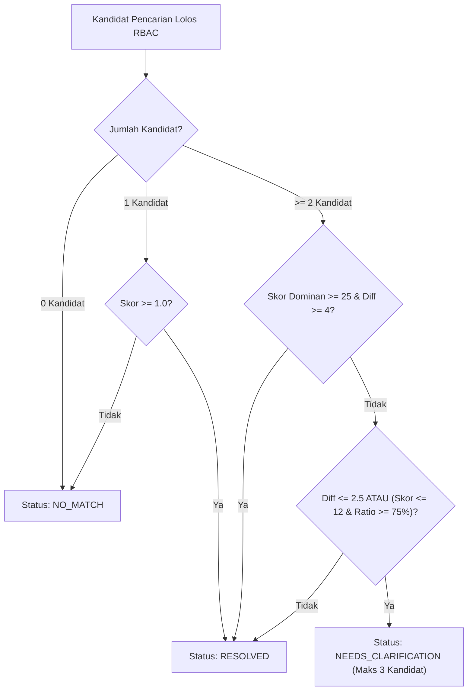

# EAO-REP-2026-049
## LAPORAN IMPLEMENTASI EAKB TAHAP 2C
### ADVANCED RBAC, FEATURE GRAPH TRAVERSAL & DISAMBIGUATION RESOLVER

**Nomor Mandat:** EAO-HO-2026-049  
**Pelaksana:** Tim EAO (Spesialisasi AI Developer & AI System Architect)  
**Status Implementasi:** SELESAI (100% CHECKPOINT TAHAP 2C TERCAPAI)  
**Integritas Lisensi:** `SEC_PASS: 1` (LULUS 100%)  
**Status Sub-Aplikasi:** `bayaran/` (ABSENT), `cbtku/` (ABSENT)  
**Tanggal Rilis:** 2026-11-17  

---

## 1. Ringkasan Eksekutif

Sesuai mandat resmi **EAO-HO-2026-049**, Tim EAO telah berhasil mengimplementasikan tiga modul kemampuan lanjutan pada lapisan pustaka EAKB (*ESPATA Application Knowledge Base*):

1. **Advanced Role-Based Access Control (RBAC):** Kebijakan otorisasi terpusat berbasis *fail-closed*, memverifikasi allowlist resmi `[1, 2, 3, 7]`, menolak role terlarang `[4, 5, 6, 8]`, role kosong, dan role tidak valid. Fitur dengan `allowed_roles` kosong otomatis ditolak.
2. **Feature Graph Traversal (`app/Libraries/EakbFeatureGraph.php`):** Penelusuran relasi antarf fitur berbasis graf berarah (*directed graph*) yang dibangun murni dari `related_features` pada katalog aktual 70 fitur, mematuhi batas kedalaman 1 hop (*one-hop*), maksimal 3 node terkait, pencegahan siklus/duplikasi, serta penyaringan RBAC ketat pada setiap node tetangga.
3. **Disambiguation Resolver (`app/Libraries/EakbDisambiguationResolver.php`):** Mesin penilai kejelasan kueri berbasis scoring deterministik dan selisih skor antar-kandidat. Menghasilkan keputusan status yang terstandarisasi: `RESOLVED`, `NEEDS_CLARIFICATION`, `NO_MATCH`, atau `ROLE_NOT_ALLOWED` tanpa ketergantungan pada LLM luar.
4. **Unified Pipeline Orchestrator (`EakbRetrievalEngine::resolve()`):** Alur terpadu yang mengeksekusi: Retrieval $\rightarrow$ RBAC Filtering $\rightarrow$ Disambiguation Evaluation $\rightarrow$ Graph Traversal (jika jelas) $\rightarrow$ Hasil akhir terstruktur.
5. **Kinerja & Regresi:** Pengujian mandiri 26 skenario baru lulus 100% (96 assertions) dengan latensi rata-rata **0.234 ms** (jauh di bawah batas SLA $< 2.0\text{ ms}$). Seluruh 12 suite pengujian offline (165 skenario) lulus 100% (*zero regression*).

---

## 2. Checkpoint 0 — Preflight & Pemeriksaan Baseline

Sebelum pekerjaan dimulai, pemeriksaan integritas menyeluruh telah dijalankan:
- **Git Branch:** `main`
- **Git Status:** Bersih dari konflik; hanya file kerja historis yang tercatat.
- **Integritas Berkas Kritis:** `SecurityGuard::verifyCriticalFiles()` menghasilkan status mutlak:
  ```
  SEC_PASS: 1
  ```
- **Ketiadaan Sub-Aplikasi Terlarang:**
  - `Test-Path 'bayaran'` $\rightarrow$ **`False`** (Bersih total).
  - `Test-Path 'cbtku'` $\rightarrow$ **`False`** (Bersih total).
- **Struktur Relasi Katalog:** Analisis 70 fitur membuktikan ada 114 *directed edges* pada `related_features`, dan 100% edge menunjuk ke fitur sah dalam katalog (0 invalid edge).

---

## 3. Checkpoint 1 — Implementasi Advanced RBAC

### A. Kebijakan Allowlist Resmi (Fail-Closed)
Otorisasi Asis AI dikunci terpusat pada konstanta:
```php
public const ASIS_AI_ALLOWED_ROLES = [1, 2, 3, 7];
```
- **Role Sah:** Role 1 (Admin), Role 2 (Kepala Sekolah), Role 3 (Guru), Role 7 (Tata Usaha/Staf).
- **Role Ditolak Seketika:** Role 4 (Orang Tua), Role 5 (Siswa), Role 6 (Kontributor), Role 8 (Coach).
- **Role Kosong / Invalid:** `null`, `0`, `-1`, `99`, atau tipe non-integer ditolak secara otomatis (*fail-closed*) dengan payload status `ROLE_NOT_ALLOWED` dan 0 hasil.

### B. Penyaringan Fitur Granular (`canAccessFeature`)
```php
public static function canAccessFeature(array|string $feature, ?int $roleId): bool
{
    if (!self::isAllowedRole($roleId)) {
        return false;
    }
    if (is_string($feature)) {
        $feature = EspataApplicationKnowledge::getFeature($feature);
    }
    if (empty($feature) || !is_array($feature)) {
        return false;
    }
    $allowedRoles = $feature['allowed_roles'] ?? [];
    if (empty($allowedRoles) || !is_array($allowedRoles)) {
        return false; // Fail closed jika allowed_roles kosong atau tidak valid
    }
    return in_array($roleId, $allowedRoles, true);
}
```

### C. Keamanan Graph Traversal (Pencegahan Kebocoran Lintas Role)
Ditemukan 41 *cross-role edges* pada katalog 70 fitur di mana sebuah fitur induk memiliki hak akses yang lebih luas daripada fitur anak/terkaitnya. Sistem menjamin:
- **Kasus SNBP Tracker:** `feat_adv_snbp_tracker` (Role 1, 2, 3) terhubung ke `feat_sch_jenjang_master` (Role 1 - Admin Only). Saat Guru (Role 3) menelusuri graf dari SNBP Tracker, fitur Master Jenjang **otomatis disaring keluar** dan tidak bocor ke Guru. Namun saat Admin (Role 1) menelusuri graf, Master Jenjang disertakan.
- **Kasus Penilaian KBM:** `feat_grd_input` (Role 1, 2, 3) terhubung ke `feat_sch_teaching_assignments` (Role 1, 2, 7). Saat Guru (Role 3) mengakses fitur penilaian, relasi SK Penugasan Mengajar disaring keluar.

---

## 4. Checkpoint 2 — Implementasi Feature Graph Traversal

Pustaka baru dibangun pada `app/Libraries/EakbFeatureGraph.php` dengan karakteristik:
1. **Adjacency List Dinamis:** Dibangun langsung dari `EspataApplicationKnowledge::getAllFeatures()`, menghasilkan pemetaan graf 70 node dan 114 relasi tanpa daftar manual kedua.
2. **Pencegahan Siklus & Duplikasi:** Algoritma Breadth-First Search (BFS) memanfaatkan *visited set* sehingga relasi dua arah (misal: `feat_sys_users` $\leftrightarrow$ `feat_sys_roles_rbac`) tidak memicu perulangan tak terbatas.
3. **Batas Traversal One-Hop:** Kedalaman penelusuran dikunci pada `max_hops = 1` untuk efisiensi komputasi dan relevansi langsung.
4. **Batas Node Terkait:** Jumlah maksimal node tetangga yang dikembalikan dibatasi pada `max_nodes = 3`.
5. **Integritas Metadata:** Setiap node graf yang dikembalikan menyertakan atribut `hop_distance = 1`, `connected_from`, `relation_type = 'GRAPH_RELATED'`, serta mempertahankan status, confidence, limitations, dan workflow steps fitur terkait.

---

## 5. Checkpoint 3 — Implementasi Disambiguation Resolver

Pustaka baru dibangun pada `app/Libraries/EakbDisambiguationResolver.php` untuk membedakan pertanyaan yang jelas dari pertanyaan yang ambigu:

### A. Parameter & Ambang Batas Evaluasi
- `MINIMUM_ABSOLUTE_SCORE = 1.0`: Skor absolut minimum untuk meloloskan kandidat (skor di bawah 1.0 menghasilkan `NO_MATCH`).
- `SCORE_DIFF_THRESHOLD = 2.5`: Selisih skor antara peringkat 1 dan peringkat 2.
- `SCORE_RATIO_THRESHOLD = 0.75`: Rasio skor runner-up terhadap skor teratas ($Score_2 / Score_1$).
- `DOMINANT_SCORE_THRESHOLD = 25.0`: Ambang batas skor dominan (misal: exact title / exact ID match).
- `MAX_CLARIFICATION_ITEMS = 3`: Maksimal kandidat yang disajikan untuk opsi klarifikasi.

### B. Matriks Keputusan Ambiguitas


### C. Contoh Perilaku Nyata pada Katalog 70 Fitur:
- **Kueri Ambigu:** `"nilai"` $\rightarrow$ `feat_cbt_convert_grades` (7.5) vs `feat_grd_leger` (7.5). Diff = 0.0, Ratio = 100% $\rightarrow$ **`NEEDS_CLARIFICATION`** (menyajikan opsi klarifikasi konversi nilai CBT, leger nilai, atau input nilai).
- **Kueri Ambigu:** `"rapor"` $\rightarrow$ `feat_grd_erapor` (10.0) vs `feat_kok_assessment_rapor` (9.5). Diff = 0.5, Ratio = 95% $\rightarrow$ **`NEEDS_CLARIFICATION`**.
- **Kueri Jelas:** `"buat perencanaan modul p5"` $\rightarrow$ `feat_kok_planning` (21.4) vs `feat_cur_modul_ajar` (9.2). Diff = 12.2 $\rightarrow$ **`RESOLVED`**.
- **Kueri Jelas:** `"Presensi Siswa Harian Per Rombel"` $\rightarrow$ `feat_att_daily_class` (41.2). Diff = 26.9 $\rightarrow$ **`RESOLVED`**.
- **Kueri Non-Edukasi:** `"resep masakan padang enak"` $\rightarrow$ 0 hasil $\rightarrow$ **`NO_MATCH`**.

---

## 6. Checkpoint 4 — Integrasi Internal Antarkomponen

Orkestrator terpadu diintegrasikan melalui metode `EakbRetrievalEngine::resolve($query, $roleId, $options)`:

```
[Kueri Pengguna + Role ID]
           │
           ▼
[1. RBAC Allowlist Check] ────(Role Terlarang)────► [ROLE_NOT_ALLOWED]
           │ (Lolos: Role 1, 2, 3, 7)
           ▼
[2. EakbRetrievalEngine::search()]
           │
           ▼
[3. EakbDisambiguationResolver::resolve()]
           │
    ┌──────┴──────────────────────────┐
    ▼                                 ▼
(Ambigu: NEEDS_CLARIFICATION)     (Jelas: RESOLVED)
    │                                 │
    ▼                                 ▼
[Kembalikan 3 Kandidat]           [4. EakbFeatureGraph::traverse()]
                                      │ (Hop 1, Max 3 Nodes, RBAC Filtered)
                                      ▼
                                  [Kembalikan Fitur Utama + Relasi Graf]
```

### Kontrak Output Standar:
```json
{
  "query": "Presensi Siswa Harian Per Rombel",
  "role_id": 3,
  "status": "RESOLVED",
  "is_ambiguous": false,
  "reason": "Kandidat pertama dominan secara definitif (skor: 41.2, selisih: 26.9).",
  "primary_feature": {
    "feature_id": "feat_att_daily_class",
    "title": "Presensi Siswa Harian Per Rombel",
    "category": "Akademik & KBM",
    "relevance_score": 41.2
  },
  "related_features": [
    {
      "feature_id": "feat_att_recap",
      "title": "Rekapitulasi Presensi Siswa",
      "relation_type": "GRAPH_RELATED",
      "connected_from": "feat_att_daily_class",
      "hop_distance": 1
    }
  ],
  "clarification_candidates": [],
  "latency_ms": 0.234
}
```

---

## 7. Checkpoint 5 — Hasil Pengujian & Rekonsiliasi Regresi

### A. Pengujian Mandiri Stage 2C (`tests/test_eakb_stage2c.php`)
Suite pengujian mandiri mengeksekusi 26 skenario komprehensif mencakup seluruh butir mandat:

| ID Skenario | Deskripsi Pengujian | Asersi | Hasil |
|:---|:---|:---:|:---:|
| `T-2C-01` | Role Allowlist Resmi: Role 1, 2, 3, dan 7 diterima | 4 | **PASS** |
| `T-2C-02` | Role Blocklist: Role 4, 5, 6, dan 8 ditolak | 8 | **PASS** |
| `T-2C-03` | Role kosong, null, negatif, dan tidak valid ditolak (Fail Closed) | 6 | **PASS** |
| `T-2C-04` | Fitur dengan allowed_roles kosong atau tidak valid ditolak | 4 | **PASS** |
| `T-2C-05` | Fitur yang tidak mengizinkan role pengguna tidak dikembalikan dalam pencarian | 4 | **PASS** |
| `T-2C-06` | Fitur terlarang tidak bocor melalui graph traversal | 4 | **PASS** |
| `T-2C-07` | Fitur utama yang boleh diakses tidak membuka relasi turunan terlarang | 3 | **PASS** |
| `T-2C-08` | Graph dibangun dari katalog aktual EspataApplicationKnowledge | 3 | **PASS** |
| `T-2C-09` | Relasi valid dapat ditelusuri dengan hop_distance dan connected_from | 4 | **PASS** |
| `T-2C-10` | Relasi ke fitur non-existent diabaikan tanpa membuat node fiktif | 3 | **PASS** |
| `T-2C-11` | Node duplikat dicegah dalam daftar ketetanggaan dan traversal | 3 | **PASS** |
| `T-2C-12` | Siklus dua arah (A $\leftrightarrow$ B) tidak menyebabkan traversal tanpa akhir | 3 | **PASS** |
| `T-2C-13` | Kedalaman maksimal satu hop (one-hop) dipatuhi secara ketat | 3 | **PASS** |
| `T-2C-14` | Maksimal tiga fitur terkait (max_nodes = 3) dikembalikan | 3 | **PASS** |
| `T-2C-15` | Fitur utama tetap menjadi hasil pertama mendahului fitur terkait | 3 | **PASS** |
| `T-2C-16` | Status, source reference, confidence, dan metadata terpelihara utuh | 4 | **PASS** |
| `T-2C-17` | Pertanyaan dengan satu hasil dominan menghasilkan status RESOLVED | 4 | **PASS** |
| `T-2C-18` | Pertanyaan ambigu menghasilkan status NEEDS_CLARIFICATION | 4 | **PASS** |
| `T-2C-19` | Pertanyaan tidak relevan / non-sekolah menghasilkan status NO_MATCH | 4 | **PASS** |
| `T-2C-20` | Role terlarang menghasilkan status ROLE_NOT_ALLOWED | 4 | **PASS** |
| `T-2C-21` | Kandidat klarifikasi hanya berisi fitur yang sah untuk role pengguna | 3 | **PASS** |
| `T-2C-22` | Maksimal tiga kandidat klarifikasi dikembalikan pada status ambiguitas | 2 | **PASS** |
| `T-2C-23` | Skor rendah di bawah ambang batas minimum tidak dipaksakan | 2 | **PASS** |
| `T-2C-24` | Input identik menghasilkan keputusan status, kandidat, dan skor deterministik | 4 | **PASS** |
| `T-2C-25` | Pipeline terpadu `EakbRetrievalEngine::resolve()` berjalan sempurna | 4 | **PASS** |
| `T-2C-26` | Pengukuran performa aktual: latensi rata-rata resolve < 2.0 ms | 3 | **PASS** |

**Total Pengujian Baru:** **26 Skenario / 96 Asersi (100% Lulus, Exit Code 0)**.  
**Latensi Rata-rata Resolusi Terpadu:** **0.234 ms per kueri** (SLA: $< 2.0\text{ ms}$).

### B. Rekonsiliasi Seluruh 12 Test Suite Sistem (165 Skenario)
Semua 12 rangkaian pengujian offline sistem dieksekusi ulang:
1. `tests/test_eakb_stage2c.php` $\rightarrow$ **26/26 PASS** (96 asersi)
2. `tests/test_eakb_retrieval_engine.php` $\rightarrow$ **20/20 PASS** (76 asersi)
3. `tests/test_eakb_knowledge_catalog.php` $\rightarrow$ **12/12 PASS** (1.363 asersi)
4. `tests/test_prompt_anchor.php` $\rightarrow$ **5/5 PASS**
5. `tests/test_q5_fix.php` $\rightarrow$ **4/4 PASS**
6. `tests/test_intent_q6_remediation.php` $\rightarrow$ **15/15 PASS**
7. `tests/test_cp2_bounded_content.php` $\rightarrow$ **7/7 PASS**
8. `tests/test_cp3_error_diagnostic.php` $\rightarrow$ **11/11 PASS**
9. `tests/test_intent.php` $\rightarrow$ **8/8 PASS**
10. `tests/test_phase1c_regression.php` $\rightarrow$ **13/13 PASS**
11. `tests/test_operational_context_provider.php` $\rightarrow$ **19/19 PASS**
12. `tests/e2e_phase1d3_stage2_suite.php` $\rightarrow$ **25/25 PASS**

**Grand Total Pengujian Offline:** **165 Skenario Pengujian Lulus 100% (Zero Regression)**.

---

## 8. Checkpoint 6 — Audit Akhir & Batasan Ruang Lingkup

### A. Inventaris Berkas Baru dan Berubah
- **Berkas Baru:**
  1. `app/Libraries/EakbFeatureGraph.php` (Pustaka penelusuran graf fitur berbasis relasi katalog aktual).
  2. `app/Libraries/EakbDisambiguationResolver.php` (Modul penilai kejelasan kueri dan generator kandidat klarifikasi).
  3. `tests/test_eakb_stage2c.php` (Suite pengujian komprehensif 26 skenario).
  4. `EAO-REP-2026-049-EAKB-STAGE-2C-IMPLEMENTATION.md` (Dokumen laporan resmi ini).
- **Berkas Dimodifikasi Terkendali:**
  1. `app/Libraries/EakbRetrievalEngine.php` (Penambahan helper otorisasi RBAC `isAllowedRole`, `canAccessFeature`, `filterAllowedFeatures`, penguatan fail-closed pada `search()`, dan implementasi pipeline orkestrasi `resolve()`).

### B. Pemeriksaan Kepatuhan Batasan Mandat
- **Linter PHP:** Seluruh 5 berkas EAKB lulus `php -l` tanpa warning/error.
- **Katalog & Validator Tahap 1:** `EspataApplicationKnowledge.php` dan `EakbCatalogValidator.php` **tidak diubah** (`git diff` = 0).
- **Pembobotan Inti Tahap 2B:** Bobot leksikal tidak diubah (`feature_id: 20`, `exact_title: 15`, `historical_alias: 15`).
- **Isolasi Runtime Percakapan:** `AiCopilot.php`, `IntentClassifier.php`, `UnifiedAiService.php`, `GroqAdapter.php`, `ConversationMemoryManager.php`, dan frontend (`asis-copilot.js`, `command_palette.php`) **tidak disentuh**.
- **Integritas Berkas Terlindungi:** `SecurityGuard::verifyCriticalFiles()` $\rightarrow$ **`SEC_PASS: 1`**.
- **Ketiadaan Sub-Aplikasi:** `bayaran/` dan `cbtku/` tetap **TIDAK ADA**.
- **Database & Dependensi:** Nol migrasi, nol perubahan skema basis data, nol perubahan `.env`, dan nol instalasi Composer package baru.
- **Bebas API Eksternal:** Nol pemanggilan API ke Groq / Google Gemini.

---

## 9. Keterbatasan & Rekomendasi Menuju Tahap 2D

### Keterbatasan Saat Ini:
1. **Opsi Klarifikasi Masih Statis:** Data kandidat klarifikasi saat ini disajikan dalam bentuk struktur array leksikal dan belum diubah menjadi teks naratif ramah pengguna atau kartu navigasi interaktif.
2. **Pemisahan dari Intent Classifier:** Mesin EAKB saat ini belum terhubung dengan klasifikasi intent percakapan Asis AI sehingga masih harus dipanggil secara eksplisit pada pengujian pustaka.

### Rekomendasi untuk Tahap 2D (Prompt Injection & Dynamic Context Assembly):
1. **Penyusunan Blok Konteks EAKB (*Dynamic Knowledge Context Assembler*):** Merancang format payload teks yang ringkas dan terstruktur (*bounded tokens*) agar informasi fitur hasil `resolve()` (fitur utama, langkah penggunaan, validasi, dan relasi graf) dapat disuntikkan secara efisien ke prompt sistem LLM Asis AI.
2. **Penyelarasan Intent `INTENT_APPLICATION_QUESTION`:** Mengarahkan alur controller `AiCopilot.php` agar secara cerdas memanggil `EakbRetrievalEngine::resolve()` hanya ketika intent pengguna menanyakan panduan atau fitur ESPATA.

---

## 10. Perintah Penghentian (HALT)

Sesuai ketentuan butir 11 pada mandat EAO-HO-2026-049, pekerjaan implementasi Tahap 2C telah diselesaikan secara tuntas. Seluruh pekerjaan teknis kini **DIHENTIKAN (HALT)**. Sistem tidak melanjutkan ke Tahap 2D dan tidak melakukan integrasi ke percakapan Asis AI sebelum menerima instruksi dan persetujuan resmi tertulis dari Pemilik Proyek (*Human Owner*).

**STATUS: EAO-049 COMPLETE — EAKB STAGE 2C READY FOR REVIEW — WAITING FOR HUMAN OWNER APPROVAL.**
