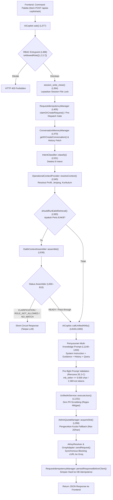

# EAO-REP-2026-060A — LAPORAN IMPLEMENTATION PREFLIGHT EAKB STAGE 2E.2
**Status Mandat:** STAGE 2E.2-A SELESAI — BASELINE VERIFIED & READY FOR STAGE 2E.2-B  
**Referensi Mandat:** `EAO-HO-2026-060`  
**Fokus Mandat:** Implementation Preflight, Pemetaan Arsitektur, Verifikasi Titik Integrasi, dan Analisis Risiko Regresi  
**Pelaksana:** Tim EAO (AI System Architect, AI Backend Engineer, AI QA Engineer, AI Security Reviewer)  
**Human Owner:** ESPATA Project Owner  
**Sifat Mandat:** READ-ONLY / PREFLIGHT-ONLY (0 Edit Kode Produksi, 0 Migrasi Database, 0 API Calls Live LLM)  
**Status Pasca-Preflight:** **STRICT HALT — WAITING FOR HUMAN OWNER APPROVAL (STAGE 2E.2-B AUTHORIZATION)**

---

## 1. RINGKASAN EKSEKUTIF PREFLIGHT

Berdasarkan mandat Human Owner `EAO-HO-2026-060`, Tim EAO telah melaksanakan tahap **Stage 2E.2-A — Implementation Preflight** secara menyeluruh. Preflight ini menetapkan baseline resmi, memetakan seluruh arsitektur aktual Asis AI, memverifikasi ketiadaan konflik kode, dan menyusun rencana teknis implementasi konkret sebelum modifikasi kode produksi Stage 2E.2 dimulai.

Hasil utama pemeriksaan:
1. **Baseline Git Terverifikasi (`BASELINE_VERIFIED`):** Branch aktif adalah `main`. 5 berkas *tracked* yang termodifikasi di working tree sepenuhnya teridentifikasi dan diklasifikasikan ke dalam artefak kerja Fase 1C, 1D, dan 2E.1 terdahulu (tidak ada kode tak dikenal atau regresi).
2. **Peta Titik Integrasi Konkret:**
   - **Educational Knowledge:** Ditetapkan pada `app/Libraries/EspataEducationalKnowledge.php` sebagai pustaka statis-kondisional pedagogik (Kurikulum Merdeka BSKAP 033/2022, 8 Profil Lulusan ESPATA, pedoman KKTP interval rubrik, tugas ajar adaptif Fase A-F) dengan batas wewenang tegas (*non-RBAC, zero feature claims*).
   - **Multi-Knowledge Prompt Integration:** Dipetakan pada `AiCopilot::callUnifiedAiNlu()` (baris 1148–1235) dengan pembagian blok XML semantik eksplisit.
   - **Pre-flight Prompt Validation:** Ditetapkan sebelum pemanggilan cURL ke provider, mengukur panjang string UTF-8 dengan batas konservatif 9.000 karakter (`ceil(9000 / 3.8) = 2.369 <= 2.400 estimated tokens`) serta pemangkasan darurat riwayat percakapan.
3. **Integritas Sistem & Lisensi:** `SecurityGuard::verifyCriticalFiles()` menghasilkan **`SEC_PASS: 1`**, zona terlarang `bayaran/` dan `cbtku/` tetap berstatus bersih (`False`).
4. **Kesiapan Gerbang (Gate Status):** Kriteria Penerimaan Stage 2E.2-A dinyatakan **`PASS`**. Baseline dinyatakan siap menerima implementasi kode Stage 2E.2-B setelah memperoleh otorisasi tertulis dari Human Owner.

---

## 2. PEMERIKSAAN GIT & KLASIFIKASI ASAL-USUL PERUBAHAN

### 2.1 Kondisi Branch & Status Working Tree
- **Active Branch:** `main`
- **Output `git status --short` (Tracked Files):**
  ```text
   M .gitignore
   M app/Config/Routes.php
   M app/Controllers/Admin/Kokurikuler.php
   M app/Controllers/Api/AiCopilot.php
   M app/Views/layouts/partials/command_palette.php
  ```
- **Output `git diff --stat`:**
  ```text
   .gitignore                                     |    2 +
   app/Config/Routes.php                          |    2 +
   app/Controllers/Admin/Kokurikuler.php          |   39 +-
   app/Controllers/Api/AiCopilot.php              | 1148 ++++++++++++++++++++----
   app/Views/layouts/partials/command_palette.php |  218 ++++-
   5 files changed, 1185 insertions(+), 224 deletions(-)
  ```

### 2.2 Klasifikasi Forensik Asal-Usul Perubahan Terdahulu
Sesuai instruksi khusus Bagian 4.2 mandat `EAO-HO-2026-060`, kelima berkas *tracked* tersebut diverifikasi secara rinci:

| Nama Berkas | Baris Berubah | Asal-Usul Tahap Kerja | Status Verifikasi | Ringkasan Fungsional Perubahan |
|:---|:---:|:---:|:---:|:---|
| `.gitignore` | +2 | **Fase 1D.1 / 1D.2** | `VERIFIED` | Menambahkan pengecualian artefak pengujian sesi: `tests/cookie_*.txt` dan `tests/cookie_*.txt.*`. |
| `app/Config/Routes.php` | +2 | **Fase 1D.2** | `VERIFIED` | Menambahkan endpoint riwayat percakapan: `api/ai-copilot/conversation/(:any)` dan `api/ai-copilot/conversation/new`. |
| `app/Controllers/Admin/Kokurikuler.php` | +15, -12 | **Fase 1C (EAO-004)** | `VERIFIED` | Remediasi keamanan: Menghapus fallback silang ke API Key guru lain di tabel `teachers`, menambahkan fallback aman ke admin di tabel `users`, dan memperbaiki sintaks `orderBy` raw SQL. |
| `app/Controllers/Api/AiCopilot.php` | +1148, -224 | **EAKB Stage 2E.1** (EAO-053 s.d. 055) | `VERIFIED` | Integrasi runtime EAKB retrieval (`shouldRunEakbRetrieval`), perakitan konteks (`EakbContextAssembler::assemble`), dan penanganan *short-circuit* (Klarifikasi, Role Not Allowed, Limit Exceeded, No Match). Terbukti utuh dan aman pada audit forensik EAO-054 dan EAO-055. |
| `app/Views/layouts/partials/command_palette.php` | +218, -12 | **Fase 1D.2 / 1D.3** | `VERIFIED` | Penambahan toolbar sesi percakapan, transmisi `client_message_id`, `conversation_id`, chips saran interaktif (*interactive suggestions*), dan penanganan kode status HTTP (401, 404, 409, 410, 429). |

**Pernyataan Tim EAO:**  
Tidak ada berkas yang berstatus `BASELINE_UNVERIFIED`. Seluruh perubahan working tree adalah artefak sah dari tahapan sebelumnya yang wajib dilestarikan. Tidak ada tindakan `reset`, `checkout`, `restore`, `clean`, atau `stash` yang dilakukan.

---

## 3. PETA ARSITEKTUR AKTUAL ASIS AI & TITIK INTEGRASI

Pemeriksaan kode aktual terhadap 10 komponen inti Asis AI memetakan alur permintaan (*request lifecycle*) secara komprehensif:



### 3.1 Pemetaan Detail Komponen & Nomor Baris Kode Aktual

1. **`app/Controllers/Api/AiCopilot.php`:**
   - **Entrypoint `ask()` (Baris 377):** Menerima kueri, memvalidasi CSRF, dan mengekstrak payload sesi.
   - **RBAC Server-side (Baris 388):** Memeriksa `EakbRetrievalEngine::isAllowedRole($roleId)` untuk memastikan hanya Role 1, 2, 3, dan 7 yang dapat masuk.
   - **Session Lock Release (Baris 394):** Memanggil `session_write_close()` sebelum proses komputasi panjang dan pemanggilan I/O jaringan sinkron untuk mencegah *lock contention*.
   - **Klasifikasi Intent (Baris 531):** `$intentClassification = IntentClassifier::classify($query);`.
   - **Konteks Operasional (Baris 537–570):** Pemanggilan `$this->getContextProvider()->resolveContext(...)`.
   - **Selective EAKB Retrieval (Baris 583–636):** Evaluasi `shouldRunEakbRetrieval($query, $intentType)` dan eksekusi `EakbContextAssembler::assemble($query, $roleId, ...)`.
   - **Short-Circuit Handlers (Baris 650–810):** Penanganan deterministik untuk `STATUS_NEEDS_CLARIFICATION`, `STATUS_ROLE_NOT_ALLOWED`, `STATUS_CONTEXT_LIMIT_EXCEEDED`, `STATUS_INVALID_RETRIEVAL_RESULT`, dan `STATUS_NO_MATCH`.
   - **Titik Integrasi Prompt Terpadu (`callUnifiedAiNlu`, Baris 1083–1290):** Lokasi penggabungan instruksi sistem, katalog aksi berizin, blok pengetahuan EAKB (baris 1148), dan konteks operasional.
2. **`app/Services/Ai/UnifiedAiService.php`:**
   - **Sanitasi Zero PII (Baris 205 & 343 / Implementasi Baris 448–500):** Menyaring NIK (16 digit), NISN (10 digit), dan nomor telepon sebelum prompt dikirim.
   - **Admin Quota Acquisition (Baris 222 & 358):** Memanggil `AdminQuotaManager::acquireSlot()` untuk alokasi kuota fallback harian (maksimal 20 generasi/hari Asia/Jakarta).
   - **Dispatch Provider (Baris 139 & 270):** Mengirim request ke adapter provider (Groq).
3. **`app/Services/Ai/Intent/IntentClassifier.php`:**
   - Mendefinisikan 8 intent resmi: `GENERAL_CONVERSATION`, `APPLICATION_QUESTION`, `KNOWLEDGE_RETRIEVAL`, `TASK_ASSISTANCE`, `NAVIGATION`, `ACTION_REQUEST`, `CLARIFICATION`, `UNSUPPORTED_REQUEST`.
4. **`app/Libraries/EakbRetrievalEngine.php` & `EakbContextAssembler.php`:**
   - Mesin pencari in-memory 70 fitur dan perakit blok semantik `<espata_application_knowledge>` dengan batas 600 estimated tokens mutlak (*fail-closed*).
5. **`app/Libraries/EspataApplicationKnowledge.php`:**
   - Katalog kanonik 70 fitur ESPATA, relasi graf ketergantungan, peran sah per-fitur, dan status modul (`ACTIVE`, `LIMITED`, `INACTIVE`).
6. **`app/Services/Ai/OperationalContextProvider.php`:**
   - Menyediakan fakta dinamis pengguna: Tahun Pelajaran, Semester, Jenjang Sekolah, Kurikulum aktif, Mata Pelajaran, dan Rombel Ajar.
7. **`app/Services/Ai/Memory/ConversationMemoryManager.php`:**
   - Mengelola riwayat percakapan pengguna (maksimal 3–4 turn terakhir / 450 estimated tokens).
8. **`app/Services/Ai/AdminQuotaManager.php` & `RequestIdempotencyManager.php`:**
   - Menjamin tata kelola kuota fallback admin (20 slot/hari, *atomic refund* pada kegagalan cURL) dan idempotensi permintaan pengguna (*lease duration* 60 detik, retensi payload 7 hari).

---

## 4. RENCANA TEKNIS EDUCATIONAL KNOWLEDGE (STAGE 2E.2-B)

### 4.1 Lokasi & Struktur Data
Pustaka Educational Knowledge akan diimplementasikan sebagai kelas mandiri di:
`app/Libraries/EspataEducationalKnowledge.php` (Namespace: `App\Libraries`).

Struktur ini dipilih karena:
- Selaras dengan `EspataApplicationKnowledge.php` yang berada di `app/Libraries/`.
- Bebas dependensi database (*pure in-memory PHP lookup*), berkinerja tinggi, dan mudah diuji secara unit test (*100% deterministic / 0 token*).

### 4.2 Format Data & Sumber Pedagogik Terkurasi
Pustaka memuat konstanta array terstruktur dari sumber resmi pendidikan:
1. **Kurikulum Merdeka (BSKAP No. 033/H/KR/2022):**
   - Struktur Fase Pembelajaran: Fase A (Kelas 1–2 SD), Fase B (Kelas 3–4 SD), Fase C (Kelas 5–6 SD), Fase D (Kelas 7–9 SMP), Fase E (Kelas 10 SMA), Fase F (Kelas 11–12 SMA).
   - Karakteristik capaian pembelajaran dan tingkat kompleksitas bahasa per-fase.
2. **Kriteria Ketercapaian Tujuan Pembelajaran (KKTP):**
   - Penegasan bahwa Kurikulum Merdeka **tidak lagi menggunakan angka statis tunggal KKM**.
   - Penggunaan 3 pendekatan KKTP: Deskripsi Kriteria, Rubrik Interval/Skala Deskriptif, dan Persentase Interval Nilai.
3. **8 Profil Lulusan ESPATA (Penguatan Karakter & Kokurikuler):**
   - Keimanan & Ketakwaan, Kewargaan Global, Gotong Royong, Kemandirian, Bernalar Kritis, Kreativitas, Komunikasi, dan Kepemimpinan.
   - Skala evaluasi kualitatif kokurikuler: MB (Mulai Berkembang), SB (Sedang Berkembang), BSH (Berkembang Sesuai Harapan), SAB (Sangat Berkembang).
4. **Pedoman Perancangan Tugas Ajar & Format Soal:**
   - Pola penyusunan instrumen penilaian formatif dan sumatif.
   - Format standar soal pilihan ganda (pertanyaan, opsi A-D/E, kunci jawaban, dan pembahasan ringkas).

### 4.3 Aturan Pemilihan Materi Berdasarkan Intent & Konteks
Pustaka menyediakan method:
```php
public static function getGuidance(string $intentType, ?OperationalContextDTO $opContext = null, ?string $query = null): ?string
```
- **Kondisi Injeksi:**
  - Jika `$intentType === IntentClassifier::INTENT_TASK_ASSISTANCE`: Injeksi pedoman pembuatan materi/tugas ajar adaptif sesuai fase jenjang guru (`Fase A` s.d. `Fase F`).
  - Jika `$intentType === IntentClassifier::INTENT_KNOWLEDGE_RETRIEVAL`: Injeksi pedoman KKTP atau Kurikulum Merdeka jika kueri mengandung kata kunci evaluasi/asesmen.
  - Jika kueri terkait Kokurikuler: Injeksi rubrik 8 Profil Lulusan dan skala kualitatif (MB, SB, BSH, SAB).
- **Penanganan Kueri Pendidikan Murni (Tanpa Application Knowledge):**
  - Jika kueri guru menanyakan materi pedagogik murni (misal: *"Jelaskan fotosintesis untuk anak SMP"* atau *"Buatkan rubrik asesmen seni budaya"*), sistem menyajikan blok `<educational_guidance>` secara utuh **tanpa memaksakan blok aplikasi ESPATA atau navigasi palsu**.

### 4.4 Batas Wewenang Mutlak (Non-RBAC & Zero Feature Claims)
1. **Dilarang Menjadi Otoritas RBAC:** Educational Knowledge adalah materi pembimbing pedagogik semata. Hak akses pengguna ke fitur ESPATA tetap 100% diputuskan oleh `$roleId` sesi server.
2. **Dilarang Membuat Klaim Fitur Aplikasi:** Teks Educational Knowledge dilarang menyatakan bahwa ESPATA memiliki menu/tombol/fitur yang belum ada di katalog kanonik `EspataApplicationKnowledge`.
3. **Penyelesaian Konflik Teori vs Aplikasi (Resolusi K-01):** Jika ada benturan antara teori pendidikan eksternal dengan fitur aplikasi (misal guru meminta sinkronisasi otomatis nilai ke Dapodik), Application Knowledge menang mutlak: sistem wajib menyatakan bahwa sinkronisasi otomatis belum tersedia (`INACTIVE`) dan mengarahkan ke ekspor Excel lokal.

---

## 5. RENCANA INTEGRASI MULTI-KNOWLEDGE PROMPT & VALIDASI (STAGE 2E.2-C)

### 5.1 Struktur Assembled Prompt Final
Penggabungan tiga kelas pengetahuan dilakukan pada `AiCopilot::callUnifiedAiNlu()` dengan skema blok semantik:

```text
[System Instruction Layer]
1. Persona & Aturan Global Asis AI (ESPATA Assistant, Bahas Indonesia Santun)
2. Batas Otoritas & Pencegahan Halusinasi Fitur
3. <espata_application_knowledge> (Maksimal 600 estimated tokens fail-closed)
4. <educational_guidance> (Maksimal 350 estimated tokens dari EspataEducationalKnowledge)
5. <operational_context> (Maksimal 250 estimated tokens dari OperationalContextProvider)

[Context & History Layer]
6. Multi-Turn Conversation History (Maksimal 3–4 turn terakhir / 450 estimated tokens)

[User Prompt Layer]
7. User Current Query + Action Catalog Filtered (Maksimal 10/40 aksi / 300 estimated tokens)
```

### 5.2 Rencana Validasi Batas Karakter & Overflow (K-01)
Implementasi pre-flight validation ditempatkan tepat sebelum request cURL dieksekusi:
1. **Titik Pengukuran:** Tepat setelah string `$systemInstruction` dan `$promptPayload` selesai dirakit, sebelum instansiasi `AiRequest` dikirim ke `UnifiedAiService::executeJson()`.
2. **Metode Penghitungan Karakter:** Menggunakan fungsi standar PHP berbasis multibyte:
   ```php
   $totalCharacters = mb_strlen($assembledSystemInstruction . "\n\n" . $userPrompt, 'UTF-8');
   ```
3. **Ambang Karakter Konservatif 9.000 Karakter:**
   - Dihitung estimasi heuristik: `ceil($totalCharacters / 3.8)`.
   - Batas ambang: Jika `$totalCharacters > 9000` (atau estimasi token melampaui 2.369 token):
     - **Tindakan Penyelamatan (Fallback Mitigasi):** Sistem otomatis memangkas riwayat percakapan menjadi 2 turn terakhir dan menghapus riwayat pesan asisten terpanjang.
     - **Proteksi Overflow Provider (Fail-Closed):** Jika setelah pemadatan darurat panjang karakter tetap melampaui batas dan output tokenisasi provider mendeteksi > 2.400 token, request dibatalkan dengan pesan kesalahan ramah (*"Pertanyaan atau konteks terlalu panjang. Harap persempit pertanyaan Anda."*).
4. **Batas EAKB 600 Token Fail-Closed:**  
   Pemeriksaan `EakbContextAssembler::estimateTokens($knowledgeBlock) <= 600` tetap berlaku di hulu. Jika melebihi 600 token, assembler seketika mengembalikan `STATUS_CONTEXT_LIMIT_EXCEEDED` tanpa mengirimkan ke LLM.

---

## 6. ANALISIS RISIKO REGRESI & MITIGASI KEAMANAN

| Area Fungsional | Potensi Risiko Regresi | Strategi Mitigasi Teruji | Verifikasi Uji |
|:---|:---|:---|:---|
| **Tata Kelola Kuota Admin (Fase 1C)** | Panggilan AI baru menguras kuota harian sekolah tanpa tercatat. | Seluruh request LLM wajib melalui `UnifiedAiService::executeJson()` yang memanggil `AdminQuotaManager::acquireSlot()` (plafon 20/hari) dan *atomic refund* jika cURL gagal. | `tests/test_phase1c_regression.php` |
| **Idempotensi & Concurrency (Fase 1C)** | Pengiriman ganda (*double-click*) dari browser memicu eksekusi ganda LLM. | Pengecekan `RequestIdempotencyManager::claimOrCreateRequest()` dengan *lease lock* 60 detik tetap aktif di gerbang awal controller `ask()`. | `tests/unit/RequestIdempotencyManagerTest.php` |
| **Privasi Pengguna (Zero PII)** | Konteks operasional atau tugas ajar membocorkan NIK guru atau NISN siswa ke Groq. | `UnifiedAiService::sanitizeZeroPii()` menyaring seluruh pola angka 10 digit, 16 digit, dan nomor telepon sebelum cURL. DTO melarang NIK/NISN. | `tests/test_operational_context_provider.php` |
| **Feature RBAC (Fase 2C/2D)** | Guru (Role 3) atau TU (Role 7) melihat detail fitur atau prasyarat modul yang terlarang bagi mereka. | Assembler mengembalikan `STATUS_ROLE_NOT_ALLOWED` secara *fail-closed* tanpa membocorkan status LIMITED atau panduan alur fitur. | `tests/test_eakb_stage2c.php` |
| **Session Starvation (Fase 1D/2E)** | Request Groq yang memakan waktu 2–4 detik memblokir tab browser lain milik pengguna. | `session_write_close()` dieksekusi pada baris 394 sebelum operasi cURL sinkron. | Audit Baris 394 `AiCopilot.php` |
| **Integritas Lisensi Sistem** | Modifikasi kode tidak sengaja menyentuh helper atau guard lisensi. | 6 file lisensi diawasi mutlak oleh `SecurityGuard::verifyCriticalFiles()`. | CLI `SEC_PASS: 1` |

---

## 7. RENCANA TAHAPAN IMPLEMENTASI BERIKUTNYA (STAGE 2E.2-B S.D. 2E.2-F)

Sesuai pola **STAGED IMPLEMENTATION WITH EXPLICIT APPROVAL GATES**, tahapan lanjutan dirancang sebagai berikut:

```text
┌─────────────────────────────────────────────────────────────────────────────┐
│ TAHAP 2E.2-A: IMPLEMENTATION PREFLIGHT [SELESAI - STATUS: PASS]             │
└──────────────────────────────────────┬──────────────────────────────────────┘
                                       │ Menunggu Otorisasi Human Owner
┌──────────────────────────────────────▼──────────────────────────────────────┐
│ TAHAP 2E.2-B: EDUCATIONAL KNOWLEDGE IMPLEMENTATION [STATUS: LOCKED]         │
│ - Buat app/Libraries/EspataEducationalKnowledge.php                         │
│ - Tulis tests/test_eakb_stage2e2_educational_knowledge.php (Unit Test)      │
│ - Verifikasi 0 Live Token, 0 Regression, SEC_PASS: 1                        │
└──────────────────────────────────────┬──────────────────────────────────────┘
                                       │ Menunggu Otorisasi Human Owner
┌──────────────────────────────────────▼──────────────────────────────────────┐
│ TAHAP 2E.2-C: MULTI-KNOWLEDGE PROMPT INTEGRATION [STATUS: LOCKED]           │
│ - Integrasikan Educational Knowledge ke AiCopilot::callUnifiedAiNlu()        │
│ - Terapkan validasi karakter pre-flight (max 9.000 char / 2.369 est token)  │
│ - Terapkan proteksi pemangkasan darurat riwayat multi-turn                   │
└──────────────────────────────────────┬──────────────────────────────────────┘
                                       │ Menunggu Otorisasi Human Owner
┌──────────────────────────────────────▼──────────────────────────────────────┐
│ TAHAP 2E.2-D: DETERMINISTIC BENCHMARK — 46 TESTS [STATUS: LOCKED]           │
│ - Tulis dan jalankan tests/test_eakb_stage2e2_benchmark_50.php              │
│ - Verifikasi 12 Unit + 18 Integration + 8 Security + 8 Mock Contract = 46/46│
│ - 0 Live LLM API Calls / 0 Token Groq Terpakai                              │
└──────────────────────────────────────┬──────────────────────────────────────┘
                                       │ Menunggu Otorisasi Human Owner
┌──────────────────────────────────────▼──────────────────────────────────────┐
│ TAHAP 2E.2-E: SECURITY & REGRESSION GATE [STATUS: LOCKED]                   │
│ - Jalankan seluruh 12 test suite regresi primer (171 skenario, 1.747 asersi)│
│ - Verifikasi SEC_PASS: 1 dan ketiadaan sub-aplikasi bayaran/cbtku           │
└──────────────────────────────────────┬──────────────────────────────────────┘
                                       │ Menunggu Otorisasi Human Owner
┌──────────────────────────────────────▼──────────────────────────────────────┐
│ TAHAP 2E.2-F: LIVE MODEL EVALUATION — 4 TESTS [STATUS: LOCKED]              │
│ - Eksekusi terpisah dengan mandat kuota khusus dari Human Owner             │
│ - BM-EK-10, BM-MK-04, BM-MK-08, BM-MK-10                                    │
└─────────────────────────────────────────────────────────────────────────────┘
```

---

## 8. DAFTAR DEPENDENSI & VERIFIKASI KEAMANAN LINGKUNGAN

### 8.1 Dependensi & Lingkungan Server
- **Bahasa & Framework:** PHP 8.1+ dan CodeIgniter 4.x.
- **Database:** MySQL 8.x / MariaDB (kompatibel InnoDB, migration-driven).
- **LLM Provider:** Groq API (`llama-3.3-70b-versatile` / `openai/gpt-oss-20b`) via cURL native PHP.
- **Kepatuhan Shared Hosting:** Tidak memperkenalkan Python, FastAPI, Node.js daemon, Redis, LangChain, atau dependensi eksternal baru.

### 8.2 Verifikasi Keamanan Lisensi & Sub-Aplikasi
Pemeriksaan keamanan mandatori yang dijalankan:
1. **Uji Integritas Lisensi:**
   ```powershell
   php -r "define('APPPATH', __DIR__ . '/app/'); require 'app/Libraries/SecurityGuard.php'; echo 'SEC_PASS: ' . App\Libraries\SecurityGuard::verifyCriticalFiles() . PHP_EOL;"
   ```
   **Hasil:** `SEC_PASS: 1` (LULUS / UTUH).
2. **Pemeriksaan Direktori Sub-Aplikasi:**
   - `bayaran/`: **`False`** (Permanently removed).
   - `cbtku/`: **`False`** (Permanently removed).

---

## 9. REKOMENDASI KESIAPAN IMPLEMENTASI & KESIMPULAN

Berdasarkan hasil pemetaan menyeluruh di atas:
1. **Status Baseline:** **`BASELINE_VERIFIED`** — Seluruh perubahan lama teridentifikasi, tidak ada konflik arsitektur, dan seluruh titik integrasi telah terpetakan dengan referensi baris kode aktual yang presisi.
2. **Kriteria Penerimaan Stage 2E.2-A:** **`PASS`** — Memenuhi seluruh syarat preflight yang ditetapkan pada mandat `EAO-HO-2026-060`.
3. **Rekomendasi Tim EAO:**  
   Baseline sistem ESPATA dinyatakan **SIAP** untuk menerima implementasi kode **Stage 2E.2-B (Educational Knowledge Implementation)** segera setelah Human Owner menerbitkan otorisasi tertulis.

---

## 10. PERNYATAAN FINAL HALT

Sesuai ketentuan Bagian 8 Mandat `EAO-HO-2026-060`:
> **STATUS: STRICT HALT — WAITING FOR HUMAN OWNER APPROVAL**  
> Tim Multi-Agen EAO telah menyelesaikan seluruh tugas Stage 2E.2-A tanpa mengubah satu pun baris kode produksi atau database, dan tidak akan memulai pekerjaan pada Stage 2E.2-B sebelum menerima persetujuan dan mandat resmi lanjutan dari Human Owner ESPATA.
